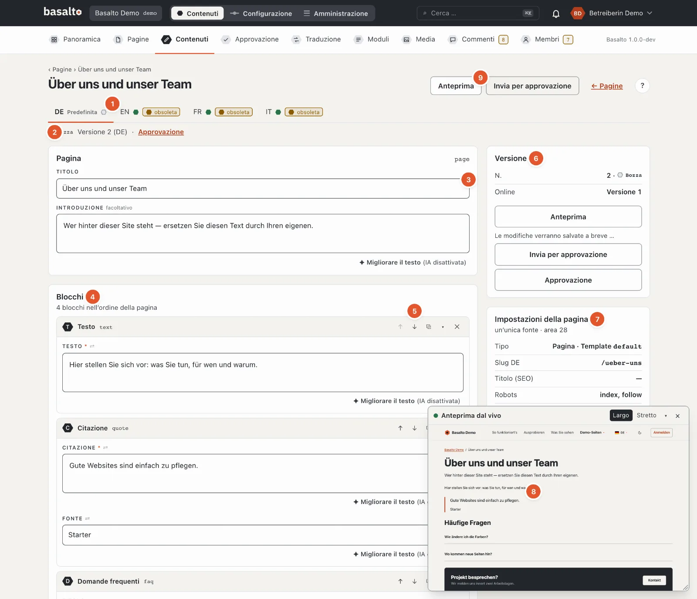
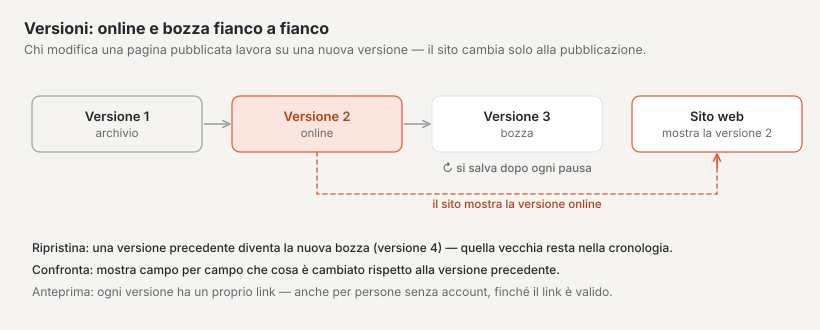
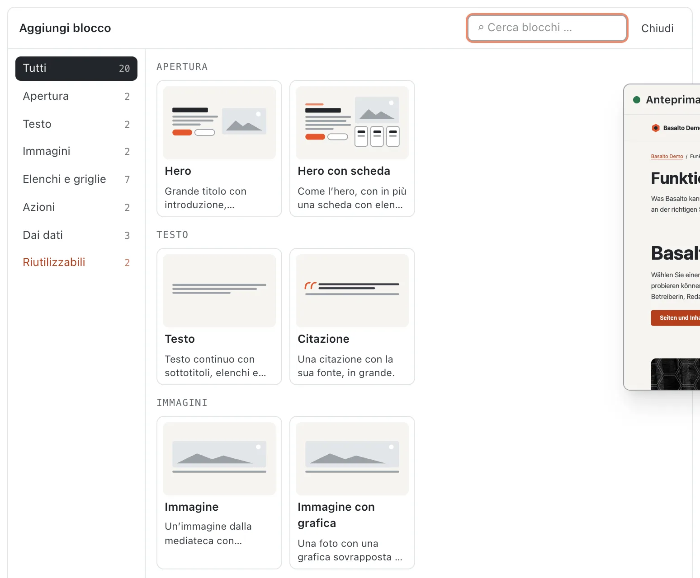
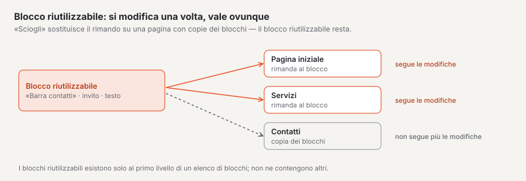
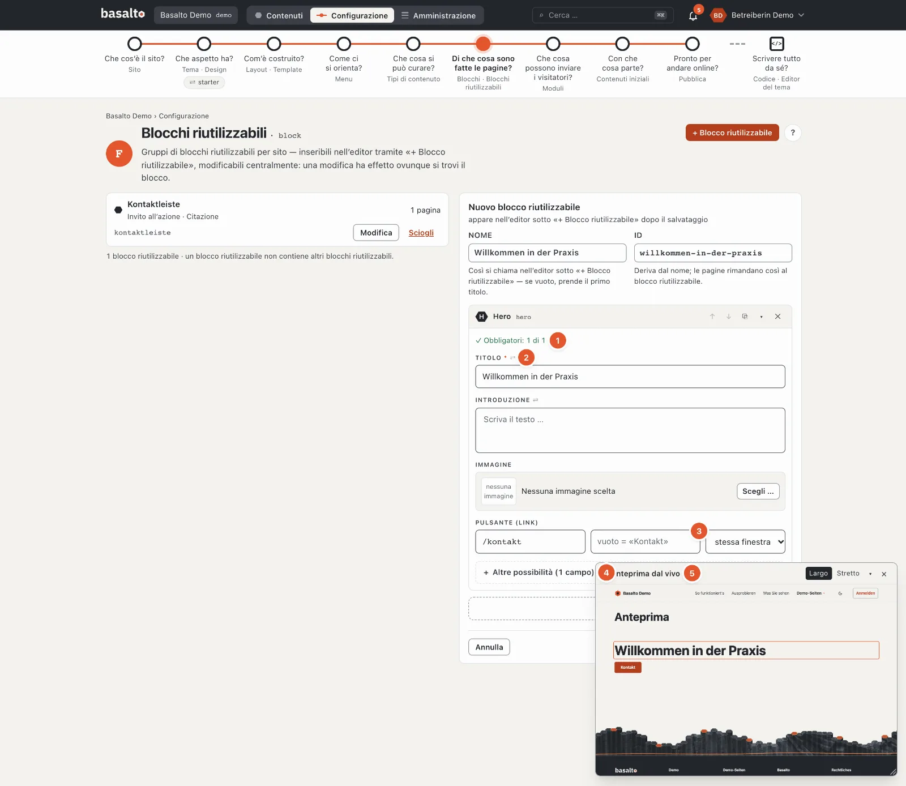
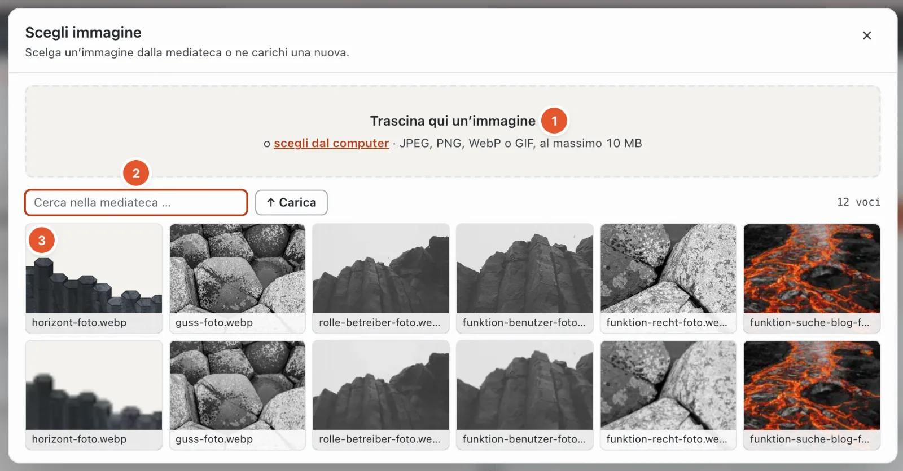
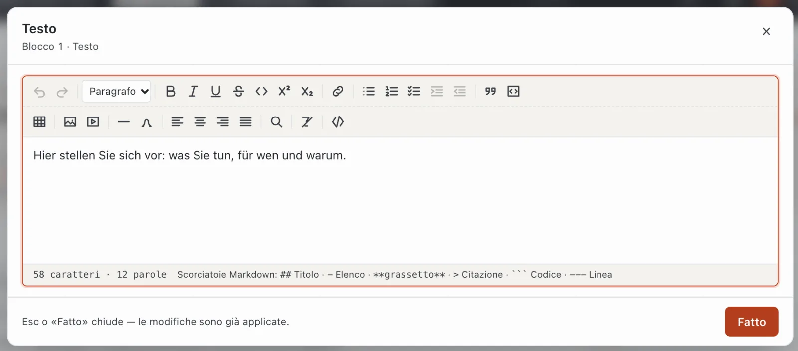
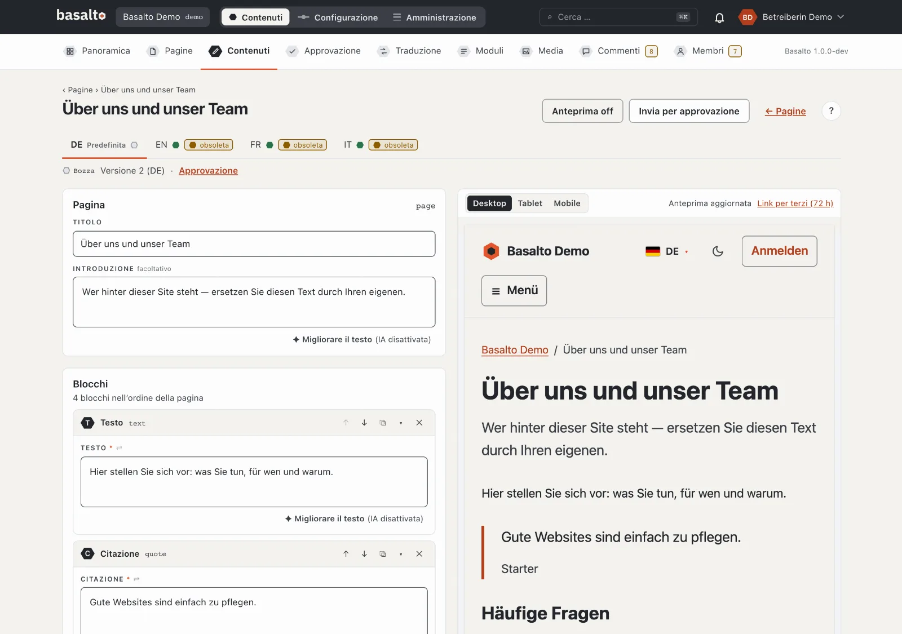
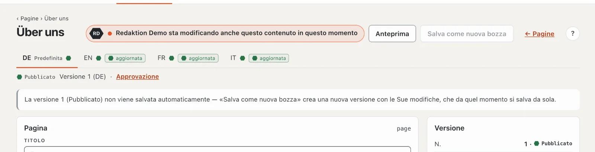

# Modificare i contenuti con i blocchi

Il contenuto di una pagina è composto da **blocchi**: sezioni di testo, immagini, hero, moduli e tutto ciò che il tema del Suo sito offre inoltre. Lei compone i blocchi nell’editor, Basalto salva da sé ogni modifica.

## Dove

- Per le pagine: modalità «Contenuti» › **Pagine**, nella riga della pagina il pulsante **«✎ Modifica contenuto»**.
- Per altri contenuti (per esempio articoli del blog): modalità «Contenuti» › **Contenuti**, scegliere il tipo, nella voce
  **«modifica»**. Una nuova voce la crea lì con **«Nuovo contenuto»**.

### L’elenco «Contenuti»

In alto c’è, per ogni **Tipo di contenuto** del tema, una scheda con il numero delle sue voci. Un segnale di avvertimento sulla scheda significa: questo
tipo non esiste più nel tema — le voci restano salvate, ma si possono modificare di nuovo solo quando il
tema riconosce di nuovo il tipo (Configurazione › Tipi di contenuto).

- **Filtro:** stato e lingua agiscono subito, la ricerca (sui titoli di tutte le versioni) con Invio.
- **Colonne:** per ogni lingua un esagono con lo stato, più l’etichetta «obsoleta» se la traduzione si basa su una
  versione più vecchia.
- **Ordine e numero di elementi per pagina** vengono dal Suo profilo (Impostazioni › «Ordinamento degli elenchi», «Elementi per
  pagina»); la barra in fondo indica entrambi.
- **«Nuovo contenuto»** crea una voce come bozza nella lingua predefinita; se c’è un solo tipo, senza chiedere.
  Il titolo all’inizio è «Nuovo: ‹tipo›».
- **Vuoto:** «Nessun tipo di contenuto» significa che il tema non ne definisce ancora (vedi Configurazione); «Ancora nessun contenuto di questo
  tipo» e «Nessun contenuto con questo filtro» si spiegano da sé.

## Struttura dell’editor

1. **Lingue** del sito come schede; «Predefinita» contrassegna la lingua predefinita. Per ogni lingua un punto di stato e, se la
   traduzione è rimasta indietro rispetto alla lingua predefinita, l’etichetta «obsoleta». Se una lingua non esiste ancora, la
   scheda offre **«Crea traduzione da XX»**: la struttura viene ripresa, i testi traducibili restano vuoti.
2. **Stato e versione**, per esempio «Bozza · versione 2 (DE)», accanto il link all’**Approvazione** di questa versione.
3. **Titolo**, per i contenuti senza albero delle pagine lo **Slug** (vuoto = dal titolo), l’**Introduzione** e i **Campi**
   del tipo.
4. I **Blocchi** nell’ordine in cui stanno sulla pagina.
5. I **pulsanti di un blocco** (vedi sotto).
6. **Versione:** numero, stato, quale versione è online e il messaggio del salvataggio automatico.
7. **Impostazioni della pagina** (solo per le pagine): tipo e template, slug, titolo per i motori di ricerca, robots, visibilità,
   finestra temporale — e «Tutte le impostazioni (12 schede)». Slug e metadati di una pagina non si trovano nell’editor, ma
   lì (vedi [Pagine e albero delle pagine](seiten.md)).
8. **Versioni** di questa lingua con «Confronta», «Anteprima» e «Ripristina».
9. **Anteprima** e **Invia per approvazione**.

In alto l’editor conta «N campi da verificare» quando mancano dati o non sono corretti; il blocco interessato riceve un
bordo rosso e un numero — gli errori nei sottoblocchi vengono contati anche verso l’alto.

## Aggiungere e ordinare i blocchi

1. Clicchi sotto i blocchi su **«+ Inserisci blocco»**. Se l’elenco è ancora vuoto, la palette è già aperta.
2. Scelga nella **palette** il blocco desiderato. Ogni scheda mostra uno **schema** del blocco — dove si trova il titolo,
   se ci sono un’immagine, pulsanti, schede o domande apribili — più il nome e una frase che dice a che cosa serve.
   A sinistra ci sono i **Gruppi** (per esempio «Apertura», «Testo», «Immagini», «Elenchi e griglie», «Azioni», «Dai
   dati») con il numero dei loro blocchi; un clic mostra solo quel gruppo. Il campo **«Cerca blocchi …»** filtra per nome,
   frase e gruppo, **Invio** inserisce il primo risultato. I blocchi non consentiti in quel punto appaiono
   tratteggiati e sbiaditi — il motivo è indicato sulla scheda. In **«Riutilizzabili»** inserisce un blocco riutilizzabile o
   una parte Lava. **Esc** o «Chiudi» richiude la palette.
3. Compili i campi del blocco.

I nuovi blocchi finiscono in fondo all’elenco; con ↑ ↓ li porta al loro posto. Nell’intestazione di ogni blocco trova:

| Pulsante | Effetto |
| --- | --- |
| ↑ / ↓ | una posizione più su o più giù (bloccato in cima o in fondo) |
| ⧉ | duplicare il blocco — la copia sta subito sotto |
| ▾ / ▸ | comprimere o espandere il blocco |
| ✕ | eliminare il blocco — con la richiesta di conferma «Eliminare il blocco?» |

Il trascinamento con il mouse non esiste nell’editor a blocchi — ↑ ↓ sono univoci e utilizzabili con la tastiera.
I blocchi compressi mostrano un breve riassunto del loro contenuto. Un numero sul blocco segnala campi che non sono ancora
corretti.

### Blocchi riutilizzabili e parti Lava

- Un **Blocco riutilizzabile** è un gruppo di blocchi che compare uguale su più pagine (per esempio una barra dei contatti).
  Nell’editor compare come **riferimento**: se qualcuno modifica il blocco riutilizzabile in Configurazione › Blocchi riutilizzabili («modifica centralmente»),
  esso cambia su tutte le pagine. **«Sciogli»** sostituisce il riferimento, su questa sola pagina, con copie dei blocchi —
  da quel momento qui sono liberamente modificabili, il blocco riutilizzabile resta per le altre pagine. I blocchi riutilizzabili esistono solo al livello
  superiore di un elenco di blocchi; se non ne sono stati creati, la selezione segnala «Ancora nessun blocco riutilizzabile».
- Una **Parte Lava** è un pezzo del tema con impostazioni, per esempio una navigazione o un campo di ricerca. Le sue
  impostazioni si trovano in Configurazione › Layout › Parti; nell’editor sceglie solo quale parte sta qui. Una
  parte Lava non si può sciogliere.

### Blocchi bloccati

Quali blocchi sono consentiti in un punto lo stabilisce il tema per tipo di contenuto o per campo. I blocchi bloccati restano visibili nella
palette; il motivo indica l’ambito di validità, per esempio «‹Hero› non è consentito per il tipo Pagina».
Si può cambiare in Configurazione › Tipi di contenuto.

### Blocchi annidati

Alcuni blocchi contengono a loro volta dei blocchi, per esempio una colonna o una scheda a registro. Al loro interno si aggiungono blocchi esattamente come sopra — a qualsiasi profondità. Quali blocchi sono consentiti e dove lo stabilisce il tema.

Se compare «Blocco sconosciuto», questo blocco non esiste (più) nel tema. Il contenuto resta salvato; si rivolga alla persona che cura il tema.

## I campi di un blocco

Il modulo di un blocco La guida:

1. **Dati obbligatori.** Sopra i campi il contatore «Obbligatori: 1 di 2» conta finché ci sono tutti (poi con ✓).
2. **Etichetta e aiuto.** Sopra ogni campo c’è la sua etichetta, con `*` se obbligatorio e ⇄ se viene tradotto per
   lingua. Sotto, una frase spiega a che cosa serve il campo, e nel campo vuoto c’è un esempio — entrambi
   vengono dal tema.
3. **Ciò che arriva automaticamente.** Un campo vuoto che riprende un valore da altrove lo mostra in grigio: «vuoto =
   «Contatto»». Se lascia vuota l’etichetta di un link, sulla pagina compare il titolo della pagina di destinazione. Nel campo
   «Indirizzo» l’editor propone le pagine del sito — digiti una parte del titolo o dell’indirizzo e
   scelga.
4. **Prima le cose più importanti.** In alto ci sono i campi obbligatori, tutto ciò che è già compilato e i campi principali del blocco —
   per un hero per esempio titolo, introduzione, immagine e pulsante. Le impostazioni di dettaglio come crediti, piccole
   versioni dell’immagine o un’etichetta diversa si trovano in **«+ Altre possibilità (N campi)»**; un clic
   le apre, «− Mostra meno» le richiude. Ciò che è compilato resta sempre visibile.
5. **Anteprima dal vivo** nella piccola finestra — vedi [sotto](#anteprima-dal-vivo-in-una-finestra).

I campi obbligatori Basalto li verifica solo all’**invio per approvazione** — il salvataggio automatico accetta anche ciò che è incompleto, affinché
nulla vada perso.

| Tipo di campo | Uso |
| --- | --- |
| Testo, e-mail, URL, slug | una riga; slug solo a–z, 0–9 e «-» |
| Area di testo, Markdown, codice | più righe; Markdown e codice in carattere a spaziatura fissa |
| Testo formattato (richtext) | testo formattato — un clic apre la finestra grande (vedi sotto) |
| Numero | cifre, con minimo e massimo dal tema |
| Interruttore | attivato o disattivato |
| Data, data con ora | scelta nel calendario |
| Selezione | un’opzione dall’elenco; «—» significa nessuna (solo se il campo non è obbligatorio) |
| Tag | digitare una parola, confermare con Invio o virgola; i doppioni vengono ignorati, ✕ ne rimuove uno |
| Immagine | «Scegli …» (o un clic sull’immagine di anteprima) apre la mediateca come finestra di dialogo — vedi sotto; il testo alternativo è precompilato dal nome del file — La preghiamo di verificarlo |
| Immagine (indirizzo) | come «Immagine»: scegliere o caricare un’immagine dalla mediateca; un clic nel campo vuoto apre la finestra di dialogo. Chi conosce un file del tema ne digita l’indirizzo (p. es. `landing/foto.webp`) |
| Galleria | «+ Scegli immagini …»: nella finestra di dialogo un clic seleziona o deseleziona, «Fatto» chiude; ↑ ↓ ordinano, testo alternativo per ogni immagine |
| File | un file dalla mediateca, nella stessa finestra di dialogo |
| Link | indirizzo (/kontakt, https://…, mailto:), etichetta e destinazione («stessa finestra» o «nuova finestra»). Se digita il titolo di una pagina («Contatto»), questo diventa il suo indirizzo («/kontakt»); se non è né un indirizzo né una pagina, il campo avvisa |
| Relazione | un altro contenuto del sito (per esempio una persona), scelto da un elenco |
| Ripetizione (repeater) | più righe costruite allo stesso modo (per esempio schede): «+ Riga», ↑ ↓ ordinano, «Rimuovi» elimina la riga **senza chiedere conferma** |
| Blocchi | blocchi annidati (vedi sotto) |
| Colore | selettore di colore o valore esadecimale (#rrggbb) |
| SEO | titolo e descrizione con contatori (consigliati 60 e 160, al massimo 120 e 320 caratteri) |
| JSON | dati strutturati; verificati quando lascia il campo |

### Scegliere e caricare immagini

Per i campi immagine, galleria e file la mediateca si apre come finestra di dialogo sopra la pagina:

1. **Trascinare** — trascini immagini dal Finder o da Esplora risorse nell’area in alto, oppure **«scegli dal computer»**.
   JPEG, PNG, WebP o GIF fino a 10 MB. Ciò che è caricato finisce nella mediateca ed è subito scelto.
2. **Ricerca e cartelle** — filtrare per nome e limitare a una cartella della mediateca.
3. **Scegliere** — un clic su un’immagine la riprende e chiude la finestra di dialogo. In una galleria ogni clic seleziona
   o deseleziona; «Fatto» chiude. Le immagini senza testo alternativo portano l’etichetta «Testo alternativo mancante».

I campi con un indirizzo d’immagine (ad esempio l’immagine di un palco) accettano anche un’**immagine del tema**: la
finestra ha allora la scheda **«Immagini del tema»** accanto alla mediateca. Le immagini sono ordinate per cartella
(schede con il numero); i file che vanno insieme formano un motivo — ad esempio «buehne» con Foto, Foto · 960 e
Schema. **Foto** e **Grafiche** si possono mostrare separatamente, l’immagine scelta compare in alto sotto «Selezione
attuale». Il campo mostra una miniatura; se manca un file indica **«File mancante»**.

Esc, × o un clic accanto alla finestra di dialogo chiudono senza modifiche.

Se un campo mostra «Tipo di campo sconosciuto», Basalto non conosce il tipo (per esempio da un modulo disattivato); il
contenuto resta salvato.

## Modificare il testo formattato

I campi di testo formattato mostrano nel modulo solo il testo formattato. Un clic su di esso (o **«Modifica ↗»**) apre il testo in una finestra grande con la barra degli strumenti completa. **«Fatto»** o Esc la chiude — le Sue modifiche sono allora già riprese.

La barra degli strumenti ha due file:

- **Annulla**, **Ripeti** e il **Formato paragrafo** (paragrafo, titolo 2, 3 o 4),
- **Grassetto**, **Corsivo**, **Sottolineato**, **Barrato**, **Codice**, **Apice**, **Pedice**,
- **Link**, **Elenco puntato**, **Elenco numerato**, **Elenco di attività**, aumentare e ridurre il rientro,
- **Citazione**, **Blocco di codice**, **Tabella**, **Immagine dalla mediateca**, **Incorporamento** (YouTube, Vimeo, mappa), **Linea di separazione**, **Caratteri speciali**,
- allineamento **Allinea a sinistra**, **Centrato**, **Allinea a destra**, **Giustificato**,
- **Cerca e sostituisci**, **Rimuovi formattazione** e **Sorgente** (solo lettura).

In basso l’editor conta caratteri e parole. Chi preferisce digitare usa le scorciatoie Markdown: `##` per un titolo, `-` per un elenco, `**fett**`, `>` per una citazione, tre backtick per il codice e `---` per una linea.

**Scorciatoie da tastiera** (Mod = ⌘ sul Mac, Ctrl su Windows; la barra degli strumenti le mostra anche al passaggio del mouse):

| Scorciatoia | Effetto | Scorciatoia | Effetto |
| --- | --- | --- | --- |
| Mod+Z / ⇧+Mod+Z | annullare / ripetere | Mod+K | link |
| Mod+B / Mod+I / Mod+U | grassetto / corsivo / sottolineato | ⇧+Mod+8 / 7 / 9 | elenco puntato / elenco numerato / elenco di attività |
| ⇧+Mod+S | barrato | Tab / ⇧+Tab | aumentare / ridurre il rientro della voce di elenco |
| Mod+E | codice nel testo | ⇧+Mod+B | citazione |
| Mod+. / Mod+, | apice / pedice | Alt+Mod+C | blocco di codice |
| ⇧+Mod+L / E / R / J | sinistra / centrato / destra / giustificato | | |

**Tabelle:** «Tabella» inserisce 3 × 3 celle con riga d’intestazione. Se il cursore si trova in una tabella, un menu offre di inserire
o eliminare righe e colonne, unire o dividere celle ed eliminare la tabella.

**Blocco di codice:** la lingua del codice (per i colori) la sceglie nel blocco stesso.

**Cerca e sostituisci** (lente): maiuscole e minuscole non contano; «Avanti», «Sostituisci» e «Sostituisci tutti»,
senza risultati «nessun risultato».

**Link:** selezioni il testo, clicchi su «Link» e inserisca l’indirizzo (https://…, mailto:, un percorso come /kontakt o #). A scelta un **titolo** (compare al passaggio del mouse). Scelga se il link si apre nella stessa finestra o in una nuova e clicchi su **«Applica»**. «Rimuovi link» lo elimina di nuovo.

**Immagini nel testo:** «Immagine dalla mediateca» inserisce un’immagine. Inserisca un **Testo alternativo** (descrive l’immagine per le persone che non la vedono), se desidera una didascalia, e scelga l’allineamento.

**Incorporamenti:** inserisca l’indirizzo di un video di YouTube o Vimeo o di una mappa di Google Maps o OpenStreetMap. Se Basalto riconosce l’indirizzo, la finestra segnala «… riconosciuto»; un indirizzo sconosciuto non si può inserire. Sul sito web l’incorporamento si carica solo quando la visitatrice dà il consenso.

## Incollare da Word e da altri programmi

Copi del testo da Word, Google Docs o da una pagina web e lo incolli con ⌘V o Ctrl+V in un campo di testo formattato. Basalto riprende:

- titoli, paragrafi, elenchi puntati ed elenchi numerati (anche da Word),
- grassetto, corsivo, sottolineato, barrato, apice e pedice,
- tabelle e link,
- **immagini**: vengono caricate automaticamente nella mediateca e collegate nel testo.

Tipi di carattere, colori e dimensioni del carattere vengono scartati — l’aspetto lo determina il tema. Un titolo di primo livello da Word diventa «Titolo 2», quelli più profondi si fermano a «Titolo 4». Anche il testo **Markdown** incollato (da un editor di testo) viene convertito.

Per le immagini incollate vale: JPEG, PNG, WebP o GIF, al massimo 10 MB per immagine. Se un’immagine non riesce, l’editor segnala «Non è stato possibile caricare un’immagine.». Dopo aver incollato, verifichi i **Testi alternativi** delle immagini nella [mediateca](medien.md).

## Anteprima dal vivo in una finestra

Una piccola finestra **«Anteprima dal vivo»** in basso a destra mostra il contenuto con il tema vero, aggiornata circa mezzo secondo
dopo ogni inserimento — senza salvare. La segue:

- **Il campo in cui scrive si illumina** nell’anteprima con una cornice color lava; l’anteprima scorre fin lì.
- **Un clic su un punto dell’anteprima** salta al campo corrispondente nel modulo.
- **Spostare** tramite l’intestazione, **Dimensione** dall’angolo in basso a destra, **«Largo»** (desktop) o **«Stretto»** (telefono),
  **▾** la comprime, **×** la chiude. Posizione e dimensione le memorizza il browser; se è chiusa, la riapre il pulsante
  **«Anteprima dal vivo»** nell’intestazione della pagina.

La finestra compare finché l’anteprima grande (split screen) è spenta e lo schermo è largo almeno 768 px.

## Anteprima in split screen

Il pulsante **«Anteprima»** divide lo schermo: a sinistra l’editor, a destra la pagina come apparirà — con le Sue modifiche, anche se non sono ancora salvate. L’anteprima si aggiorna poco meno di un secondo dopo ogni modifica («Aggiornamento anteprima …», poi «Anteprima aggiornata»); se non riesce, vi compare il motivo.

Con la **Larghezza del dispositivo** verifica la resa su «Desktop» (larghezza piena), «Tablet» (768 px) e «Mobile» (375 px). Sugli schermi stretti si passa da una all’altra con le schede «Editor» e «Anteprima». «Anteprima off» chiude di nuovo l’anteprima.

### Condividere l’anteprima con altri

**«Link per terzi (72 h)»** genera un link con cui anche persone senza accesso al backend possono vedere la pagina — per esempio per un riscontro da parte di clienti. Con «Copia» il link finisce negli appunti. Mostra la versione salvata più recente di questa lingua, è valido 72 ore («scade …») e non viene indicizzato dai motori di ricerca.

## Salvataggio automatico

Nell’editor non c’è un pulsante per salvare. Circa un secondo dopo il Suo ultimo inserimento, Basalto salva da sé. In basso a destra compare brevemente «… salvato» con l’ora; un messaggio di errore resta lì finché non è risolto. A destra, sotto «Versione», è indicato ciò che sta accadendo:

| Messaggio | Significato |
| --- | --- |
| Salva automaticamente nella versione … | tutto salvato |
| Le modifiche verranno salvate a breve … | sta ancora digitando |
| Salvataggio … | è in corso il salvataggio |
| Senza titolo non si salva. | inserisca prima un titolo |
| Non salvato — verifichi i campi evidenziati. | un campo non è corretto; è evidenziato |

Si salva sempre **nella bozza**. La versione online sul sito web non cambia per questo. I blocchi modificati mostrano brevemente «✓ salvato».

Se la versione più recente è già stata inviata per approvazione, approvata o pubblicata, l’editor non salva da sé. Il pulsante **«Salva come nuova bozza»** crea allora una nuova versione con le Sue modifiche; da quel momento si salva di nuovo da sé.

### Chi ci sta lavorando insieme a Lei

Se qualcun altro ha aperto lo stesso contenuto, in alto accanto ai pulsanti compare **«Marco Bernasconi sta
modificando anche questo contenuto in questo momento»** con le iniziali in un esagono. Vi accordate prima di
modificare entrambi: ogni salvataggio crea una nuova versione e tutte restano sotto «Versione». L’indicazione scompare
appena l’altra persona chiude l’editor — al più tardi dopo un minuto.

## Versioni e ripristino

L’elenco **«Versioni»** a destra mostra tutte le versioni di questa lingua con numero, stato, autrice o autore e data.

- **«Confronta»** mostra che cosa è cambiato rispetto alla versione precedente — riga per riga «campo: ‹vecchio› → ‹nuovo›», oppure «nessuna modifica rispetto alla precedente».
- **«Anteprima»** apre esattamente questa versione in una nuova scheda del browser.
- **«Ripristina»** crea subito da una versione più vecchia una **nuova bozza** («Versione 2 ripristinata come versione 5.»). Nulla viene sovrascritto; la versione online resta finché la nuova non è pubblicata.

Quante versioni archiviate vengono conservate lo stabilisce l’impostazione «Conservare le versioni archiviate» (predefinito: 50 per contenuto e lingua).

## Inviare per approvazione

Quando ha finito, clicchi su **«Invia per approvazione»**. Prima l’editor salva ciò che è ancora in sospeso; poi la versione va in approvazione. «Invia per approvazione» è bloccato, con il motivo, finché manca il titolo («inserisca prima il titolo, poi invii») o finché ci sono campi obbligatori vuoti («Invio per approvazione solo con tutti i campi obbligatori — ne mancano N»); l’editor li evidenzia. Maggiori dettagli in [Approvazione e pubblicazione](freigabe.md).

Se una versione è stata respinta, in alto compare «Respinto» con il commento della persona che ha verificato.

## Sul telefono

Sotto i 768 px di larghezza i blocchi sono disposti come **schede** con un breve contenuto, uno sotto l’altro. Un tocco apre un blocco come
foglio sull’intera superficie; «Fatto» lo chiude. L’eliminazione avviene in due passi («Rimuovi», poi «Rimuovi
davvero»). «+ Blocco» apre la palette dal basso. Una barra fissa in basso contiene Anteprima e Invia per approvazione.

## Domande frequenti

**Dove imposto slug, titolo della pagina o descrizione di una pagina?**
Nelle impostazioni della pagina — link «Tutte le impostazioni (12 schede)» a destra nell’editor. Vedi [Pagine e albero delle pagine](seiten.md).

**Lavoro in una lingua diversa dalla lingua predefinita.**
Usi «Traduci affiancato» — lì il testo della lingua predefinita sta direttamente sopra il Suo. Vedi [Tradurre](uebersetzen.md).

**Ho eliminato un blocco per errore.**
Nell’elenco «Versioni» apra la versione precedente con «Ripristina». Il blocco eliminato è di nuovo presente nella nuova bozza; le modifiche fatte da quella versione in poi dovrà poi rifarle.

## Per continuare

- [Media](medien.md)
- [Approvazione e pubblicazione](freigabe.md)
- [Tradurre](uebersetzen.md)
