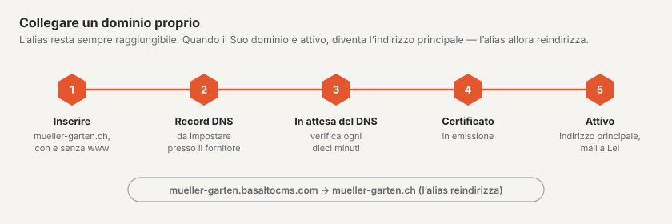

# Domini

In **Amministrazione › Account › Domini** stabilisce a quali indirizzi è raggiungibile il Suo sito. La scheda la vedono proprietario, amministrazione e fatturazione dell’account; modificare possono proprietario e amministrazione.

## Alias

Ogni sito è raggiungibile fin dal primo momento con il suo **alias**, per esempio `mueller-garten.basaltocms.com` — incluso in ogni piano.

- **Modifica alias:** inserisca il nuovo nome (3–40 caratteri, lettere minuscole, cifre e trattino) e scelga «Modifica alias». Il nuovo alias vale subito. Quello vecchio reindirizza al sito ancora per **30 giorni** e poi torna libero.
- Se un nome è libero lo vede già mentre digita; se è occupato, accanto compare un suggerimento.
- I motori di ricerca non indicizzano l’alias. Chi vuole essere trovato collega un dominio proprio.

## Dominio proprio

Porta con sé il Suo dominio (registrato presso il Suo provider, per esempio Infomaniak, Hostpoint, Cloudflare o Swizzonic).

1. In «Altro dominio» inserisca il dominio, per esempio `mueller-garten.ch`, e scelga «Aggiungi dominio». L’indirizzo con e senza `www` lo creiamo entrambi — contano come **un solo** dominio.
2. Inserisca i **Record DNS** visualizzati presso il Suo provider esattamente come sono indicati (tipo, nome, valore).
3. Attenda: verifichiamo ogni dieci minuti. Con «Verifica ora» avviene subito (una volta al minuto). Lo stato passa da «in attesa del DNS» a «certificato in emissione» fino ad «attivo» — di solito in meno di 15 minuti, a volte fino ad alcune ore.
4. Non appena il dominio è attivo, diventa l’**indirizzo principale** del Suo sito e Lei riceve un’e-mail. Da quel momento l’alias reindirizza al Suo dominio; i link con l’alias continuano a funzionare.

Se compare «Errore», la scheda indica il messaggio. Di solito manca un record DNS o contiene un errore di battitura — lo corregga e verifichi di nuovo.

**Cambiare l’indirizzo principale:** con «… come indirizzo principale» sceglie se il Suo sito compare con `www.mueller-garten.ch` o con `mueller-garten.ch`; l’altro indirizzo reindirizza.

**Rimuovi:** «Rimuovi» elimina il dominio. Se era l’indirizzo principale, lo torna a essere l’alias.

## Quanti domini

| Piano | Domini propri |
| --- | --- |
| Start | nessuno |
| Standard | 1 |
| Pro | 5 |

Se la quota è esaurita, proprietario e fatturazione possono ordinare, al momento dell’aggiunta, un **dominio aggiuntivo per CHF 5 al mese** — oppure passare a un piano più grande. Nel periodo di prova non è ancora disponibile un dominio proprio. Il Suo sito resta in ogni caso raggiungibile.

## Per continuare

- [Esportazione e disdetta](konto.md)
- [Andare online](../einrichtung/live-gehen.md)
