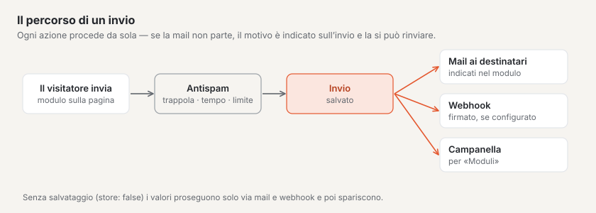
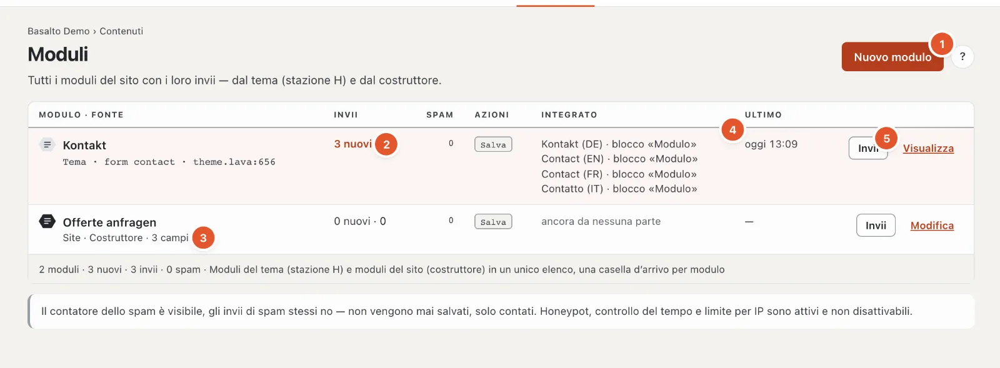
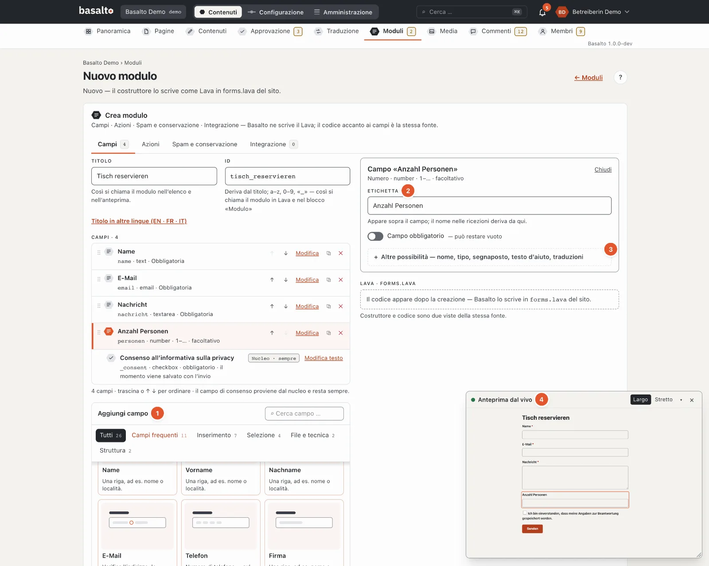
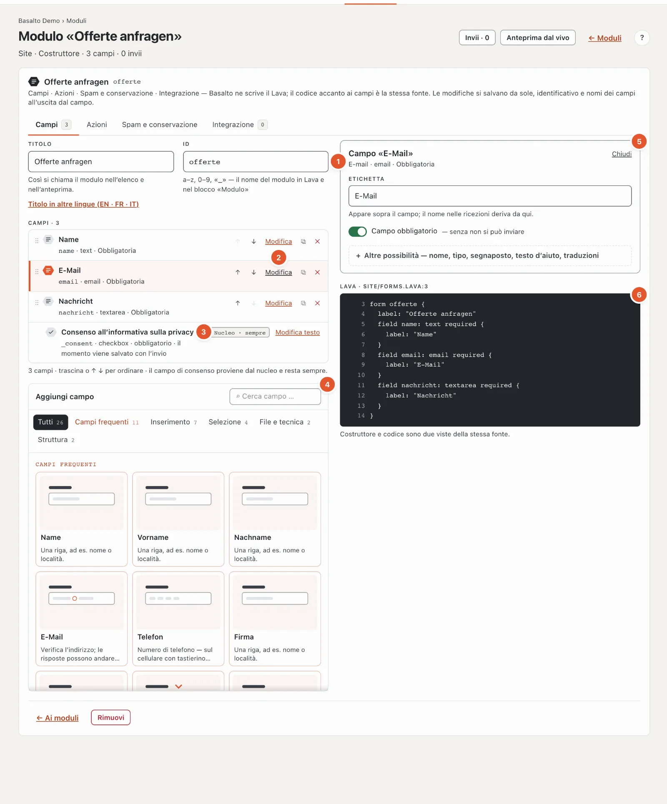
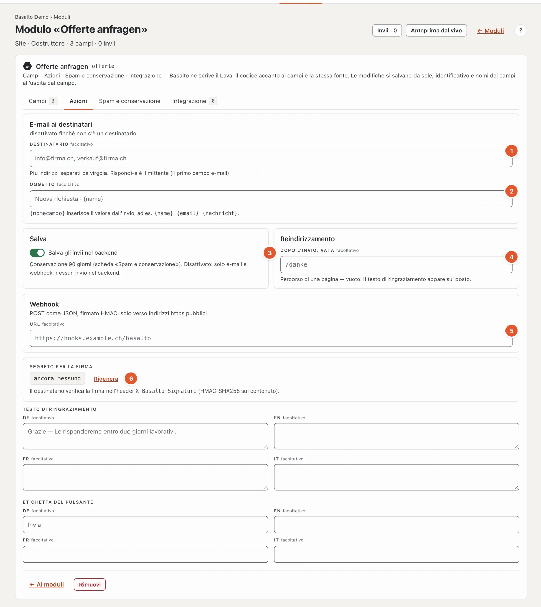
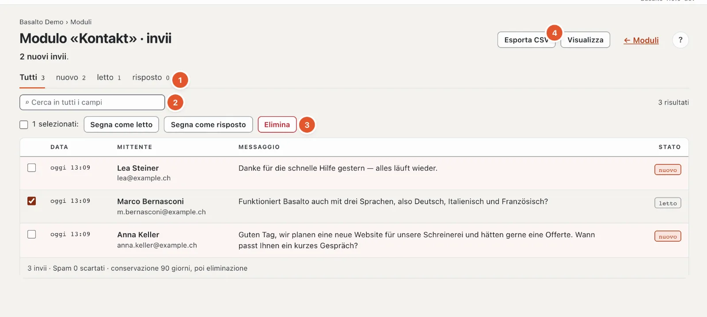
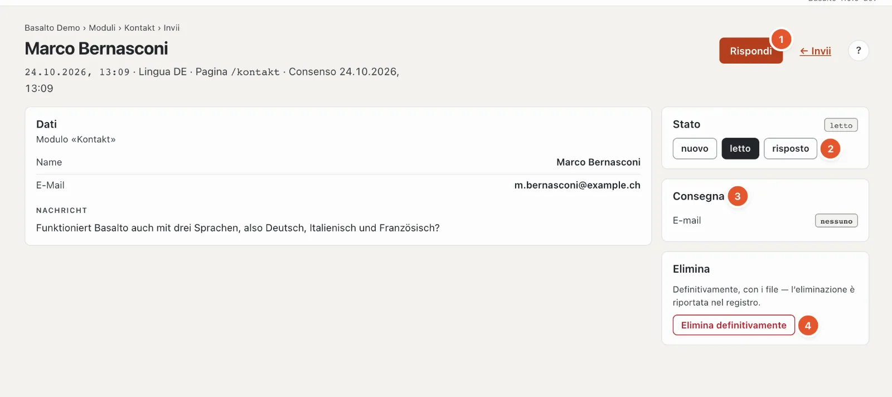

# Moduli

Con i moduli riceve richieste, iscrizioni o ordinazioni tramite il sito web. Ogni modulo ha nel backend una propria **casella d’arrivo** e può inoltre inviare ogni invio per e-mail o trasmetterlo a un altro sistema.

## Dove

Modalità «Contenuti» › **Moduli**.

1. **«Nuovo modulo»** crea un modulo con il costruttore.
2. **Invii**: «3 nuovi · 3» significa tre nuovi su un totale di tre. I moduli con nuovi invii hanno lo sfondo chiaro.
3. **Fonte**: «Sito · Costruttore» oppure «Tema · form contact · theme.lava:612» (il punto nel tema).
4. **Integrato**: in quali pagine e in quale lingua il modulo si trova nel blocco «Modulo» — oppure «ancora da nessuna parte».
5. **«Invii»** apre la casella d’arrivo, «Modifica» (per i moduli del tema «Visualizza») il modulo.

L’elenco mostra inoltre il **contatore spam**, le **azioni** impostate (e-mail, salvataggio, reindirizzamento, webhook) e sotto «Ultimo» il momento dell’ultimo invio. Se un’e-mail non è stata consegnata, compare in rosso «1 e-mail non consegnata — reinviarla nell’invio».

Esistono due tipi di moduli:

- **Modulo del sito** — creato nel backend con il costruttore; può modificarlo Lei stesso.
- **Modulo del tema** — arriva con il tema. Può visualizzarlo e gestirne gli invii, ma non modificarne campi e testi. Il tema Starter include per esempio il modulo «Contatto».

## Creare un modulo

1. Clicchi su **«Nuovo modulo»**.
2. Inserisca il **titolo**, per esempio «Prenotare un tavolo». L’**ID** ne deriva («tisch_reservieren»); con esso sceglierà poi il modulo nel blocco «Modulo». I titoli in altre lingue si trovano sotto **«Titolo in altre lingue»** — se vuoto, vale il titolo della lingua predefinita.
3. Clicchi su **«Crea»**.

Un nuovo modulo ha già tre campi obbligatori: **Nome**, **E-mail** e **Messaggio**. Li adatti o ne aggiunga altri.

In seguito tutte le modifiche si salvano da sole; l’identificativo e i nomi dei campi quando si lascia il campo. Finché un dato non è corretto, non viene salvato nulla: in alto compare «N dati non sono corretti», sulla scheda il numero di errori e sul campo il motivo. Il modulo ha quattro schede.

### Aggiungere e impostare i campi

Il costruttore La guida come i moduli dei blocchi:

1. **Aggiungi campo** — una palette con un disegno e una frase per ogni campo, suddivisa in gruppi (Campi frequenti, Inserimento, Selezione, File e tecnica, Struttura) e con ricerca; Invio inserisce il primo risultato. I **campi frequenti** portano già con sé etichetta, nome e obbligatorietà: Nome, Nome di battesimo, Cognome, E-mail, Telefono, Azienda, Messaggio, Data desiderata, Numero di persone, Allegato e «Per favore mi richiami» — l’etichetta in ogni lingua del sito.
2. **Prima l’essenziale** — un campo scelto mostra in alto solo la sua **etichetta**, **campo obbligatorio** e ciò di cui il tipo ha assolutamente bisogno (le **opzioni** di una selezione, i **tipi di file** di un file, il **valore** di un campo nascosto). Il **nome** nell’invio deriva dall’etichetta, finché non lo modifica Lei stesso.
3. **Altre possibilità** — nome, tipo, segnaposto, testo d’aiuto, limiti e le **traduzioni** per ogni altra lingua (se vuoto, vale la lingua predefinita). Se lì c’è un errore, l’area è già aperta.
4. **Anteprima dal vivo** — il modulo come lo vedono i visitatori, nella piccola finestra in basso a destra, aggiornata a ogni modifica. Il campo scelto si illumina; un clic su un campo dell’anteprima ne apre le impostazioni. Spostare, ridimensionare e chiudere come per i [blocchi](bloecke.md#anteprima-dal-vivo-in-una-finestra); una volta chiusa, la riapre «Anteprima dal vivo» nell’intestazione della pagina.

### Scheda «Campi»

1. **ID** — lettere minuscole, cifre e «_», all’inizio una lettera, da 2 a 60 caratteri, univoco nel sito. Gli identificativi dei moduli del tema sono già assegnati.
2. **I campi** nel loro ordine. Sotto il titolo c’è una riga breve, per esempio «email · email · Obbligatoria» (nome, tipo, obbligo) o «radio · 4 opzioni». «Modifica» apre le impostazioni, ↑ e ↓ spostano il campo (oppure lo trascini dalla maniglia ⠿), ⧉ lo duplica, ✕ lo rimuove.
3. **Consenso all’informativa sulla privacy** — è presente in ogni modulo e non si può rimuovere («Nucleo · sempre»). Il momento del consenso viene salvato con l’invio. Il testo lo modifica con «Modifica testo».
4. **Aggiungi campo** — la palette (vedi sopra) con i campi frequenti e una scheda per ogni tipo: Testo, E-mail, Numero, Telefono, URL, Data, Su più righe, Selezione, Radio, Casella di controllo, File, Intervallo, Campo nascosto, Spiegazione e Gruppo.
5. **Le impostazioni del campo scelto** — «Chiudi» le richiude.
6. **Il codice** — lo stesso modulo come Lava, solo in lettura e con i numeri di riga; compare dopo la creazione. Non Le serve: costruttore e codice sono due viste della stessa fonte.

Le impostazioni di un campo:

- **Etichetta** e **Campo obbligatorio** — in alto.
- **Nome** (sotto «Altre possibilità») — la chiave del campo nell’invio e nell’esportazione CSV, derivata dall’etichetta. Deve essere univoco in tutto il modulo, anche tra i gruppi. In un modulo con invii lo modifichi solo con cautela: i vecchi invii mantengono la vecchia chiave.
- **Tipo**, **Segnaposto** (appare in grigio nel campo vuoto) e **Testo d’aiuto** (appare sotto il campo) — sotto «Altre possibilità», dove si trovano anche etichetta, segnaposto, testo d’aiuto e opzioni per ogni altra lingua.
- A seconda del tipo:
  - **Selezione** e **Radio**: le **opzioni**, una per riga e per lingua. Senza opzioni il modulo non si può salvare.
  - **Numero** e **Intervallo**: **Min**, **Max** e **Passo**.
  - **Testo** e **Su più righe**: **Caratteri massimi** — senza indicazione 500 per Testo, 5000 per Su più righe.
  - **File**: i **tipi di file** consentiti (per esempio «pdf, docx») e la **dimensione in MB**. Senza indicazione sono consentiti PDF e immagini fino a 10 MB.
  - **Campo nascosto**: il **valore** che viene inviato in modo invisibile — per esempio per riconoscere da quale campagna proviene una richiesta.
  - **Spiegazione**: solo un testo, senza inserimento.
  - **Gruppo**: raggruppa i campi sotto un titolo; i suoi sottocampi li aggiunge con la palette «Aggiungi sottocampo» nelle impostazioni del gruppo. I gruppi non si possono annidare; trascinando si ordina all’interno dello stesso livello.

Un modulo richiede almeno un campo di inserimento.

### Scheda «Azioni»

1. **Destinatario** — uno o più indirizzi, separati da virgola. Senza destinatario l’invio di e-mail è disattivato. Le risposte a questa e-mail vanno al mittente (il primo campo e-mail del modulo).
2. **Oggetto** — con {feldname} inserisce valori dell’invio, per esempio «Nuova richiesta · {name}».
3. **Salva gli invii nel backend** — se l’interruttore è disattivato, i valori vengono trasmessi solo per e-mail e webhook e nel backend non resta nulla; nemmeno i file allegati.
4. **Reindirizzamento** — dove arrivano i visitatori dopo l’invio: il percorso di una pagina («/danke») o un indirizzo https completo. Se vuoto, il testo di ringraziamento compare sul posto.
5. **Webhook** — trasmette ogni invio come JSON a un altro sistema, per esempio a un CRM. Sono consentiti solo indirizzi https nell’internet pubblico. Di regola lo configura il personale tecnico.
6. **Segreto per la firma** — con esso l’altro sistema verifica che l’invio provenga davvero dal Suo sito (intestazione X-Basalto-Signature). «Rigenera» crea un nuovo segreto; quello vecchio non vale più da subito, quindi inserisca quello nuovo presso il destinatario.

Sotto si trovano **Testo di ringraziamento** ed **Etichetta del pulsante** per ogni lingua.

Webhook e segreto li vede e li modifica solo chi ha tutti i diritti sui moduli (diritto «Moduli · tutto»).

### Scheda «Spam e conservazione»

La **protezione antispam** funziona senza enigmi per i visitatori. Il campo, il controllo del tempo e il limite sono sempre attivi:

- un campo invisibile per le persone, che compilano solo le macchine,
- un controllo del tempo: chi invia prima di 3 secondi dal caricamento viene considerato una macchina — così come chi invia una pagina rimasta aperta per più di 14 giorni,
- un limite di 5 invii al minuto per indirizzo IP.
- un piccolo **compito di calcolo per il browser** (proof of work): si svolge in background durante la compilazione, senza enigmi e senza dati a terzi; sotto il modulo compare «Protezione antispam: verificato». Senza script il modulo chiede una semplice somma («4 + 7 =»). Si disattiva in Amministrazione › Impostazioni › Protezione antispam.

Lo spam non viene mai salvato, solo contato. Il mittente riceve la stessa risposta di ringraziamento di tutti gli altri — così una macchina non impara dove ha fallito.

Sotto **Conservazione** stabilisce dopo quanti giorni gli invii vengono eliminati (da 1 a 3650). Se vuoto, vale l’impostazione del sito — di fabbrica **90 giorni** («Amministrazione › Impostazioni», gruppo «Conservazione», «Conservare gli invii dei moduli»). Dopodiché un’eliminazione notturna cancella definitivamente gli invii insieme ai file.

### Scheda «Integrazione»

Qui vede in quali pagine si trova il modulo, con un link all’editor. In una pagina lo inserisce con il **blocco «Modulo»** nell’editor a blocchi (vedi [Modificare i contenuti con i blocchi](bloecke.md)). In alternativa può essere integrato in modo fisso in un layout. La casella d’arrivo è la stessa in entrambi i casi.

### Modificare l’identificativo

Blocchi e layout trovano il modulo tramite il suo identificativo. Se il modulo è integrato, l’identificativo resta quindi fisso — Basalto segnala «L’identificativo resta finché il modulo è integrato» e indica le pagine. Scelga prima lì un altro modulo, poi l’identificativo si può modificare. In caso di modifica, invii e contatore spam seguono il cambiamento.

## Visualizzare gli invii

Nell’elenco clicchi sul modulo su **«Invii»** (nel modulo stesso lo stesso pulsante si trova in alto).

1. **Stato** — «Tutti», «nuovo», «letto», «risposto», ognuno con il numero.
2. **Cerca** in tutti i campi; la ricerca parte da sola non appena smette per un attimo di digitare.
3. **Modificare più invii** — metta la spunta davanti agli invii (la spunta in alto seleziona tutti quelli di questa pagina), poi **«Segna come letto»**, **«Segna come risposto»** o **«Elimina»**.
4. **«Esporta CSV»** — gli invii come tabella, vedi sotto.

L’elenco mostra data, mittente, un estratto del messaggio e lo stato. Come mittente valgono il primo campo di testo e l’indirizzo e-mail, l’estratto proviene dal primo campo su più righe. Gli elenchi lunghi si sfogliano in basso.

I tre stati:

- **nuovo** — non ancora aperto,
- **letto** — aperto (avviene automaticamente all’apertura),
- **risposto** — contrassegnato così da Lei.

## Un invio

In alto si trovano il momento, la lingua, la pagina da cui è arrivato l’invio e il momento del consenso. Sotto, tutti i **dati**; i file allegati li scarica con un clic. Se qualcuno ha poi rimosso un campo dal modulo, il suo valore compare comunque con «(campo rimosso)».

1. **«Rispondi»** apre il Suo programma di posta con l’indirizzo del mittente. Il pulsante compare solo se l’invio contiene un indirizzo e-mail valido. In seguito contrassegni l’invio come «risposto».
2. **Stato** — nuovo, letto o risposto.
3. **Consegna** — per e-mail e webhook rispettivamente «consegnato», «in attesa di invio», «non consegnato» o «nessuno» (il modulo non invia e-mail oppure non ha un webhook).
4. **«Elimina definitivamente»**, vedi sotto.

### E-mail non consegnata

Se l’e-mail ai destinatari non ha potuto essere inviata, nella scheda «Consegna» compare «non consegnato» e sotto il motivo (lo stesso vale per il webhook). Con **«Reinvia e-mail»** riprova. Anche l’elenco dei moduli e la «Panoramica» segnalano tali invii.

## Notifica

I nuovi invii vengono segnalati dalla campanella in alto a destra (più invii di uno stesso modulo stanno su una riga). Se desidera anche un’e-mail, lo imposta nel profilo sotto «Notifiche». L’e-mail con il contenuto dell’invio va invece ai destinatari indicati nella scheda «Azioni».

## Esportare

**«Esporta CSV»** scarica gli invii come tabella, che si apre direttamente in Excel o Numbers (punto e virgola come separatore, i caratteri accentati restano intatti) — con data, lingua, pagina, stato, consenso e tutti i campi. Per i file compare solo il nome del file. Un filtro impostato (stato, ricerca) vale anche per l’esportazione. Il file si chiama per esempio «eingaenge-contact-2026-10-21.csv». Ogni esportazione viene registrata.

## Eliminare

Un invio viene eliminato **definitivamente**, insieme ai file allegati — non esiste un cestino. Nell’invio: «Elimina definitivamente», poi «Sì, elimina». Più invii insieme: metta la spunta, «Elimina», poi «Sì, elimina definitivamente». L’eliminazione compare nel registro.

Un intero modulo del sito lo rimuove in fondo al modulo con «Rimuovi». I suoi invii restano conservati fino alla successiva eliminazione notturna.

## Domande frequenti

**Perché non vedo gli invii di spam?**
Lo spam non viene mai salvato, solo contato. Il numero compare nell’elenco dei moduli e in fondo alla casella d’arrivo.

**Un modulo del tema deve ricevere un campo aggiuntivo.**
I moduli del tema li modifica la persona che cura il tema. In alternativa crei un proprio modulo del sito e lo scelga nel blocco «Modulo».

**Non riesco a modificare l’identificativo.**
Il modulo è integrato. Nelle pagine indicate scelga prima un altro modulo nel blocco «Modulo».

**Gli invii di un modulo del tema sono scomparsi.**
Se un modulo non è più nel tema, anche i suoi invii non sono più raggiungibili. Si rivolga alla persona che cura il tema.

**Posso conservare gli invii più a lungo?**
Conservi i dati personali solo per il tempo in cui Le servono. Il termine lo imposta per ogni modulo nella scheda «Spam e conservazione».

## Per continuare

- [Guida per la redazione](index.md)
- [Impostazioni](../verwaltung/einstellungen.md)
