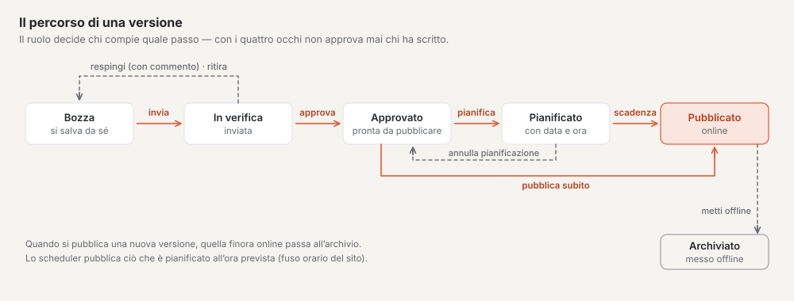
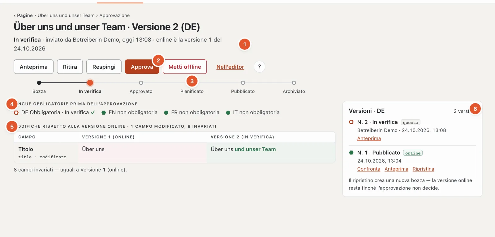
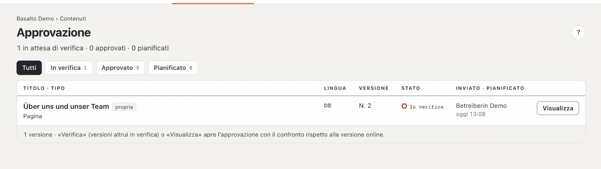

# Approvazione e pubblicazione

Nulla va online senza verifica. Ogni versione segue un percorso fisso: la redazione invia, l’approvazione verifica, approva e pubblica — subito o in un momento pianificato. La versione online sul sito web resta invariata finché non ne viene pubblicata una nuova.

## Dove

- Modalità «Contenuti» › **Approvazione** — tutte le versioni in attesa di verifica o di pubblicazione.
- L’approvazione di una singola pagina la apre nell’albero delle pagine con il pulsante **«✓ Approvazione»** nella riga, nell’editor
  con il link «Approvazione» accanto allo stato, dall’elenco con **«Verifica»** o **«Visualizza»**.

Chi può approvare viene informato di ogni versione inviata anche tramite la **Campanella** (e, se lo desidera, per e-mail); chi
ha inviato viene informato quando la versione è stata respinta, approvata o pubblicata — vedi
[Notifiche](index.md#notifiche).

> «Pubblicare» qui significa: mettere online **una versione** di una pagina. Il «Pubblica» nella modalità Configurazione
> è un’altra cosa — lì l’intero **sito** viene messo online per la prima volta.

## Il percorso di una versione

In alto nella pagina di approvazione una barra mostra a che punto si trova la versione:

**Bozza → In verifica → Approvato → Pianificato → Pubblicato → Archiviato**

| Stato | Significato |
| --- | --- |
| Bozza | è in lavorazione e si salva automaticamente |
| In verifica | inviata, in attesa di approvazione |
| Approvato | verificata, pronta per la pubblicazione |
| Pianificato | viene pubblicata in un momento stabilito |
| Pubblicato | è online sul sito web |
| Archiviato | una versione precedentemente online oppure messa offline |

Ogni lingua ha le proprie versioni e segue il percorso per conto suo.

## Chi può fare che cosa

| Passo | Ruoli |
| --- | --- |
| Inviare, ritirare | Redattore, Traduttore, Amministratore, Gestore |
| Approvare, respingere | Approvatore, Amministratore, Gestore |
| Pianificare, pubblicare, mettere offline | Approvatore, Amministratore, Gestore |

I pulsanti che il Suo ruolo non ha non compaiono affatto. **«Approva»** e **«Pubblica»** invece compaiono anche
bloccati, con il motivo sotto — e sempre **un solo** motivo, in un ordine fisso (vedi i passi più sotto).
Se lo stesso motivo vale per entrambi, compare «Approvazione e pubblicazione bloccate: …».

## La pagina di approvazione

1. **Intestazione:** lo stato, chi l’ha impostato e quando, e quale versione è online («online è la versione 1 del …» oppure
   «ancora nessuna versione online»).
2. **I passi** possibili in quel momento (Anteprima, Ritira, Respingi, Approva, Pianifica, Pubblica,
   Metti offline) e «Nell’editor».
3. **La barra di stato.**
4. **Lingue obbligatorie prima dell’approvazione:** per ogni lingua obbligatoria ✓ o ✗. ✓ significa che la versione più recente di questa lingua
   non è più una bozza; le lingue non obbligatorie compaiono accanto a titolo informativo.
5. **Modifiche** rispetto alla versione online (altrimenti rispetto alla precedente): per ogni campo modificato una riga con «vecchio» e
   «nuovo», le parole modificate evidenziate, sotto «N campi invariati». Per la prima versione compare «Prima versione
   — non c’è nulla da confrontare».
6. **Versioni** di questa lingua: «questa» contrassegna quella visualizzata, «online» quella pubblicata, le più vecchie si trovano sotto
   «Archivio» — con «Confronta», «Anteprima» e «Ripristina».

Sul telefono i passi si trovano in una barra fissa in basso.

## I singoli passi

### Inviare

Nell’editor o nella pagina di approvazione: **«Invia per approvazione»**. La versione passa a «In verifica» e compare nell’elenco «Approvazione». Se mancano campi obbligatori, Basalto non invia e contrassegna i campi nell’editor.

Più pagine insieme le invia nell’albero delle pagine con l’azione collettiva (vedi [Pagine e albero delle pagine](seiten.md)).

### Ritirare

Se ha inviato troppo presto, **«Ritira»** riporta la versione allo stato di bozza. È possibile finché è «In verifica».

### Verificare

La pagina di approvazione mostra **che cosa è cambiato** — rispetto alla versione online oppure, se nessuna è ancora online, rispetto alla versione precedente. Con «Anteprima» vede la pagina come apparirà; «Nell’editor» porta al contenuto.

Nell’elenco delle **Versioni**, con «Confronta» mette a confronto una versione più vecchia con quella attuale; «Chiudi confronto» nasconde di nuovo il confronto.

### Approvare

**«Approva»** porta la versione su «Approvato». Il pulsante è bloccato — verificato in quest’ordine — se

1. vale il principio dei quattro occhi e la versione l’ha creata o inviata Lei stesso,
2. manca ancora una lingua obbligatoria («Approvazione solo con tutte le lingue obbligatorie — mancano: …», vedi [Tradurre](uebersetzen.md)),
3. il Suo ruolo non approva.

### Respingere

**«Respingi»** apre un campo **«Commento»** con l’indicazione di a chi torna la versione («di ritorno a ‹Nome›»). Scriva che cosa deve cambiare — il commento è obbligatorio (al massimo 2000 caratteri). La versione torna come bozza all’autrice o all’autore; il commento compare poi in alto nell’editor sotto «Respinto» e la persona riceve una notifica.

### Pianificare

In **«Pianifica»** sceglie **Data** e **Ora** (preimpostato: domani alle 08:00) e clicca su **«Pianifica pubblicazione»**. L’ora vale nel fuso orario del sito; se lavora in un altro fuso orario, la pagina lo segnala. Un momento nel passato viene rifiutato — per pubblicare subito usi «Pubblica». Fino al momento pianificato resta online la versione online precedente.

- **«Ripianifica»** cambia il momento.
- **«Annulla pianificazione»** riporta la versione su «Approvato».

La pubblicazione la esegue un servizio in background (lo scheduler), precisa al minuto. Il suo «battito» compare accanto al campo di pianificazione: se si è fatto vivo negli ultimi cinque minuti, è tutto a posto; altrimenti compare in rosso «le pubblicazioni pianificate non vengono eseguite» — in tal caso informi l’amministrazione, perché senza di lui ciò che è pianificato resta in sospeso.

### Pubblicare

**«Pubblica»** mette online **subito** una versione approvata o pianificata. La versione online precedente viene archiviata. Il pulsante è bloccato — verificato in quest’ordine — se

1. lo slug in questa lingua è già occupato da un’altra pagina pubblicata,
2. vale l’obbligo del testo alternativo e un’immagine non ha testo alternativo (vedi [Media](medien.md)),
3. il Suo ruolo non pubblica.

### Mettere offline

**«Metti offline»** toglie dalla rete la versione online — possibile non appena esiste una versione online, indipendentemente dallo stato in cui si trova la versione più recente. Dopo la conferma «Sì, metti offline» la pagina in questa lingua non è più raggiungibile; la versione viene archiviata. Il contenuto stesso resta: con «Ripristina» nell’elenco delle versioni torna a essere una bozza, che segue di nuovo il percorso.

## Principio dei quattro occhi

Se il principio dei quattro occhi è attivo, nessuno può approvare il proprio lavoro: chi ha creato o inviato una versione non può approvarla personalmente. Nella pagina di approvazione compare allora «Principio dei quattro occhi: chi invia non approva.», nell’elenco le proprie versioni sono contrassegnate con «propria».

Lo attiva un’amministratrice o un amministratore in «Amministrazione › Impostazioni», gruppo «Approvazione». Di fabbrica è disattivato.

## L’elenco «Approvazione»

L’intestazione conta «N in attesa di verifica · N approvate · N pianificate». In alto filtra per **«In verifica»**, **«Approvato»** e **«Pianificato»** — ognuno con il numero di versioni — oppure mostra «Tutti». Ogni riga indica titolo, tipo, lingua, numero di versione, stato e chi ha inviato e quando, oppure quando verrà pubblicata; le pianificate vengono per prime, in ordine di momento. «propria» contrassegna le versioni che ha inviato Lei (senza mittente: quelle che ha redatto Lei).

**«Verifica»** compare per le versioni inviate da altre persone; per tutte le altre il pulsante si chiama «Visualizza». Se non c’è nulla in attesa, compare «Nulla in attesa di approvazione», con un filtro senza risultati «Nulla in questo filtro». Il numero accanto alla voce di menu «Approvazione» conta ciò che è in attesa di verifica.

## Recuperare una versione più vecchia

Nell’elenco delle versioni della pagina di approvazione, **«Ripristina»** crea da una versione più vecchia una nuova bozza. La versione online resta finché questa bozza non ha completato il percorso.

## Domande frequenti

**Ho inviato — e adesso?**
La versione è in attesa in «Approvazione». Chi può approvare la vede lì e come attività nella «Panoramica». Se viene respinta, il commento compare nel Suo editor.

**La pagina è pubblicata, ma voglio correggere qualcosa.**
La modifichi semplicemente nell’editor. Nasce una nuova bozza, la versione online resta online finché la correzione non è approvata e pubblicata.

**Posso approvare e pubblicare in un solo passo?**
No, sono due passi: prima «Approva», poi «Pubblica» oppure «Pianifica pubblicazione».

## Per continuare

- [Tradurre](uebersetzen.md)
- [Pagine e albero delle pagine](seiten.md)
- [Ruoli](../verwaltung/rollen.md)
