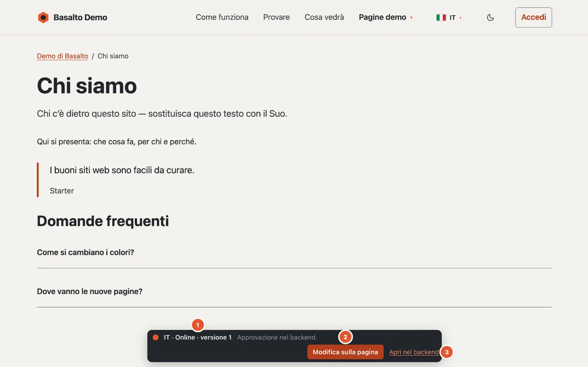
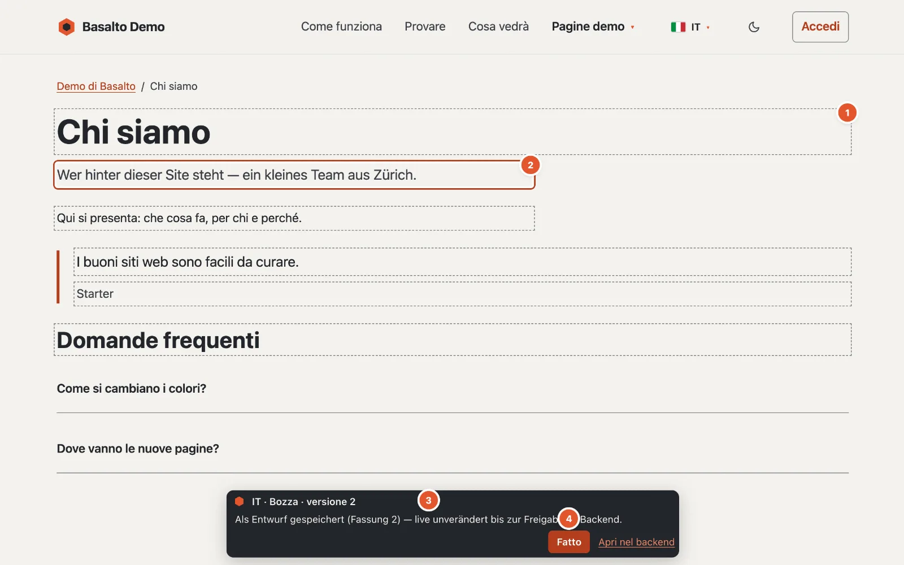

# Modificare sulla pagina

Le piccole correzioni di testo le può fare direttamente sul sito web: correggere un refuso, riordinare una frase, accorciare un titolo. La Sua modifica viene salvata come **bozza** — sul sito web per i visitatori non cambia nulla finché la versione non è approvata e pubblicata nel backend.

## Dove

Sul sito web stesso. Se nello stesso browser ha effettuato l’accesso al backend e può modificare la pagina, in fondo a ogni pagina pubblicata appare una piccola **barra di Basalto**.

1. **Lingua e stato** — per esempio «DE · Online · Versione 4». Se è già in attesa una versione più recente, compare accanto: «Online · Versione 4 · In verifica: versione 5». Accanto c’è un avviso o l’ultimo messaggio.
2. **«Modifica sulla pagina»** attiva la modalità di modifica; al suo interno il pulsante si chiama **«Fatto»**.
3. **«Apri nel backend»** porta direttamente nell’editor di questa pagina e lingua.

Le visitatrici e i visitatori non vedono mai questa barra.

## Chi può farlo

Tutti coloro che possono modificare i contenuti: Redattore, Amministratore e Gestore. I ruoli «Traduttore» e «Approvatore» da soli non bastano — le traduzioni nascono campo per campo nella vista di traduzione (vedi [Tradurre](uebersetzen.md)).

## Come procedere

1. Apra la pagina sul sito web e nella barra clicchi su **«Modifica sulla pagina»**. La pagina si ricarica e mostra ora lo stato più recente — anche una bozza non ancora pubblicata. La barra indica quanti campi sono modificabili («3 campi modificabili — le modifiche vengono salvate come bozza.»).
2. I testi modificabili hanno un **bordo tratteggiato** (1 nell’immagine). Clicchi all’interno e modifichi il testo; il campo in lavorazione ha una **cornice** (2).
3. Poco meno di un secondo dopo l’ultima digitazione Basalto salva da solo. La barra segnala «Salvataggio …» e poi per esempio «Salvato come bozza (versione 5) — online invariato fino all’approvazione nel backend.» (3)
4. Clicchi su **«Fatto»** (4) per uscire dalla modalità di modifica. Altrimenti resta attiva per tutta la Sua sessione, anche su altre pagine. Se non è ancora tutto salvato, Basalto chiede «Non tutte le modifiche sono salvate. Terminare comunque?».
5. Invii la versione per approvazione nel backend — tramite «Apri nel backend» e lì «Invia per approvazione» (vedi [Approvazione e pubblicazione](freigabe.md)).

Se la versione più recente è già stata inviata, approvata o pubblicata, la Sua prima modifica avvia una **nuova bozza**; la barra lo segnala.

## Cosa si può modificare qui

- il **titolo** e l’**introduzione**,
- i campi di testo del tipo di contenuto,
- testo, campo di testo e testo formattato nei **blocchi**, anche in quelli annidati.

Nel testo formattato l’editor sul sito conosce **Grassetto** (⌘B o Ctrl+B), **Corsivo** (⌘I o Ctrl+I) e **Link** (⌘K o Ctrl+K) — senza barra degli strumenti. Con ⌘K una piccola finestra chiede l’indirizzo; se lo lascia vuoto, il link viene rimosso. Il testo incollato arriva sempre come testo semplice, senza formattazione estranea.

Nei campi a una riga **Invio** termina l’inserimento; nei campi di testo a più righe Invio crea una nuova riga. **Esc** esce da qualsiasi campo.

## Cosa resta nel backend

- immagini, tabelle e incorporamenti,
- testo formattato con più di una formattazione semplice — in tal caso il campo non è modificabile sulla pagina. Semplice significa: paragrafi, sottotitoli, elenchi, citazioni, linee di separazione e a capo, oltre a grassetto, corsivo, sottolineato, barrato, codice, apice e pedice e link. Immagini, tabelle, elenchi di attività o incorporamenti nel testo formattato rendono il campo un caso per il backend,
- aggiungere, spostare o eliminare blocchi,
- slug, metadati e tutte le altre impostazioni,
- inviare per approvazione, approvare e pubblicare.

Se su una pagina non c’è nulla che si possa modificare qui, la barra segnala «Nessun testo di questa pagina si può modificare qui — usare il backend.»

## Se qualcosa non funziona

Se un campo non ha potuto essere salvato, ha una **cornice rossa** e la barra indica il motivo.

**«Nel frattempo questa pagina è stata modificata altrove — ricarichi, così non si sovrascrive nulla.»**
Qualcuno ha modificato la stessa versione contemporaneamente nel backend o sulla pagina. Basalto allora non salva, per non sovrascrivere nulla — e su questa pagina non accetta più nulla finché non viene ricaricata. Ricarichi la pagina e ripeta la Sua modifica.

**«Nessuna connessione — la modifica non è ancora salvata.»**
La rete era assente. Verifichi la connessione; la prossima digitazione riprova.

**«Nessuna autorizzazione a modificare questa pagina.»**
Il Suo ruolo non consente (più) questa pagina o lingua — si rivolga all’amministrazione.

**«La sessione è scaduta — ricaricare e accedere.»**
Acceda di nuovo al backend e ricarichi la pagina.

**Il testo è troppo lungo.**
I testi a una riga hanno al massimo 300 caratteri, i campi di testo 5000, il testo formattato 20'000. I testi più lunghi li modifichi nel backend.

**Lascio la pagina prima che sia salvato.**
Il browser chiede conferma se ci sono ancora modifiche non salvate.

## Per continuare

- [Modificare i contenuti con i blocchi](bloecke.md)
- [Approvazione e pubblicazione](freigabe.md)
