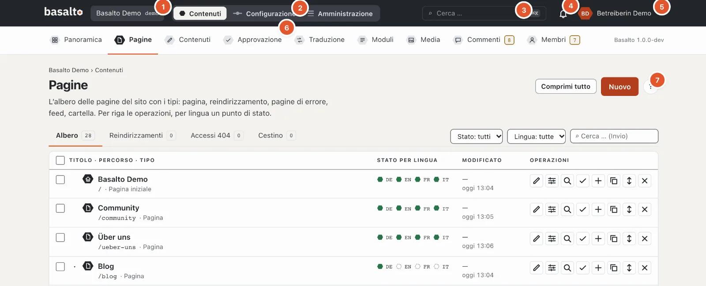
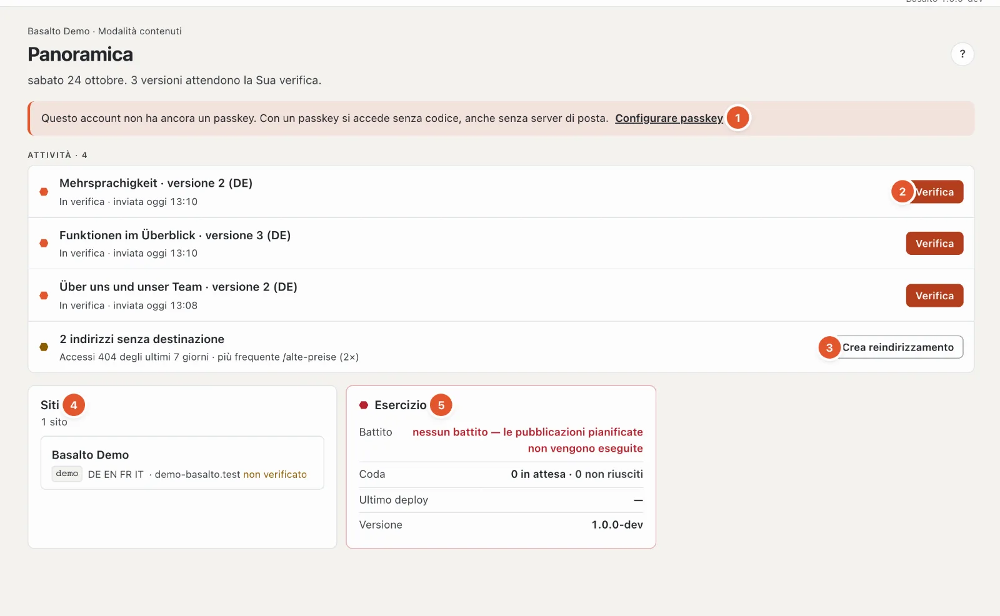
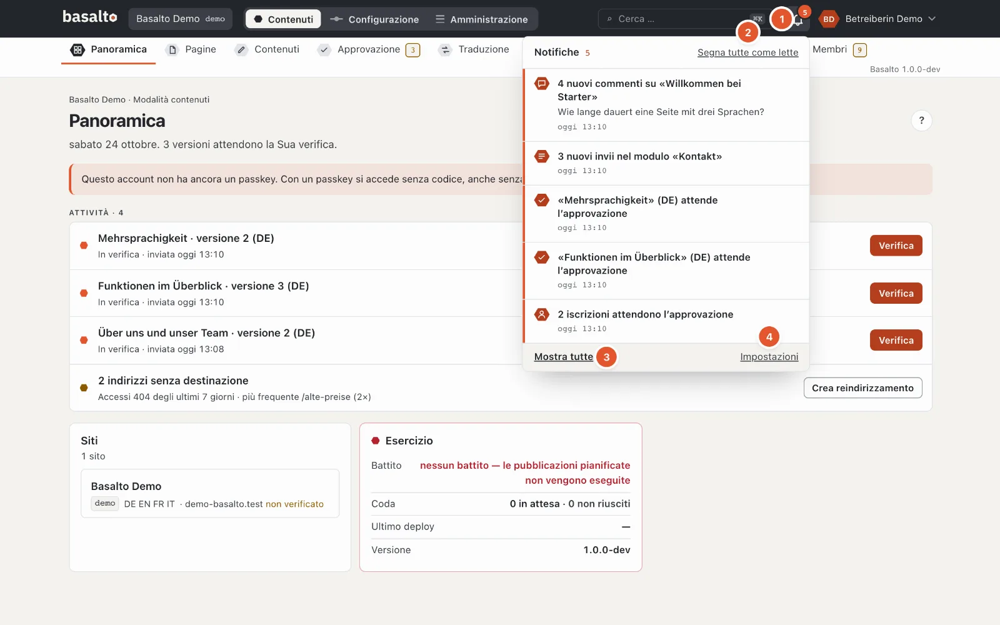
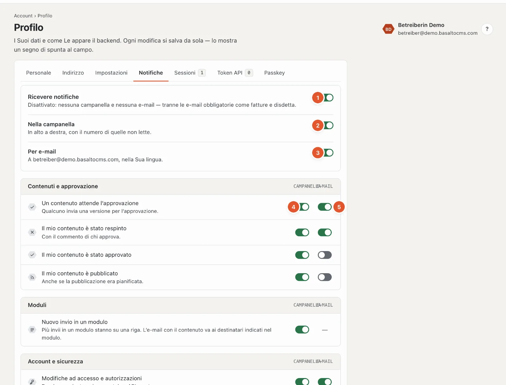
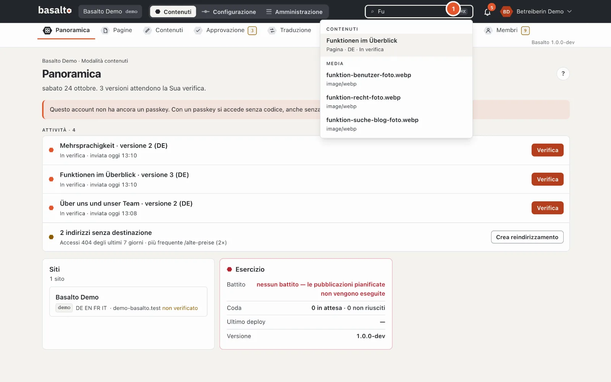

# Guida per la redazione

Questa guida spiega il lavoro quotidiano nel backend di Basalto: creare pagine, curare testi e immagini, tradurre, approvare e pubblicare. Non servono conoscenze tecniche.

In quasi ogni pagina del backend, in alto a destra, c’è un **«?»** rotondo. Apre la guida adatta a quella pagina — come barra sul bordo destro, mentre la pagina dietro resta utilizzabile. Più rapido ancora con il tasto **?** o **F1**; maggiori dettagli in [Guida e scorciatoie](#guida-e-scorciatoie).

## Che cosa contiene la guida

| Pagina | Di che cosa si tratta |
| --- | --- |
| [Pagine e albero delle pagine](seiten.md) | Creare, spostare, copiare ed eliminare pagine; cestino, reindirizzamenti e risultati 404 |
| [Modificare i contenuti con i blocchi](bloecke.md) | Editor a blocchi, testo formattato, incollare da Word, anteprima, salvataggio automatico, versioni |
| [Media](medien.md) | Mediateca, caricamento, cartelle, testi alternativi, varianti delle immagini, sostituzione, cestino |
| [Tradurre](uebersetzen.md) | Traduzione dalla lingua predefinita, lingue obbligatorie, lingua di riserva, panoramica «Traduzione» |
| [Approvazione e pubblicazione](freigabe.md) | Inviare per approvazione, approvare, respingere, pianificare, pubblicare, mettere offline; principio dei quattro occhi |
| [Moduli](formulare.md) | Creare moduli, consultare, esportare ed eliminare gli invii, e-mail ai destinatari |
| [Commenti](kommentare.md) | Moderare, rispondere, segnare come spam, eliminare i commenti |
| [Membri](mitglieder.md) | Pagine solo per membri, accesso senza password, approvazione, blocco, invito |
| [Modificare sulla pagina](frontend-editor.md) | Modificare i testi direttamente sul sito web — come bozza |
| [Suggerimenti IA](ki.md) | Farsi proporre testi migliorati, traduzioni, dati SEO e testi alternativi — solo con un clic, come bozza |

## Ruoli

Che cosa Lei può fare nel backend dipende dal Suo ruolo nel sito. Il ruolo lo assegna un’amministratrice o un amministratore in «Amministrazione › Utenti». Così sono impostati i modelli — la Sua installazione può averli adattati o aver creato ruoli propri:

| Ruolo | Può |
| --- | --- |
| **Redattore** | Creare, modificare ed eliminare pagine e contenuti, gestire i media, curare moduli e invii, moderare i commenti, inviare versioni per approvazione. Approvare, pubblicare, configurazione e amministrazione non ne fanno parte. |
| **Approvatore** | Verificare le versioni inviate, approvarle o respingerle, pianificare pubblicazioni, pubblicare e mettere offline. |
| **Traduttore** | Tradurre i contenuti nelle altre lingue del sito — la lingua di origine resta bloccata. |
| **Amministratore** | Tutto nel sito, anche configurazione, utenti, ruoli e impostazioni. |
| **Gestore** | Tutto; il ruolo è immutabile, ogni sito ha almeno un gestore. |

Ciò che il Suo ruolo non può fare non compare nel menu. Se all’interno di una pagina Le manca un diritto, il backend mostra il motivo direttamente sul pulsante bloccato — per esempio «Il Suo ruolo non approva». Come si impostano i ruoli è spiegato nel manuale d’esercizio, in «Ruoli e diritti».

## Struttura del backend

### L’intestazione

1. **Sito** — se lavora in più siti, scelga qui il sito.
2. **Contenuti · Configurazione · Amministrazione** — il selettore tra le modalità; vede solo quelle che servono al Suo ruolo.
3. **Cerca …** — la ricerca (vedi [Ricerca](#ricerca)).
4. La **Campanella** — le Sue notifiche (vedi [Notifiche](#notifiche)).
5. La Sua **Immagine del profilo** e il nome — il menu con profilo, impostazioni, guida ed «Esci».
6. Le **Stazioni** della modalità, qui con un numero (vedi sotto).
7. Il **«?»** rotondo — la guida a questa pagina.

### Modalità «Contenuti»

Qui si svolge il lavoro redazionale. Sotto l’intestazione ci sono le stazioni:

- **Panoramica** — le Sue attività: versioni da verificare, elementi respinti, traduzioni mancanti nelle lingue obbligatorie, indirizzi senza destinazione e avvisi come testi alternativi mancanti. Se non c’è nulla da fare, compare «Nulla in attesa».
- **Pagine** — l’albero delle pagine del sito web.
- **Contenuti** — voci senza un posto fisso nell’albero delle pagine, per esempio articoli del blog o persone.
- **Approvazione** — tutto ciò che attende una verifica o la pubblicazione.
- **Traduzione** — ciò che manca o è obsoleto in altre lingue.
- **Moduli** — i moduli e i loro invii.
- **Media** — la mediateca.
- **Commenti** e **Membri** — compaiono solo se il rispettivo modulo è attivato per il sito.

Un numero in **ambra** accanto a una stazione significa: lì qualcosa La attende — in «Approvazione» versioni da verificare, in «Traduzione» lacune, in «Moduli» nuovi invii, in «Commenti» e «Membri» elementi in attesa. Un numero **grigio** è solo informativo. I numeri vengono ricontati ogni 30 secondi.

### La panoramica

In alto ci sono la data e, in una frase, ciò che c’è da fare.

1. **Avvisi** — per esempio che il Suo account non ha ancora una passkey, che sono inserite immagini senza testo alternativo, che l’e-mail di un invio di modulo non è stata recapitata, che un job in background è fallito (con «Riprovare» e «Scarta», se Lei gestisce l’esercizio) o che l’installazione non ha ancora una licenza.
2. **Attività** con il pulsante adatto:
   - **In verifica** — versioni di altri che Lei può approvare: «Verifica».
   - **Approvato** — in attesa di pubblicazione; **Pianificato** — va online all’ora impostata.
   - **Respinto** — solo le Sue versioni, con «Rielaborare».
   - **Traduzione** — traduzioni mancanti o obsolete nelle lingue obbligatorie (tra i 100 contenuti modificati più di recente, al massimo 30 attività).
3. **Indirizzi senza destinazione** — risultati 404 degli ultimi 7 giorni con l’indirizzo più frequente e «Crea reindirizzamento»; solo se Lei può pubblicare.
4. **Siti** — i siti in cui lavora, con lingue e dominio.
5. **Esercizio** — battito (lo scheduler gira?), coda, ultimo deploy e versione. Rosso significa: qui qualcosa non va — per esempio senza battito le pubblicazioni pianificate non partono.

Se non c’è nulla da fare, compare «Nulla in attesa».

### Modalità «Configurazione»

Qui il sito viene progettato e costruito. Sotto l’intestazione c’è il **Percorso di configurazione**: nove stazioni
nell’ordine in cui nasce un sito — ognuna con la domanda a cui risponde e, sotto, il termine tecnico:

| Stazione | Termine tecnico |
| --- | --- |
| Che cos’è il sito? | Sito |
| Che aspetto ha? | Tema · Design — sotto, il punto di passaggio ai **Temi** |
| Com’è costruito? | Layout · Template |
| Come ci si orienta? | Menu |
| Che cosa si può curare? | Tipi di contenuto |
| Di che cosa sono fatte le pagine? | Blocchi · Blocchi riutilizzabili |
| Che cosa possono inviare i visitatori? | Moduli |
| Con che cosa parte? | Contenuti iniziali |
| Pronto per andare online? | Pubblica |

Un clic su una stazione apre una scheda: che cosa significa la stazione, il suo stato (la stessa verifica di
`basalto:check`) e le pagine relative. Una ✗ rossa o un ! giallo su una stazione mostra dove manca qualcosa; un
anello grigio tratteggiato significa che la stazione è ancora in attesa. **Esc** chiude la scheda. Alla fine si dirama **«Codice»** — l’editor
del tema per chi scrive il tema da sé. Sul telefono il percorso si apre come elenco. Tutti i dettagli sono nella
guida dedicata alla configurazione: [Configurazione](../einrichtung/README.md).

### Modalità «Amministrazione»

«Siti», «Moduli», «Utenti», «Ruoli», «Impostazioni», «Licenza», «Esercizio», «Registro», «Passkey» e ciò che i moduli
vi aggiungono. Queste aree sono per lo più compito di amministratrici e amministratori; hanno una guida propria:
[Amministrazione](../verwaltung/README.md).

## Il Suo account: profilo e impostazioni

In alto a destra c’è la Sua **Immagine del profilo** (o le Sue iniziali). Un clic apre il menu con **«Profilo»**, **«Impostazioni»**, **«Guida e scorciatoie»** ed **«Esci»**; con la tastiera si sceglie con **↑ ↓** (Inizio e Fine saltano alla prima e all’ultima voce), **Esc** chiude.

Il profilo ha queste schede:

- **Personale:** nome e cognome, telefono (il prefisso si sceglie tramite la bandiera) e un’**Immagine del profilo** (JPEG, PNG o WebP fino a 5 MB, ritagliata in formato quadrato). Senza immagine compaiono le Sue iniziali. L’**indirizzo e-mail** lo modifica l’amministrazione.
- **Indirizzo:** via, codice postale, località e paese.
- **Impostazioni:** lingua dell’interfaccia, fuso orario, formato di data e ora, **Pagina iniziale dopo l’accesso** (Panoramica, Pagine, Approvazione, Traduzione o Media), **Aspetto** (chiaro, scuro o come nel sistema operativo), **Elementi per pagina** (25, 50 o 100 — per contenuti, media, invii dei moduli e registro), **Ordinamento degli elenchi** (prima i più recenti o i meno recenti, per titolo) e le **Scorciatoie della guida** (attivate o disattivate).
- **Notifiche:** vedi [Notifiche](#notifiche).
- **Sessioni:** dove Lei è connesso — browser, indirizzo IP e «ultima attività»; «questa sessione» è quella in cui sta lavorando ora. «Esci» termina una sessione, **«Termina tutte le altre»** tutte tranne questa. Utile se non si è disconnesso su un dispositivo altrui.
- **Token API:** per programmi che lavorano con Basalto tramite l’interfaccia (per esempio un’importazione). **«Nuovo token»**: nome, sito, **Capacità** (lettura, scrittura — mai più di quanto consenta il Suo ruolo) e, se desidera, una data di scadenza, poi «Crea token». Il token compare **una sola volta** — lo copi subito. L’elenco mostra quando un token è stato creato e usato l’ultima volta; «Revoca» lo blocca subito, dopo una richiesta di conferma.
- **Passkey:** porta alla gestione delle Sue passkey (accesso senza codice, con impronta digitale, volto o blocco del dispositivo). Lì si trova anche **«Scarica i miei dati (JSON)»** — tutto ciò che Basalto salva sul Suo account.

Ogni modifica si salva da sola e vale solo per Lei.

## Notifiche

La **Campanella** (1) in alto a destra mostra in lava quante notifiche non sono lette (da 100 in su «99+»). Un clic apre le otto più recenti; quelle non lette hanno a sinistra la linea rossa. Un clic su una notifica apre ciò di cui si tratta — se proviene da un altro sito, il backend passa a quel sito. Con il segno di spunta sul bordo ne segna una come letta (un secondo clic la rende di nuovo non letta), **«Segna tutte come lette»** (2) le sbriga tutte in una volta, **Esc** chiude. La campanella controlla ogni minuto se è arrivato qualcosa — solo finché la finestra è visibile — e in tal caso oscilla brevemente. Se ha disattivato del tutto le notifiche, nella campanella compare **«Attiva»**.

**«Mostra tutte»** (3) apre il **centro notifiche**: tutte le notifiche per giorno, con i filtri «Non lette» e per gruppo, per ogni riga «Segna come letto» o «Non letta» e «Rimuovi», in alto «Segna tutte come lette» e «Rimuovi quelle lette».

Ciò che riceve dipende dal Suo ruolo — per esempio:

| Notifica | Chi la riceve |
| --- | --- |
| Un contenuto attende l’approvazione | Chi può approvare |
| Il mio contenuto è stato respinto, approvato, pubblicato | Chi ha inviato la versione per approvazione |
| Nuovo invio in un modulo | Chi vede moduli e invii — più invii di un modulo stanno su una riga |
| Nuovo commento | Chi modera i commenti — raggruppati per contenuto |
| Una nuova adesione attende l’approvazione | Chi gestisce i membri |
| Il supporto del produttore accede | Chi gestisce il sito |
| Modifiche ad accesso e autorizzazioni | Lei stesso (nuova passkey, nuovo token API) |
| Abbonamento, fatture, periodo di prova, dominio, esportazione | Titolare e fatturazione dell’account (solo in abbonamento) |

Che cosa arriva nella campanella e che cosa per e-mail lo imposta nel profilo, in **«Notifiche»** (anche tramite «Impostazioni» (4) in fondo alla campanella): un **interruttore principale** (1), un interruttore ciascuno per **Campanella** (2) ed **E-mail** (3) e, sotto, ogni notifica singolarmente, per gruppi, con le colonne **Campanella** (4) ed **E-mail** (5). Se lavora anche nell’extranet del produttore, si aggiunge una colonna **«Extranet»**. Le **e-mail obbligatorie** come fatture e disdetta arrivano sempre — lì si può disattivare solo la campanella. Dove al posto di un interruttore c’è un trattino, l’e-mail si imposta altrove: per i moduli nel modulo (destinatari), per i commenti nel blocco dei commenti. «Ripristina le impostazioni predefinite» in fondo riporta tutte le singole notifiche al loro valore predefinito; i tre interruttori principali restano come sono.

## Ricerca

Il campo **«Cerca …»** nell’intestazione si apre anche con la combinazione di tasti **⌘K** (Mac) o **Ctrl+K** (Windows). Digiti almeno due caratteri. La ricerca trova al massimo sei risultati per gruppo:

- **Contenuti** e pagine per titolo — anche bozze, con tipo, lingua e stato,
- **Media** per nome del file o titolo — un risultato apre la mediateca con questo termine di ricerca,
- **Utenti** per nome o indirizzo e-mail, se Lei può gestire gli utenti.

Con i tasti freccia sceglie un risultato, **Invio** lo apre, **Esc** chiude la ricerca. Sul telefono la ricerca è nascosta.

## Guida e scorciatoie

La barra della guida mostra la pagina adatta al Suo lavoro e cerca in tutta la documentazione: questa guida per la redazione, l’esercizio, la documentazione per sviluppatori e il Marketplace. Digiti una parola chiave in alto nella barra; un risultato porta direttamente alla sezione giusta. I link nel testo aprono la pagina di guida successiva nella barra stessa. **«Apri come pagina»** mostra la pagina a tutta larghezza, con tutte le pagine della guida a sinistra.

**Larghezza della barra:** trascini con il mouse il bordo sinistro della barra verso sinistra o verso destra. Con la tastiera si usa la maniglia con **← →** (con il tasto Maiuscole a passi più grandi), **Inizio** e **Fine** saltano alla larghezza massima e minima. Basalto memorizza la larghezza nel Suo profilo — alla prossima apertura, anche su un altro dispositivo, sarà di nuovo così. Sugli schermi stretti la barra occupa tutta la larghezza.

**Immagini:** un clic su un’immagine della guida la mostra in grande, lo sfondo diventa sfocato. **Esc**, un clic accanto o **×** la chiudono.

| Tasto | Effetto |
|---|---|
| **?** o **F1** | Apri o chiudi la guida |
| **/** | cercare nella guida aperta |
| **Esc** | chiudere la guida |
| **⌘K** o **Ctrl+K** | cercare nel backend |
| **↑ ↓** e **Invio** | scegliere e aprire un risultato |

Nei campi di inserimento e negli editor — anche nell’editor del codice — **?** e **/** sono caratteri normali; lì solo **F1** apre la guida. L’elenco dei tasti è anche nella barra, in **«Scorciatoie da tastiera»**.

## Termini importanti

- **Versione** — ogni lingua di un contenuto ha versioni numerate. Ciò che è online sul sito web è sempre una versione precisa. Le modifiche finiscono in una bozza, la versione online resta intatta finché non ne viene pubblicata una nuova.
- **Stato di una versione** — «Bozza», «In verifica», «Approvato», «Pianificato», «Pubblicato», «Archiviato». Maggiori dettagli in [Approvazione e pubblicazione](freigabe.md).
- **Lingua predefinita** — la lingua principale del sito. Le traduzioni nascono da essa.
- **Lingua obbligatoria** — una lingua senza la cui versione non si approva.
- **Salvataggio automatico** — nell’editor non c’è un pulsante per salvare; le modifiche si salvano da sole dopo una breve pausa.

## Domande frequenti

**Ho modificato qualcosa, ma sul sito web non lo vedo.**
Le modifiche vengono salvate come bozza. Diventano visibili solo quando la versione è stata inviata per approvazione, approvata e pubblicata. Vedi [Approvazione e pubblicazione](freigabe.md).

**Non vedo il pulsante «Pubblica» oppure è bloccato.**
Possono pubblicare i ruoli «Approvatore», «Amministratore» e «Gestore». Con il ruolo Redattore Lei invia la versione per approvazione.

**Dove trovo pagine o immagini eliminate?**
Nella scheda «Cestino» in «Pagine» oppure nel «Cestino» della mediateca. Vedi [Pagine e albero delle pagine](seiten.md) e [Media](medien.md).

## Per continuare

- [Pagine e albero delle pagine](seiten.md)
- [Modificare i contenuti con i blocchi](bloecke.md)
- [Media](medien.md)
