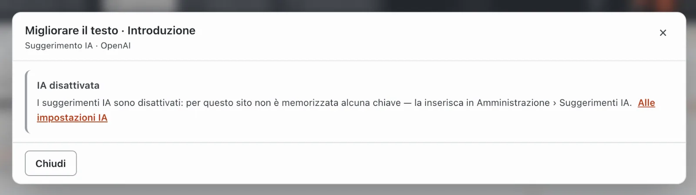
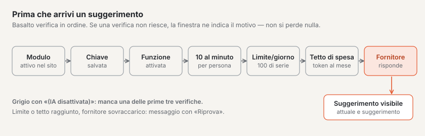
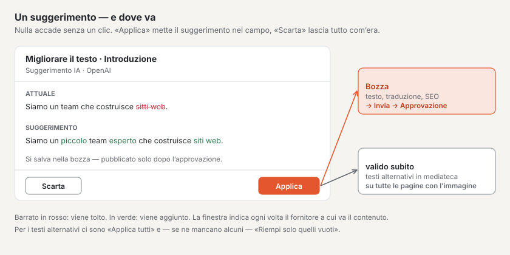

# Suggerimenti IA

Con il modulo «Suggerimenti IA» un’intelligenza artificiale Le suggerisce come un testo può suonare meglio, quale testo alternativo serve a un’immagine, come potrebbe essere tradotto un campo o quale titolo della pagina e quale descrizione si adattano ai risultati di ricerca. Valgono sempre tre regole:

- **Nulla avviene senza clic.** L’IA lavora solo quando clicca su **«✦ Suggerimento»** — mai in background, mai all’apertura di una pagina.
- **È sempre un suggerimento.** Lo vede accanto al testo attuale e decide: **«Applica»** o **«Scarta»**.
- **Si riprende nella bozza.** Un suggerimento non viene mai pubblicato automaticamente — segue la stessa strada di ogni modifica: bozza, invio per approvazione, approvazione. L’unica eccezione sono i testi alternativi nella mediateca (vedi sotto).

## Dove si trovano i pulsanti

| Funzione | Dove | Chi può farlo |
| --- | --- | --- |
| **Migliorare il testo** | Nell’editor a blocchi sotto ogni campo di testo, area di testo e testo formattato, anche sotto l’introduzione | Redattore, Amministratore, Gestore |
| **Traduzione** | Nella traduzione affiancata sotto ogni campo traducibile — il quarto pulsante accanto a «→ applica» | tutti coloro che possono tradurre |
| **Suggerimento SEO** | Nelle impostazioni della pagina, scheda «Metadati», per lingua | Redattore, Amministratore, Gestore |
| **Suggerire testi alternativi** | Nella mediateca, nel dettaglio di un’immagine, sotto i testi alternativi | tutti coloro che possono modificare i media |

I pulsanti compaiono solo se il modulo è attivato per il sito. I campi vuoti non hanno pulsante — senza testo non c’è nulla da migliorare.

Per il **testo alternativo** il pulsante c’è solo per le immagini raster (JPG, PNG, WebP, GIF) — non per SVG e PDF — e solo se il fornitore scelto sa leggere le immagini (DeepSeek e Groq non lo sanno fare).

**Grigio con «(IA disattivata)»** significa: per il sito non è stata depositata alcuna chiave oppure la funzione è disattivata. Un clic indica il motivo — la finestra ha allora solo «Chiudi» e il link **«Alle impostazioni IA»**.

## Come funziona

1. Sotto il campo clicchi su **«✦ Migliorare il testo»** (o «Suggerimento», «Suggerimento SEO», «Suggerire testi alternativi»).
2. Si apre una finestra: «Suggerimento in arrivo …». Dopo pochi secondi **Attuale** e **Suggerimento** compaiono uno accanto all’altro; le parole cancellate in rosso, quelle nuove in verde.
3. **«Applica»** inserisce il suggerimento nel campo. Dopo può continuare a modificarlo come qualsiasi testo.
4. **«Scarta»** chiude la finestra — non cambia nulla.

Nella bozza aperta il salvataggio automatico salva il testo ripreso come se fosse stato digitato. Se nell’editor c’è una versione pubblicata, la bozza nasce solo con **«Salva come nuova bozza»**; la versione pubblicata resta com’è.

### Migliorare il testo

L’IA corregge ortografia, grammatica e punteggiatura e rende il testo più chiaro — nella stessa lingua, con lo stesso messaggio e all’incirca della stessa lunghezza. Nel testo formattato titoli, elenchi, link ed evidenziazioni restano intatti. Se un testo formattato contiene **immagini, tabelle, elenchi di attività o incorporamenti**, l’IA non fa alcun suggerimento — queste parti andrebbero perse lungo la strada.

### Traduzione

Nella traduzione affiancata l’IA prende sempre il testo della **versione di origine** nella lingua predefinita — non ciò che c’è nel campo di destinazione. «Applica al campo di destinazione» inserisce la traduzione nel campo della lingua di destinazione; il salvataggio avviene nella bozza di questa lingua. Verifichi i termini tecnici e i nomi.

### Suggerimento SEO

Dal contenuto della versione più recente l’IA suggerisce un **titolo della pagina** (al massimo da 60 a 70 caratteri) e una **descrizione** (al massimo 160 caratteri). «Applica» compila entrambi i campi; l’anteprima del risultato di ricerca sottostante mostra subito come appare.

Se nella lingua non esiste ancora una versione, compare «prima il contenuto, poi i metadati»; se la pagina non ha ancora testo, non c’è suggerimento.

### Testi alternativi

L’IA guarda l’immagine e suggerisce un testo alternativo per **ogni lingua del sito**. **«Applica tutti»** compila tutte le lingue. Se mancano solo alcuni testi alternativi, c’è in più **«Riempi solo quelli vuoti»** — allora quelli esistenti restano come sono.

**Attenzione:** i media non hanno versioni. I testi alternativi ripresi si salvano subito e valgono immediatamente su tutte le pagine che mostrano l’immagine. La ripresa è registrata nel registro. Verifichi quindi il suggerimento con cura — l’IA non conosce né i nomi delle persone né il contesto.

## Protezione dei dati

Ogni suggerimento invia il contenuto interessato al fornitore scelto dal Suo sito (per esempio OpenAI, Anthropic o Mistral): il testo del campo, il testo di origine di una traduzione, il contenuto di una pagina per il suggerimento SEO oppure l’immagine. La finestra indica ogni volta il fornitore. Non invii nulla che non debba uscire dall’azienda.

Basalto stesso **non memorizza contenuti**: nel registro figura solo chi ha usato quale funzione su quale contenuto e quando, e se il suggerimento è stato ripreso.

## Attivazione e limiti

Un’amministratrice o un amministratore configura l’IA in **Amministrazione › Suggerimenti IA**. In alto è indicato quanti suggerimenti sono già stati fatti oggi e quanti token sono stati consumati questo mese.

1. **Fornitore** — OpenAI, Anthropic (Claude), Google Gemini, Mistral AI, xAI (Grok), DeepSeek, Groq oppure OpenRouter. Il **modello** è facoltativo; se vuoto vale il valore predefinito del fornitore.
2. **Chiave (API key)** — fornita dal fornitore. Viene salvata cifrata e lascia il server solo nella richiesta al fornitore; poi qui compare solo «impostata ✓» con gli ultimi caratteri. «Rimuovi chiave» disattiva tutti i pulsanti IA del sito.
3. **Limite giornaliero** — suggerimenti al giorno per l’intero sito, di fabbrica 100 (da 1 a 10'000). Quando è raggiunto, la finestra lo segnala; il giorno dopo si riprende.
4. **Tetto di spesa** — token al mese (da 1000), vuoto significa senza tetto. Quando è raggiunto, fino a fine mese non ci sono più suggerimenti.
5. **Funzioni** — un interruttore ciascuno per migliorare il testo, testi alternativi, traduzione e suggerimenti SEO.
6. **Utilizzo** — per mese il numero di suggerimenti, quanti sono stati ripresi e quanti sono falliti, i token e la ripartizione per funzione. Lì non compaiono contenuti.

Inoltre vale sempre:

- **Al massimo dieci suggerimenti al minuto per persona.**
- **Al massimo 12'000 caratteri** vengono inviati al fornitore; un testo più lungo non riceve alcun suggerimento.
- **Gli errori del fornitore** (sovraccarico, credito esaurito, chiave rifiutata) compaiono come messaggio comprensibile con **«Riprova»**. Nel frattempo non va perso nulla.

## Domande frequenti

**Non vedo alcun pulsante «Suggerimento».**
Il modulo non è attivato per il sito, oppure il campo è vuoto. Chi traduce non vede «Migliorare il testo» e «Suggerimento SEO».

**Il pulsante è grigio e si chiama «(IA disattivata)».**
Manca la chiave, oppure la funzione è disattivata. Si rivolga all’amministrazione del sito.

**Il suggerimento è già sul sito web?**
No. Tranne che per i testi alternativi finisce nella bozza e, come ogni modifica, richiede invio per approvazione, approvazione e pubblicazione.

## Per continuare

- [Modificare i contenuti con i blocchi](bloecke.md)
- [Configurare i suggerimenti IA](../betrieb/ki.md)
