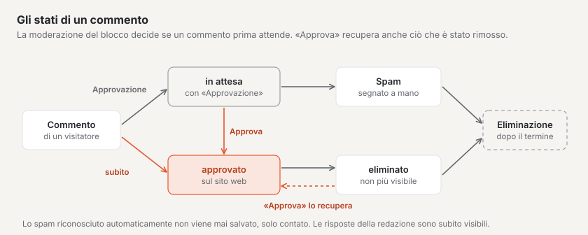
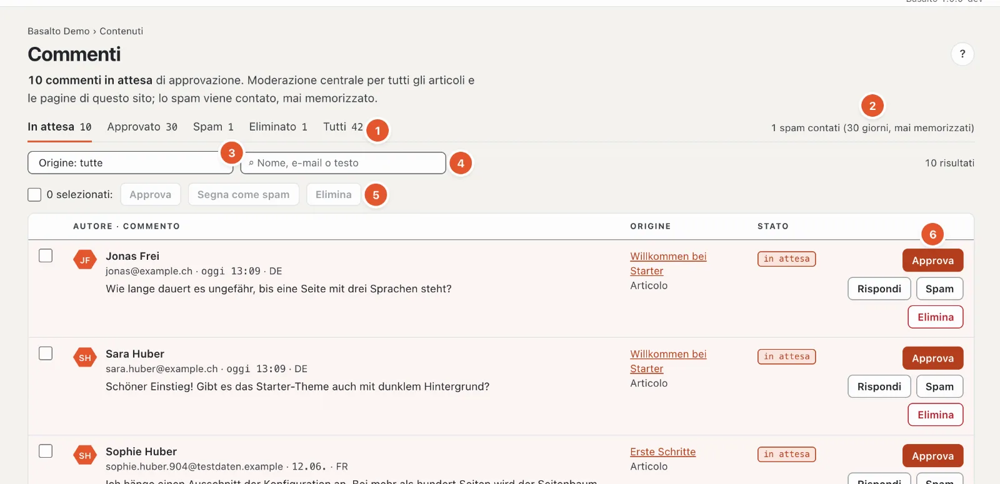
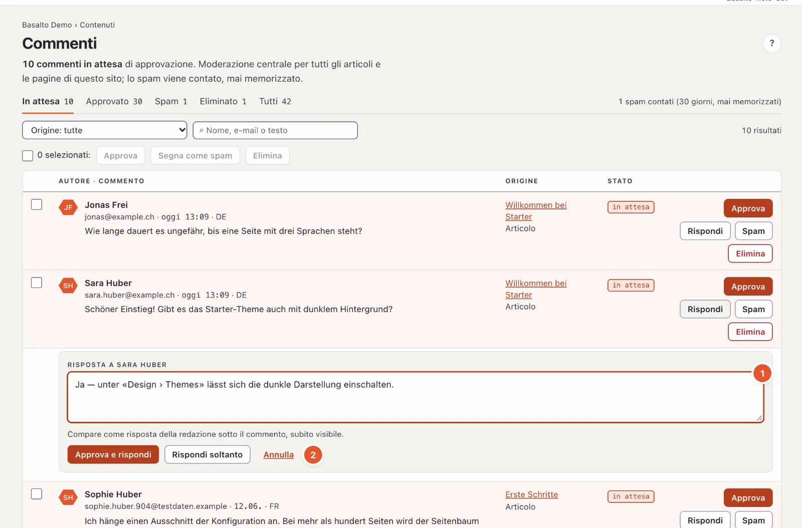

# Commenti

Con il modulo «Commenti» visitatrici e visitatori possono commentare articoli e pagine — senza account. Nel backend modera tutti i commenti del sito in un unico posto.

## Dove

Modalità «Contenuti» › **Commenti**. La voce di menu compare solo se il modulo è attivato per il sito (se ne occupa un’amministratrice o un amministratore sotto «Amministrazione › Siti», scheda «Moduli»). Il numero sulla voce di menu indica quanti commenti attendono l’approvazione.

Possono moderare tutti coloro che possono modificare i contenuti: Redattore, Amministratore e Gestore.

## Come i commenti arrivano su una pagina

I commenti compaiono dove in una pagina si trova il **blocco «Commenti»**. Nel tema Starter il blocco ha queste impostazioni:

| Impostazione | Effetto |
| --- | --- |
| Moderazione | «Approvazione»: ogni commento attende nella moderazione · «subito»: visibile finché qualcuno non lo rimuove |
| Ordinamento | i meno recenti o i più recenti prima |
| Numero per pagina | quanti commenti compaiono alla volta (da 1 a 100, di fabbrica 20) |
| Risposte | i visitatori possono rispondere su un livello, oppure per niente |
| Notifica | e-mail per un nuovo commento alla redazione, all’autrice o all’autore dell’articolo, oppure disattivata |
| Chiudere i commenti | nessun nuovo commento; quelli esistenti restano visibili |

Le impostazioni le modifica come qualsiasi altro blocco nell’editor della pagina; come ogni altra modifica, ha effetto solo con la pubblicazione.

Se la moderazione è impostata su «Approvazione», anche le risposte dei visitatori attendono l’approvazione. Chi commenta vede dopo l’invio «Il Suo commento è in attesa di approvazione.». Nome, e-mail e commento sono obbligatori, un proprio sito web è facoltativo; l’indirizzo e-mail non viene mai pubblicato.

## La moderazione

1. **Stato** — «In attesa», «Approvato», «Spam», «Eliminato» o «Tutti», ognuno con il numero. Se ci sono commenti in attesa, la pagina si apre direttamente su «In attesa».
2. **Contatore spam** — quanto spam è stato respinto negli ultimi 30 giorni. Il totale dall’inizio compare in basso nel piè di pagina.
3. **Origine** — solo i commenti di una pagina o di un articolo.
4. **Cerca** per nome, e-mail o testo.
5. **Più commenti insieme** — vedi sotto.
6. **Le azioni** per ogni commento.

I moduli dei commenti usano la stessa protezione antispam dei [moduli](formulare.md), compreso il compito di calcolo per il browser. Se in Amministrazione › Impostazioni › Protezione antispam è attivo **«Consultare Stop Forum Spam»**, i commenti di mittenti di spam noti finiscono direttamente in «Spam» — un errore si può approvare lì.

Ogni riga mostra l’autrice o l’autore con l’e-mail (e il sito web, se indicato), data e lingua, il testo, per le risposte «↳ Risposta a …», l’origine con un link e lo stato. Le risposte della redazione portano il contrassegno «Redazione». In ogni pagina compaiono 50 commenti; gli altri si sfogliano in basso.

Le azioni — compaiono solo quelle adatte allo stato:

- **«Approva»** — il commento compare sul sito web. Per tutti quelli non ancora approvati.
- **«Rispondi»** — apre un campo di risposta (vedi sotto). Per i commenti in attesa e approvati.
- **«Spam»** — contrassegna il commento come spam; scompare subito dal sito web. Le risposte della redazione non si possono contrassegnare come spam, solo eliminare.
- **«Elimina»** — rimuove subito il commento dal sito web.

I commenti eliminati e quelli contrassegnati come spam restano ancora per un po’ nella moderazione (filtro «Eliminato» o «Spam»). Con «Approva» recupera un commento rimosso per errore.

## Rispondere

1. Clicchi sul commento su **«Rispondi»** e scriva la Sua risposta nel campo **«Risposta a …»** (da 2 a 5000 caratteri).
2. Se il commento è ancora in attesa, scelga **«Approva e rispondi»** (entrambe le cose in un solo passo) oppure **«Rispondi soltanto»** — in tal caso il commento resta in attesa. Per i commenti approvati il pulsante si chiama semplicemente «Rispondi». «Annulla» chiude il campo.

Sul telefono ci sono solo «Approva e rispondi» o «Rispondi».

La Sua risposta compare **subito** sotto il commento, contrassegnata come risposta della redazione, con il Suo nome. Le risposte esistono su un solo livello: se risponde a una risposta, la Sua compare sotto lo stesso commento originale.

## Più commenti insieme

Metta la spunta davanti ai commenti (oppure in alto «Seleziona tutti in questa pagina») e scelga **«Approva»**, **«Segna come spam»** o **«Elimina»**.

## Spam

Lo spam riconosciuto automaticamente — per esempio da programmi che compilano moduli in massa — non viene **mai salvato**, solo contato. La protezione è la stessa dei moduli: un campo invisibile, un controllo del tempo e un limite per indirizzo IP. Il numero compare in alto nella moderazione. Ciò che passa comunque lo contrassegna a mano con «Spam»; anche questo viene contato.

## Notifica

I nuovi commenti vengono segnalati dalla campanella in alto a destra (più commenti su uno stesso contenuto stanno su una riga). L’e-mail relativa non si imposta nel profilo, ma sul blocco «Commenti» (impostazione «Notifica»).

## Protezione dei dati

In fondo alla pagina il riquadro «Protezione dei dati» riassume ciò che viene salvato:

- **Indirizzo IP** — solo come somma di controllo, per il limite per IP; l’indirizzo stesso non viene salvato.
- **Indirizzo e-mail** — salvato, ma mai pubblicato.
- **Cancellazione** — i commenti eliminati e lo spam vengono cancellati definitivamente da un’eliminazione notturna dopo il termine impostato, di fabbrica **365 giorni**. Il termine lo modifica un’amministratrice o un amministratore sotto «Amministrazione › Impostazioni», gruppo «Conservazione», «Conservare commenti eliminati e spam». I commenti approvati e quelli in attesa restano.
- **Su richiesta** — informazioni e cancellazione per indirizzo e-mail le gestisce l’amministrazione sotto «Amministrazione › Utenti».

Chi commenta acconsente espressamente alla pubblicazione di nome e commento.

## Domande frequenti

**Un commento non si vede sul sito web.**
Verifichi lo stato nella moderazione. «in attesa» significa: deve ancora essere approvato. Se l’integrazione è impostata su «subito», compare senza approvazione.

**Non desidero più nuovi commenti su un articolo.**
Nel blocco «Commenti» di questo articolo metta la spunta su «Chiudere i commenti». I commenti esistenti restano visibili.

**Ho eliminato un commento per errore.**
Filtri per «Eliminato» e clicchi sul commento su «Approva».

## Per continuare

- [Membri](mitglieder.md)
- [Guida per la redazione](index.md)
