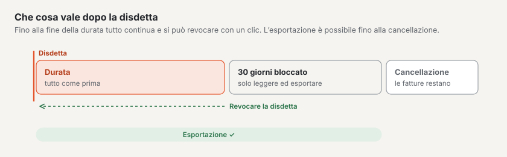

# Esportazione e disdetta

In **Amministrazione › Account › Esportazione e disdetta** ritira i Suoi dati e disdice il Suo abbonamento. La scheda la vedono
proprietario, amministrazione e fatturazione dell’account; disdire può solo il **proprietario**.

## Esportazione

«I Suoi dati restano Suoi»: l’esportazione completa può crearla **in qualsiasi momento** — non solo quando se ne va.

1. In «Contenuto» sceglie **Intero account** (solo proprietario) oppure **un sito**.
2. Scelga «Creare una nuova esportazione». L’esportazione viene creata in background; la barra mostra a che punto è. Può
   lasciare la pagina.
3. Quando è pronta, riceve un’**e-mail con link**. Il link vale **7 giorni**; per scaricare deve accedere.
   Dopo eliminiamo il file — se necessario ne crei semplicemente uno nuovo.

Cosa contiene: i contenuti come JSON con tutte le versioni e lingue, i media con le loro varianti di immagine, tema, navigazione,
moduli, impostazioni e utenti con i loro ruoli. Gli invii dei moduli (dati personali) non sono inclusi. L’esportazione ha
lo stesso formato dell’importazione: **esportazione → installazione vuota → importazione** dà lo stesso sito, anche sul Suo
server.

È sempre in corso una sola esportazione alla volta. Possono esportare il proprietario (sito o intero account) nonché l’amministrazione
dell’account e il gestore di un sito (solo il sito).

## Disdire

1. Nel riquadro «Disdire l’abbonamento» ci sono i Suoi dati: **Durata fino al**, cosa vale **dopo** e il giorno della **cancellazione**.
2. Inserisca il **nome dell’account** esattamente come è scritto e metta la spunta «Ho creato l’esportazione o non ne ho
   bisogno.».
3. Scelga «Confermare la disdetta». Riceve un’e-mail con tutti i dati.

Cosa vale poi:

| Periodo | Cosa vale |
| --- | --- |
| Fino alla fine della durata | Tutto come prima. La durata termina con il periodo pagato; nel **periodo di prova subito**. Non arriva nessun’altra fattura. |
| 30 giorni dopo | **Bloccato:** il Suo sito web mostra solo «Questo sito non è più disponibile.» Lei stesso può leggere ed esportare tutto nel backend, ma non modificare più nulla. Gli altri utenti non possono più entrare. |
| Il giorno della cancellazione | Eliminiamo definitivamente siti, media e utenti. Il Suo account e le Sue **fatture restano**, perché lo esige la legge. Il Suo alias è poi di nuovo libero. |

La avvisiamo per e-mail **sette giorni** e **un giorno** prima della cancellazione.

In alto nel backend durante la durata compare una fascia: «Disdetto · durata fino al … · poi bloccato per 30 giorni · eliminazione
il …».

## Revocare la disdetta

Fino alla fine della durata basta un clic: **«Revocare la disdetta»** nella fascia in alto o nel riquadro «Cosa vale ora».
Il Suo abbonamento continua semplicemente, come se nulla fosse. Dopo la fine della durata non è più possibile — il sito
è bloccato e viene eliminato.

## Trasferimento in caso di cambio di piano

Se passa da **Start** a **Standard** o **Pro** (o viceversa), i Suoi siti si trasferiscono su un’altra piattaforma. Ciò
avviene da sé:

- Durante il trasferimento (di solito pochi minuti) può leggere nel backend, ma non salvare nulla. Lo indica una fascia.
- Il Suo sito web resta raggiungibile per tutto il tempo e i suoi **indirizzi restano gli stessi** — alias e domini propri.
- Dopo riceve un’e-mail. Acceda con il codice via e-mail; **passkey** e **accesso a due fattori**
  li configuri di nuovo.
- Verifichi i Suoi siti e in «Esportazione e disdetta» scelga **«Concludere il trasferimento»**. Solo allora eliminiamo la
  vecchia copia.

## Domande frequenti

**Posso proseguire il mio sito più tardi su un server proprio?**
Sì. Crei un’esportazione del sito e la importi in un’installazione di Basalto (`basalto:import`).

**Non trovo più il link dell’e-mail.**
In «Esportazione e disdetta» l’esportazione compare con «Scarica», finché è disponibile.

**Ho disdetto — posso comunque ancora esportare?**
Sì, fino alla cancellazione: durante la durata e durante i 30 giorni di blocco.

**Perché il pulsante «Disdire l’abbonamento» non c’è?**
Disdire può solo il proprietario dell’account. Il ruolo lo vede in alto nell’account («Proprietario», «Amministrazione», «Fatturazione»).

## Per continuare

- [Domini](domains.md)
- [Siti](../verwaltung/sites.md)
