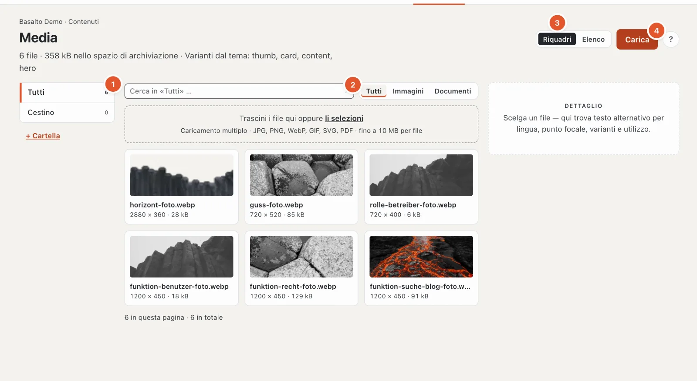
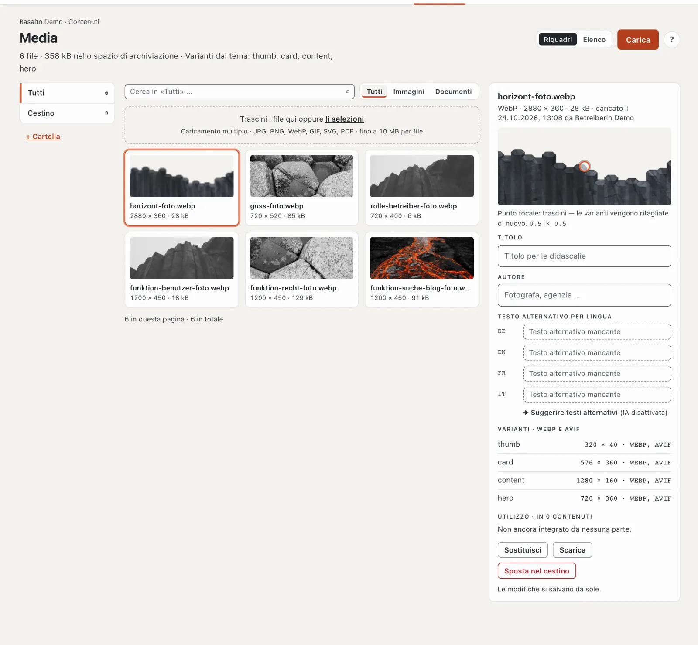
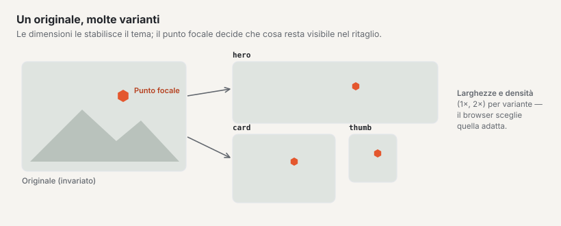
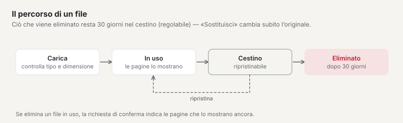

# Media

Nella mediateca si trovano tutte le immagini e tutti i documenti del sito. Da qui li inserisce nelle pagine e nei contenuti. Un’immagine la carica una sola volta — Basalto ne ricava da sé le dimensioni adatte a ogni dispositivo.

## Dove

Modalità «Contenuti» › **Media**.

L’intestazione indica il numero di file, lo spazio occupato e le **varianti dal Tema** (le dimensioni che Basalto ritaglia da ogni immagine). A sinistra si trovano le cartelle (1), al centro i file, a destra il **dettaglio** del file selezionato. In alto può cercare e filtrare per tipo (2: «Tutti», «Immagini», «Documenti») e passare dalla visualizzazione «Riquadri» a «Elenco» e viceversa (3).

- **Ricerca:** per nome del file, titolo e autore — solo nella cartella aperta («Cerca in ‹Tutti›» cerca ovunque); Invio la avvia.
- **Elenco:** colonne dimensioni (per gli SVG «Vettoriale»), peso, stato (per esempio «Testo alternativo mancante») e data di caricamento. L’ordine e il numero di elementi per pagina vengono dal Suo profilo.
- **Vuoto:** «Ancora nessun file» (in tal caso l’intera superficie è area di rilascio), «Questa cartella è vuota», «Nessun risultato» oppure «Il cestino è vuoto».

## Caricare file

1. A sinistra apra la cartella a cui appartengono i file (oppure «Tutti»).
2. Trascini i file nell’area **«Trascini i file qui oppure li selezioni»** — oppure clicchi su **«Carica»** (4).
3. Basalto mostra per ogni file lo stato — in attesa, in caricamento, completato o rifiutato — e in alto, per esempio, «2 di 3 completati · 1 rifiutato». Per le immagini compare poi brevemente «Generazione delle varianti …». Finché un caricamento è in corso, un secondo è bloccato.

Sono ammessi **JPG, PNG, WebP, GIF, SVG e PDF fino a 10 MB per file**; si possono caricare più file insieme. Un file viene rifiutato con un motivo: tipo errato, troppo grande oppure un SVG con script (per motivi di sicurezza). Se il Suo sito ha una **quota di spazio**, la mediateca avvisa a partire dal 90 % e, a spazio pieno, segnala «Spazio esaurito — caricamento bloccato.» In caso di sostituzione il file vecchio non viene conteggiato.

Caricare file e curarne i dati è consentito ai ruoli con «Media · modificare»; cartelle, sostituzione e cestino richiedono «Media · eliminare».

Anche le immagini che incolla nell’editor da Word o da una pagina web finiscono qui (vedi [Modificare i contenuti con i blocchi](bloecke.md)).

## Cartelle

- **«+ Cartella»** crea una nuova cartella — all’interno della cartella aperta in quel momento (al massimo 6 livelli, nomi fino a 120 caratteri). Inserisca il nome, poi «Crea».
- **✎** rinomina una cartella, **✕** la elimina — entrambi compaiono quando passa con il mouse sopra la cartella. I file al suo interno (anche quelli delle sottocartelle) non vanno persi, passano in «Tutti».
- Un file lo sposta nel dettaglio con il campo **«Cartella»**.

## Il dettaglio di un file

Clicchi su un file. A destra vede tipo, dimensioni, peso, quando e da chi è stato caricato, e inoltre:

- **Anteprima con punto focale** — trascini il punto sulla parte più importante dell’immagine (per esempio un volto). Le varianti ritagliate vengono allora tagliate in modo che questa zona resti visibile. Il salvataggio avviene quando rilascia il punto; i numeri sotto (da 0 a 1 per asse, 0.5 × 0.5 è il centro) ne indicano la posizione. Vengono ritagliate di nuovo solo le immagini raster.
- **Titolo** e **Autore** (per esempio la fotografa o l’agenzia).
- **Testo alternativo per lingua** (vedi sotto).
- **Cartella**.
- **Varianti** — le dimensioni che Basalto ha generato per il tema, ognuna con larghezza × altezza e formati (per esempio «576 × 360 · WEBP, AVIF»); «in sospeso» finché sono ancora in preparazione.
- **Utilizzo** — in quali contenuti il file è inserito.

Tutti i dati **si salvano da soli**; un «✓ salvato» lo conferma. «Scarica» scarica l’originale.

## Testo alternativo

Il testo alternativo descrive un’immagine per le persone che non possono vederla e per i motori di ricerca. Scriva in breve che cosa si vede nell’immagine e a che cosa serve — un testo proprio per ogni lingua del sito.

**«Suggerire testi alternativi»** fa scrivere all’IA un testo alternativo per ogni lingua, se il modulo «Suggerimenti IA» è configurato — i suggerimenti compaiono subito nel campo; li verifichi (vedi [Suggerimenti IA](ki.md)). Altrimenti lì compare «(IA disattivata)».

Se nel Suo sito è attivo l’**obbligo del testo alternativo**, vale quanto segue:

- Nel dettaglio, accanto a «Testo alternativo per lingua», compare l’etichetta «Obbligatoria».
- Le immagini senza testo alternativo riportano nella panoramica l’avviso «Testo alternativo mancante» con le lingue interessate.
- Un contenuto che contiene un’immagine senza testo alternativo nella sua lingua **non si può pubblicare**. L’approvazione indica le immagini interessate.
- Nella «Panoramica» compare un avviso con il numero di immagini inserite senza testo alternativo.

L’obbligo lo attiva un’amministratrice o un amministratore in «Amministrazione › Siti», aprendo il sito, scheda «Generale», **«Testo alternativo obbligatorio»** (vedi [Il sito](../einrichtung/site.md)). Alcuni temi richiedono i testi alternativi di per sé — il tema Starter lo fa.

## Varianti delle immagini

Al caricamento Basalto genera da ogni immagine le dimensioni previste dal tema — per esempio una piccola miniatura, un’immagine per le schede e una grande immagine di apertura — nel formato moderno WebP, a seconda del tema anche in AVIF e in doppia risoluzione per gli schermi ad alta risoluzione. Il sito web fornisce a ogni dispositivo la dimensione adatta. Lei non deve fare nulla; non è necessario rimpicciolire le immagini prima.

Per le grafiche SVG e i documenti PDF non ci sono varianti.

## Sostituire un file

Con **«Sostituisci»** nel dettaglio carica un nuovo file al posto di quello vecchio — per esempio una foto aggiornata o un nuovo listino prezzi. Tutte le pagine che usano il file mostrano poi quello nuovo; non deve inserire nulla di nuovo. Le varianti vengono generate di nuovo e il nome del file diventa quello del nuovo file.

**Attenzione:** l’originale vecchio e le sue varianti vengono **eliminati subito** — senza passare dal cestino. Se il file vecchio Le serve ancora, lo scarichi prima.

## Cestino

**«Sposta nel cestino»** nel dettaglio mette un file nel cestino. Se è ancora inserito da qualche parte, la richiesta di conferma elenca i contenuti; con «Sposta comunque nel cestino» conferma. Se non è inserito da nessuna parte, basta una breve conferma. Nel dettaglio di un file eliminato compare «Nel cestino dal …».

- La cartella **«Cestino»** a sinistra mostra tutti i file eliminati.
- **«Ripristina»** nel dettaglio recupera un file.
- Dopo **30 giorni** nel cestino, un ciclo di eliminazione notturno cancella il file definitivamente — originale e varianti. Il termine si può modificare in «Amministrazione › Impostazioni» (gruppo «Media», «Cestino della mediateca»).

Fino all’eliminazione definitiva, le pagine che usano ancora l’immagine mostrano una variante già generata; dopo, il punto resta vuoto. Prima di eliminare controlli quindi l’«Utilizzo».

## Scegliere immagini nell’editor

Un campo immagine nell’editor apre con **«Scegli»** la mediateca in una finestra: ricerca per nome o numero (#12), cartelle, **«Carica»** direttamente da qui (solo immagini raster, in «Tutti»), l’etichetta «Testo alternativo mancante» sulle immagini senza testo alternativo (più tardi blocca la pubblicazione, se vale l’obbligo). Per le gallerie sceglie più immagini; l’ordine lo sistema poi nel campo.

## Sul telefono

Le cartelle compaiono in alto come campo di selezione, il dettaglio si apre come foglio sull’intera superficie e una barra fissa in basso contiene «Carica».

## Domande frequenti

**Non trovo più un’immagine.**
Cerchi il nome del file in alto nella mediateca o nella ricerca dell’intestazione. Scelga a sinistra «Tutti», così vengono passate in rassegna tutte le cartelle. Guardi anche nel «Cestino».

**Perché non riesco a pubblicare la mia pagina?**
Se nell’approvazione compare «Testo alternativo mancante», completi qui nella mediateca il testo alternativo delle immagini indicate — nella lingua della pagina.

**Devo rimpicciolire le immagini prima di caricarle?**
No. Carichi l’immagine in buona qualità (fino a 10 MB); Basalto genera da sé le dimensioni.

## Per continuare

- [Modificare i contenuti con i blocchi](bloecke.md)
- [Aspetto: temi, design e varianti delle immagini](../einrichtung/aussehen.md)
