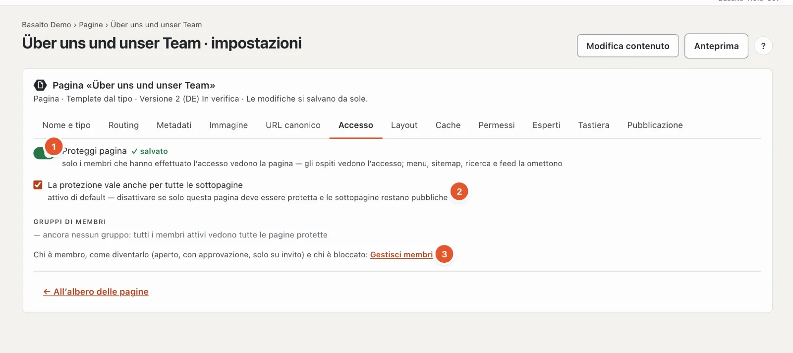
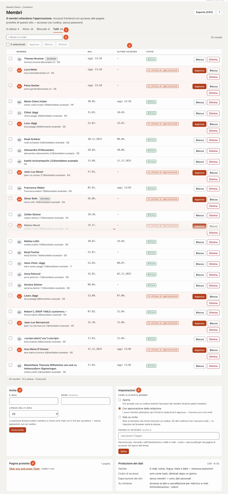

# Membri

Con il modulo «Membri» rende alcune pagine visibili solo ai membri che hanno effettuato l’accesso — un’area per l’associazione, documenti per i partner, verbali. I membri accedono **senza password**: inseriscono il loro indirizzo e-mail e ricevono un codice per e-mail. Nel backend vede tutti i membri del sito, approva quelli nuovi, li blocca e invia inviti.

## Dove

- Modalità «Contenuti» › **Membri** — l’elenco, gli inviti, le impostazioni e le pagine protette a colpo d’occhio. Il numero sulla voce di menu indica quanti membri attendono l’approvazione.
- Nelle impostazioni di ogni pagina, scheda **«Accesso»** — lì protegge una pagina.

La voce di menu compare solo se il modulo è attivato per il sito (modalità «Amministrazione» › «Siti», aprire il sito, scheda **«Moduli»**; di fabbrica disattivato — vedi [Il sito](../einrichtung/site.md#scheda-moduli)).

| Ruolo | Può |
| --- | --- |
| Redattore | visualizzare, approvare, bloccare e invitare membri; proteggere pagine |
| Amministratore, Gestore | inoltre eliminare iscrizioni, esportare l’elenco (CSV) e modificare le impostazioni |

## Proteggere una pagina

Apra le impostazioni della pagina (nell’albero delle pagine «Impostazioni»), scheda **«Accesso»**.

1. Attivi **«Proteggi pagina»**. La modifica si salva da sola e vale subito — anche per la versione già pubblicata.
2. **«La protezione vale anche per tutte le sottopagine»** è attivo di fabbrica: tutto ciò che sta sotto questa pagina è allora anch’esso riservato ai membri. Lo disattivi se deve essere protetta solo questa pagina.

Non esistono gruppi di membri: tutti i membri attivi vedono tutte le pagine protette del sito (per questo sotto «Gruppi di membri» compare «ancora nessun gruppo»). Il link **«Gestisci membri»** (3) porta all’elenco.

Si può proteggere anche una **cartella** — pratico per un’intera area riservata ai membri: tutte le pagine nella cartella sono protette.

Se una pagina si trova sotto una pagina protetta, la scheda «Accesso» mostra in alto «Protetta da «…»». In tal caso la pagina è protetta, qualunque cosa imposti su di essa — si può sbloccare solo sulla pagina superiore.

### Cosa vedono gli ospiti

- Al posto del contenuto una pagina **«Accesso richiesto»** con il modulo di accesso — né il titolo né il testo della pagina protetta. Se il sito ha una pagina di errore «401», il suo testo compare sopra.
- Le pagine protette mancano nel **menu**, così come nella **sitemap**, nella **ricerca**, negli **elenchi** e nei **feed**. I membri le vedono nel menu non appena hanno effettuato l’accesso.
- I motori di ricerca ricevono lo stato «401» e «noindex»; nulla di tutto ciò finisce nell’indice.

Le pagine protette non provengono mai dalla cache delle pagine. I membri che hanno effettuato l’accesso vedono sempre la pagina aggiornata, solo per sé.

### Se il modulo è disattivato

Le pagine protette restano protette — ma nessuno può accedere. Gli ospiti vedono solo «Questa pagina è riservata ai membri.». La redazione del sito vede sempre le pagine protette quando ha effettuato l’accesso al backend (anteprima, modifica sulla pagina).

## Come si diventa membri

Sotto «Membri» › **Impostazioni** un’amministratrice o un amministratore sceglie la regola per il sito:

| Regola | Cosa succede |
| --- | --- |
| **Aperta** | Chi accede con codice tramite l’accesso dei membri diventa subito membro. |
| **Con approvazione della redazione** (predefinita) | L’iscrizione nasce al primo accesso, ma resta in attesa finché la redazione non la approva. Il membro riceve quindi un’e-mail. |
| **Solo su invito** | Solo gli indirizzi invitati ricevono un codice. Per gli altri indirizzi non parte nulla — la risposta nel browser resta la stessa, affinché nessuno possa scoprire chi è membro. |

Con «Con approvazione» la campanella in alto a destra segnala le nuove richieste («… vorrebbe diventare membro»; più richieste stanno su una riga).

L’accesso si trova su ogni pagina protetta e sulla pagina di accesso del sito (`/account/login`). Nel tema Starter vi porta **«Accedi»** in alto a destra. Sotto **«Pagina di accesso»** può indicare invece una propria pagina su cui il Suo tema mostra l’accesso — un percorso che inizia con «/», al massimo 200 caratteri. Vale anche per i link nelle e-mail. «Salva» applica regola e pagina di accesso.

### Invitare

Sotto «Membri» › **Invita**: indirizzo e-mail, a scelta il nome, la lingua dell’e-mail — **«Invia invito»**. La persona diventa subito membro e riceve un’e-mail con le indicazioni per accedere; nell’elenco porta il contrassegno «invitato».

- Se l’indirizzo attende già l’approvazione, con l’invito diventa subito attivo.
- Se è già attivo, riceve soltanto di nuovo l’e-mail.
- Un indirizzo bloccato non riceve alcun invito; lo approvi prima di nuovo.

## L’elenco

1. **Stato** — «In attesa», «Attivo», «Bloccato», «Tutti», ognuno con il numero. Se ci sono membri in attesa, la pagina si apre direttamente su «In attesa».
2. **Cerca** per nome o e-mail.
3. **Dal** — quando è nata l’iscrizione; **Ultimo accesso** — «—» significa: non ha mai effettuato l’accesso.
4. **Invita** e 5. **Impostazioni** (regola e pagina di accesso), vedi sopra.
6. **Pagine protette** — tutte le pagine protette del sito con link, e il riquadro **Protezione dei dati**.

In ogni pagina compaiono 50 membri; sul telefono come schede una sotto l’altra.

Le azioni per ogni membro:

- **«Approva»** — l’iscrizione diventa attiva; chi era in attesa riceve un’e-mail. Così sblocca anche i membri bloccati.
- **«Blocca»** — la persona non vede più alcuna pagina protetta, anche se accede di nuovo.
- **«Elimina»** (Amministratore, Gestore) — l’iscrizione scompare. L’account dietro di essa resta, perché può per esempio avere licenze o voci nel Marketplace; una persona viene eliminata del tutto tramite la protezione dei dati (vedi sotto).

Con le spunte seleziona più membri insieme. **«Esporta (CSV)»** in alto a destra scarica l’elenco filtrato (e-mail, nome, lingua, stato, date) — con il punto e virgola come separatore, così che Excel lo apra direttamente. Ogni esportazione compare nel registro.

## Protezione dei dati

- Vengono salvati e-mail, nome, lingua, stato e date — **nessuna password**. I codici di accesso solo come somma di controllo; l’eliminazione notturna li rimuove dopo un giorno.
- **Informazioni e cancellazione** per indirizzo e-mail le gestisce l’amministrazione sotto «Amministrazione › Utenti» (oppure `php artisan basalto:privacy`): l’informazione indica account e iscrizioni; la cancellazione rimuove le iscrizioni e rende anonimo l’account.
- L’**esportazione di un sito** (trasferimento, modello) non porta con sé i membri — sono dati personali. Le pagine protette invece sì.

## Per autori di temi

I tag ``, `` e `` sono descritti in [Lava — il linguaggio dei temi](../entwickler/lava.md#tag-dei-membri).

## Domande frequenti

**Un membro non vede la pagina.**
Verifichi lo stato nell’elenco: «In attesa di approvazione» o «Bloccato» non aprono alcuna pagina protetta. E inoltre: la persona ha effettuato l’accesso nello stesso sito? Gli account valgono per sito.

**Vedo la pagina protetta, anche se non sono membro.**
Ha effettuato l’accesso al backend — la redazione del sito vede sempre le pagine protette. Esca oppure apra una finestra privata per vedere la pagina come un ospite.

**Non arriva nessun codice.**
Controlli la cartella spam. Se il sito è impostato su «Solo su invito», solo gli indirizzi invitati ricevono un codice.

## Per continuare

- [Commenti](kommentare.md)
- [Community](../community/README.md)
