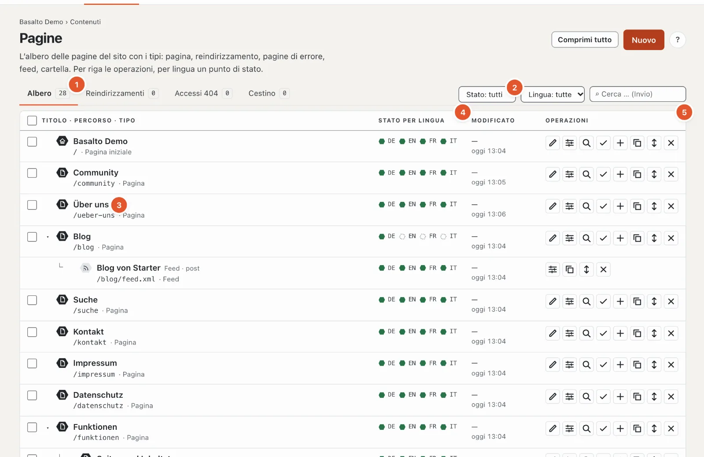
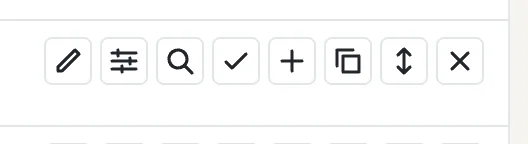
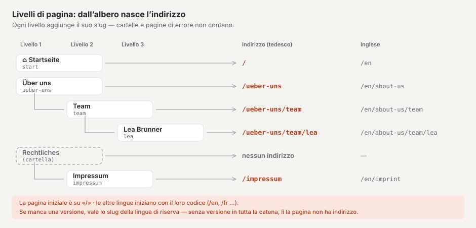
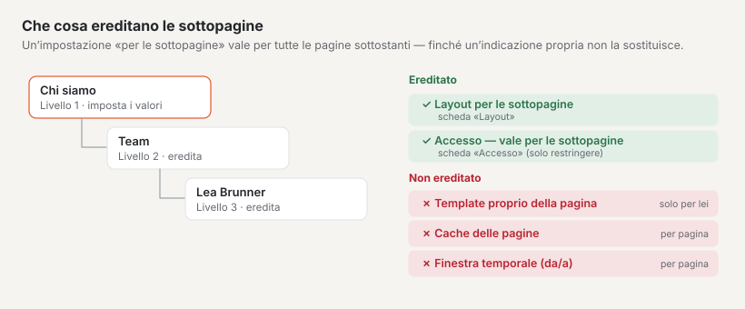
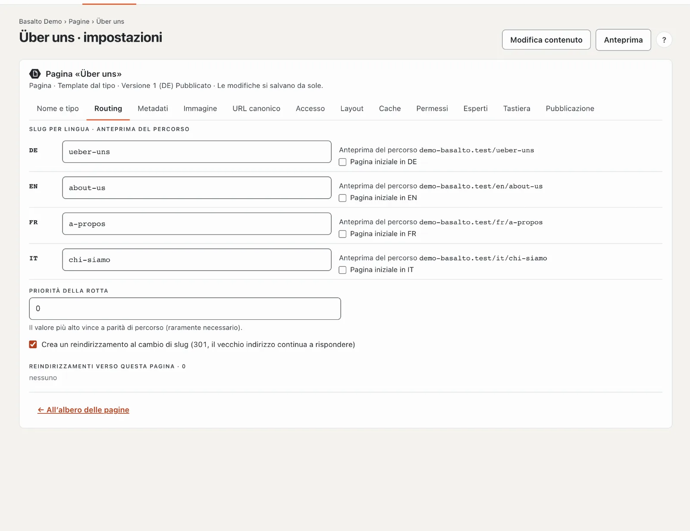
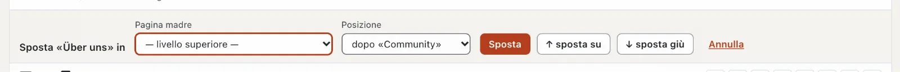

# Pagine e albero delle pagine

L’albero delle pagine mostra tutte le pagine del sito web nel loro ordine: in alto le pagine principali, rientrate sotto di esse
le sottopagine. Dall’albero nascono gli **indirizzi** delle pagine, i **menu** e le **briciole di pane** («Home › Chi siamo
› Team»). La posizione di una pagina nell’albero è quindi più che ordine — determina come i visitatori la trovano.

## Dove

Modalità «Contenuti» › **Pagine**. La pagina ha quattro schede: «Albero», «Reindirizzamenti», «Accessi 404» e «Cestino»; il numero
accanto indica quante voci ci sono.

## L’albero

Ogni riga mostra **Titolo**, **Percorso** e **Tipo** (3), accanto per ogni lingua un **punto di stato** (4) e a destra le
**Operazioni** (5). La legenda sotto l’albero spiega i punti:

| Punto | Significato |
| --- | --- |
| verde pieno | Pubblicato — i visitatori vedono questa versione |
| bordo verde | Approvato o pianificato — attende la pubblicazione |
| bordo rosso | In verifica — inviato per approvazione, attende l’approvazione |
| grigio | Bozza |
| tratteggiato | manca — in questa lingua non esiste ancora una versione |
| etichetta «obsoleta» | la traduzione si basa su una versione più vecchia della lingua predefinita (vedi [Tradurre](uebersetzen.md)) |

Sotto il titolo compaiono, secondo la situazione, delle indicazioni: «non pubblicato», «Cartella · solo struttura», «Feed · tipo» o, per un
reindirizzamento, «→ destinazione». La **Pagina iniziale** porta il simbolo di una casa.

| Pulsante (da sinistra) | Che cosa fa |
| --- | --- |
| ✎ Modifica contenuto | apre l’editor a blocchi della pagina (vedi [Modificare i contenuti con i blocchi](bloecke.md)) |
| ☰ Impostazioni | apre nome, indirizzo, metadati e le altre schede |
| ⌕ Anteprima | mostra la versione più recente così come apparirà |
| ✓ Approvazione | apre l’approvazione di questa pagina (vedi [Approvazione e pubblicazione](freigabe.md)) |
| ＋ Sottopagina | crea una nuova pagina **sotto** questa |
| ⧉ Copia | crea una copia subito dopo |
| ↕ Sposta | apre la riga per spostare (pagina madre e posizione) |
| ✕ Elimina | sposta la pagina con le sue sottopagine nel cestino |

Cartelle, feed e pagine di errore hanno meno pulsanti — non hanno un contenuto fatto di blocchi.

**Filtrare** (2): per stato e lingua agisce subito, la ricerca (sui titoli di tutte le lingue e sul percorso) con Invio.
Le pagine madri di un risultato restano visibili in modo sbiadito, così vede dove si trova; il filtro di stato nasconde
le cartelle. «Reimposta filtro» mostra di nuovo tutto. Con «Comprimi tutto» o «Espandi tutto» chiude o apre le
sottopagine; la freccia davanti a una riga chiude o apre solo le sue sottopagine.

## Livelli delle pagine: come dall’albero nasce l’indirizzo

Ogni pagina si trova su un **livello**: le pagine senza pagina madre sul livello 1 («— livello superiore —»), le loro sottopagine sul
livello 2, le sottopagine di queste sul livello 3 — in profondità quanto desidera; un limite non c’è. Nell’albero ogni livello è
un po’ più rientrato e agganciato alla pagina madre con «└».

L’**indirizzo** (il percorso) di una pagina è composto dagli slug di tutte le pagine madri e dal proprio slug, separati da
«/». Lo slug è la parte dell’indirizzo che inserisce per ogni lingua nella scheda «Routing».

- Solo **pagine, reindirizzamenti e feed** contribuiscono all’indirizzo. **Cartelle** e **pagine di errore** vengono
  saltate: le note legali nella cartella «Rechtliches» si trovano sotto `/impressum`, non sotto `/rechtliches/impressum`.
- La **Pagina iniziale** si trova su `/`; le sue sottopagine stanno direttamente sotto (`/kontakt`, non `/start/kontakt`).
- Le **altre lingue** iniziano con la loro sigla: `/en/about-us/team`. Ogni lingua ha i propri slug.
- Se **manca una versione** in una lingua, vale lo slug della lingua di riserva (vedi [Tradurre](uebersetzen.md#lingua-di-riserva));
  se in tutta la catena non c’è alcuna versione, la pagina in questa lingua non ha un indirizzo — l’anteprima del percorso indica allora
  che il percorso «non è ancora noto».

A che cosa servono i livelli:

- **Indirizzi parlanti:** `/leistungen/laravel` dice a visitatori e motori di ricerca dove si trovano.
- I **menu** nascono dall’albero (vedi sotto), e così le **briciole di pane**.
- Le **impostazioni si ereditano** verso il basso (vedi [Cosa ereditano le sottopagine](#cosa-ereditano-le-sottopagine)).

Una pagina un livello più in basso la crea cliccando, nella riga della futura pagina madre, su **«＋ Sottopagina»**
oppure scegliendo la **Pagina madre** al momento della creazione. Una pagina esistente la porta su un altro livello con **«Sposta»**.
Se così cambia l’indirizzo, Basalto reindirizza automaticamente il vecchio indirizzo.

### La pagina iniziale

Per ogni lingua c’è esattamente una pagina iniziale. La definisce nella scheda «Routing» con «Pagina iniziale in DE» (o EN …);
una nuova pagina iniziale sostituisce la precedente. Se non ne è scelta nessuna, in un’altra lingua vale la pagina iniziale della
lingua predefinita, altrimenti la prima pagina del livello superiore.

### Cosa ereditano le sottopagine

- **«Layout per le sottopagine»** (scheda «Layout») vale per tutte le pagine sottostanti, finché una pagina non sceglie essa stessa
  qualcos’altro.
- **Accesso:** se protegge una pagina con «vale per le sottopagine», sono protette anche tutte le pagine sottostanti; una
  sottopagina non può annullare la protezione (vedi [Membri](mitglieder.md)).
- **Non** si ereditano il template proprio di una pagina, la sua cache di pagina e la sua finestra temporale.

### Menu e briciole di pane

Quali livelli mostra un menu lo stabilisce il tema: da quale livello (livello di partenza) e per quanti livelli (di solito uno).
Nel menu compaiono solo pagine che i visitatori possono vedere. Non compaiono nel menu:

- le cartelle — le loro sottopagine ne prendono il posto,
- pagine di errore e feed,
- pagine fuori dalla loro finestra temporale e pagine protette, per gli ospiti,
- pagine con «Nascondi nel menu (resta raggiungibile)» (scheda «Esperti») — **insieme alle loro sottopagine**.

Un reindirizzamento nel menu porta direttamente alla sua destinazione. Le **briciole di pane** iniziano con la pagina iniziale, saltano
le cartelle e compaiono solo a partire da due voci.

## Creare una pagina

1. Clicchi in alto a destra su **«Nuovo»** — oppure, nella riga della futura pagina madre, su «＋ Sottopagina».
2. Scelga il **Tipo**. Determina quali schede ci sono e non si può più modificare in seguito:
   - **Pagina** — una pagina normale con contenuto fatto di blocchi (12 schede).
   - **Reindirizzamento** — reindirizza a un’altra pagina del sito («interno») o a un indirizzo esterno («esterno») (4
     schede). Per un reindirizzamento esterno, ogni lingua aggiuntiva può avere un proprio indirizzo, per esempio la
     versione inglese di un sito partner; un campo vuoto significa «come la lingua principale».
   - **Pagina di errore 401, 403, 404, 503** — la pagina che i visitatori vedono con questo codice di errore — per esempio 404, quando
     un indirizzo non viene trovato (5 schede).
   - **Feed** — un elenco delle voci più recenti di un tipo di contenuto come RSS 2.0 o Atom 1.0 (6 schede).
   - **Cartella** — struttura l’albero, non ha di per sé né indirizzo né contenuto (3 schede: nome, accesso, permessi).
3. Nella scheda «Nome e tipo» inserisca il **nome per ogni lingua** (al massimo 200 caratteri) e scelga la
   **Pagina madre**. Il nome compare nell’albero e nei menu.
4. Clicchi su **«Salva»** (oppure «Salva e nuovo» per la pagina successiva, «Salva e chiudi» per tornare
   all’albero).

Con il salvataggio nasce la prima versione — come bozza in ogni lingua per cui ha inserito un nome.
Il contenuto vero e proprio lo scrive poi tramite «✎ Modifica contenuto» nell’editor a blocchi. Se qualcosa non va, in alto compare
«N dati non sono corretti.» con l’elenco delle schede interessate; un clic porta lì.

Quando in seguito modifica le impostazioni, non c’è più un pulsante per salvare: **Le modifiche si salvano da sole.**
Un segno di spunta «✓ salvato» lo conferma.

### Regole per lo slug

- Sono ammessi lettere minuscole a–z, cifre e «-» (non all’inizio), al massimo 200 caratteri; per feed e sitemap
  può terminare con `.xml`.
- Se lo lascia vuoto, Basalto lo forma dal nome («Über uns» → `ueber-uns`).
- Se l’indirizzo in questa lingua è già occupato, Basalto ne propone uno libero («…-2»).

## Le schede delle impostazioni

| Scheda | Contenuto |
| --- | --- |
| Nome e tipo | Nome per lingua, pagina madre; per reindirizzamento e feed la loro destinazione o fonte |
| Routing | Slug per lingua con **Anteprima del percorso**, pagina iniziale per lingua, priorità della rotta, reindirizzamento al cambio di slug, reindirizzamenti verso questa pagina |
| Metadati | Titolo della pagina (al massimo 70 caratteri) e descrizione (160) per lingua con anteprima del risultato di ricerca, robots |
| Immagine | Immagine della pagina per la condivisione sui social network e per gli elenchi, con punto focale e testo alternativo |
| URL canonico | automatico o un indirizzo proprio |
| Accesso | Proteggere la pagina — solo per membri connessi, se desidera insieme alle sottopagine (modulo «Membri», vedi [Membri](mitglieder.md)) |
| Layout | Template della pagina (dal tipo o uno proprio) e «Layout per le sottopagine» |
| Cache | Cache di pagina per questa pagina attivata o disattivata, durata nel browser e nelle cache intermedie (da 0 a 31'536'000 secondi) |
| Permessi | persona responsabile e ruoli della pagina — determinanti per le autorizzazioni restano i ruoli del sito |
| Esperti | Visibilità nella sitemap HTML, nell’indice di ricerca e nel menu; classe CSS |
| Tastiera | un carattere (a–z o 0–9, univoco per sito): i visitatori saltano alla pagina con Alt o Ctrl+Alt + carattere |
| Pubblicazione | Stato della versione per lingua; finestra temporale «Mostra da» e «Mostra fino a» (formato AAAA-MM-GG HH:MM) |

**Priorità della rotta:** se due contenuti portano allo stesso indirizzo — per esempio una pagina e un contenuto con una propria
rotta —, vince quello con il numero più alto; a parità, il primo nell’albero. Raramente necessario.

**Finestra temporale:** fuori dalla finestra temporale la pagina risponde con «non trovata» e manca in menu, sitemap e
ricerca — la versione però resta pubblicata.

## Spostare

- **Trascinare:** afferri una riga in un punto qualsiasi e la trascini nel nuovo posto. Decide il punto in cui la rilascia:
  nel **terzo superiore** di una riga la pagina finisce **prima**, nel **terzo inferiore** **dopo**, al **centro**
  diventa **Sottopagina** di questa riga (solo per pagine e cartelle).
- **Con «↕ Sposta»:** la riga si apre. Scelga la nuova **Pagina madre** e la **Posizione** («all’inizio»
  o «dopo …») e confermi con «Sposta». Per piccoli passi ci sono «↑ sposta su» e «↓ sposta giù»;
  «Annulla» chiude la riga.

Non è possibile: mettere una pagina sotto sé stessa o sotto una delle sue sottopagine, sotto un reindirizzamento, un
feed o una pagina di errore (le pagine madri sono solo pagine e cartelle) — né farlo senza il diritto sulla lingua predefinita.

Se così cambia l’indirizzo di una pagina, Basalto crea automaticamente un **reindirizzamento** dal vecchio al nuovo
indirizzo — anche per tutte le sottopagine. Lo stesso accade quando una pagina viene pubblicata con un nuovo slug.
Si può disattivare per ogni pagina nella scheda «Routing» («Crea un reindirizzamento al cambio di slug»).

## Copiare

«⧉ Copia» chiede «Creare una copia?». Con «Sì» nasce, subito sotto l’originale, una pagina dello stesso tipo con le stesse
impostazioni. Il titolo riceve l’aggiunta «(copia)», lo slug termina con «-kopie», e ogni lingua inizia come
bozza. **Le sottopagine non vengono copiate.**

## Eliminare e cestino

«✕ Elimina» chiede conferma e sposta la pagina **con tutte le sottopagine** nel cestino. Sul sito web non sono più
raggiungibili.

Nella scheda **«Cestino»** compare ogni pagina eliminata con tipo, data di eliminazione e — se aveva sottopagine — «con N
sottopagine». **«Ripristina»** rimette la pagina con queste sottopagine al suo vecchio posto nell’albero. Una
sottopagina che aveva già eliminato prima singolarmente resta nel cestino finché non la ripristina Lei stesso.

## Più pagine in una volta

Metta i segni di spunta davanti alle righe desiderate (solo righe di tipo «Pagina», al massimo 500; il segno di spunta nell’intestazione le seleziona
tutte). In alto compare l’azione collettiva:

- **«Invia per approvazione»** — manda tutte le bozze delle pagine scelte in approvazione (solo se tutti i campi obbligatori
  sono compilati).
- **«Pubblica»** — pubblica le versioni già approvate o pianificate. Se il Suo ruolo non lo consente,
  il backend lo segnala.
- **«Elimina»** — sposta le pagine nel cestino.
- «Annulla selezione» rimuove tutti i segni di spunta.

Ciò che non è stato possibile lo indica poi il messaggio, con il titolo (i primi cinque).

## Reindirizzamenti

La scheda **«Reindirizzamenti»** elenca i reindirizzamenti da vecchi indirizzi (i 500 più recenti). La colonna «Origine»
dice come sono nati: «automatico» (con lo spostamento o il cambio di slug), «a mano» o «importazione».

**Creare un reindirizzamento a mano:**

1. In **«Indirizzo vecchio»** inserire il percorso, per esempio «/vecchia-pagina».
2. In **«Destinazione»** inserire il nuovo indirizzo («/nuova-pagina» o un indirizzo completo con https://).
3. Scegliere lo stato: **301 permanente**, **302 temporaneo** o **410 rimosso** (senza destinazione — l’indirizzo segnala
   allora «non esiste più»).
4. Cliccare su **«Crea»**. Se per il vecchio indirizzo esiste già un reindirizzamento, viene sostituito.

Molti reindirizzamenti in una volta li riprende con **«Importa CSV …»**: per ogni riga «indirizzo vecchio; destinazione; stato»
(punto e virgola, virgola o tabulazione; stato vuoto significa 301), al massimo 2 MB e 5000 righe. Le righe errate le indica
poi il messaggio (le prime 50). Le catene (A → B → C) le risolve Basalto da sé: A porta direttamente a C.

I reindirizzamenti esistenti li modifica direttamente nella riga con «Modifica»: Invio o uscita dal campo salva, Esc
annulla. «Rimuovi» elimina il reindirizzamento — il vecchio indirizzo risponde poi con «non trovata». La colonna
«Accessi» mostra quante volte un reindirizzamento è già stato usato.

## Accessi 404

La scheda **«Accessi 404»** mostra indirizzi che i visitatori hanno richiamato ma che non esistono — i più frequenti
prima (fino a 200), con numero, primo e ultimo accesso e la pagina da cui provenivano.

- **«Crea reindirizzamento»** — inserisca la destinazione; la riga è così sbrigata.
- **«Scarta»** — rimuove la riga. Se l’indirizzo viene richiamato di nuovo, viene ricontato.

Gli indirizzi senza nuovi accessi li elimina una pulizia notturna dopo 90 giorni (il termine si può modificare in «Amministrazione ›
Impostazioni», gruppo «Conservazione»). Se ci sono accessi 404 aperti, nella «Panoramica» compare un’attività
relativa.

## Domande frequenti

**Non trovo lo slug nell’editor.**
Slug, metadati e visibilità di una pagina si trovano nelle impostazioni («☰ Impostazioni», schede «Routing» e
«Metadati»), non nell’editor a blocchi.

**Posso cambiare il tipo di una pagina?**
No, il tipo resta quello scelto alla creazione. Crei una nuova pagina con il tipo desiderato e sposti le
sottopagine.

**Ho spostato una pagina — i vecchi link ora sono rotti?**
No. Il reindirizzamento automatico porta visitatori e motori di ricerca al nuovo indirizzo. Lo vede nella scheda
«Reindirizzamenti».

**Perché la mia pagina non è nel menu?**
Verifichi: si trova su un livello che il menu del tema mostra? È impostato «Nascondi nel menu (resta raggiungibile)» — per essa o
per una pagina madre? È pubblicata e nella finestra temporale? È protetta e Lei sta guardando come ospite?

**A che cosa servono le cartelle invece delle pagine?**
Una cartella raggruppa pagine nell’albero senza allungare l’indirizzo — utile per «Rechtliches» con note legali e
protezione dei dati, che devono comunque trovarsi sotto `/impressum` e `/datenschutz`.

## Per continuare

- [Modificare i contenuti con i blocchi](bloecke.md)
- [Approvazione e pubblicazione](freigabe.md)
- [Menu](../einrichtung/menues.md)
