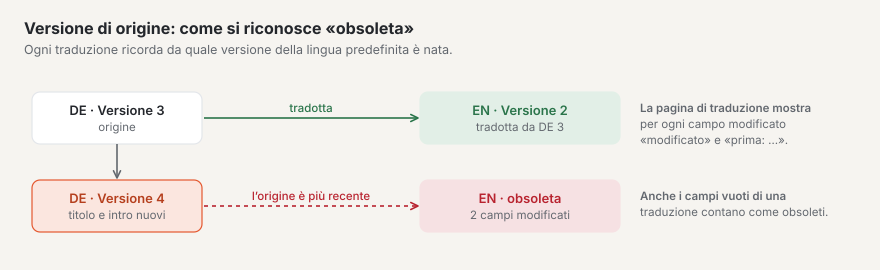
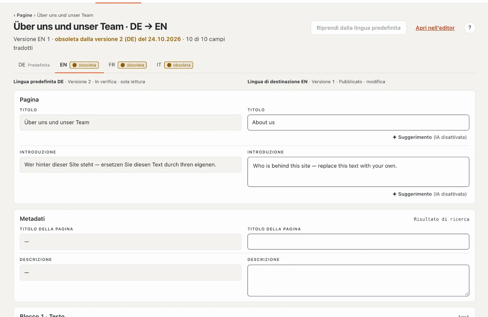
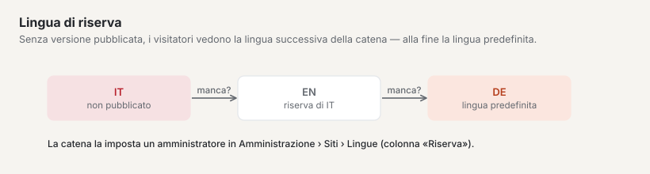
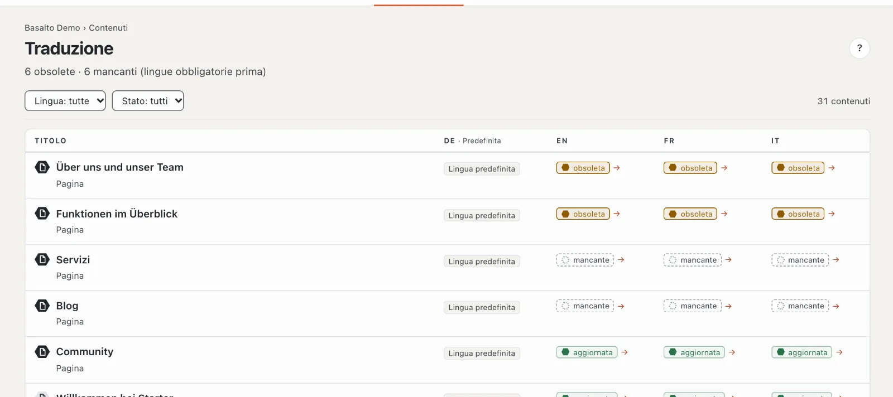

# Tradurre

Se il Suo sito ha più lingue, ogni traduzione nasce dalla **lingua predefinita**. Basalto ricorda su quale versione della lingua predefinita si basa una traduzione e Le mostra se nel frattempo lì è cambiato qualcosa.

## Dove

- Modalità «Contenuti» › **Traduzione** — l’elenco di tutti i contenuti con traduzioni mancanti o obsolete.
- Nell’editor di un contenuto in una lingua diversa dalla lingua predefinita: **«Traduci affiancato»**.

## Che cosa si traduce

Si traducono i testi: titolo, introduzione, titolo della pagina e descrizione, oltre ai campi di testo e di testo formattato che il tema contrassegna come traducibili.

Tutto il resto — per esempio immagini, numeri o campi di selezione — è **condiviso**: vale per tutte le lingue e si gestisce solo nella lingua predefinita. Questi campi portano l’etichetta «condiviso».

## Lo stato di una traduzione

| Stato | Significato |
| --- | --- |
| **aggiornata** | la traduzione corrisponde alla versione più recente della lingua predefinita e tutti i campi traducibili sono compilati |
| **obsoleta** | un campo traducibile della lingua predefinita è cambiato dopo la traduzione — oppure nella traduzione ci sono campi vuoti che nella lingua predefinita hanno un testo |
| **mancante** | in questa lingua non esiste ancora una versione |

Una nuova immagine da sola non rende obsoleta una traduzione — solo un testo modificato.

## Creare una traduzione

1. Apra la traduzione — dall’elenco «Traduzione» (un clic sullo stato della lingua nella riga) oppure nell’editor con «Traduci affiancato».
2. Se nella lingua di destinazione non esiste ancora una versione, clicchi su **«Crea traduzione da …»**. Basalto crea una bozza basata sulla versione attuale della lingua predefinita. Senza permesso per questa lingua o senza una versione della lingua predefinita il pulsante è bloccato.
3. Traduca campo per campo: **a sinistra** il testo della lingua predefinita (sola lettura), **a destra** il Suo campo nella lingua di destinazione. Le intestazioni delle colonne indicano lingua, versione, stato e «sola lettura» o «modifica». I campi sono suddivisi in sezioni: pagina (titolo, introduzione), metadati (titolo della pagina, descrizione) e una per ogni blocco. Sotto i 1024 px di larghezza, origine e destinazione stanno una sotto l’altra.
4. Il salvataggio avviene automaticamente poco più di un secondo dopo l’ultima immissione, non appena il titolo è tradotto. Un «✓ salvato» accanto al campo lo conferma. I campi di testo contengono al massimo 300 caratteri, le aree di testo 5000; se qualcosa non va, in alto compare «N campi non sono corretti». Se Lei può modificare la lingua, Basalto lo verifica al salvataggio.

Un campo di destinazione vuoto ha un bordo tratteggiato e l’indicazione «Traduzione mancante …».

Utile:

- **«→ applica»** accanto a un campo vuoto copia il testo della lingua predefinita nel Suo campo — comodo per nomi o termini tecnici che restano uguali.
- **«Riprendi dalla lingua predefinita»** in alto riempie tutti i campi ancora vuoti con il testo della lingua predefinita.
- **«Suggerimento»** accanto a un campo fa tradurre all’IA, se il modulo «Suggerimenti IA» è configurato (vedi [Suggerimenti IA](ki.md)); altrimenti lì compare «(IA disattivata)».
- Il contatore «… di … campi tradotti» mostra a che punto è; i campi vuoti nella lingua predefinita non vengono contati.

## Aggiornare una traduzione obsoleta

Se una traduzione è obsoleta, la pagina di traduzione mostra in alto «obsoleta dalla versione … del …». I campi modificati portano l’etichetta **«modificato»** e mostrano sotto «prima:» il testo precedente della lingua predefinita. Così vede esattamente che cosa è nuovo e adatta solo quei punti.

## Inviare e approvare

Ogni lingua ha le proprie versioni e passa l’approvazione per conto suo. Quando la traduzione è pronta, la invii — con «Apri nell’editor» e lì «Invia per approvazione». Se la versione della lingua di destinazione è già stata inviata o pubblicata, il salvataggio crea una nuova bozza; la versione online resta online. Maggiori dettagli in [Approvazione e pubblicazione](freigabe.md).

## Lingue obbligatorie

Una **lingua obbligatoria** deve esistere prima che un contenuto possa essere approvato. La lingua predefinita è sempre obbligatoria. Se manca una lingua obbligatoria, l’approvazione è bloccata con l’indicazione «Approvazione solo con tutte le lingue obbligatorie — mancano: …». Una lingua conta come presente non appena è almeno inviata.

Nelle schede delle lingue in alto, per le lingue obbligatorie compare «Obbligatoria». Le traduzioni mancanti o obsolete nelle lingue obbligatorie compaiono inoltre come attività nella «Panoramica».

## Lingua di riserva

Se in una lingua manca la versione pubblicata, visitatrici e visitatori vedono la versione della **lingua di riserva** — e se nemmeno lì ce n’è una, la successiva nella catena fino alla lingua predefinita. La pagina di traduzione lo segnala («i visitatori vedono la lingua di riserva …»).

Quali lingue sono obbligatorie e quale lingua di riserva vale lo stabilisce un’amministratrice o un amministratore: «Amministrazione › Siti», aprire il sito, scheda **«Lingue»** (colonne «Predefinita», «Obbligatoria» e «Riserva»).

## La panoramica «Traduzione»

In alto compare «N obsolete · N mancanti». L’elenco mostra per ogni contenuto (pagine e contenuti, fino a 500) lo stato in ogni lingua: prima i contenuti con lacune nelle **lingue obbligatorie**, poi quelli con lacune in altre lingue, poi il resto — a ogni livello, i modificati più di recente per primi. L’intestazione di ogni colonna indica «Predefinita» o «Obbligatoria»; un esagono davanti al titolo distingue pagina e contenuto. Filtri per **lingua** (la lingua predefinita non è selezionabile) e per **stato** («obsoleta» o «mancante»); «Reimposta filtro» mostra di nuovo tutto. Un clic sullo stato di una lingua apre la traduzione. Quando tutto è fatto compare «Tutto tradotto», con un filtro senza risultati «Nessun risultato».

Il numero accanto a «Traduzione» nel menu mostra quanto resta ancora da fare.

## Domande frequenti

**Posso tradurre anche direttamente nell’editor normale?**
Sì. Nell’editor della lingua di destinazione «Crea traduzione da …» crea una bozza con i blocchi della lingua predefinita, che poi sovrascrive. La vista «Traduci affiancato» è però più chiara, perché il testo di partenza sta proprio accanto al Suo campo.

**Non riesco a modificare un campo.**
Se compare «Vale per tutte le lingue — si gestisce nella lingua predefinita», il campo è condiviso. Lo modifichi nell’editor della lingua predefinita. Se nell’intestazione della colonna compare «sola lettura», il Suo ruolo non consente questa lingua (i ruoli possono essere limitati a determinate lingue).

**Perché la mia traduzione è «obsoleta» anche se non ho cambiato nulla?**
Qualcuno ha modificato un testo traducibile nella lingua predefinita — l’etichetta «modificato» Le mostra quale campo. Oppure nella Sua traduzione c’è un campo vuoto che nella lingua predefinita ha un testo.

## Per continuare

- [Approvazione e pubblicazione](freigabe.md)
- [Il sito](../einrichtung/site.md)
