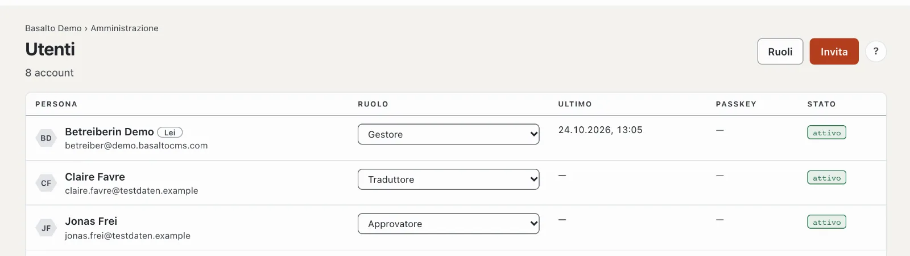
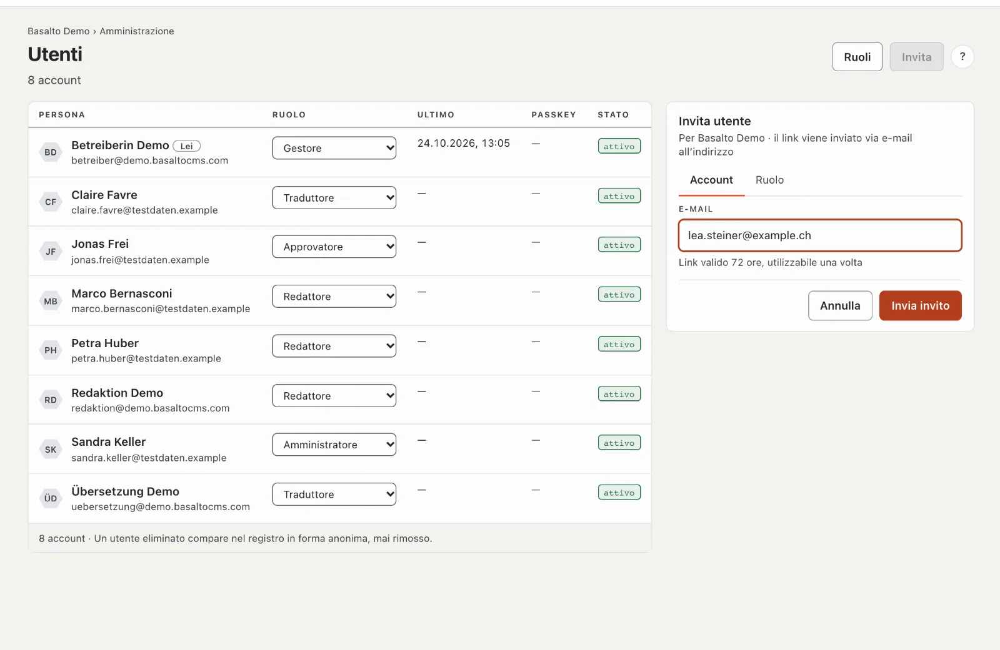
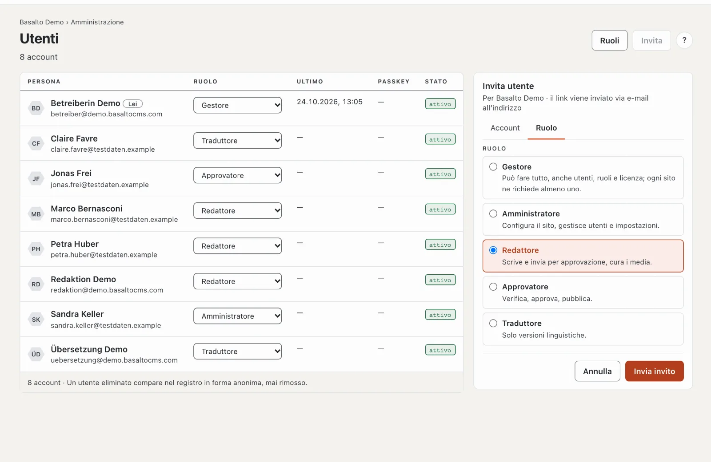
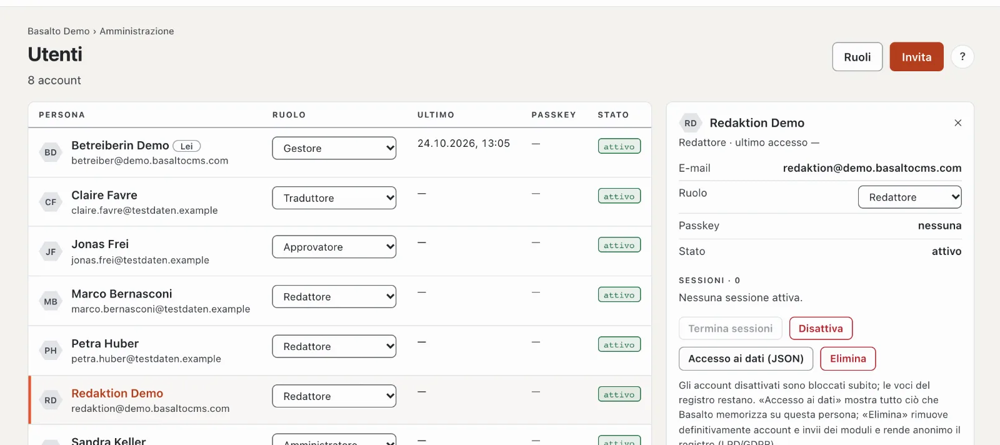

# Utenti

Sotto **Utenti** vede tutte le persone con accesso al sito attuale, ne invita di nuove e assegna i ruoli. Qui disattiva account, termina sessioni e soddisfa richieste di accesso ai dati e di cancellazione.

## Dove

Modalità «Amministrazione» › **Utenti**.

Una riga per persona con nome ed e-mail («Lei» contrassegna il Suo account), **Ruolo** in questo sito, **Ultimo** (ultimo accesso), **Passkey** (quanti) e **Stato** («attivo», «disattivato», «invitato»). Un clic su una riga apre a destra la scheda della persona. In alto **«Ruoli»** porta alla [matrice dei ruoli](rollen.md).

## Invitare qualcuno

1. **«Invita»** apre a destra la scheda «Invita utente» per il sito attuale.
2. Scheda **Account**: l’**indirizzo e-mail**. Il link nell’invito è **valido 72 ore e utilizzabile una sola volta** (il termine lo imposta sotto [Impostazioni](einstellungen.md), gruppo «Accesso»).
3. Scheda **Ruolo**: scegliere il ruolo — ognuno con una frase che dice che cosa può fare.
4. **«Invia invito»**.

La persona apre il link e ha così effettuato l’accesso; in futuro accede con un codice via e-mail o un passkey. Fino ad allora compare nell’elenco come «invitato», con «valido fino al …» e «invitato da …». Un nuovo invito allo stesso indirizzo sostituisce quello aperto.

Per un invito aperto:

- **«Invia di nuovo»** — un nuovo link, il termine ricomincia.
- **«Ritira»** — dopo la domanda «Ritirare?» con «Sì» il link non è più valido.
- Se il termine è scaduto, compare «invitato · scaduto». Invii di nuovo l’invito.

Se l’indirizzo appartiene già a questo sito, Basalto rifiuta l’invito — il ruolo lo cambia allora nell’elenco. Se la persona ha un account in un altro sito, con l’invito riceve anche un ruolo in questo.

## Cambiare il ruolo

Scelga un altro ruolo nella colonna **Ruolo** — la modifica vale subito e compare nel registro. Valgono due regole:

- **Non regalare diritti:** assegna solo ruoli che non possono fare più di Lei. Il ruolo «Gestore» lo assegna solo un gestore.
- **Almeno un gestore:** nessuno può declassare l’ultimo gestore di un sito.

## La scheda della persona

La scheda mostra e-mail, ruolo, passkey, stato e le **sessioni** (dove la persona ha effettuato l’accesso in questo momento). Sotto:

- **«Termina sessioni»** — disconnette la persona ovunque, per esempio dopo la perdita di un dispositivo.
- **«Disattiva»** — blocca l’account: tutte le sessioni terminano subito, l’accesso non è più possibile. Dopo la domanda «Disattivare …?» con «Sì, disattiva». **«Attiva»** lo annulla. Le voci del registro restano. Il proprio account non si può disattivare; le proprie sessioni le termina nel profilo.
- **«Accesso ai dati (JSON)»** — tutto ciò che Basalto salva su questa persona, come file: per una richiesta secondo la LPD/il GDPR.
- **«Elimina»** — rimuove **definitivamente** l’account e gli invii dei moduli con questo indirizzo e-mail; nel registro non resta alcun nome, le voci compaiono in forma anonima. Non si può annullare.

L’**indirizzo e-mail** di una persona al momento non si può modificare nel backend; in caso di cambio crei un nuovo account ed elimini quello vecchio.

## Domande frequenti

**L’invito non arriva.**
Controlli la cartella spam e se l’installazione può inviare e-mail (vedi [Esercizio](betrieb.md)). Con «Invia di nuovo» parte un nuovo link.

**Non riesco ad assegnare a una persona il ruolo «Amministratore».**
Il Suo ruolo può fare meno di un amministratore — i diritti che non si hanno non si assegnano.

**Disattivare o eliminare?**
Disattivare, finché la persona potrebbe tornare o le sue tracce devono restare ricostruibili. Eliminare solo su richiesta secondo la LPD/il GDPR — è definitivo.

## Per continuare

- [Ruoli](rollen.md)
- [Registro](protokoll.md)
