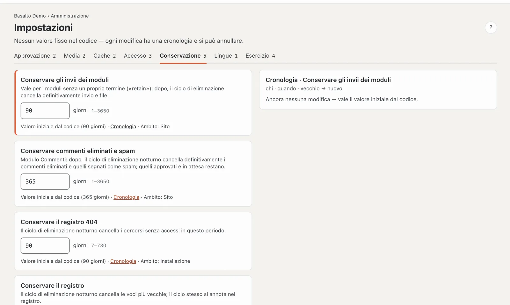
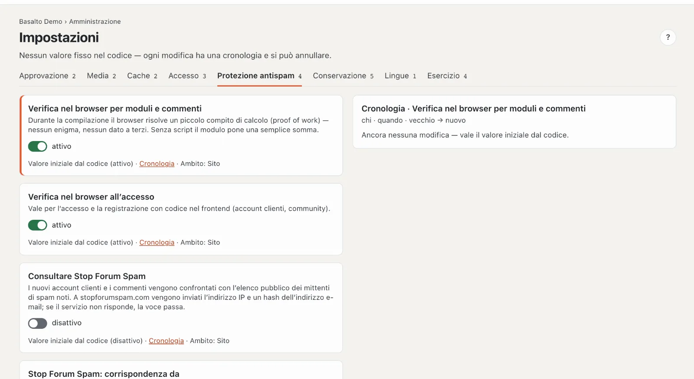

# Impostazioni

Sotto **Impostazioni** si trovano i termini, gli interruttori e i limiti di Basalto — nessun valore fisso nel codice. Ogni modifica ha una **cronologia** e si può annullare.

## Dove

Modalità «Amministrazione» › **Impostazioni**. In alto una scheda per gruppo con il numero dei suoi valori: Approvazione, Media, Cache, Accesso, Conservazione, Lingue, Esercizio.

Una scheda per valore:

- **Nome** e che effetto ha il valore.
- Il **campo** — un interruttore o un numero con unità e intervallo consentito (per esempio «Giorni 1–3650»).
- Sotto: **«Valore iniziale dal codice (…)»**, finché nessuno l’ha modificato, altrimenti **«Modificato da … il …»**; **«Cronologia»**; e **«Ambito»** — se il valore vale per l’intera **installazione** o solo per questo **sito**.

Le modifiche si salvano da sole («salvataggio …», poi «salvato»). Se un valore è fuori dall’intervallo, l’errore compare accanto al campo e non viene salvato nulla. Senza il diritto di modifica i campi sono bloccati («sola lettura»).

## Cronologia e annullamento

**«Cronologia»** mostra a destra ogni modifica di questo valore: chi, quando, vecchio → nuovo. **«Ripristina»** su una voce riporta il valore a quello stato precedente — anche questo compare poi nella cronologia e nel [registro](protokoll.md). Senza modifiche compare «Ancora nessuna modifica — vale il valore iniziale dal codice.».

## Tutti i valori

| Gruppo | Impostazione | Predefinito | Intervallo | Vale per | Effetto |
| --- | --- | --- | --- | --- | --- |
| Approvazione | Principio dei quattro occhi | disattivato | — | Sito | Chi invia per approvazione non può approvare la propria versione. |
| Approvazione | Conservare le versioni archiviate | 50 | 0–1000 | Sito | per contenuto e lingua; le versioni archiviate più vecchie le elimina il ciclo di eliminazione; 0 = conservarle tutte |
| Media | Testo alternativo obbligatorio | disattivato | — | Sito | La pubblicazione senza testo alternativo per lingua viene respinta (anche nelle impostazioni del sito). |
| Media | Cestino della mediateca | 30 giorni | 1–365 | Installazione | poi il ciclo di eliminazione elimina definitivamente originale e varianti |
| Cache | Cache delle pagine | attivo | — | Sito | Le pagine arrivano pronte dalla cache; ogni pubblicazione la invalida e preriscalda la pagina. Singole pagine le esclude nella scheda «Cache» della pagina. |
| Cache | Pagine nella cache al massimo | 24 ore | 1–168 | Sito | poi la richiesta successiva esegue di nuovo il rendering, anche senza modifiche |
| Accesso | Validità del codice di accesso | 10 minuti | 2–60 | Installazione | per quanto tempo vale il codice dell’e-mail |
| Accesso | Nuovo codice al più presto dopo | 30 secondi | 0–600 | Installazione | «Invia di nuovo il codice» conta alla rovescia questo tempo dopo l’ultimo codice; 0 = subito |
| Accesso | Validità dei link monouso | 60 minuti | 5–1440 | Installazione | link da installer e console |
| Accesso | Validità di un invito | 72 ore | 1–720 | Installazione | vedi [Utenti](benutzer.md) |
| Protezione antispam | Verifica nel browser per moduli e commenti | attiva | sì/no | Sito | compito di calcolo in background (proof of work), senza enigmi; senza script una semplice somma |
| Protezione antispam | Verifica nel browser all’accesso | attiva | sì/no | Sito | accesso e registrazione con codice nel frontend |
| Protezione antispam | Consultare Stop Forum Spam | disattivata | sì/no | Sito | nuovi account clienti e commenti confrontati con l’elenco pubblico dei mittenti di spam noti; a stopforumspam.com vanno l’indirizzo IP e un hash dell’indirizzo e-mail |
| Protezione antispam | Stop Forum Spam: corrispondenza da | 80 percento | 1–100 | Sito | livello di confidenza dell’elenco a partire dal quale una voce è considerata spam |
| Statistiche | Contare le visite | attivo | attivo/disattivo | Sito | contare le visualizzazioni e mostrare le impostazioni dei cookie; visitatori e sessioni solo con consenso (vedi [Statistiche](statistik.md)) |
| Conservazione | Conservare gli invii dei moduli | 90 giorni | 1–3650 | Sito | per moduli senza termine proprio; poi il ciclo di eliminazione elimina invio e file |
| Conservazione | Conservare commenti eliminati e spam | 365 giorni | 1–3650 | Sito | modulo Commenti; quelli approvati e in attesa restano |
| Conservazione | Conservare il registro 404 | 90 giorni | 7–730 | Installazione | i percorsi senza accessi in questo periodo vengono eliminati |
| Conservazione | Conservare il registro | 365 giorni | 30–3650 | Installazione | le voci più vecchie le elimina il ciclo di eliminazione |
| Conservazione | Conservare le statistiche | 400 giorni | 30–1095 | Installazione | la pulizia elimina le visualizzazioni più vecchie |
| Conservazione | Conservare i backup | 7 | 1–365 | Installazione | i backup più vecchi nella stessa cartella vengono eliminati |
| Lingue | Lingue obbligatorie prima dell’approvazione | — | — | Sito | un rimando: lingue obbligatorie e lingua di riserva si trovano presso le lingue del sito («Apri →») |
| Esercizio | Soglia del battito | 5 minuti | 2–60 | Installazione | se l’ultimo battito è più vecchio, l’indirizzo di stato segnala «con problemi» |
| Esercizio | Allarme errori da | 20 eccezioni | 0–100'000 | Installazione | tanti errori nella finestra fanno partire un’e-mail a titolare e amministrazione dell’account dell’installazione; 0 = nessun allarme |
| Esercizio | Finestra dell’allarme errori | 5 minuti | 1–60 | Installazione | su quale periodo si conta |
| Esercizio | Pausa dopo un allarme errori | 60 minuti | 5–1440 | Installazione | per tutto questo tempo non arriva un’altra e-mail |
| Esercizio | Dati di utilizzo per il produttore | attivo | attivo/disattivo | Installazione | il controllo degli aggiornamenti invia un identificativo casuale, la versione, PHP e il tipo di database — nessun indirizzo, nessun contenuto (vedi [Aggiornamenti](updates.md)) |

Il **ciclo di eliminazione** viene eseguito ogni notte ed elimina ciò che ha raggiunto i termini — definitivamente. Si annota da sé nel registro.

## Domande frequenti

**Un valore vale per l’installazione — perché lo vedo in ogni sito?**
I valori con «Ambito: Installazione» valgono allo stesso modo per tutti i siti; una modifica ha effetto ovunque.

**Ho modificato qualcosa per sbaglio.**
Apra la «Cronologia» e scelga «Ripristina» sullo stato precedente.

## Per continuare

- [Registro](protokoll.md)
- [Esercizio](betrieb.md)
