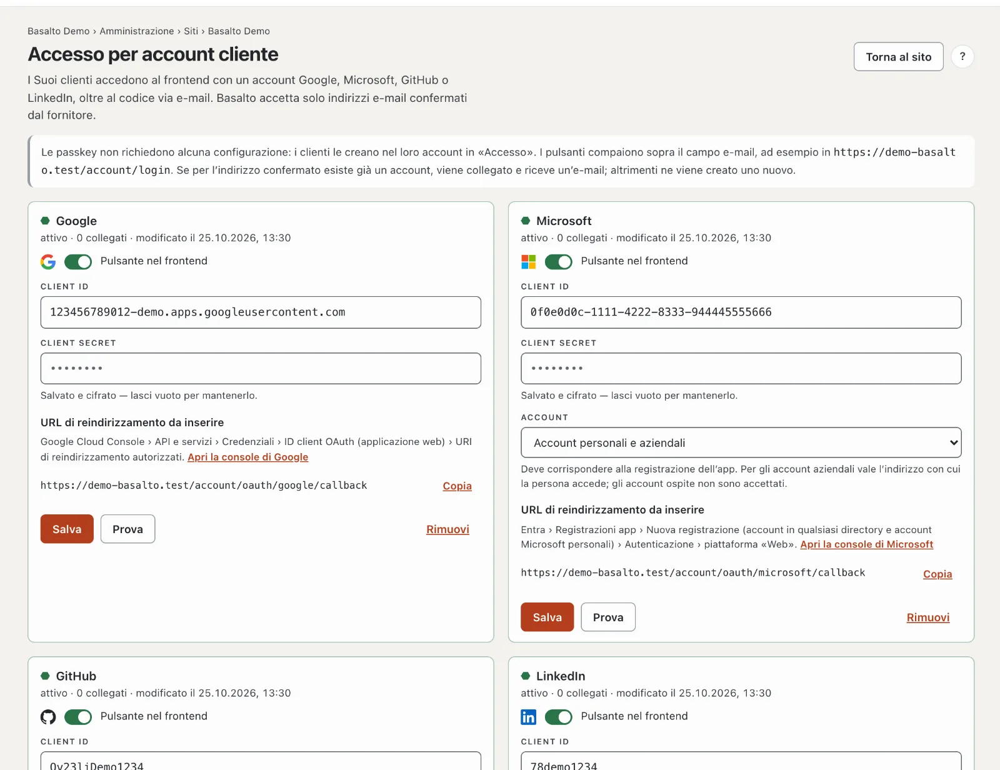
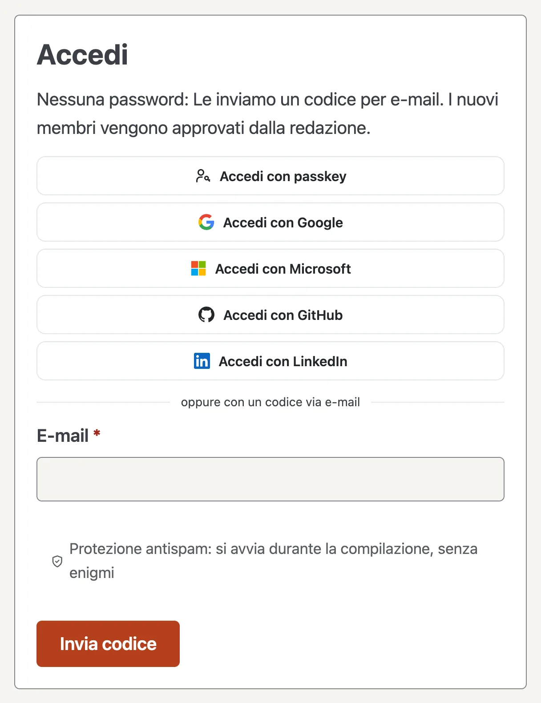

# Accesso per account cliente

I Suoi clienti accedono al frontend con una passkey o con un account Google, Microsoft, GitHub o LinkedIn, oltre al codice via e-mail. Vale ovunque entri in gioco l’account cliente: forum, membri, vendita licenze e marketplace.

## Come appare nel frontend

Sopra il campo e-mail compaiono «Accedi con passkey» e i pulsanti dei fornitori attivati, seguiti da «oppure con un codice via e-mail».

- **Se per l’indirizzo esiste già un account cliente,** Basalto vi fa accedere la persona e, la prima volta, collega l’account del fornitore. L’account cliente riceve un’e-mail al riguardo («Nuovo accesso con Google»). Da quel momento conta l’ID presso il fornitore: se qualcuno vi cambia l’indirizzo, l’accesso continua a funzionare.
- **Altrimenti viene creato un nuovo account cliente**, ma solo se il sito ammette nuovi account. Se i membri sono impostati su «solo su invito», con un fornitore accedono solo gli account esistenti.
- **Nell’account** la sezione **«Accesso»** mostra gli account collegati. **Collega** funziona anche con un account che ha un altro indirizzo; **Scollega** rimuove il collegamento. Il codice via e-mail funziona sempre.

## Codice via e-mail

Chi inserisce il proprio indirizzo e-mail riceve un codice di sei cifre. L’e-mail lo mostra in grande in caselle e sotto, in piccolo, come sequenza di cifre — un doppio clic seleziona l’intero codice da copiare.

- **Una casella per cifra.** Digitando si passa avanti, il tasto di cancellazione torna indietro; incollando o con il completamento automatico del telefono si riempie tutto il codice.
- **Nessun pulsante necessario.** Quando ci sono tutte e sei le cifre, l’accesso prosegue da sé. Un codice errato svuota le caselle.
- **«Invia di nuovo il codice»** conta alla rovescia dopo ogni codice e poi si attiva. La durata si imposta in [Impostazioni](einstellungen.md): gruppo «Accesso», **«Nuovo codice al più presto dopo»** (predefinito 30 secondi).
- Senza JavaScript resta un solo campo con «Accedi».

## Passkey

Le passkey non richiedono alcuna configurazione. Chi ha effettuato l’accesso ne crea una nell’account in **«Accesso» › Aggiungi passkey**, confermata con impronta digitale, volto o blocco del dispositivo. Dopo basta **«Accedi con passkey»**, senza alcun codice.

- **Il pulsante compare solo** se il browser supporta le passkey; altrimenti resta il codice via e-mail.
- **Una passkey vale per il dominio** su cui è stata creata. Se il sito ha più domini, è meglio che i Suoi clienti la creino sull’indirizzo principale.
- **Ogni nuova passkey** invia un’e-mail all’account. **Rimuovi** nell’account la elimina nel sito; sul dispositivo la elimina la persona stessa.

## Configurare

1. Apra **Amministrazione › Siti ›** il Suo sito **› Accesso per account cliente**.
2. Crei un’app presso il fornitore (istruzioni sotto) e vi inserisca l’**URL di reindirizzamento** di Basalto: **Copia** la riprende esattamente.
3. In Basalto inserisca **Client ID** e **Client secret**, attivi **Pulsante nel frontend** e clicchi su **Salva**.
4. **Prova:** accede una volta davvero presso il fornitore. Poi in alto compare il risultato, ad esempio «Google ha confermato l’account …». Non viene creato alcun account cliente.

Possono configurare il gestore del sito e il proprietario e l’amministrazione dell’account. I pulsanti compaiono solo se un modulo del sito usa l’account cliente (forum, membri, vendita licenze o marketplace).

## Google

1. Nella [Google Cloud Console](https://console.cloud.google.com) scelga o crei un progetto.
2. **API e servizi › Schermata di consenso OAuth:** tipo di utente **Esterno**, nome dell’app, indirizzo di assistenza e logo. Ambiti: `openid`, `email`, `profile`. Poi **pubblichi** l’app: in modalità test possono accedere solo gli utenti di test registrati.
3. **Credenziali › Crea credenziali › ID client OAuth**, tipo di applicazione **Applicazione web**.
4. **URI di reindirizzamento autorizzati:** gli URL di reindirizzamento di Basalto.
5. Inserisca in Basalto il **Client ID** (termina con `.apps.googleusercontent.com`) e il **client secret**.

## Microsoft

1. Nell’[interfaccia di amministrazione di Microsoft Entra](https://entra.microsoft.com) vada su **Registrazioni app › Nuova registrazione**.
2. **Tipi di account supportati:** «Account in qualsiasi directory organizzativa e account Microsoft personali»: in Basalto scelga poi «Account personali e aziendali» in **Account**. Oppure «Solo account Microsoft personali»: in Basalto «Solo account personali». Le due impostazioni devono corrispondere.
3. **URI di reindirizzamento:** piattaforma **Web**, l’URL di reindirizzamento di Basalto. Altri indirizzi in **Autenticazione**.
4. Copi l’**ID applicazione (client)** dalla panoramica. In **Certificati e segreti › Nuovo segreto client** copi il **valore** (non l’ID) e lo inserisca. Annoti la data di scadenza e inserisca per tempo un nuovo segreto.
5. **Autorizzazioni API:** Microsoft Graph, delegate: `openid`, `profile`, `email`, `User.Read`.

**Quale indirizzo conta:** per gli account personali l’indirizzo dell’account Microsoft, per gli account aziendali il nome di accesso (UPN), non il campo «E-mail», che l’amministrazione di una directory può impostare liberamente. Gli account ospite (`…#EXT#@…`) vengono rifiutati.

## GitHub

1. **GitHub › Settings › Developer settings › OAuth Apps › New OAuth App**; per un’organizzazione, nelle sue impostazioni.
2. **Homepage URL:** l’indirizzo del sito. **Authorization callback URL:** l’URL di reindirizzamento dell’indirizzo principale: GitHub accetta un solo indirizzo per app.
3. Copi il **Client ID**, clicchi su **Generate a new client secret** e inserisca il secret.

Con GitHub, Basalto accetta solo l’indirizzo principale confermato dell’account.

## LinkedIn

1. Su [LinkedIn Developers](https://www.linkedin.com/developers/apps) clicchi su **Create app**: serve una pagina LinkedIn della Sua azienda.
2. In **Products** aggiunga «Sign In with LinkedIn using OpenID Connect».
3. **Auth › Authorized redirect URLs:** l’URL di reindirizzamento di Basalto. Inserisca **Client ID** e **Primary Client Secret**.

## Sicurezza e protezione dei dati

- **Contano solo gli indirizzi confermati.** Se il fornitore non segnala che l’e-mail è confermata, Basalto rifiuta l’accesso: altrimenti qualcuno potrebbe impossessarsi di un account esistente con l’indirizzo di un’altra persona.
- **Prima del clic nessun fornitore viene a sapere nulla:** i pulsanti sono normali link; nulla viene caricato da Google e simili. Il reindirizzamento usa `state`, con Google e Microsoft anche PKCE; il ritorno vale solo con la sessione corrispondente.
- **Protezione antispam:** se Stop Forum Spam è attivo (vedi [Impostazioni](einstellungen.md)), Basalto controlla anche i nuovi account creati tramite un fornitore.
- **Il client secret** è salvato cifrato nel database, non va mai al browser, mai nel registro e non nell’esportazione di un sito. Il registro annota «Accesso per account cliente configurato» e «… rimosso».
- **Accesso ai dati e cancellazione** indicano o rimuovono i collegamenti e le passkey di un account cliente.
- **Informativa sulla privacy:** se attiva dei fornitori, li indichi nell’informativa sulla privacy del sito come destinatari durante l’accesso.

### Protezione dei dati nel conto cliente

Il conto cliente contiene la sezione **Protezione dei dati** — i diritti secondo il RGPD e la LPD da esercitare da sé,
sempre solo per questo sito:

- **Scaricare i dati** (accesso, portabilità): tutto ciò che riguarda il conto su questo sito come file JSON — conto,
  conti collegati, passkey, community, commenti, invii di moduli, licenze e acquisti. I conti con lo stesso indirizzo
  su altri siti e il conto del backend non ne fanno parte.
- **Rettificare i dati:** nome, azienda e indirizzo; il team modifica l'indirizzo e-mail su richiesta.
- **Consensi:** impostazioni dei cookie e consenso alle condizioni della community, ciascuno con revoca.
- **Richieste** (rettifica, limitazione, opposizione, altro): arrivano con una scadenza di un mese in
  **Amministrazione › Protezione dei dati**; campanella ed e-mail vanno a chi vede l'area «Richieste sulla protezione
  dei dati». «Evadere e rispondere» invia la risposta per e-mail; il numero nel menu indica quelle aperte.
- **Eliminare il conto:** confermato con l'indirizzo e-mail — non finché un contratto è in corso (abbonamento SaaS,
  Licenza Agenzia). Le fatture restano senza la persona, i contributi nella community senza nome; la conferma arriva
  per e-mail.

Le disdette senza accesso passano da «Disdire i contratti qui» nel piè di pagina del sito.

## Se qualcosa non funziona

| Segnale | Causa | Soluzione |
| --- | --- | --- |
| `redirect_uri_mismatch` (Google), AADSTS50011 (Microsoft), «redirect_uri is not associated» (GitHub) | L’URL di reindirizzamento manca presso il fornitore o è diverso | Inserire l’indirizzo di Basalto esattamente; dietro un proxy verificare `https` |
| «… non ha confermato il Suo indirizzo e-mail» | L’indirizzo non è confermato presso il fornitore (GitHub: nessun indirizzo principale confermato) | Confermarlo lì oppure accedere con il codice via e-mail |
| «Gli account ospite di un’altra directory non sono accettati» | Account ospite Microsoft | Accedere con il proprio account |
| «… solo su invito» | Il sito non crea nuovi account | Invitare la persona: dopo funziona |
| «L’accesso è scaduto» | Ritorno su un altro host, cookie bloccato o attesa troppo lunga | Ricominciare dallo stesso indirizzo |
| «Questo sito non conosce questa passkey» | Passkey rimossa dall’account o creata su un altro dominio | Accedere con il codice via e-mail e creare di nuovo la passkey |
| Nessun pulsante visibile | Fornitore disattivato o nessun modulo usa l’account cliente | Controllare l’interruttore, attivare il modulo |

## Per continuare

- [Siti](sites.md)
- [SSO per gli utenti del backend](../betrieb/sso.md)
- [Impostazioni](einstellungen.md)
- [Profili e conversazioni](../community/profile.md)
