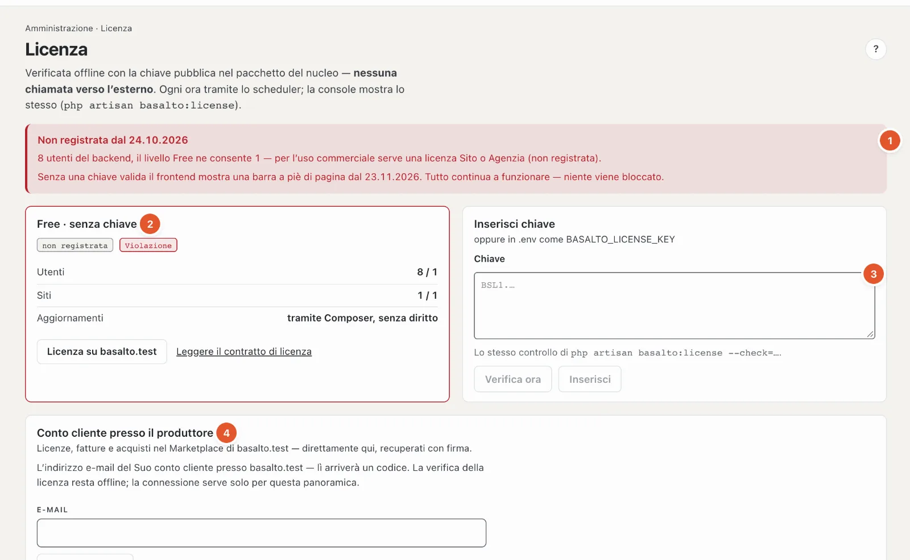

# Licenza

Sotto **Licenza** vede con quale livello funziona l’installazione, se rispetta i limiti, e inserisce la chiave. Basalto verifica la licenza **offline** — senza chiamate verso l’esterno — e **non blocca mai** una funzione.

## Dove

Modalità «Amministrazione» › **Licenza**.

1. **Avviso in alto** — se l’installazione non è registrata, qui è indicato da quando e perché, per esempio «3 utenti del backend, il livello Free ne consente 1», e da quando il frontend mostra una barra a piè di pagina. «Tutto continua a funzionare — niente viene bloccato.»
2. **La scheda della licenza** — livello (per esempio «Free · senza chiave»), contrassegni **«registrata»/«non registrata»** e **«conforme»/«Violazione»**, poi **Utenti** e **Siti** (usati / consentiti), **Aggiornamenti** (fino a quando sono incluse le nuove versioni). Con una chiave inoltre licenziatario, domini, emissione e ID chiave; per una sottolicenza d’agenzia il cliente. I link «Licenza su …» (acquistare o rinnovare) e «Leggere il contratto di licenza».
3. **Inserisci chiave** — incollare la chiave, **«Verifica ora»** mostra il risultato senza inserire nulla; **«Inserisci»** la applica. Una chiave non valida non viene inserita. **«Rimuovi chiave»** riporta a Free. Le chiavi le inseriscono solo i gestori. Se la chiave si trova nel file `.env` dell’installazione, la scheda lo indica — l’inserimento nel backend ha la precedenza.
4. **Conto cliente presso il produttore** — vedi sotto.

## Livelli

| Livello | In breve |
| --- | --- |
| **Free** | senza chiave: un sito, un utente del backend, tutti i moduli — per sviluppo, test e uso privato |
| **Sito** | un dominio di produzione, fino a tre siti in un’installazione; nuove versioni per un anno dall’acquisto |
| **Agenzia** | tutti i siti e le installazioni per Lei e per i Suoi clienti; una chiave di sottolicenza per cliente, su richiesta senza il marchio Basalto nel backend |

**Violazione** significa: l’installazione supera il suo livello — più utenti o siti di quanto consentito o un dominio che non figura nella chiave. In tal caso è considerata non registrata. Dopo **30 giorni** senza registrazione il frontend mostra una sottile barra a piè di pagina; non succede altro. Se il diritto agli aggiornamenti è scaduto, il software continua a funzionare; per le nuove versioni serve un rinnovo.

## Conto cliente presso il produttore

Chi ha acquistato una licenza su basaltocms.com vede chiavi, fatture e acquisti nel Marketplace direttamente qui (solo gestori):

1. Inserire l’**indirizzo e-mail** del conto cliente, **«Richiedi codice»**. Se lì esiste un account, arriva un codice di sei cifre a questo indirizzo.
2. Inserire il **codice** — una casella per cifra; incollando si riempie tutto il codice. Quando ci sono tutte e sei le cifre, Basalto si collega da solo. Se non è arrivato nulla, **«Invia di nuovo il codice»** si attiva dopo una breve attesa (vedi [Impostazioni](einstellungen.md), «Nuovo codice al più presto dopo»).
3. Una volta collegata, la scheda mostra le **Licenze** (con «Usa questa chiave»), le **Fatture** in PDF e gli **acquisti** nel Marketplace. «Aggiorna» recupera lo stato più recente, «Scollega» scioglie il collegamento.

La verifica della licenza resta comunque offline; il collegamento serve solo per questa panoramica. Dettagli per la tecnica: [Licenza](../betrieb/lizenz.md).

## Domande frequenti

**Devo acquistare subito una licenza?**
No. Per sviluppo, test e uso privato basta Free. Per l’uso commerciale con più persone o siti serve una licenza Sito o Agenzia; fino ad allora dopo 30 giorni compare la barra a piè di pagina.

**Vedo «Inserisci» bloccato.**
Le chiavi le inseriscono solo i gestori — oppure il campo è ancora vuoto.

## Per continuare

- [Licenza](../betrieb/lizenz.md)
- [Aggiornamenti](updates.md)
