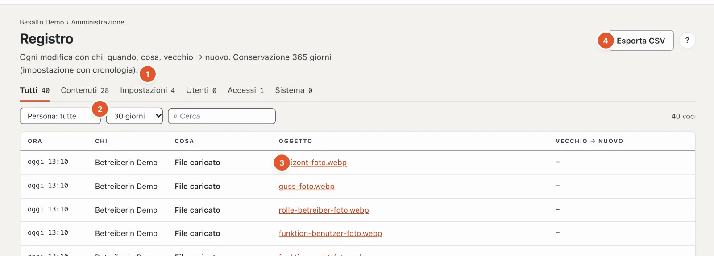

# Registro

Il **registro** annota chi ha modificato che cosa e quando — con il valore prima e dopo. Così ogni modifica si può ricostruire, anche dopo mesi.

## Dove

Modalità «Amministrazione» › **Registro**. In alto è indicato per quanto tempo vengono conservate le voci (di fabbrica 365 giorni, impostazione «Conservare il registro»).

1. **Tipi** — «Tutti», «Contenuti», «Impostazioni», «Utenti», «Accessi», «Sistema», ciascuno con il numero di voci.
2. **Persona** — solo le voci di una persona; **Periodo** — 1, 7, 30, 90 o 365 giorni oppure «totale»; **Cerca** nel testo delle voci.
3. **Le voci** — Ora, Chi, Cosa, Oggetto (con «apri», dove l’oggetto esiste ancora) e **vecchio → nuovo**.
4. **«Esporta CSV»** — le voci con i filtri impostati come tabella.

Gli elenchi lunghi li sfoglia con «Più recenti» e «Meno recenti». «Reimposta filtro» mostra di nuovo tutto.

## La cronologia di un contenuto

Il link **«Cronologia»** su un contenuto o su un’impostazione apre il registro filtrato su questo oggetto — in alto compare allora **«solo: …»**. Con «Rimuovi filtro contenuto» (×) vede di nuovo tutte le voci.

## Che cosa viene registrato

- **Contenuti** — creare, modificare, inviare per approvazione, approvare, pubblicare, eliminare, ripristinare.
- **Impostazioni** — ogni modifica di un valore, tema, ruoli, moduli.
- **Utenti** — inviti, ruoli, disattivazioni, eliminazioni, accesso ai dati.
- **Accessi** — accessi riusciti e sessioni.
- **Sistema** — ciclo di eliminazione, pubblicazioni, backup, job.

Se una persona viene eliminata, le sue voci restano — **in forma anonima**: al posto del nome compare un segnaposto. Nulla viene rimosso dal registro, se non per il termine di conservazione.

## Domande frequenti

**Manca una voce.**
Verifichi il periodo — di fabbrica l’elenco mostra gli ultimi 30 giorni. «totale» mostra tutto ciò che è ancora conservato.

## Per continuare

- [Utenti](benutzer.md)
- [Impostazioni](einstellungen.md)
