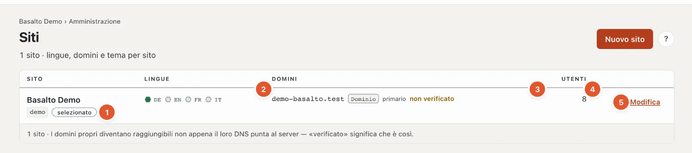

# Siti

Un’installazione può gestire più siti web — ciascuno con lingue, domini, tema e contenuti propri, amministrati nello stesso backend.

## Dove

Modalità «Amministrazione» › **Siti**.

Una riga per sito:

1. **Sito** — nome e handle; «selezionato» contrassegna il sito in cui sta lavorando.
2. **Lingue** — per ogni lingua un esagono: pieno verde per la lingua predefinita, un anello verde per le lingue obbligatorie, grigio per quelle facoltative. Passandoci sopra con il mouse si leggono ruolo e lingua di riserva.
3. **Domini** — gli indirizzi del sito con il loro tipo (alias, dominio proprio, reindirizzamento), «primario» per l’indirizzo principale e «verificato» o «non verificato». Verificato significa: il DNS del dominio punta al server.
4. **Utenti** — quante persone hanno un ruolo nel sito.
5. **«Modifica»** apre il sito; **«Cambia»** (per gli altri siti) lo rende il sito attuale in tutto il backend.

**«Nuovo sito»** crea un altro sito: nome, handle, lingua predefinita e tema, poi «Salva e chiudi». Quanti siti sono consentiti lo dice la [licenza](lizenz.md). In abbonamento i nuovi siti li creano titolare e amministrazione dell’account sotto «Account › Siti».

## Modificare un sito

Che cosa si trova nelle quattro schede «Generale», «Lingue», «Domini» e «Moduli» lo spiega la guida alla configurazione: [Il sito](../einrichtung/site.md). Inoltre, in alto a destra:

- **«Accesso tramite SSO»** — configurare l’accesso tramite Microsoft Entra ID o Google Workspace (vedi [SSO](../betrieb/sso.md)).
- **«Accesso per account cliente»** — i clienti accedono al frontend con Google, Microsoft, GitHub o LinkedIn (vedi [Accesso per account cliente](kundenanmeldung.md)).
- **«Scarica l’esportazione»** — l’intero sito come ZIP: contenuti come JSON e tutti i media, nello stesso formato dell’importazione; senza invii dei moduli e membri (dati personali). Per una copia o un trasferimento in un’altra installazione. Un’esportazione non sostituisce un backup dell’intera installazione (vedi [Esercizio](betrieb.md#backup)).

## Domande frequenti

**Non vedo «Nuovo sito».**
Il Suo ruolo non consente di modificare l’area «Impostazioni, moduli e siti» — oppure l’installazione funziona in abbonamento; allora i nuovi siti li crea l’account.

**Come elimino un sito?**
Al momento non è possibile né nel backend né nella console. Se non vuole più gestire un sito, ne rimuova i domini e, per sicurezza, scarichi l’esportazione.

## Per continuare

- [Il sito](../einrichtung/site.md)
- [Utenti](benutzer.md)
