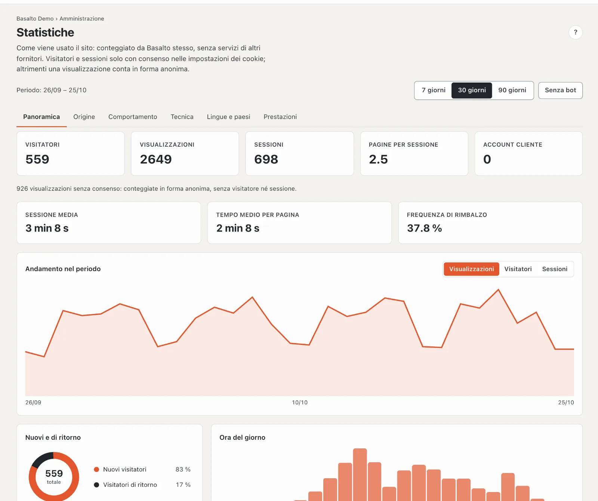
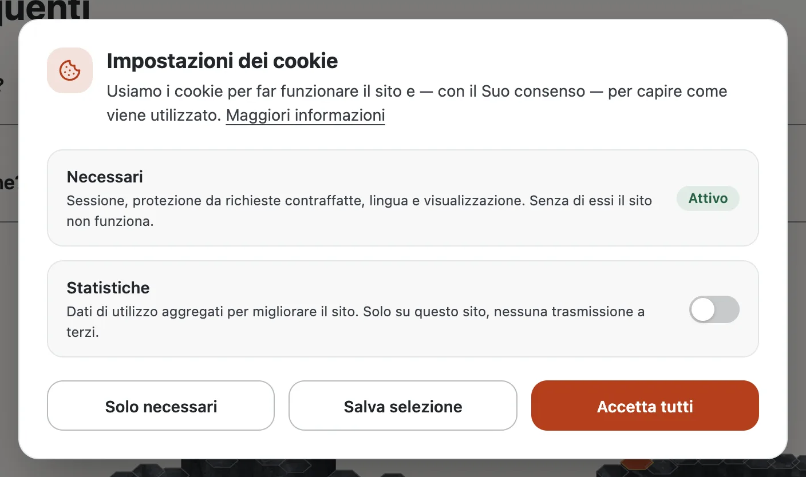

# Statistiche

Basalto conta da sé come viene usato il Suo sito, senza servizi di altri fornitori, senza script da altri server e senza indirizzi IP. In **Amministrazione › Statistiche** vede visitatori, visualizzazioni, provenienza, pagine più visitate, tecnologia, lingue e tempi di risposta del sito selezionato.

## Che cosa viene contato

- **Ogni visualizzazione di pagina** del sito conta, anche le pagine servite rapidamente dalla cache. Non vengono contati il precaricamento del browser, le pagine di errore e le persone connesse al backend (Lei e il Suo team).
- **Senza consenso** una visualizzazione conta **in forma anonima**: pagina, link in entrata (solo l’host), browser, sistema, dispositivo e lingua, senza cookie né identificativo. Le visualizzazioni sono esatte, ma mancano visitatori e sessioni.
- **Con il consenso** nelle impostazioni dei cookie il browser crea due identificativi casuali: uno per il visitatore (un anno) e uno per la sessione (30 minuti senza attività). Basalto conta così visitatori, sessioni, durata, rimbalzi e pagine di ingresso e di uscita. Un browser con «Global Privacy Control» conta sempre in forma anonima.
- **Nessun indirizzo IP** e **nessun parametro** dell’indirizzo vengono salvati: da `?utm_source=…` Basalto riprende solo fonte, mezzo e campagna.
- **Il paese** compare solo se un servizio a monte, come Cloudflare, lo trasmette.

## Leggere le statistiche

In alto sceglie il **periodo** (7, 30 o 90 giorni) e se contare i **bot**. Un clic su una pagina, un link in entrata, un browser, un dispositivo, un paese o una lingua **filtra l’intero rapporto**; la selezione compare in alto e si rimuove elemento per elemento.

| Scheda | Contenuto |
| --- | --- |
| **Panoramica** | Visitatori, visualizzazioni, sessioni, pagine per sessione, account cliente; sessione media, tempo medio per pagina, frequenza di rimbalzo; andamento nel periodo, visitatori nuovi e di ritorno, ora del giorno |
| **Provenienza** | Canali (diretto, motori di ricerca, social network, campagne, link in entrata), link in entrata e campagne (UTM) |
| **Comportamento** | Pagine più visitate, pagine di ingresso e di uscita, ultime visualizzazioni |
| **Tecnologia** | Dispositivi, browser e sistemi operativi |
| **Lingue e paesi** | Lingua delle pagine visualizzate e paesi |
| **Prestazioni** | Tempo di risposta del server (media, p50, p90, p99), pagine più lente e bot |

Giorni e ore seguono il fuso orario del sito.

## Impostazioni dei cookie

Se un sito conta le visite, le **impostazioni dei cookie** chiedono il consenso alla prima visita:

- **Necessari** è sempre attivo (sessione, protezione da richieste contraffatte, lingua, visualizzazione).
- **Statistiche** è disattivato di fabbrica: un consenso preselezionato non sarebbe valido. Se il tema integra servizi di altri fornitori, si aggiunge **Contenuti esterni**.
- **Solo necessari**, **Salva selezione** e **Accetta tutti** hanno la stessa grandezza e sono ugualmente facili da raggiungere.
- La scelta vale un anno. I visitatori la modificano in qualsiasi momento tramite **Impostazioni dei cookie** nel piè di pagina; «Maggiori informazioni» porta all’informativa sulla privacy del sito.

## Attivare, disattivare, conservare

- **Amministrazione › Impostazioni › Statistiche › Contare le visite**: per sito, attivo di fabbrica. Se disattivato non si aggiungono visualizzazioni e le impostazioni dei cookie compaiono solo se il tema integra servizi di altri fornitori.
- **Amministrazione › Impostazioni › Conservazione › Conservare le statistiche**: 400 giorni di fabbrica; la pulizia notturna elimina le visualizzazioni più vecchie.
- **Chi vede le statistiche** dipende dal ruolo (area «Statistiche»); di fabbrica gestore e amministratore.
- **Accesso ai dati e cancellazione** di una persona staccano le sue visualizzazioni dall’account cliente; i numeri restano anonimi. L’esportazione di un sito non include le statistiche.
- **Informativa sulla privacy:** menzioni le proprie statistiche e le impostazioni dei cookie nell’informativa sulla privacy del sito.

## Per i temi

Un link a `#cookie-einstellungen` apre le impostazioni dei cookie da qualsiasi punto. I temi forniti lo mettono nel piè di pagina, nascosto finché le impostazioni non sono sulla pagina (`data-cookie-link hidden`). Gli script di altri fornitori stanno nel tema come `<script type="text/plain" data-consent …>` e `publish { cookie: consent }` li dichiara: vengono eseguiti solo dopo il consenso a «Contenuti esterni».

## Per continuare

- [Impostazioni](einstellungen.md)
- [Ruoli](rollen.md)
- [Accesso per account cliente](kundenanmeldung.md)
- [Lava](../entwickler/lava.md)
