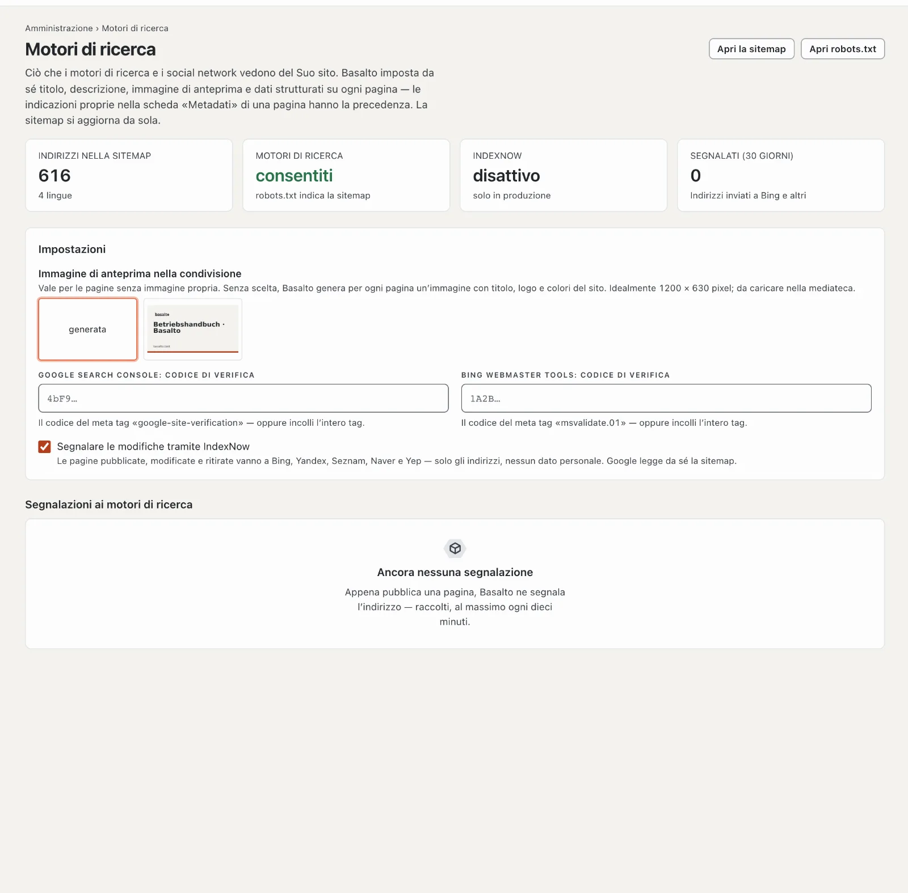

# Motori di ricerca

Basalto prepara da sé ogni pagina pubblica in modo che motori di ricerca e social network la capiscano: titolo,
descrizione, immagine di anteprima, versioni linguistiche, dati strutturati e sitemap. In **Amministrazione › Motori di
ricerca** vede che cosa arriva e stabilisce le poche indicazioni che Basalto non può conoscere da sé.

## Che cosa imposta Basalto da sé su ogni pagina

Non deve fare nulla — né nella redazione né nel tema. Ciò che indica personalmente nelle impostazioni di una pagina,
scheda **Metadati**, ha sempre la precedenza.

| Indicazione | Da dove viene |
| --- | --- |
| **Titolo** | titolo della pagina con il complemento del tema (per esempio «· Nome del sito») — senza complemento se il nome è già nel titolo |
| **Descrizione** | la descrizione propria, altrimenti l’introduzione, altrimenti il primo paragrafo del contenuto — accorciata a circa 160 caratteri alla fine di una parola |
| **Immagine di anteprima** | immagine della pagina, altrimenti la prima immagine del contenuto, altrimenti l’immagine di anteprima del sito, altrimenti un’immagine che Basalto genera da sé |
| **Indirizzo canonico** | l’indirizzo della pagina in questa lingua; le viste con contenuto proprio (una voce del marketplace) mantengono il loro parametro |
| **Versioni linguistiche** | ogni lingua con una propria versione, più la lingua standard come predefinita (`hreflang`) |
| **Dati strutturati** | sito web e organizzazione con logo nella pagina iniziale, pagina e briciole di pane ovunque, articolo con data e autore per i contributi; i moduli aggiungono i propri (evento, posto di lavoro, messaggio del forum, software del marketplace) |
| **Sitemap** | `/sitemap.xml` con una sitemap per lingua, ogni indirizzo con l’ultima modifica, le versioni linguistiche e l’immagine della pagina — aggiornata da sola |
| **robots.txt** | consente ai motori di ricerca tutto tranne l’amministrazione e indica la sitemap |

Le pagine riservate ai membri, le bozze, i reindirizzamenti e le pagine con «noindex» non sono né nella sitemap né
nell’indice. Chi apre il Suo sito con o senza «www.» arriva sul dominio principale del sito (reindirizzamento 301) — per
i motori di ricerca esiste una sola volta.

## L’immagine di anteprima dei link condivisi

Quando qualcuno condivide un link al Suo sito — in un messaggio, su LinkedIn o Facebook —, l’anteprima mostra
un’immagine. Se una pagina non ha un’immagine propria, Basalto usa l’**immagine di anteprima nella condivisione** del
sito. Se non ne è scelta nessuna, Basalto ne genera una per pagina: 1200 × 630 pixel con il titolo della pagina, il logo
e l’indirizzo nei colori del Suo tema.

1. Carichi un’immagine nella **Mediateca** — idealmente 1200 × 630 pixel, in JPEG, PNG o WebP.
2. Apra **Amministrazione › Motori di ricerca** e la scelga in **Immagine di anteprima nella condivisione**. Si salva da
   sola.

## Registrarsi presso Google

Google trova da sé la sitemap tramite `robots.txt`. Nella **Google Search Console** vede inoltre quali pagine sono
nell’indice, con quali termini di ricerca arrivano i visitatori e se Google segnala errori.

1. Apra la Google Search Console e aggiunga una **proprietà** del tipo **Prefisso URL** — l’indirizzo del Suo sito, per
   esempio `https://www.esempio.ch/`.
2. Scelga **Tag HTML** come metodo di verifica e copi il tag.
3. Lo incolli in Basalto in **Amministrazione › Motori di ricerca › Google Search Console: codice di verifica** — il tag
   intero o solo il codice di `content="…"`.
4. Clicchi su **Verifica** nella Search Console.
5. In **Sitemap**, invii l’indirizzo `sitemap.xml`.

Se in alto a sinistra la Search Console mostra solo il nome del dominio (`esempio.ch`, senza `https://`), il Suo sito è
verificato come **dominio** — di solito tramite una voce DNS. In questo caso i passi da 2 a 4 non servono e il campo in
Basalto resta vuoto. In **Sitemap** indichi per un dominio l’indirizzo completo: `https://esempio.ch/sitemap.xml`.

Lo stesso vale per **Bing Webmaster Tools** con il tag `msvalidate.01`; Bing può anche importare un sito verificato
dalla Search Console.

## Segnalare le modifiche con IndexNow

Quando pubblica una pagina, la modifica o la ritira, Basalto ne segnala l’indirizzo tramite **IndexNow** a Bing,
Yandex, Seznam, Naver e Yep — raccolti, al massimo ogni dieci minuti. Vengono trasmessi solo indirizzi, nessun dato
personale. La chiave richiesta da IndexNow la genera Basalto da sé e la mette a disposizione all’indirizzo del sito.
L’elenco **Segnalazioni ai motori di ricerca** mostra che cosa è stato segnalato.

IndexNow segnala solo se il sito è **online**, i motori di ricerca sono consentiti e Basalto funziona **in produzione**
— un ambiente di test non segnala mai. Può disattivarlo in **Segnalare le modifiche tramite IndexNow**. Google non usa
IndexNow; Google legge la sitemap.

## Come i motori di ricerca usano il Suo sito

Quante visite arrivano dai motori di ricerca, da quali pagine entrano e quanto spesso passano Googlebot e altri crawler
lo mostra la scheda **Motori di ricerca** in [Statistiche](statistik.md).

## Se qualcosa non funziona

| Segno | Causa | Soluzione |
| --- | --- | --- |
| **Motori di ricerca: non consentiti** | Il tema blocca i motori di ricerca (`publish { robots: disallow }`) oppure è un ambiente di test | adeguare il tema; gli ambienti di test restano bloccati di proposito |
| **IndexNow: disattivo — solo in produzione** | Basalto funziona in locale o in un ambiente di test | voluto; in produzione segnala da solo |
| La Search Console non trova il tag | codice non ancora salvato, oppure la pagina arriva ancora da una cache | controllare il codice, attendere un minuto, verificare di nuovo |
| L’anteprima mostra un’immagine vecchia | i social network conservano le anteprime per un po’ | farla recuperare di nuovo nello strumento del social network (p. es. il «Sharing Debugger» di Facebook) |

## Per continuare

- [Statistiche](statistik.md)
- [Pagine e albero delle pagine](../redaktion/seiten.md)
- [Andare online](../einrichtung/live-gehen.md)
- [Impostazioni](einstellungen.md)
