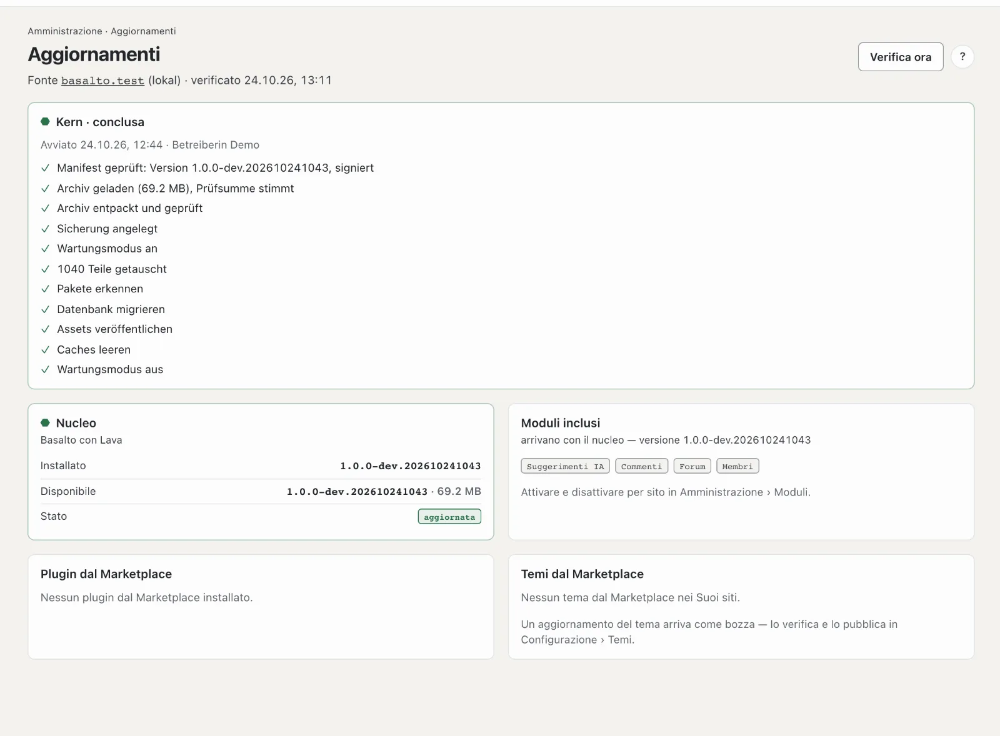

# Aggiornamenti

**Aggiornamenti** mostra se Basalto è aggiornato: il nucleo, i moduli inclusi, i plugin e i temi dal
Marketplace. Se c’è qualcosa di nuovo, lo installa da qui — con backup e via di ritorno.

## Dove

Modalità «Amministrazione» › **Aggiornamenti**. Il numero accanto alla voce indica gli aggiornamenti disponibili secondo l’ultima verifica.

In alto è indicata la **Fonte**, cioè il produttore presso cui Basalto si informa:
- `basaltocms.com` per produzione e demo,
- `testing.basaltocms.com` negli ambienti di test,
- `basalto.test` nello sviluppo locale.

Basalto verifica da sé una volta al giorno. Con **«Verifica ora»** ottiene subito lo stato. Se c’è qualcosa di nuovo,
arriva una notifica nella campanella e, se impostato, via e-mail — una volta per ogni nuovo stato.

Con il controllo Basalto invia al produttore dei **dati di utilizzo**: un identificativo casuale di questa installazione,
la versione, la versione di PHP e il tipo di database. Indirizzi, contenuti e dati personali non vengono inviati; il
produttore conserva solo un’impronta dell’identificativo e conta così le installazioni attive e le versioni. Per
disattivarli: **Impostazioni** › Esercizio › «Dati di utilizzo per il produttore» — il controllo degli aggiornamenti
avviene allora senza questi dati.

## Le schede

| Scheda | Che cosa mostra | Che cosa fare |
| --- | --- | --- |
| **Nucleo** | versione installata e disponibile, dimensione, «Novità» | «Aggiorna a …» |
| **Moduli inclusi** | forum, commenti, membri, IA … — arrivano con il nucleo | attivare e disattivare per sito sotto **Moduli** |
| **Plugin dal Marketplace** | versione installata e nuova per ogni plugin | «Aggiorna» |
| **Temi dal Marketplace** | per ogni sito il tema con versione installata e nuova | «Carica come bozza» |

## Aggiornare il nucleo

Dopo «Aggiorna a …» conferma. Basalto procede poi in sequenza; la pagina mostra ogni passo:

1. Scaricare l’archivio e verificare la firma — solo release firmate dal produttore
2. Backup di database e media
3. Modalità manutenzione — il sito web mostra brevemente una pagina di manutenzione, Lei continua a lavorare
4. Sostituire i file, migrare il database, rinnovare asset e cache
5. Disattivare la modalità manutenzione

**Se un passo non riesce, tornano i vecchi file.** Il database resta com’è — le migrazioni di Basalto sono costruite
in modo che anche lo stato precedente funzioni con esse.

Restano intatti `.env`, lo spazio di archiviazione (media, backup, registri), il file del database e i temi propri.

## Temi

Un aggiornamento del tema arriva **come bozza**: esamina le modifiche sotto Configurazione › Temi nell’anteprima e
solo dopo pubblica. Un tema a pagamento richiede e-mail e token del Suo conto cliente presso il produttore.

## Plugin

I plugin del Marketplace Basalto li installa esattamente come il nucleo: archivio firmato, backup, sostituzione,
migrazioni, via di ritorno. Per questo servono e-mail e token del Suo conto cliente presso il produttore (come per
Composer).

## Quando non si può installare dal backend

- **Copia di lavoro Git o Composer:** se Basalto è stato configurato con Git o Composer, la pagina si limita a
  verificare. Mostra inoltre il comando per aggiornare sul server.
- **Abbonamento (SaaS):** in abbonamento nucleo e plugin li installa il gestore. Qui vede solo i temi del Suo sito.
- **Nessun diritto di scrittura:** la pagina indica la cartella — la tecnica configura i diritti.

## Diritto agli aggiornamenti

Se il diritto agli aggiornamenti della Sua licenza è scaduto, sulla pagina compare un avviso. Basalto continua a
funzionare e non viene bloccato nulla; le nuove versioni fanno parte del rinnovo (vedi [Licenza](lizenz.md)).

Il lato tecnico — comando `basalto:update`, fonte per ambiente, ripristino a mano — si trova nella
[documentazione d’esercizio](../betrieb/updates.md).

## Per continuare

- [Aggiornamenti](../betrieb/updates.md)
- [Backup](../betrieb/backup.md)
