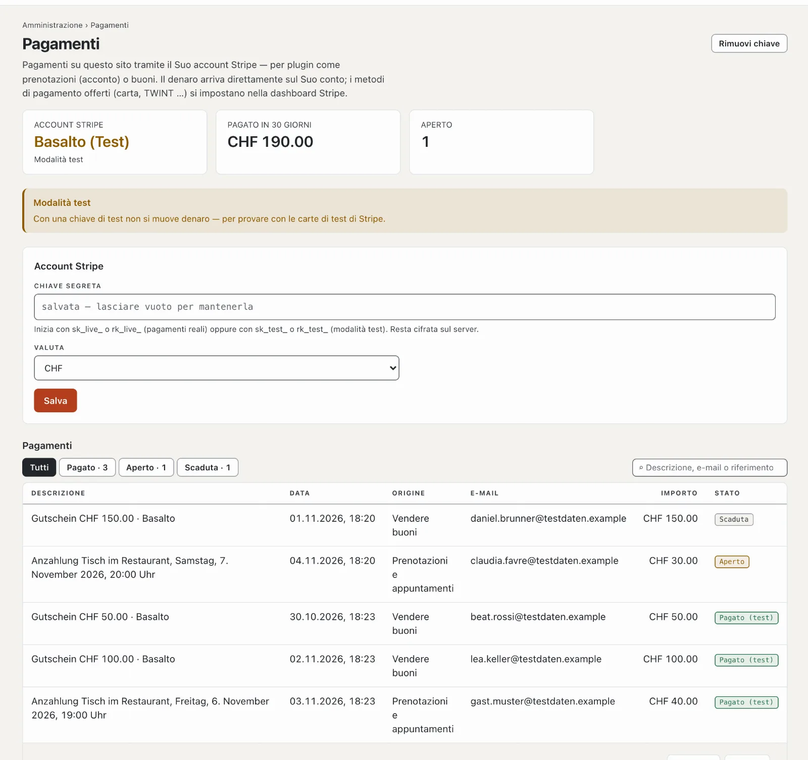

# Pagamenti

Plugin come «Prenotazioni e appuntamenti» (acconto) e «Vendere buoni» incassano pagamenti — tramite il Suo account
Stripe. In **Amministrazione › Pagamenti** lo collega e vede tutti i pagamenti del sito. Il denaro arriva
direttamente sul Suo conto; Basalto non vi partecipa.

## Collegare l’account Stripe

1. Apra un account presso Stripe (o usi quello esistente) e copi la **chiave segreta** nella dashboard Stripe in
   **Sviluppatori › Chiavi API** — inizia con `sk_live_`. Basta una chiave limitata (`rk_live_`) con diritto di
   scrittura su «Checkout Sessions».
2. La incolli in **Amministrazione › Pagamenti**, scelga la **valuta** (CHF o EUR), **«Salva»**.
3. Basalto chiede subito a Stripe se la chiave è valida e mostra il nome dell’account.

La chiave resta cifrata sul server e non torna mai al browser; lasciata vuota, resta quella salvata.
**«Rimuovi chiave»** scollega l’account — i nuovi pagamenti allora non sono più possibili, quelli esistenti restano
nell’elenco.

## Provare in modalità test

Con una chiave di test (`sk_test_…`) non si muove denaro; paga con le carte di test di Stripe. La pagina mostra
**«Modalità test»**, e i pagamenti effettuati compaiono come **«Pagato (test)»**. Per l’esercizio reale sostituisce
la chiave con la `sk_live_…`.

## Come si svolge un pagamento

1. Un ospite prenota o acquista; Basalto crea il pagamento e lo indirizza a Stripe.
2. Lì paga con i metodi di pagamento che ha attivato nella dashboard Stripe — carta, TWINT e altri.
3. Di ritorno sul Suo sito, Basalto chiede lo stato a Stripe. Se l’ospite chiude prima la finestra, Basalto recupera
   da sé lo stato ogni cinque minuti — per questo serve la pianificazione dell’installazione
   ([Esercizio](betrieb.md)).
4. Se un pagamento Stripe scade senza essere pagato, il plugin libera il posto o l’ordine.

Rimborsi e versamenti li gestisce nella dashboard Stripe.

## L’elenco dei pagamenti

In alto ci sono l’account (pagamenti reali o modalità test), quanto è stato pagato negli ultimi 30 giorni e quanti
pagamenti sono aperti. L’elenco mostra data, descrizione, origine (il plugin), e-mail, importo e stato — **Pagato**,
**Aperto** o **Scaduta** —, con ricerca e filtro.

## Chi vede i pagamenti

L’area si chiama **«Pagamenti»** ([Ruoli](rollen.md)); di fabbrica ce l’hanno gestore e amministratore.

## Per continuare

- [Plugin «Prenotazioni e appuntamenti»](../marktplatz/plugin-reservierungen.md)
- [Plugin «Vendere buoni»](../marktplatz/plugin-gutscheine.md)
- [Ruoli](rollen.md)
