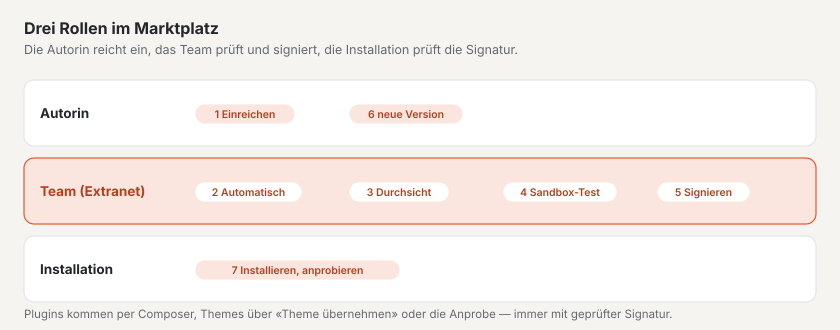

# Marktplatz für Autorinnen und Autoren

Im Marktplatz auf basaltocms.com bieten Sie Themes und Plugins für Basalto an. Jede Einreichung wird automatisch
geprüft, von Hand durchgesehen und bei der Freigabe von basaltocms.com signiert — erst dann steht sie im Katalog. Ein
Eintrag ist kostenlos oder kostet einmalig je Installation — das wählen Sie beim Einreichen. Ein Eintrag mit Preis
erscheint im Katalog, sobald basaltocms.com den Verkauf freischaltet und Ihr Stripe-Konto verbunden ist
([Verkaufen](#verkaufen)).



> **Bedingungen:** Wer einreicht, stimmt den Autoren-Bedingungen zu
> ([Autoren-Bedingungen](../recht/de/autoren-bedingungen.md), im Produkt unter `/_recht/<sprache>/autoren-bedingungen`).
> Sie sind ein Entwurf, anwaltliche Prüfung ausstehend. Zeitpunkt und Fassung der Zustimmung stehen an jeder Version.

## Autorenkonto

1. Auf der Seite **«Autorenkonto»** auf basaltocms.com die E-Mail eingeben. Es gibt kein Passwort: Sie bekommen einen
   Code per Mail; beim ersten Mal entsteht so Ihr Kundenkonto (dasselbe wie für den Lizenzkauf).
2. **«Autorenprofil anlegen»:** «Name als Autor» (Person, Firma oder Studio — so steht es im Katalog), Ort, Website.
3. Das Autorenkonto ist ein **Bereich Ihres Kundenkontos** (neben Käufen, Lizenzen und Community); die Seite
   «Autorenkonto» führt dorthin. Oben stehen die Zahlen (im Katalog, Installationen, in Prüfung), dann **«Ihre
   Einträge»** als Karten: Art, Stand («im Katalog», «in Durchsicht», «abgelehnt», «wartet auf den Verkaufsstart»),
   Version, Angebot, Installationen und Downloads, dazu **«Im Katalog ansehen»**, **«Neue Version»** und die Klappen
   **«Angebot ändern»**, **«Prüfbericht»** und **«Versionen»**. Darunter **«Einreichen»**, sobald es etwas zu verkaufen
   gibt **«Verkäufe je Monat»** und **«Auszahlung»**, zuletzt Autorenprofil und **«Composer-Token»**.
4. Unter **«Als Nächstes»** in der Übersicht des Kontos steht, was Sie tun sollten — etwa eine abgelehnte Version
   neu einreichen oder das Auszahlungskonto verbinden; unter **«Zuletzt»** Freigaben und Ablehnungen.

Fremde Einträge sehen Sie im Autorenkonto nicht, und ein Paketname gehört dem Autor, der ihn zuerst eingereicht hat.

## Paketformate

Eine Einreichung ist ein ZIP. Ob Theme oder Plugin, erkennt der Marktplatz am Inhalt.

### Theme

Ein Theme-Paket im Format von `basalto:theme-pack` ([Themes](../entwickler/themes.md#theme-pakete)): die Dateien des
Theme-Ordners und `manifest.json` mit der SHA-256-Prüfsumme jeder Datei.

```sh
php artisan basalto:check --theme=themes/mein-theme   # Lava vorher prüfen
php artisan basalto:theme-pack mein-theme              # → storage/app/themes/mein-theme-1.0.0.zip
```

- **Name:** der Ordnername — Kleinbuchstaben, Ziffern und Bindestrich, höchstens 64 Zeichen.
- **Version** aus `theme.json` (`version`), als Versionsnummer wie `1.2.0`; ohne Angabe packt `theme-pack` `0.0.0`.
- **Angaben** aus `theme.json`: `label` (Titel im Katalog), `description`, `license`, `preview` (Pfad zu einem
  Vorschaubild im Paket: SVG, PNG, JPG oder WebP, höchstens 1 MB), `requires` (Mindestversion von Basalto, etwa
  `{"basalto": ">=1.3.9"}` — der Eintrag zeigt sie unter «Braucht»; ohne Angabe gilt `>=1.0`).
- **Pflicht:** `category` — eine von `firma`, `portfolio`, `gastro`, `verein`, `magazin`, `onepager`,
  `shop` — und mindestens ein Bild: `screenshots` (Liste von Pfaden im Paket, 1–6 Bilder, PNG, JPEG oder WebP, je
  höchstens 1 MB) oder `preview`.
- **Freiwillig:** `homepage`, `docs`, `support` (https-Adressen). Ein `seed` mit Startinhalten zeigt das Theme in der
  Sandbox und im Schaufenster mit Inhalt statt leer. Die Sprachen aus `site { languages: … }` legen Sandbox und
  Schaufenster als Sprachen der Site an — Startinhalte in mehreren Sprachen sind dort also alle zu sehen.

```json
{
    "label": "Fjord",
    "description": "Ruhig und klar, mit Dunkelmodus.",
    "version": "1.0.0",
    "license": "MIT",
    "category": "firma",
    "preview": "assets/preview.svg",
    "screenshots": ["assets/screens/start.webp", "assets/screens/kontakt.webp"],
    "docs": "https://example.ch/fjord"
}
```
- **Kein PHP:** Dateien mit `.php`, `.phtml` oder `.phar` lehnt die Prüfung ab — Themes sind Daten.
- Eine eigene Signatur ist nicht nötig; basaltocms.com signiert bei der Freigabe neu.

### Plugin

Ein Composer-Paket als ZIP: `composer.json` an der Wurzel oder im einzigen Ordner der Wurzel (wie ein Archiv, das ein Code-Hoster als ZIP ausliefert).
Aufbau und Schnittstelle wie bei Modulen ([Module und Plugins](../entwickler/erweiterungen.md)).

```json
{
    "name": "hersteller/karten",
    "version": "1.0.0",
    "type": "basalto-plugin",
    "license": "MIT",
    "description": "Karten als Lava-Tag",
    "require": { "php": "^8.4", "basalto/core": "*" },
    "autoload": { "psr-4": { "Hersteller\\Karten\\": "src/" } },
    "extra": {
        "laravel": { "providers": ["Hersteller\\Karten\\KartenServiceProvider"] },
        "basalto": {
            "module": "karten", "name": "Karten", "api": 1,
            "category": "inhalte",
            "icon": "assets/icon.svg",
            "screenshots": ["assets/screens/block.png"],
            "adds": { "blocks": ["Karte"], "forms": [], "types": [], "pages": [], "settings": ["Kartenanbieter"] }
        }
    }
}
```

| Feld | Regel |
| --- | --- |
| `name` | gültiger Composer-Name `hersteller/paket`, klein geschrieben |
| `version` | Pflicht — der Marktplatz liest die Version von hier (`1.2.0`, `v` davor erlaubt) |
| `type` | `library`, `basalto-plugin` oder `basalto-module` |
| `extra.basalto` | `module` (Handle: a–z, 0–9, `-` und `_`, mit einem Buchstaben am Anfang, höchstens 40 Zeichen), `name` (Anzeigename), `api` = `1` |
| `extra.laravel.providers` | mindestens ein Service-Provider |
| `autoload.psr-4` | sonst Hinweis: Klassen sind nicht ladbar |
| `license` | weicht sie von der beim Einreichen gewählten Lizenz ab, gibt es einen Hinweis |
| `extra.basalto.category` | Pflicht: `inhalte`, `formulare`, `shop`, `marketing`, `medien`, `mitglieder`, `anbindung` oder `entwicklung` |
| `extra.basalto.icon` | SVG, PNG oder WebP im Paket, höchstens 256 KB — sonst Hinweis, der Katalog zeigt den Anfangsbuchstaben |
| `extra.basalto.screenshots` | 1–6 Bilder im Paket (PNG, JPEG, WebP, je höchstens 1 MB) — sonst Hinweis |
| `extra.basalto.adds` | was das Plugin der Site hinzufügt: `blocks`, `types`, `forms`, `pages`, `settings` (je eine Liste von Namen) — der Katalog zeigt es nach den Stationen des Fahrplans; sonst Hinweis |
| `homepage`, `support.docs`, `support.issues` | https-Adressen zu Website, Doku und Support |

## Was die automatische Prüfung prüft

Beim Hochladen prüft der Marktplatz sofort das Paket und ob Name und Version erkennbar sind; Fehler stehen am Feld.
Die volle Prüfung läuft danach in der Warteschlange und endet im **Prüfbericht** mit sieben Schritten. Aus dem Paket
wird dabei nichts ausgeführt.

| Schritt | Geprüft | Ablehnung bei |
| --- | --- | --- |
| **Paket** | lesbares ZIP, Grösse, Pfade | über 10 MB gepackt oder 50 MB entpackt, über 2000 Dateien; **ZIP-Slip** (Pfade mit `..`, absolute Pfade, Laufwerksbuchstaben, Backslashes); symbolische Links |
| **Manifest** | Theme: Manifest und Prüfsummen, Lava-Compiler; Plugin: `composer.json`, `php -l` jeder PHP-Datei, Verbotsliste | Manifest fehlt oder passt nicht, Compiler-Fehler, Syntaxfehler, verbotene Aufrufe, ungültige Felder |
| **Tests** | Themes: der Compiler statt Tests; Plugins: ob Tests beiliegen | — (mitgelieferte Tests werden nie ausgeführt; die Durchsicht liest sie) |
| **Prüfstand** | Themes: Kontraste nach WCAG 2.2 AA (hell und dunkel, auch je Farbvariante), Dunkelmodus, Farbvarianten (`palette`, eigene Marke), Fremdressourcen (`src`, `<link href>`, `url()`, `@import` auf fremde Server), Gewicht der Assets, Startinhalte; Plugins: PHPStan (Stufe 5, statisch), Schreibzugriffe, Tests | — (nur Hinweise; die Kennzahlen stehen als Marken im Katalog) |
| **Sandbox** | wir installieren die Einreichung in einer Wegwerf-Installation mit Beispielinhalt und probieren sie aus | was dort nicht funktioniert, mit Notiz |
| **Signatur** | offen bis zur Freigabe | — |
| **Durchsicht** | von Hand | Grund der Ablehnung |

**Verbotsliste** (über den PHP-Tokenizer; Kommentare und Texte zählen nicht): `exec`, `shell_exec`, `system`,
`passthru`, `proc_open`, `popen`, `pcntl_exec`, `pcntl_fork`, `dl`, `create_function`, `eval` und der
Backtick-Operator führen zur Ablehnung. Schreiben am Flysystem vorbei (`file_put_contents`, `fopen`, `fwrite`,
`unlink`, `rename`, `copy`, `mkdir`, `chmod`, `symlink` u. a.) ergibt einen **Hinweis** — erlaubt sind nur
Storage-Disks.

**Hinweise** lehnen nicht ab, die Durchsicht sieht sie aber: Warnungen des Lava-Compilers, eine unvollständige rote
Linie, fehlende Tests, fehlendes `autoload.psr-4`.

## Einreichen

**«Neue Einreichung»** im Autorenkonto öffnet ein Fenster in vier Schritten — **Paket**, **Angaben**, **Angebot**,
**Prüfen und einreichen**. «Weiter» prüft die Felder des Schritts; ziehen Sie die ZIP-Datei auf das Feld oder wählen Sie
sie aus, dann zeigt das Fenster gleich Art, Name und Version des Pakets. Vor dem Absenden fasst der letzte Schritt
Paket, Kurzbeschreibung und Angebot zusammen. Meldet der Marktplatz einen Fehler, öffnet das Fenster wieder beim
betroffenen Schritt. **«Neue Version»** an einem Eintrag öffnet dasselbe Fenster mit dessen Angaben. Die Felder:

| Feld | |
| --- | --- |
| «Paket (ZIP)» | Pflicht, höchstens 10 MB |
| «Angebot» | **«Kostenlos»** oder **«Verkaufen»** — bei «Verkaufen» dazu «Preis je Installation» und «Währung» ([Verkaufen](#verkaufen)) |
| «Lizenz» | bei «Kostenlos» je Eintrag: MIT, GPL-3.0-or-later, LGPL-3.0-or-later, Apache-2.0, BSD-3-Clause oder die Basalto Marktplatz-Lizenz; bei «Verkaufen» immer die Basalto Marktplatz-Lizenz |
| «Kurzbeschreibung» | eine Zeile für die Karte im Katalog; leer = aus dem Paket |
| «Beschreibung» | Klartext; Leerzeilen trennen Absätze |
| «Was ist neu» | Änderungen dieser Version |
| Zustimmung | «Ich stimme den Bedingungen für Autoren zu.» — ohne sie nimmt der Marktplatz nichts an |

Je IP-Adresse nimmt der Marktplatz höchstens 30 Einreichungen pro Stunde an.

## Durchsicht und Ablehnung

| Stand | Bedeutung |
| --- | --- |
| **in Prüfung** | die automatische Prüfung läuft |
| **in Durchsicht** | Prüfung bestanden, die Durchsicht folgt (in der Regel zwei bis drei Arbeitstage) |
| **veröffentlicht** | freigegeben, signiert, im Katalog und im Composer-Repository |
| **abgelehnt** | automatisch (die markierten Stellen im Prüfbericht) oder in der Durchsicht mit Grund |

Nach der automatischen Prüfung testen wir die Einreichung in einer **Sandbox** — einer eigenen Installation nur für
diesen Test, mit den Startinhalten des Themes bzw. dem Starter-Theme. Danach wird sie gelöscht. Erst ein bestandener
Sandbox-Test erlaubt die Freigabe; bei «nicht bestanden» steht unsere Notiz im Grund der Ablehnung.

Im Katalog trägt jeder Eintrag seinen **Prüfstand**: die Kennzahlen der automatischen Prüfung und «Sandbox geprüft am …».
Freigegebene Themes bekommen ein **Schaufenster** — eine Site mit ihren Startinhalten, die Besucher live anprobieren.

Über jeden Entscheid bekommen Sie eine Mail in Ihrer Sprache. Bei der Freigabe gehen Titel, Texte, Lizenz und
Vorschaubild der Version auf den Eintrag über. Nach einer Ablehnung die Stellen beheben und mit **«Neu einreichen»**
beim selben Eintrag wieder hochladen.

## Bewertungen

Käufer und Nutzerinnen bewerten Einträge mit 1–5 Sternen und Text; der Durchschnitt steht auf der Karte im Katalog
(«★ 4.6 (12)») und lässt nach «Bewertung» sortieren. Eigene Einträge lassen sich nicht bewerten. Zu jeder neuen
Bewertung bekommen Sie eine Mail. Angemeldet im Kundenkonto steht auf der Seite des Eintrags unter jeder Bewertung
**«Öffentlich antworten»** — leer gespeichert, entfernt die Antwort. Unpassende Bewertungen (Werbung, Beleidigungen,
Personendaten) blendet das Team von basaltocms.com mit Grund aus; sie zählen dann nicht im Durchschnitt.

## Versionen

- Jede Einreichung ist eine Version eines Eintrags. Für eine neue Version **«Neu einreichen»** beim Eintrag wählen —
  das Paket muss denselben Namen tragen.
- Eine Versionsnummer, die schon in Prüfung, in Durchsicht oder veröffentlicht ist, lässt sich nicht noch einmal
  einreichen — Nummer erhöhen. Eine abgelehnte Nummer dürfen Sie wieder verwenden.
- Der Katalog zeigt die höchste veröffentlichte Version; Composer bekommt alle veröffentlichten Versionen.

## Composer-Token

Unter **«Composer-Token»** mit **«Token erzeugen»** ein Token anlegen; Benutzer ist die E-Mail des Kontos, Passwort das
Token. Ein neues Token macht das alte ungültig. Das Token brauchen alle, die Plugins aus dem Marktplatz installieren —
auch ohne eigene Einträge ([Marktplatz für Installationen](installieren.md)). Mit Ihrem Token bekommen Sie auch Ihre
eigenen bezahlten Versionen, ohne sie zu kaufen.

## Verkaufen

«Verkaufen» wählen Sie beim Einreichen schon jetzt — auch bevor basaltocms.com den Verkauf freischaltet (die
Autoren-Bedingungen kündigen das 30 Tage vorher an). Ein freigegebener Eintrag mit Preis **wartet**, bis verkauft werden
kann: Er steht nicht im Katalog, hat keine Eintragsseite und ist nicht ladbar, auch nicht kostenlos. Im Autorenkonto
steht dann **«wartet auf den Verkaufsstart»** oder, ist der Verkauf schon offen, **«wartet auf das Auszahlungskonto»**.
Sobald beides stimmt, erscheint der Eintrag von selbst.

### Stripe Connect verbinden

Ausgezahlt wird über **Stripe Connect** mit einem **Express-Konto**: Stripe prüft Ihre Identität, nimmt Ihr
Bankkonto auf und zahlt Ihren Anteil direkt aus. basaltocms.com sieht weder Bank- noch Ausweisdaten.

1. Im Autorenkonto Reiter **«Auszahlung»** → **«Mit Stripe verbinden»**. basaltocms.com legt das Konto an und schickt
   Sie ins Onboarding von Stripe.
2. Angaben bei Stripe ausfüllen. Danach kommen Sie ins Autorenkonto zurück; ist der Link abgelaufen, erzeugt basaltocms.com
   einen neuen.
3. Den Stand hält Stripe aktuell (Ereignis `account.updated`):

| Stand | Bedeutung |
| --- | --- |
| **nicht verbunden** | noch kein Stripe-Konto |
| **Angaben fehlen** | Onboarding nicht fertig, oder Stripe verlangt weitere Angaben — **«Angaben bei Stripe ergänzen»** |
| **verbunden ✓** | Angaben eingereicht, Stripe prüft noch; Ihre Einträge mit Preis erscheinen im Katalog |
| **Auszahlungen aktiv ✓** | Stripe zahlt nach seinem Zahlungsplan aus |

Mit **«Stripe-Dashboard öffnen»** sehen Sie bei Stripe Auszahlungen, Bankkonto und Steuerangaben.

### Preis

In der Einreichung **«Verkaufen»** wählen, dann **«Preis je Installation»** (z. B. `59` oder `59.50`) und
**«Währung»** (CHF, EUR oder USD) — zwischen 5 und 5000.

- Ein bezahlter Eintrag steht immer unter der **Basalto Marktplatz-Lizenz**; die Lizenz stellt der Marktplatz selbst um.
- Der Preis gilt mit der **Freigabe** der Version, wie Texte und Lizenz.
- Bei einem freigegebenen Eintrag ändern Sie das Angebot mit **«Angebot ändern»**: kostenlos oder verkaufen, Preis und
  Währung. Das gilt für die aktuelle Version und alle neuen; ältere Versionen behalten ihren Preis, wer schon
  installiert hat, behält seine Fassung. Verkaufen geht so nur unter der Basalto Marktplatz-Lizenz — steht der Eintrag
  unter einer freien Lizenz, reichen Sie eine neue Version unter der Marktplatz-Lizenz ein.
- Ein Kauf gilt **einmalig je Installation** und bringt **ein Jahr Updates**: alle Versionen, die bis ein Jahr nach dem
  Kauf erscheinen. Danach bekommt der Käufer neue Versionen erst mit einem neuen Kauf.
- Kaufen lässt sich der Eintrag nur, solange Stripe Überweisungen an Ihr Konto zulässt — sonst steht «Derzeit nicht
  käuflich» beim Eintrag.

### Provision

basaltocms.com behält **10 Prozent des Preises ohne Mehrwertsteuer**; kostenlose Einträge sind ohne Provision. Beispiel
ohne MwSt.: Preis CHF 59.00 → Provision CHF 5.90 → **CHF 53.10 für Sie**. Ist basaltocms.com mehrwertsteuerpflichtig,
gilt die Provision auf den Nettobetrag, und die MwSt. bleibt bei basaltocms.com. Eine andere Provision kündigt
basaltocms.com allen Autorinnen und Autoren mindestens 30 Tage vorher per E-Mail an; bis sie gilt, steht sie im Reiter
«Verkäufe». Verkäufer sind Sie: Die Quittung nennt Sie, basaltocms.com vermittelt den Kauf.

Technisch ist jeder Kauf eine **Destination Charge**: Stripe belastet den Käufer auf dem Konto von basaltocms.com, behält
dort Provision (und MwSt.) als `application_fee_amount` und überweist den Rest auf Ihr Express-Konto. Die Gebühren
von Stripe trägt basaltocms.com, sie schmälern Ihren Anteil nicht. Bei einer vollen Rückerstattung bucht Stripe Ihren
Anteil zurück, und der Käufer verliert den Zugang.

### Verkäufe und Auszahlung

- Reiter **«Verkäufe»:** Summe je Monat (nach Monat der Zahlung, je Währung) mit Umsatz, Provision und
  Auszahlungsbetrag, darunter die letzten Verkäufe. Angaben zu Käufern sehen Sie nicht.
- Reiter **«Auszahlung»:** Stand von Stripe Connect, der laufende Monat («CHF 1'550 Verkäufe · 10 % Provision ·
  CHF 1'395»), die **nächste Auszahlung** und die letzten Auszahlungen. Termin und Betrag einer Auszahlung legt Stripe
  fest (Zahlungsplan, Wartefrist); basaltocms.com zeigt sie, sobald Stripe sie plant (`payout.created`). Bis dahin steht
  der offene Anteil aus Ihren Käufen da — als Schätzung.

## Weiter

- [Marktplatz](README.md)
- [Themes](../entwickler/themes.md)
- [Module und Plugins](../entwickler/erweiterungen.md)
