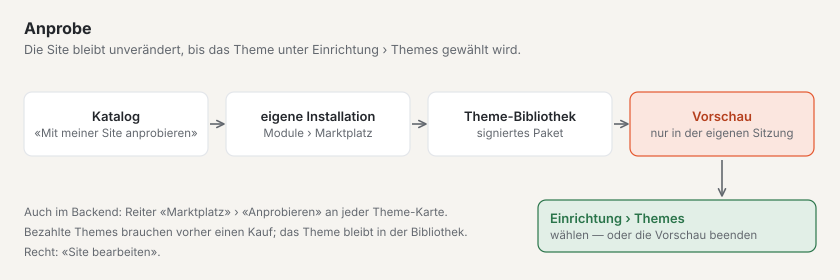

# Marktplatz für Installationen

Jede Basalto-Installation sieht den Katalog des Marktplatzes von basaltocms.com im Backend. Plugins kommen per Composer
in die Installation, Themes als signiertes Paket über «Theme übernehmen» — einen ZIP-Upload für Code gibt es nicht.
Bezahlte Einträge kaufen Sie vorher auf basaltocms.com ([Kaufen](#kaufen)).

## Verwaltung › Module

**Verwaltung › Module** (`/admin/module`) — nur für Besitzer und Administration der Site. Zwei Reiter:

| Reiter | Inhalt |
| --- | --- |
| **Module** | installierte Module und Plugins, ihr Stand auf dieser Site («an auf dieser Site» bzw. «aus …») und was sie brauchen; «Zur Site» führt zum Schalter |
| **Marktplatz** | Katalog von basaltocms.com mit Filter Themes/Plugins und Suche; «Installieren» öffnet den Installationsdialog |

Geschaltet wird nicht hier, sondern je Site unter **Verwaltung › Sites › Site bearbeiten › Reiter «Module»**.

Eine **Karte** im Reiter «Marktplatz» zeigt Name, Autorin, Preis («kostenlos» oder z. B. «CHF 59»), Sterne mit Zahl der
Bewertungen, Installationen und den **Prüfstand**: Kennzahlen aus der automatischen Prüfung als Marken — ✓ erfüllt,
✗ nicht erfüllt, ○ keine Angabe (Themes z. B. Kontraste nach WCAG 2.2 AA, Dunkelmodus, ohne Fremdressourcen; Plugins
z. B. PHPStan, speichert nur über Storage, mit Tests) und «Sandbox geprüft am …». Nur Themes haben **«Anprobieren»**.

Den Katalog liest der Kern ohne Token über `GET <BASALTO_MARKETPLACE_URL>/marketplace/api/entries` und hält ihn zehn
Minuten im Cache; **«Neu laden»** holt ihn sofort. Ist basaltocms.com nicht erreichbar, zeigt der Reiter «Marktplatz
nicht erreichbar» und versucht es nach einer Minute wieder — das übrige Backend wartet nicht darauf. Der Kern übernimmt
aus der Antwort nur bekannte Felder und baut jede Adresse selbst aus `BASALTO_MARKETPLACE_URL`.

## Kaufen

Bezahlte Einträge tragen im Katalog den Preis («CHF 59») statt «kostenlos». Gekauft wird auf basaltocms.com im
Kundenkonto — dasselbe Konto wie für Lizenzen und das Composer-Token.

1. Auf der Seite des Eintrags **«Kaufen CHF 59»**. Ohne Anmeldung geht es zuerst ins **Kundenkonto** (Code per Mail,
   kein Passwort); dort führt **«Weiter zum Kauf»** zurück zum Eintrag.
2. Angemeldet **«Für welche Installation?»** ausfüllen (Domain oder Name — steht auf der Quittung) und kaufen. Bezahlt
   wird bei **Stripe Checkout** mit den Zahlarten, die basaltocms.com bei Stripe eingeschaltet hat.
3. Sobald Stripe die Zahlung bestätigt (meist nach wenigen Sekunden), steht der Kauf im Kundenkonto unter **«Käufe im
   Marktplatz»**: Datum, Betrag, Installation, **Updates bis**, die **Quittung** als PDF und bei Themes das signierte
   Paket. Die Quittung kommt auch per Mail, in der Sprache des Kaufs.

Was ein Kauf umfasst:

- **einmalig je Installation** — für eine weitere Installation kaufen Sie noch einmal;
- **ein Jahr Updates:** alle Versionen, die bis ein Jahr nach dem Kauf erscheinen. Danach liefern Composer und
  «Theme übernehmen» keine neueren Versionen mehr; ein neuer Kauf bringt ein weiteres Jahr. Die Versionen, die Sie haben,
  dürfen Sie weiter nutzen;
- die **Basalto Marktplatz-Lizenz** des Autors. Rückgabe innert 14 Tagen nach den AGB — mit der Rückerstattung endet der
  Zugang.

Ohne Kauf antwortet basaltocms.com bei einer bezahlten Version mit **403** (mit Token) bzw. **401** (ohne).

## Plugin installieren

Der Installationsdialog zeigt die Befehle zum Kopieren («Befehle kopieren»). In der Installation ausführen:

```sh
composer config repositories.basalto composer https://basaltocms.com/composer
composer config http-basic.basaltocms.com <E-Mail> <Token>
composer require hersteller/karten:^1.0
php artisan migrate
```

- **Token:** Benutzer ist die E-Mail Ihres Kundenkontos auf basaltocms.com, Passwort das Token aus dem
  **Autorenkonto** (Anmeldung per Code, auch ohne eigene Einträge; [Composer-Token](autoren.md#composer-token)). Ohne
  gültiges Paar antwortet das Composer-Repository des Marktplatzes mit 401, und Composer fragt nach Zugangsdaten.
- `composer config http-basic…` schreibt das Token in `auth.json` im Projektordner. Diese Datei gehört nicht in die
  Versionsverwaltung (`/auth.json` steht in `.gitignore`); auf Laravel Cloud als Secret `COMPOSER_AUTH` hinterlegen.
- Composer prüft beim Herunterladen die SHA-1-Prüfsumme des Pakets (`dist.shasum`). Das Paket enthält zusätzlich
  Manifest und Signatur des Marktplatzes (`basalto-manifest.json`, `basalto-signature`).
- Nach `migrate` erscheint das Plugin unter **Module**; ist es schaltbar, auf der Site einschalten.
- Ein eigenes Build für Backend-Seiten (Vue) von Plugins Dritter ist noch offen
  ([Module und Plugins](../entwickler/erweiterungen.md#inertia-seiten-mit-namensraum)).

Updates kommen wie bei jedem Composer-Paket: `composer update hersteller/karten`, danach `php artisan migrate`.

**Bezahlte Plugins** liefert das Composer-Repository nur dem Token eines Käufers: `packages.json` nennt für jedes Token nur die
Versionen, die es beziehen darf (kostenlose alle, bezahlte bis zum Ende des Update-Jahres). Kaufe also mit demselben
Kundenkonto, dessen Token in `auth.json` steht.

## Theme anprobieren



Auf der Seite eines Themes im Katalog: **«Mit meiner Site anprobieren»** — die Adresse der eigenen Basalto-Site
eingeben, dann **«Weiter zu …»**. In der eigenen Installation fragt **Verwaltung › Module › Marktplatz › Anprobe**
nach; **«Mit meiner Site anprobieren»** holt das Theme (signiert) in die [Theme-Bibliothek](../entwickler/themes.md)
und zeigt die Site damit in der eigenen Sitzung. Die Site bleibt unverändert, bis das Theme unter **Einrichtung ›
Themes** gewählt wird. Im Reiter «Marktplatz» steht derselbe Knopf **«Anprobieren»** an jeder Theme-Karte, dazu der
Prüfstand jedes Eintrags.

- Beim Holen steht «Wird geholt …». Bei bezahlten Themes weist die Anprobe darauf hin, dass zuerst ein Kauf nötig ist;
  gibt es das Theme nicht (mehr), sagt sie es.
- Danach zeigt ein Band «Vorschau mit Theme …» an, dass Sie eine Vorschau sehen. Beenden geht über das Band oder unter
  **Einrichtung › Themes**; dort wählen Sie das Theme auch für die Site. Das Theme bleibt in der Bibliothek, auch wenn
  Sie die Vorschau beenden.
- Anprobieren braucht das Recht, die Site zu bearbeiten.

## Theme übernehmen

Bei einem Theme zeigt der Dialog **«Theme übernehmen»**. Basalto

1. lädt das Paket von `<BASALTO_MARKETPLACE_URL>/marketplace/themes/<name>/<version>.zip` (höchstens 10 MB),
2. vergleicht die SHA-256-Prüfsumme mit dem Katalog,
3. prüft Manifest und **Signatur des Marktplatz-Schlüssels** mit dem öffentlichen Schlüssel im Kern — ohne gültige
   Signatur wird nichts übernommen,
4. legt die Dateien als **Entwürfe** im Theme-Editor an (**Einrichtung › Theme-Editor**).

Veröffentlicht wird dort wie jede Theme-Änderung, nach Vorschau und Freigabe ([Themes](../entwickler/themes.md)).
Bis dahin bleibt das bisherige Theme live.

**Bezahlte Themes** lädt Basalto mit E-Mail und Token Ihres Kundenkontos — aus `BASALTO_MARKETPLACE_EMAIL` und
`BASALTO_MARKETPLACE_TOKEN` oder, wenn die fehlen, aus `auth.json` (`http-basic.<host>`, wie für Composer). Die
Zugangsdaten gehen nur an `BASALTO_MARKETPLACE_URL`. Meldet der Dialog «Kein Kauf dieses Themes …», fehlt der Kauf
mit diesem Konto oder das Update-Jahr ist vorbei. Ohne eigene Installation mit `.env` (etwa auf der SaaS) laden Sie das
signierte Paket im Kundenkonto herunter.

## Bewerten

Auf der Seite eines Eintrags steht unter **«Bewertungen»** der Durchschnitt mit der Verteilung der Sterne und die
Bewertungen anderer — mit dem Vermerk **«gekauft»** (bezahlter Eintrag, Kauf belegt) oder **«installiert»** (Download
über Composer bzw. «Theme übernehmen» mit E-Mail und Token belegt).

Angemeldet im Kundenkonto: Sterne wählen (1–5), freiwillig ein Titel, dann **«Ihre Erfahrung»** (10–2000 Zeichen) und
**«Bewertung veröffentlichen»**. Bezahlte Einträge bewertet nur, wer sie gekauft hat. Je Kundenkonto gibt es eine
Bewertung je Eintrag; **«Bewertung ändern»** ersetzt sie (eine Antwort der Autorin fällt dann weg), **«Meine Bewertung
löschen»** entfernt sie. Unter der Bewertung steht der Vorname mit dem ersten Buchstaben des Nachnamens aus dem
Kundenkonto — nie die E-Mail.

Unter jeder fremden Bewertung steht **«Bewertung melden»** — auch ohne Kundenkonto: Grund wählen («Werbung oder Spam»,
«Beleidigend oder herabsetzend», «Enthält persönliche Daten», «Gehört nicht zu diesem Eintrag», «Anderes»), freiwillig
ein Hinweis, dann **«Meldung senden»**. Je Person zählt eine Meldung je Bewertung; wer bewertet hat, erfährt nicht, wer
gemeldet hat. Ab drei offenen Meldungen ist eine Bewertung vorläufig ausgeblendet, bis das Team entscheidet.

## Einstellungen

| Variable | Bedeutung | Vorgabe |
| --- | --- | --- |
| `BASALTO_MARKETPLACE_URL` | Adresse des Marktplatzes für Katalog, Theme-Pakete und die angezeigten Composer-Befehle | `https://basaltocms.com` |
| `BASALTO_MARKETPLACE_PUBLIC_KEY` | öffentlicher Ed25519-Schlüssel für die Signaturprüfung — nur für Tests oder einen eigenen Marktplatz | leer: `Core::MARKETPLACE_PUBLIC_KEY` |
| `BASALTO_MARKETPLACE_EMAIL`, `BASALTO_MARKETPLACE_TOKEN` | E-Mail und Token des Kundenkontos für bezahlte Themes — als Secret, nie in einer Datei der Versionsverwaltung | leer: aus `auth.json` |

Zum Ausprobieren gegen eine lokale Produkt-Site `BASALTO_MARKETPLACE_URL=https://basalto.localhost` setzen; der Host
für `http-basic` trägt dann einen Port mit, falls die Adresse einen hat.

## Weiter

- [Aussehen: Themes, Design und Bildvarianten](../einrichtung/aussehen.md)
- [Updates](../verwaltung/updates.md)
- [Marktplatz](README.md)
