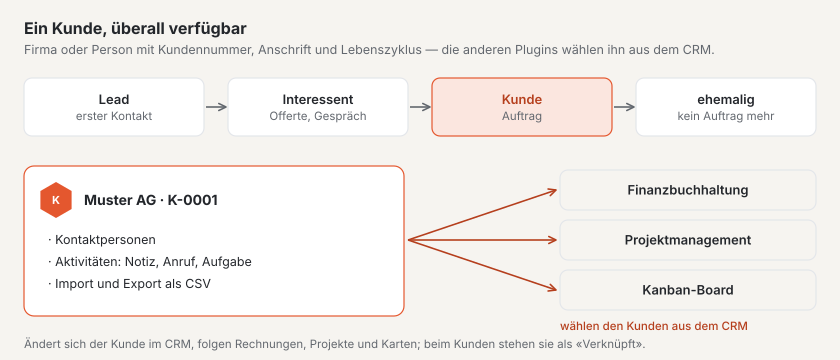
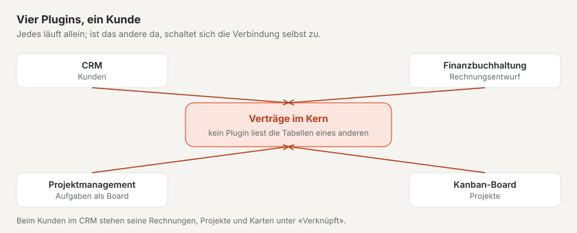

# Plugin «CRM»

Mit dem «CRM» führen Sie Ihre Kunden an einem Ort: Firmen und Personen mit Kundennummer, Anschrift, Kontaktpersonen,
Aktivitäten und ihrem Stand im Lebenszyklus — vom ersten Kontakt bis zum ehemaligen Kunden. Haben Sie dazu die Plugins
«Finanzbuchhaltung», «Projektmanagement» oder «Kanban-Board», wählen diese die Kunden direkt aus dem CRM. Das Plugin
ist kostenpflichtig — CHF 99 mit einem Jahr Updates — und kommt von Basalto.

## Installieren und einschalten

1. Auf basaltocms.com kaufen — einmalig je Installation ([Kaufen](installieren.md#kaufen)).
2. Im Backend unter **Verwaltung › Module › Marktplatz** bei «CRM» **«Installieren»**
   ([Plugin installieren](installieren.md#plugin-installieren)).
3. Unter **Verwaltung › Sites › Site bearbeiten › Reiter «Module»** einschalten. Ab Werk ist es aus.

Danach steht unter **Inhalte** der Menüpunkt **«CRM»**. Die Zahl daran nennt die offenen Aufgaben, die heute oder früher
fällig sind.

## Einen Kunden anlegen

1. Unter **CRM** auf **«Neuer Kunde»**.
2. Die **Art** wählen: **Firma** oder **Person**. Bei einer Firma tragen Sie den **Firmennamen** ein, bei einer Person
   **Vorname** und **Nachname** — sie bilden dann den Namen.
3. Den **Lebenszyklus** wählen (siehe unten) und, wenn Sie bei diesem Kunden auch einkaufen, **«Auch Lieferant»**
   ankreuzen.
4. Anschrift, E-Mail, Telefon und auf Wunsch **UID**, **Sprache**, **Website**, **Verantwortlich** und **Notizen**
   ergänzen.
5. **«Anlegen»**.

Die **Kundennummer** vergibt das CRM selbst: «K-0001», «K-0002» und so weiter, ohne Lücken. Danach öffnet sich der
Kunde; alles, was Sie dort ändern, speichert sich selbst.

| Feld | Was geprüft wird |
| --- | --- |
| **Land** | ISO-Code mit zwei Buchstaben, zum Beispiel CH, LI, DE, AT, FR oder IT; leer heisst Schweiz |
| **PLZ** | Schweiz und Liechtenstein: vier Ziffern von 1000 bis 9658 · Österreich: vier Ziffern · Deutschland, Frankreich, Italien: fünf Ziffern · andere Länder: bis 12 Zeichen |
| **UID** | beginnt sie mit «CHE», hat sie die Form CHE-123.456.789, auf Wunsch mit «MWST» dahinter |
| **E-Mail** | eine gültige Adresse; sie wird klein geschrieben gespeichert |

## Lebenszyklus

| Stand | Bedeutung |
| --- | --- |
| **Lead** | erster Kontakt, noch kein Gespräch |
| **Interessent** | Sie sind im Gespräch oder haben eine Offerte geschickt |
| **Kunde** | es gibt einen Auftrag — so ist es ab Werk |
| **Ehemaliger Kunde** | im Moment kein Auftrag mehr |

Den Stand ändern Sie beim Kunden oder für mehrere auf einmal: in der Liste markieren und unten **«Lebenszyklus: …»**
wählen.

## Kontaktpersonen

Bei einer Firma halten Sie unter **Kontaktpersonen** die Menschen fest, mit denen Sie zu tun haben: Vorname, Nachname,
**Funktion**, E-Mail und Telefon. Eine davon ist der **Hauptkontakt** — die erste von selbst; kreuzen Sie bei einer
anderen **«Hauptkontakt»** an, wechselt er. Ein Klick auf eine Kontaktperson öffnet sie zum Bearbeiten; dort lässt sie
sich auch löschen.

**Gut zu wissen:** Mit dem Plugin «Projektmanagement» öffnet die E-Mail-Adresse einer Kontaktperson im Kundenkonto der
Website die Projekte dieses Kunden.

## Aktivitäten und Aufgaben

Unter **«Aktivität erfassen»** halten Sie fest, was mit dem Kunden geschehen ist oder noch ansteht:

| Art | Wofür |
| --- | --- |
| **Notiz** | was Sie sich merken wollen |
| **Anruf**, **Besprechung**, **E-Mail** | Gespräche mit Datum und auf Wunsch mit Kontaktperson |
| **Aufgabe** | etwas, das zu tun ist — mit **«Fällig am»** |

Offene Aufgaben stehen beim Kunden zuoberst; ist das Datum vorbei, sind sie rot. Mit **«Als erledigt markieren»** ist
eine Aufgabe erledigt. Die Kennzahl **«Fällige Aufgaben»** über der Liste und die Zahl am Menüeintrag zählen alle offenen
Aufgaben, die heute oder früher fällig sind.

## Kunden finden

Die Liste zeigt alle Kunden, die nicht im Archiv sind, nach Name. Die **Suche** findet Namen, Kundennummern, Orte,
E-Mail-Adressen, UID und Kontaktpersonen — Umlaute und Gross- und Kleinschreibung spielen keine Rolle: «zurich» findet
Zürich. Mehrere Wörter müssen alle vorkommen («anna keller»). Dazu filtern Sie nach **Lebenszyklus** und unter
**Liste** nach **Aktiv**, **Lieferanten** oder **Archiv**.

## Archivieren statt löschen

Kunden werden nicht gelöscht, sondern archiviert — beim Kunden mit **«Archivieren»** oder für mehrere in der Liste. Ein
archivierter Kunde lässt sich weiter ansehen und ändern, erscheint aber in keiner Auswahl der anderen Plugins mehr;
Rechnungen, Projekte und Karten behalten ihn. Unter **Liste › Archiv** holen Sie ihn mit **«Zurückholen»** wieder
zurück.

## Import und Export

Unter **CRM › Import und Export**:

- **«Alle Kunden exportieren»** lädt alle Kunden, die nicht im Archiv sind, als CSV-Datei herunter.
- **«Vorlage herunterladen»** gibt eine Datei mit den Spalten und einer Beispielzeile.
- **«Liste einlesen»** nimmt eine CSV-Datei entgegen.

Die Datei hat Semikolons als Trenner und ist in UTF-8 gespeichert — in Excel als «CSV UTF-8». Die Spalten heissen
**Kundennummer**, **Art**, **Firmenname**, **Vorname**, **Nachname**, **Lebenszyklus**, **Lieferant**, **E-Mail**,
**Telefon**, **Website**, **Strasse und Nummer**, **PLZ**, **Ort**, **Land**, **UID**, **Sprache** und **Notizen**; nicht
alle müssen vorhanden sein. Beim Einlesen gilt:

- Eine Zeile mit einer **bekannten Kundennummer** oder **E-Mail-Adresse** ändert diesen Kunden, statt ihn doppelt
  anzulegen. Leere Zellen und fehlende Spalten lassen seine Angaben, wie sie sind.
- Alle anderen Zeilen werden neue Kunden mit der nächsten Kundennummer.
- Eine Zeile mit Fehlern — etwa einer falschen PLZ — wird übersprungen; die Meldung nennt sie mit ihrer Nummer. Die
  übrigen Zeilen werden übernommen.

**Gut zu wissen:** Werte, die Excel als Formel lesen würde (etwa eine Telefonnummer mit «+»), tragen im Export ein
Hochkomma davor. Beim Einlesen fällt es wieder weg.

## Zusammenspiel mit anderen Plugins

Sobald ein Kunde angelegt ist, wählen ihn die anderen Plugins — ohne weiteren Schritt:

| Plugin | Was es mit dem Kunden macht |
| --- | --- |
| **Finanzbuchhaltung** | Kunden als Debitoren für Rechnungen, Lieferanten als Kreditoren |
| **Projektmanagement** | Projekte je Kunde; die E-Mail-Adressen von Kunde und Kontaktpersonen öffnen die Projekte im Kundenkonto |
| **Kanban-Board** | Karten an Kunden hängen |

Ändern Sie Name oder Anschrift im CRM, übernehmen die anderen Plugins die Änderung. Was sie zu einem Kunden wissen —
Rechnungen, Projekte, Karten —, steht bei ihm unter **«Verknüpft»**.

## Datenschutz

- **Auskunft und Löschung** je E-Mail-Adresse erledigt die Verwaltung unter «Verwaltung › Benutzer» (oder
  `php artisan basalto:privacy`): Die Auskunft nennt Kunden mit dieser Adresse samt Aktivitäten und Kontaktpersonen.
  Das Löschen entfernt Kontaktpersonen mit dieser Adresse; ein Kunde, der eine Person ist, verliert Name, Anschrift,
  Telefon, Notizen und Aktivitäten — die Kundennummer bleibt, damit Rechnungen und Projekte ihren Bezug behalten. Bei
  einer Firma fällt nur die E-Mail-Adresse weg.
- Der **Export einer Site** nimmt die Kunden nicht mit — nutzen Sie dafür den Export als CSV.

## Wenn etwas nicht klappt

| Zeichen | Ursache | Lösung |
| --- | --- | --- |
| «Die PLZ in der Schweiz und in Liechtenstein hat vier Ziffern (1000–9658).» | PLZ und Land passen nicht zusammen | unter **Land** den richtigen ISO-Code eintragen, etwa DE für Deutschland |
| «Eine Firma braucht einen Firmennamen.» | Art «Firma» ohne Firmennamen | Firmennamen eintragen oder die Art «Person» wählen |
| Ein Kunde fehlt in der Auswahl der Finanzbuchhaltung oder eines Projekts | er ist archiviert, oder das CRM ist für diese Site aus | unter **Liste › Archiv** zurückholen bzw. das CRM unter «Module» der Site einschalten |
| «Die Datei hat keine erkennbare Kopfzeile …» | die erste Zeile nennt keine bekannten Spalten | die Vorlage herunterladen und deren Kopfzeile übernehmen |
| Umlaute sind nach dem Import falsch | die Datei ist nicht in UTF-8 gespeichert | in Excel «CSV UTF-8» wählen |
| Ein Kunde ist nach dem Import doppelt | weder Kundennummer noch E-Mail-Adresse stimmten überein | den doppelten archivieren; beim nächsten Mal die Spalte **Kundennummer** aus dem Export mitgeben |

## Weiter

- [Für Installationen](installieren.md)
- [Marktplatz](README.md)
- [Plugin «Vereinsbeiträge mit QR-Rechnung»](plugin-vereinsbeitraege.md)
