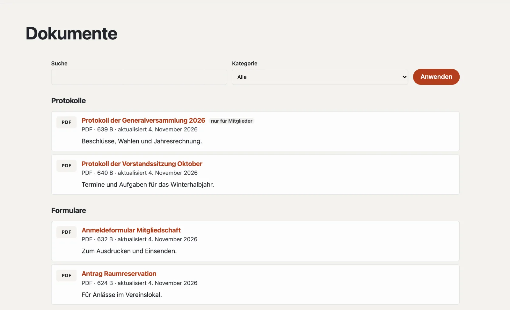

# Plugin «Dokumente und Downloads»

Mit «Dokumente und Downloads» stellen Sie Dateien zum Herunterladen bereit: Protokolle, Formulare, Preislisten,
Statuten. Besucher finden sie nach Kategorien auf einer eigenen Seite; laden Sie eine neue Fassung hoch, bleibt der
Link gleich. Dokumente «nur für Mitglieder» laden nur angemeldete Mitglieder herunter. Das Plugin ist kostenlos und
kommt von Basalto.



## Installieren und einschalten

1. Im Backend unter **Verwaltung › Module › Marktplatz** bei «Dokumente und Downloads» **«Installieren»**
   ([Plugin installieren](installieren.md#plugin-installieren)).
2. Unter **Verwaltung › Sites › Site bearbeiten › Reiter «Module»** für die Sites einschalten — ab Werk ist es aus.

Danach steht unter **Inhalte** der Reiter **«Dokumente»**.

## Die Dokumentseite anlegen

1. **Seiten › Neu** (oder eine bestehende Seite), Name zum Beispiel «Downloads».
2. Reiter **«Experten»** › **«Modul einhängen»** › **«Dokumente»**, speichern.
3. Die Seite wie gewohnt veröffentlichen.

Die Seite zeigt alle Dokumente nach Kategorien, ab sechs Dokumenten mit Suche. `?kategorie=<kennung>` zeigt nur eine
Kategorie — praktisch als Link aus dem Menü.

## Ein Dokument hochladen

Unter **Inhalte › Dokumente** **«Dokument hochladen»**: Datei wählen, Titel (leer: aus dem Dateinamen) und Kategorie.
Es ist sofort auf der Dokumentseite. Erlaubt sind PDF, Word, Excel, PowerPoint, OpenDocument, RTF, Text, CSV, ZIP und
Bilder (JPEG, PNG, WebP) bis 20 MB.

| Im Dokument | |
| --- | --- |
| Titel, Beschreibung | je Sprache der Site |
| Kategorie | für die Gruppen auf der Dokumentseite |
| Nur für Mitglieder | Gäste sehen das Dokument mit Schloss und melden sich zum Herunterladen an |
| Auf der Dokumentseite zeigen | ohne Haken ist das Dokument **verborgen** — der Link funktioniert dann nicht |
| Adresse unter der Dokumentseite | aus dem Titel vorgeschlagen |
| **Neue Fassung hochladen** | ersetzt die Datei, der Link bleibt; die letzten fünf Fassungen bleiben unter «Frühere Fassungen» |

Die Spalte **«Downloads»** zählt, wie oft eine Datei geladen wurde.

## Kategorien

Unter **Inhalte › Dokumente › Kategorien** legen Sie Kategorien mit Name, Kennung (für `?kategorie=` und Lava) und
Reihenfolge an. Ohne Kategorien stehen alle Dokumente in einer Liste. Löschen Sie eine Kategorie, bleiben ihre
Dokumente — ohne Kategorie.

## Nur für Mitglieder

Mit dem Modul **«Mitglieder»** sehen Gäste ein Dokument «nur für Mitglieder» mit einem Schloss und melden sich zum
Herunterladen an ([Mitglieder](../redaktion/mitglieder.md)). Ist das Modul aus, lädt ein solches Dokument niemand
ausser der Redaktion herunter.

## Dokumente auf anderen Seiten

Der Lava-Teil **«Dokumente»** zeigt die Dokumente einer Kategorie auf einer beliebigen Seite: unter
**Einrichtung › Layouts › Reiter «Teile»** **«+ Instanz»** (Kategorie, Anzahl, Überschrift) oder im Theme:

```lava

```

## Gut zu wissen

- Downloads gehen über die Site, nicht über einen direkten Pfad zur Datei — so gelten Zugriff und Zähler immer.
- PDF und Bilder öffnen sich im Browser, alles andere wird heruntergeladen.
- Dateien gehen nicht mit dem Export einer Site mit; ziehen Sie sie mit der Sicherung um.

## Weiter

- [Mitglieder](../redaktion/mitglieder.md)
- [Für Installationen](installieren.md)
- [Marktplatz](README.md)
