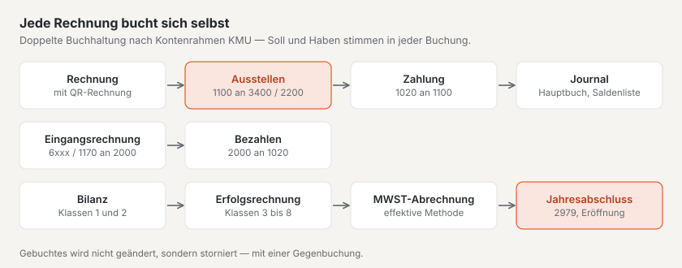

# Plugin «Finanzbuchhaltung»

Mit «Finanzbuchhaltung» führen Sie die Buchhaltung Ihrer Firma in Basalto: doppelte Buchhaltung nach dem Schweizer
Kontenrahmen KMU mit Journal, Hauptbuch und Saldenliste, Debitoren und Kreditoren, Rechnungen mit Schweizer
QR-Rechnung, Eingangsrechnungen, Zahlungen, Bilanz, Erfolgsrechnung, MWST-Abrechnung nach der effektiven Methode und
Jahresabschluss. Das Plugin ist kostenpflichtig — CHF 149 mit einem Jahr Updates — und kommt von Basalto.

## Installieren und einschalten

1. Auf basaltocms.com kaufen — einmalig je Installation ([Kaufen](installieren.md#kaufen)).
2. Im Backend unter **Verwaltung › Module › Marktplatz** bei «Finanzbuchhaltung» **«Installieren»**
   ([Plugin installieren](installieren.md#plugin-installieren)).
3. Unter **Verwaltung › Sites › Site bearbeiten › Reiter «Module»** einschalten. Ab Werk ist das Plugin aus.

Danach steht unter **Inhalte** der Menüpunkt **«Finanzbuchhaltung»**. Die Zahl daran nennt die überfälligen Rechnungen.

## Firma und Konto eintragen

Unter **Finanzbuchhaltung › Einstellungen** stehen die Angaben für jede Rechnung und den QR-Zahlteil. Sie speichern
sich selbst.

| Feld | |
| --- | --- |
| **Name der Firma**, **Strasse**, **Hausnummer**, **PLZ**, **Ort**, **Land** | Absender der Rechnung und «Konto / Zahlbar an» im Zahlteil; Schweiz oder Liechtenstein |
| **IBAN oder QR-IBAN** | Konto der Firma. Mit einer QR-IBAN trägt jede Rechnung eine **QR-Referenz**, mit einer gewöhnlichen IBAN eine **Creditor Reference (RF)** |
| **BESR-ID** | nur, wenn Ihre Bank zur QR-IBAN eine vergeben hat — sonst leer lassen |
| **UID/MWST-Nummer** | steht auf jeder Rechnung, zum Beispiel «CHE-123.456.789 MWST» |
| **Mehrwertsteuerpflichtig** | ohne Häkchen tragen neue Positionen keine MWST, und die Rechnung vermerkt «Nicht mehrwertsteuerpflichtig.» |
| **MWST-Satz neuer Positionen**, **Ertragskonto neuer Positionen** | Vorgaben für Positionen — auch für Rechnungen, die andere Plugins übergeben |
| **Konto für Zahlungen** | das Bankkonto, auf das Zahlungen gebucht werden (ab Werk 1020 Bank) |
| **Zahlungsfrist (Tage)** | bestimmt «Zahlbar bis», wenn eine Rechnung kein eigenes Datum hat (ab Werk 30) |
| **Satz auf der Rechnung** | zum Beispiel ein Dank für den Auftrag |

## Das erste Geschäftsjahr anlegen

Buchungen gehören immer zu einem offenen Geschäftsjahr. Unter **Finanzbuchhaltung › Geschäftsjahre** tragen Sie
**Beginn** und **Ende** ein und wählen **«Anlegen»**. Mit dem ersten Geschäftsjahr entstehen:

- der **Kontenplan** mit den gebräuchlichen Konten des Kontenrahmens KMU, von 1000 Kasse und 1020 Bank über 1100
  Forderungen aus Lieferungen und Leistungen, 2000 Verbindlichkeiten aus Lieferungen und Leistungen und 2200
  Geschuldete MWST bis 3400 Dienstleistungserlöse, 6000 Raumaufwand und 2979 Jahresgewinn oder Jahresverlust;
- die **MWST-Sätze** ab 2024: Umsatzsteuer 8,1 % (UN81), 2,6 % (UR26) und 3,8 % (UB38), Vorsteuer auf Material und
  Dienstleistungen (VM81, VM26, VM38, Konto 1170) und auf Investitionen und übrigem Betriebsaufwand (VI81, VI26,
  Konto 1171), jeweils mit der Ziffer der MWST-Abrechnung.

Unter **Kontenplan** ergänzen Sie eigene Konten (Nummer mit vier bis sechs Ziffern) und benennen bestehende um. Die
**Art** — Aktiven, Passiven, Ertrag, Aufwand oder Abschluss — ergibt sich aus der Klasse und bestimmt, ob das Konto in
der Bilanz oder in der Erfolgsrechnung steht. Ein Konto ohne Häkchen **«In Auswahllisten anbieten»** bleibt mit seinen
Buchungen erhalten, erscheint aber in keiner Auswahl mehr. Ändert sich ein Steuersatz, legen Sie besser einen neuen
MWST-Code an und setzen den alten auf inaktiv — gebuchte Beträge behalten ihren Satz.

## Debitoren und Kreditoren

Unter **Debitoren und Kreditoren** stehen die Personenkonten: **Debitoren** bekommen Ihre Rechnungen, **Kreditoren**
schicken Ihnen Rechnungen. Die Spalte **Offene Posten** zeigt, was noch offen ist; ein Klick öffnet das Personenkonto
mit seinen Rechnungen.

- **Ohne CRM** legen Sie Personenkonten hier an: Art, Name oder Firma, Kontaktperson, Anschrift, E-Mail und
  UID/MWST-Nummer. Die Nummer vergibt die Buchhaltung selbst («DEB-0001», «KRE-0001»).
- **Mit dem Plugin «CRM»** wählen Sie bei einer Rechnung direkt einen Kunden aus Ihrer Kundenliste. Das Personenkonto
  entsteht beim ersten Gebrauch; Name und Anschrift pflegen Sie im CRM, die Buchhaltung folgt jeder Änderung. Für
  Eingangsrechnungen stehen die Kunden zur Wahl, die im CRM als **«Lieferant»** markiert sind. Ein Personenkonto, das
  schon vor dem CRM bestand, verbindet sich von selbst mit dem Kunden, der dieselbe E-Mail-Adresse hat.

## Eine Rechnung schreiben

1. In der Übersicht **Finanzbuchhaltung** bei **«Neue Rechnung»** den **Debitor** und einen **Titel** wählen und
   **«Entwurf anlegen»**.
2. Im Entwurf unter **«Position hinzufügen»** Text, **Menge**, **Einheit**, **Preis ohne MWST**, **MWST** und
   **Ertragskonto** eintragen und **«Hinzufügen»** — so viele Positionen wie nötig. Die Summen rechnen sich selbst:
   die MWST je Satz auf die Summe seiner Positionen, auf den Rappen gerundet.
3. Oben **Rechnungsdatum**, **Zahlbar bis** und eine **Einleitung** ergänzen, wenn Sie möchten — leer gilt der Tag des
   Ausstellens und die Zahlungsfrist der Einstellungen. **«Vorschau (PDF)»** zeigt die Rechnung mit dem Vermerk
   «Entwurf».
4. **«Ausstellen»**: Die Rechnung bekommt die nächste Nummer des Jahres («2027-0001»), ihre Zahlungsreferenz und wird
   gebucht — Forderungen aus Lieferungen und Leistungen im Soll, Ertrag und Geschuldete MWST im Haben.

Fehlt noch etwas — Positionen, Debitor, Kontoangaben oder ein offenes Geschäftsjahr für das Rechnungsdatum —, nennt der
Entwurf es unter **«Noch nicht bereit»**. **«PDF»** öffnet die ausgestellte Rechnung mit dem QR-Zahlteil zum Versand. Ein
Entwurf lässt sich löschen; eine ausgestellte Rechnung ohne Zahlung lässt sich nur **stornieren**: Eine Gegenbuchung
hebt die Buchung auf, die Rechnung bleibt mit dem Stand **Storniert** in der Liste.

## Zahlungen erfassen

In einer offenen Rechnung unter **«Zahlung erfassen»** den **Betrag** (vorgeschlagen ist der offene Betrag) und
**«Eingang am»** eintragen und **«Erfassen»**. Die Buchhaltung bucht das Konto für Zahlungen an die Forderungen.
Teilzahlungen sind möglich; reicht der Betrag, ist die Rechnung **Bezahlt**. Die Liste der Übersicht filtert nach
**Offen**, **Entwürfe**, **Überfällig**, **Bezahlt**, **Storniert** und **Alle**.

## Eingangsrechnungen erfassen

Unter **Eingangsrechnungen** wählen Sie bei **«Eingangsrechnung erfassen»** den **Kreditor** und tragen Text,
**Rechnungsdatum**, **Betrag inkl. MWST**, **Aufwandkonto** und den Satz der **Vorsteuer** ein. **«Erfassen und
buchen»** rechnet die Vorsteuer aus dem Betrag heraus und bucht Aufwand und Vorsteuer (1170 bzw. 1171) an die
Verbindlichkeiten. In der Eingangsrechnung verbucht **«Zahlung erfassen»** die Zahlung vom Konto für Zahlungen; ohne
Zahlung lässt sie sich stornieren.

## Von Hand buchen

Im **Journal** stehen alle Buchungen eines Geschäftsjahres mit **Beleg-Nr.**, Datum, Text, **Soll**, **Haben** und
Herkunft. Unter **«Buchungssatz erfassen»** buchen Sie selbst — als Buchungssatz «Soll an Haben»:

1. **Datum**, **Beleg** und **Text** eintragen.
2. Das Konto im **Soll** und das Konto im **Haben** wählen und den **Betrag inkl. MWST** eintragen.
3. Optional einen **MWST-Code** wählen: Mit Umsatzsteuer geht der Steueranteil vom Ertragskonto auf 2200, mit
   Vorsteuer vom Aufwand- oder Anlagekonto auf 1170 bzw. 1171.
4. **«Buchen»** — die Buchung bekommt die nächste Belegnummer.

Soll und Haben müssen in jeder Buchung gleich sein. Gebuchtes wird nie geändert: Eine falsche Buchung öffnen Sie und
wählen **«Stornieren»** — eine Gegenbuchung mit vertauschtem Soll und Haben hebt sie auf, danach buchen Sie richtig.

## Hauptbuch und Berichte

- **Hauptbuch:** Ein Klick auf ein Konto im **Kontenplan** zeigt alle seine Buchungen im gewählten Geschäftsjahr mit
  **Gegenkonto** und laufendem **Saldo**; das neue Jahr beginnt mit der Eröffnungsbuchung.
- **Saldenliste:** Soll, Haben und Saldo je Konto — die Summen von Soll und Haben sind gleich.
- **Bilanz:** Aktiven (Umlaufvermögen, Anlagevermögen) und Passiven (kurzfristiges und langfristiges Fremdkapital,
  Eigenkapital) am Ende des Geschäftsjahres, mit **Vorjahr**. Solange das Jahr nicht abgeschlossen ist, steht der
  Erfolg als Zeile **«Gewinn/Verlust (nicht abgeschlossen)»** unter dem Eigenkapital.
- **Erfolgsrechnung:** Ertrag und Aufwand nach den Klassen 3 bis 8, mit Vorjahr; zuletzt **Jahresgewinn** oder
  **Jahresverlust**.

Die Berichte wählen das Geschäftsjahr oben in der Liste; ein Klick auf ein Konto öffnet sein Hauptbuch.

## MWST-Abrechnung

Unter **MWST-Abrechnung** rechnet die Buchhaltung nach der **effektiven Methode** mit **vereinbartem Entgelt** —
massgebend ist das Datum der Rechnung bzw. Buchung. Wählen Sie das **Quartal**, das **Semester** oder das **ganze Jahr**.
Die Liste zeigt die Ziffern des Formulars der Eidgenössischen Steuerverwaltung (ESTV) mit Beträgen ohne MWST:

| Ziffer | |
| --- | --- |
| **200** | Total der vereinbarten Entgelte (Erlöse der Klasse 3) |
| **289** | Umsatz ohne MWST-Code — prüfen Sie hier steuerbefreite und ausgenommene Umsätze (Ziffern 220 bis 280) |
| **299** | Steuerbarer Gesamtumsatz |
| **303**, **313**, **343** | Leistungen zu 8,1 %, 2,6 % und 3,8 % mit der Steuer |
| **399** | Total geschuldete Steuer |
| **400**, **405**, **479** | Vorsteuer auf Material und Dienstleistungen, auf Investitionen und übrigem Betriebsaufwand, Total |
| **500** bzw. **510** | zu bezahlender Betrag bzw. Guthaben |

Die Abrechnung ist eine Hilfe: Vergleichen Sie die Werte vor dem Einreichen mit dem Formular der ESTV, und tragen Sie
Entgeltsminderungen, Korrekturen der Vorsteuer und die Ziffern 220 bis 280 selbst ein.

## Das Geschäftsjahr abschliessen

Unter **Geschäftsjahre** steht beim ältesten offenen Jahr **«Abschliessen»**. Der Jahresabschluss

1. überträgt den Erfolg mit einer Abschlussbuchung auf das Konto **2979 Jahresgewinn oder Jahresverlust**,
2. sperrt das Jahr — Buchungen sind danach nicht mehr möglich,
3. legt das Folgejahr an, falls es fehlt, und eröffnet es mit den Salden der Bilanz (Eröffnungsbuchung).

Die Gewinnverwendung — etwa von 2979 auf 2970 Gewinnvortrag oder Verlustvortrag — buchen Sie danach selbst im neuen
Jahr. Die Erfolgsrechnung des abgeschlossenen Jahres zeigt den Erfolg weiterhin.

## Mit CRM und Projektmanagement

- **CRM:** Kunden und Lieferanten wählen Sie aus dem CRM; beim Kunden im CRM stehen unter «Verknüpft» seine
  Rechnungen mit Nummer, Betrag und Stand.
- **Projektmanagement:** Erfasste Zeit eines Projekts kommt als Rechnungsentwurf in die Finanzbuchhaltung — mit dem
  Vorgabe-MWST-Satz und dem Vorgabe-Ertragskonto. Der Entwurf nennt, aus welchem Plugin er kommt. Löschen Sie ihn oder
  stornieren Sie die Rechnung, gibt das Projektmanagement die Zeit wieder zum Abrechnen frei.

## Im Kundenkonto

Kundinnen und Kunden sehen im Kundenkonto den Bereich **«Rechnungen»** mit ihren ausgestellten Rechnungen — alle, deren
Debitor ihre E-Mail-Adresse trägt, mit dem CRM auch die Rechnungen an die Firma, zu der sie als Kontaktperson gehören.
Offene Rechnungen stehen unter «Als Nächstes», das PDF mit QR-Zahlteil lässt sich herunterladen.

## Datenschutz und Aufbewahrung

- **Auskunft** je E-Mail-Adresse (unter «Verwaltung › Benutzer» oder `php artisan basalto:privacy`) nennt die
  Personenkonten und Rechnungen.
- **Löschen:** Rechnungen, Buchungen und Personenkonten sind Geschäftsbücher und müssen zehn Jahre aufbewahrt werden.
  Sie bleiben mit Name und Anschrift stehen; gelöscht wird die E-Mail-Adresse, damit die Rechnungen nicht mehr im
  Kundenkonto erscheinen. Personenkonten ohne Rechnung und ohne Buchung fallen ganz weg.
- Der **Export einer Site** nimmt die Buchhaltung nicht mit — sie bleibt bei der bisherigen Site.

## Gut zu wissen

- Rechnungen werden auf den Rappen genau gerechnet, ohne Rundung auf fünf Rappen — die QR-Rechnung wird elektronisch
  bezahlt.
- Die Finanzbuchhaltung nimmt Ihnen die Arbeit ab, ersetzt aber nicht die gesetzlichen Pflichten der Buchführung und der
  MWST. Lassen Sie Kontenplan, Abschluss und MWST-Abrechnung im Zweifel von Ihrer Treuhänderin oder Ihrem Treuhänder
  prüfen.
- Lohnbuchhaltung, Anlagenbuchhaltung, die Saldosteuersatzmethode und Fremdwährungen ausser CHF und EUR gehören nicht
  dazu.

## Wenn etwas nicht klappt

| Zeichen | Ursache | Lösung |
| --- | --- | --- |
| **«Noch kein Geschäftsjahr»** | es gibt noch kein Geschäftsjahr | unter **Geschäftsjahre** das erste anlegen |
| **«Kontoangaben fehlen»** | Name, IBAN, PLZ oder Ort der Firma fehlen | unter **Einstellungen** ergänzen |
| **«Noch nicht bereit»** im Entwurf | Positionen, Debitor, Kontoangaben oder Geschäftsjahr fehlen | die genannten Schritte erledigen |
| «Für den … gibt es kein Geschäftsjahr» | das Datum liegt ausserhalb aller Geschäftsjahre | das passende Geschäftsjahr anlegen oder das Datum korrigieren |
| «Das Geschäftsjahr … ist abgeschlossen» | das Datum liegt in einem abgeschlossenen Jahr | im offenen Jahr buchen |
| «Soll und Haben stimmen nicht überein» | eine Buchung geht nicht auf | Beträge der Zeilen prüfen |
| «Umsatzsteuer braucht ein Ertragskonto …» | der MWST-Code passt nicht zu den Konten | Umsatzsteuer-Codes mit einem Ertragskonto, Vorsteuer-Codes mit einem Aufwand- oder Anlagekonto buchen |
| **«Stornieren»** fehlt | die Rechnung hat schon eine Zahlung | erst klären, ob die Zahlung zurückgeht; eine Gutschrift buchen Sie von Hand |
| Kein Kunde aus dem CRM in der Auswahl | das CRM ist für diese Site aus oder der Kunde archiviert | CRM einschalten bzw. den Kunden im CRM zurückholen |

## Weiter

- [Plugin «CRM»](plugin-crm.md)
- [Plugin «Projektmanagement»](plugin-projektmanagement.md)
- [Marktplatz für Installationen](installieren.md)
- [Marktplatz](README.md)
