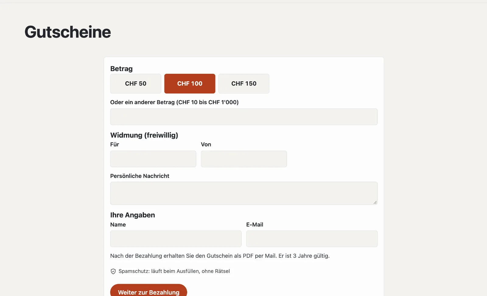

# Plugin «Gutscheine verkaufen»

Mit «Gutscheine verkaufen» bieten Sie Wertgutscheine online an: Betrag wählen, eine Widmung dazu, bezahlen per Karte
oder TWINT über Ihr eigenes Stripe-Konto — und gleich danach liegt der Gutschein als PDF mit Code im Postfach. Im
Backend lösen Sie ihn ganz oder teilweise ein und sehen den Restwert. Das Plugin kostet CHF 99 mit einem Jahr Updates
und kommt von Basalto.



## Installieren und einschalten

1. Auf basaltocms.com im Marktplatz kaufen ([Kaufen](installieren.md#kaufen)), dann im Backend unter
   **Verwaltung › Module › Marktplatz** bei «Gutscheine verkaufen» **«Installieren»**
   ([Plugin installieren](installieren.md#plugin-installieren)).
2. Unter **Verwaltung › Sites › Site bearbeiten › Reiter «Module»** für die Sites einschalten — ab Werk ist es aus.
3. Unter **Verwaltung › Zahlungen** Ihr Stripe-Konto verbinden ([Zahlungen](../verwaltung/zahlungen.md)).

Danach steht unter **Inhalte** der Reiter **«Gutscheine»**.

## Die Gutschein-Seite anlegen

**Seiten › Neu**, Name zum Beispiel «Gutscheine», Reiter **«Experten»** › **«Modul einhängen»** › **«Gutscheine»**,
veröffentlichen. Besucher wählen dort einen Betrag (oder einen anderen innerhalb Ihrer Grenzen), schreiben auf Wunsch
**Für**, **Von** und eine **persönliche Nachricht** und geben Name und E-Mail an. **«Weiter zur Bezahlung»** führt zu
Stripe.

Nach dem Bezahlen:

- erhält der Käufer eine Mail mit dem Gutschein als PDF (Betrag, Widmung, Code, gültig bis, Ihre Adresse),
- zeigt die Seite den Code und **«Gutschein herunterladen (PDF)»**,
- erhält Ihr Team eine Nachricht «Gutschein verkauft».

Wird nicht bezahlt, verfällt die Bestellung — es entsteht kein Gutschein.

Einen Hinweis mit den Beträgen als Knöpfen setzen Sie mit dem Lava-Teil **«Gutscheine»** auf jede Seite:

```lava

```

## Verkauf einstellen

Unten auf **Inhalte › Gutscheine** unter **«Verkauf»**:

| Einstellung | |
| --- | --- |
| Beträge zur Wahl | mit Komma getrennt, z. B. 50, 100, 150 |
| Freier Betrag erlaubt, ab, bis | ein anderer Betrag innerhalb dieser Grenzen |
| Gültig (Jahre) | ab dem Kauf; prüfen Sie die Frist für Ihr Geschäft rechtlich |
| Hinweis auf dem Gutschein | z. B. «Einlösbar im Restaurant und an der Bar» |

## Einlösen

Oben auf **Inhalte › Gutscheine** unter **«Einlösen»**: **Code** (Bindestriche, Leerzeichen und Kleinbuchstaben sind
egal) und **Betrag**, auf Wunsch eine Notiz wie «Rechnung 1043». Basalto zieht den Betrag ab und zeigt den Restwert;
mehr als den Restwert lässt es nicht zu, ebenso wenig einen abgelaufenen oder stornierten Gutschein. Bei Restwert 0 ist
der Gutschein **aufgebraucht**.

Die Seite eines Gutscheins zeigt jedes Einlösen mit Datum, Betrag, Notiz und Person, dazu das **PDF**,
**«Um ein Jahr verlängern»** und **«Stornieren»**. Eine Rückzahlung bei einer Stornierung lösen Sie im Stripe-Dashboard
aus.

## Gutscheine ohne Online-Kauf

**«Gutschein ausstellen»** unten auf **Inhalte › Gutscheine** erstellt einen gültigen Gutschein — verkauft an der Kasse
oder verschenkt —, auf Wunsch mit dem PDF per Mail. Ausstellen und Einlösen gehen auch ohne eingerichtete Zahlungen.

## Datenschutz

Gespeichert werden Name und E-Mail des Käufers und die Widmung. Löschen Sie die Angaben einer Person unter
**Verwaltung › Benutzer** ([Benutzer](../verwaltung/benutzer.md)), bleibt der Gutschein gültig. Zwei Jahre nach Ablauf
entfernt der nächtliche Löschlauf die Angaben zur Person; nie bezahlte Bestellungen schon nach einem Tag.

## In der Statistik

Unter [Statistik](../verwaltung/statistik.md) zeigt der Reiter **Gutscheine** verkaufte Gutscheine, Umsatz, eingelöste Beträge und den offenen Restwert, mit dem Vergleich zum Zeitraum davor.

## Weiter

- [Zahlungen](../verwaltung/zahlungen.md)
- [Für Installationen](installieren.md)
- [Marktplatz](README.md)
