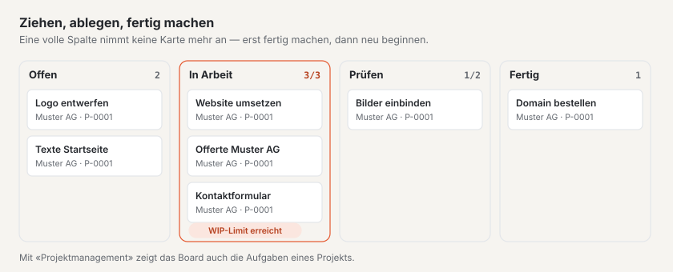

# Plugin «Kanban-Board»

Mit dem «Kanban-Board» planen Sie Arbeit nach der Kanban-Methode: Karten wandern von Spalte zu Spalte, von «Offen» bis
«Fertig», und ein **WIP-Limit** (Work in Progress — höchstens so viele Karten gleichzeitig in einer Spalte) sorgt
dafür, dass zuerst fertig wird, was angefangen ist. Karten tragen eine verantwortliche Person, eine Fälligkeit und
Labels; mit den Plugins «CRM» und «Projektmanagement» hängen Sie sie an Kunden und Projekte. Das Plugin ist kostenlos
und kommt von Basalto.

## Installieren und einschalten

1. Im Backend unter **Verwaltung › Module › Marktplatz** bei «Kanban-Board» **«Installieren»**
   ([Plugin installieren](installieren.md#plugin-installieren)).
2. Unter **Verwaltung › Sites › Site bearbeiten › Reiter «Module»** für die Sites einschalten, die es nutzen sollen —
   ab Werk ist es aus.

Danach steht unter **Inhalte** der Menüpunkt **«Kanban-Board»**. Die Zahl daran nennt die offenen Karten, deren
Fälligkeit vorbei ist.

## Ein Board anlegen

1. Unter **Inhalte › Kanban-Board** im Formular **«Neues Board»** einen **Namen** und auf Wunsch eine **Beschreibung**
   eintragen.
2. **«Anlegen»** — das Board öffnet sich.

Jedes neue Board kommt mit vier Spalten und drei Labels, die Sie danach unter **«Einstellungen»** anpassen:

| Spalte | WIP-Limit | |
| --- | --- | --- |
| **Offen** | ohne | alles, was noch nicht begonnen ist |
| **In Arbeit** | 3 | |
| **Prüfen** | 2 | |
| **Fertig** | ohne | gilt als erledigt — Karten bekommen hier ihr Erledigt-Datum |

Die Labels heissen **Dringend** (rot), **Wartet** (gelb) und **Idee** (Lava).

## Karten anlegen und verschieben

- **Anlegen:** Unter jeder Spalte steht das Feld **«+ Karte hinzufügen»**. Titel tippen, Enter drücken — die Karte
  steht unten in der Spalte.
- **Mit der Maus:** Karte ziehen und an der gewünschten Stelle ablegen, in derselben oder einer anderen Spalte.
- **Mit der Tastatur:** Unter jeder Karte stehen vier Pfeilknöpfe, die Sie mit der Tabulatortaste erreichen —
  **←** und **→** schieben die Karte in die Spalte links bzw. rechts (unten an), **↑** und **↓** eine Stelle nach oben
  bzw. unten.
- **Öffnen:** Ein Klick auf den Titel öffnet die Karte.

Das Board zeigt den neuen Stand sofort. Auf schmalen Bildschirmen stehen die Spalten untereinander.

Jede Karte zeigt ihren Titel, darunter Kunde und Projekt, die Labels, die Fälligkeit — rot, wenn sie vorbei ist und
die Karte nicht in einer erledigten Spalte liegt — und die verantwortliche Person.

## Das WIP-Limit

Oben rechts in jeder Spalte steht, wie viele Karten darin liegen, mit Limit etwa **«2/3»**. Ist das Limit erreicht,
nimmt die Spalte keine Karte mehr an: Weder Verschieben noch «Karte hinzufügen» gehen, und das Board meldet
**«Die Spalte «In Arbeit» hat ihr WIP-Limit (3) erreicht.»** Machen Sie zuerst eine Karte fertig und schieben Sie sie
weiter — so will es die Kanban-Methode.

- Innerhalb einer vollen Spalte umordnen und Karten hinausschieben geht immer.
- Senken Sie das Limit unter die Zahl der Karten, die schon darin liegen, ist die Spalte rot umrandet, bis wieder
  genug Karten weitergezogen sind.
- Leer oder 0 heisst: ohne Limit.

## Eine Karte bearbeiten

Ein Klick auf den Titel öffnet die Karte. Sie speichert sich selbst.

| Feld | |
| --- | --- |
| **Titel**, **Beschreibung** | worum es geht |
| **Verantwortlich** | eine Person, die im Backend dieser Site arbeitet — sie bekommt eine Benachrichtigung |
| **Fällig am** | ist das Datum vorbei, erscheint es auf dem Board rot (ausser in einer erledigten Spalte) |
| **Label «…»** | die Labels des Boards zum Ankreuzen |
| **Kunde** | nur mit dem Plugin «CRM»: ein Kunde aus Ihrer Kundenliste |
| **Projekt** | nur mit dem Plugin «Projektmanagement»: ein laufendes Projekt |

Oben stehen **«Zum Board»**, **«Archivieren»** und **«Löschen»**.

## Spalten und Labels einstellen

Auf dem Board öffnet **«Einstellungen»**:

- **Board:** Name, Beschreibung und bis zu sechs **Labels** mit Farbe (Grau, Grün, Gelb, Rot, Lava). Benennen Sie ein
  Label um, bleibt es an seinen Karten; leeren Sie den Namen, verschwindet es von ihnen.
- **Spalten:** Ein Klick auf eine Spalte öffnet Name, **WIP-Limit** und **«Karten hier gelten als erledigt»**.
  **«Nach links»** und **«Nach rechts»** ändern die Reihenfolge. Löschen lässt sich eine Spalte erst, wenn keine Karte
  mehr darin liegt — auch keine archivierte.
- **Neue Spalte:** Name, WIP-Limit, erledigt — **«Anlegen»** setzt sie rechts an.
- **Archivierte Karten:** mit **«Zurückholen»** wieder unten in ihre Spalte, sofern das WIP-Limit es erlaubt.

## Mit CRM und Projektmanagement

Das Kanban-Board arbeitet allein. Sind die anderen Plugins installiert und für die Site eingeschaltet, kommen ihre
Daten von selbst dazu:

- **Mit dem [Plugin «CRM»](plugin-crm.md)** wählen Sie an einer Karte den **Kunden**. Ändert sich sein Name im CRM,
  folgt die Karte. Beim Kunden im CRM stehen seine offenen Karten unter den verknüpften Datensätzen.
- **Mit dem [Plugin «Projektmanagement»](plugin-projektmanagement.md)** wählen Sie das **Projekt**; das Projekt zeigt
  seine Karten ebenso. Dazu öffnet **«Als Kanban-Board»** in einem Projekt dessen Aufgaben als Board: Die Spalten sind
  die Stände der Aufgaben, Verschieben ändert den Stand, die Aufgaben bleiben im Projektmanagement. Die WIP-Limits
  dieser Boards stellen Sie unter dem Board bei **«WIP-Limits»** ein. Die Übersicht nennt solche Boards unter
  **«Weitere Boards»**.

Fehlt ein Plugin, gibt es an der Karte kein Feld dafür, und ein Hinweis sagt, was das Plugin bringen würde. Was schon
an einer Karte hängt, bleibt erhalten und steht oben auf der Karte.

## Archivieren und löschen

- **Boards** archivieren Sie in der Übersicht (Häkchen, dann **«Archivieren»**) oder unter **«Einstellungen»**. Der
  Filter **«Archiv»** zeigt sie; **«Zurückholen»** holt sie zurück. Endgültig löschen lässt sich ein Board nur aus dem
  Archiv — mit allen Spalten und Karten.
- **Karten** archivieren Sie in der Karte; sie verschwinden vom Board und stehen unter **«Einstellungen»** bei den
  archivierten Karten.

## Benachrichtigungen

Wird Ihnen eine Karte zugewiesen, meldet die Glocke **«Karte zugewiesen»** — auf Wunsch auch per Mail
([Benachrichtigungen](../redaktion/index.md#benachrichtigungen)). Wer sich eine Karte selbst zuweist, bekommt keine
Nachricht.

## Gut zu wissen

- Boards und Karten gehören zu ihrer Site. Beim Export einer Site gehen sie nicht mit — sie sind Arbeitsstand mit
  Personen und Verweisen auf andere Plugins.
- Wer Karten anlegen und verschieben darf, regelt der Bereich **«Kanban-Board»** in den Rollen
  ([Rollen und Rechte](../verwaltung/rollen.md)).

## Wenn etwas nicht klappt

| Zeichen | Ursache | Lösung |
| --- | --- | --- |
| «Die Spalte «…» hat ihr WIP-Limit (…) erreicht.» | die Spalte ist voll | erst eine Karte darin fertig machen und weiterziehen — oder das Limit unter «Einstellungen» erhöhen |
| Die Felder **Kunde** oder **Projekt** fehlen | das Plugin «CRM» bzw. «Projektmanagement» ist nicht installiert oder für die Site aus | installieren bzw. unter Site bearbeiten › «Module» einschalten |
| «Die Spalte hat noch Karten …» | in der Spalte liegen Karten, auch archivierte | Karten verschieben oder löschen, dann die Spalte löschen |
| «Als Kanban-Board» fehlt im Projekt | das Kanban-Board ist für die Site aus | unter Site bearbeiten › «Module» einschalten |
| Eine archivierte Karte lässt sich nicht zurückholen | ihre Spalte hat das WIP-Limit erreicht | Platz in der Spalte schaffen oder das Limit erhöhen |

## Weiter

- [Plugin «CRM»](plugin-crm.md)
- [Plugin «Projektmanagement»](plugin-projektmanagement.md)
- [Für Installationen](installieren.md)
- [Marktplatz](README.md)
