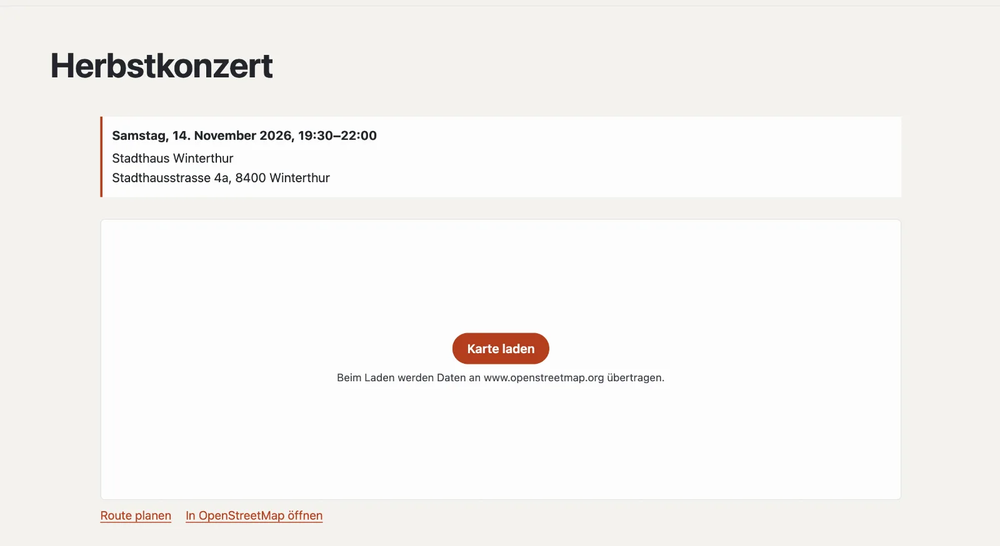

# Plugin «Karte ohne Tracking»

«Karte ohne Tracking» zeigt einen Ort auf einer Karte von OpenStreetMap — aber erst, wenn die Besucherin darauf
klickt. Bis dahin lädt die Seite nichts von einem fremden Server. Adressen in der Schweiz findet Basalto selbst, einmal,
über die Suche der Bundesgeodaten (geo.admin.ch). Darunter stehen «Route planen» und «In OpenStreetMap öffnen». Das
Plugin ist kostenlos und kommt von Basalto.



## Installieren und einschalten

1. Im Backend unter **Verwaltung › Module › Marktplatz** bei «Karte ohne Tracking» **«Installieren»**
   ([Plugin installieren](installieren.md#plugin-installieren)).
2. Unter **Verwaltung › Sites › Site bearbeiten › Reiter «Module»** für die Sites einschalten — ab Werk ist es aus.

## Eine Karte einsetzen

Die Karte ist ein Lava-Teil: unter **Einrichtung › Layouts › Reiter «Teile»** bei «Karte» **«+ Instanz»** und die
Einstellungen ausfüllen. Die Instanz setzen Sie im Editor einer Seite mit **«+ Lava-Teil»** ein — etwa auf der Seite
«Kontakt» — oder in eine Region eines Layouts ([Aufbau: Layouts, Teile und Templates](../einrichtung/aufbau.md)).

| Einstellung | |
| --- | --- |
| Adresse | z. B. «Stadthausstrasse 4a, 8400 Winterthur» — Basalto sucht den Ort einmal und merkt ihn sich |
| Bezeichnung | steht fett unter der Karte, z. B. «Stadthaus» |
| Zoom | 3 (ganz weit) bis 19 (Hauseingang), ab Werk 16 |
| Höhe | in Pixeln, 200 bis 800, ab Werk 360 |

Im Theme geht es direkt; statt einer Adresse auch mit Koordinaten:

```lava


```

Mit dem Plugin [Veranstaltungen](plugin-veranstaltungen.md) zeigt jede Veranstaltung mit Adresse ihre Karte von selbst.

## Orte prüfen und korrigieren

Unter **Inhalte › Orte der Karte** steht jede Adresse, die eine Karte zeigt, mit dem gefundenen Ort und seiner Quelle.

| Aktion | Wirkung |
| --- | --- |
| **Adresse prüfen** | sucht eine Adresse schon vorab — so sehen Sie, ob sie gefunden wird |
| **Breite, Länge** | von Hand setzen, etwa für einen Eingang hinter dem Haus; die Quelle wird «von Hand», und Basalto sucht nicht mehr |
| **Neu suchen** | fragt geo.admin.ch noch einmal; von Hand gesetzte Koordinaten werden ersetzt |
| **Vergessen** | entfernt den Ort; beim nächsten Aufruf einer Karte sucht Basalto ihn neu |

geo.admin.ch kennt Adressen, Orte und Namen der Schweiz. Findet die Suche eine Adresse nicht, erscheint statt der Karte
ein Link «Auf OpenStreetMap suchen»; nach sieben Tagen versucht es Basalto noch einmal. Antwortet der Dienst gerade
nicht, merkt sich Basalto nichts und versucht es beim nächsten Aufruf.

## Datenschutz

- Bis zum Klick auf **«Karte laden»** fragt der Browser der Besucherin keinen fremden Server an. Wer in den
  Cookie-Einstellungen «Externe Inhalte» erlaubt hat, sieht die Karte gleich.
- Erst mit dem Klick lädt die Karte von OpenStreetMap (www.openstreetmap.org); dabei erhält OpenStreetMap die
  IP-Adresse und die Angaben des Browsers. Erwähnen Sie das in der Datenschutzerklärung Ihrer Site.
- Die Suche bei geo.admin.ch macht der Server von Basalto — mit der Adresse aus dem Block, nie mit Daten von
  Besuchern. Die gefundenen Orte gehen mit dem Export einer Site mit.

## Weiter

- [Plugin «Veranstaltungen»](plugin-veranstaltungen.md)
- [Für Installationen](installieren.md)
- [Marktplatz](README.md)
