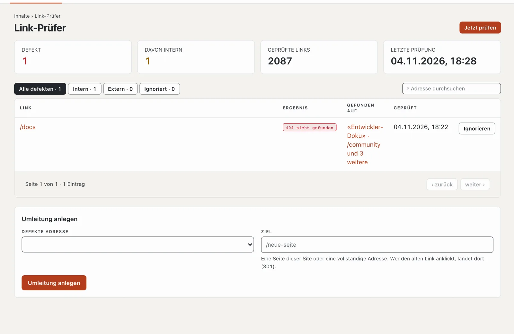

# Plugin «Link-Prüfer»

Der Link-Prüfer findet defekte Links und Bilder auf Ihrer Site — auf eigene Seiten, die es nicht mehr gibt, und auf
fremde Adressen, die nicht mehr antworten. Er zeigt, auf welcher Seite der Link steht, und legt für interne Fehler mit
einem Klick eine Umleitung an. Das Plugin ist kostenlos und kommt von Basalto.

## Installieren und einschalten

1. Im Backend unter **Verwaltung › Module › Marktplatz** bei «Link-Prüfer» **«Installieren»**
   ([Plugin installieren](installieren.md#plugin-installieren)).
2. Unter **Verwaltung › Sites › Site bearbeiten › Reiter «Module»** für die Sites einschalten — ab Werk ist es aus.

Danach steht unter **Inhalte** der Reiter **«Link-Prüfer»**.

## Wann geprüft wird

- **Jede Nacht** zwischen 1 und 5 Uhr (Zeitzone der Site) von selbst — vorausgesetzt, der Zeitplan der Installation
  läuft ([Betrieb](../verwaltung/betrieb.md)).
- **Jederzeit** mit **«Jetzt prüfen»**. Grosse Sites brauchen einige Minuten; die Seite zeigt, wie weit die Prüfung ist.

Geprüft werden alle veröffentlichten Seiten in allen Sprachen: Links, Bilder und eingebettete Dateien. Interne Adressen
prüft Basalto direkt, ohne Umweg über das Netz; fremde Adressen fragt es höflich nacheinander ab.

## Die Ergebnisse lesen

| Spalte | |
| --- | --- |
| Link | die defekte Adresse |
| Ergebnis | z. B. «404 nicht gefunden», «410 entfernt», «Zeitüberschreitung», «Keine Verbindung» |
| Gefunden auf | die Seiten, auf denen der Link steht — ein Klick öffnet sie |

Oben wählen Sie **«Alle defekten»**, **«Intern»**, **«Extern»** oder **«Ignoriert»**; die Suche filtert nach Adresse.

## Einen defekten Link beheben

- **Auf der Seite korrigieren:** Seite öffnen, Link im Editor anpassen. Bei der nächsten Prüfung verschwindet er.
- **Umleitung anlegen** (nur interne Adressen): die alte Adresse leitet dann dauerhaft (301) auf ein neues Ziel — eine
  Seite der Site oder eine vollständige Adresse. Die Umleitung steht danach auch unter **Seiten › Umleitungen**.
- **Ignorieren:** für Links, die absichtlich so sind oder nur gelegentlich nicht antworten. Unter «Ignoriert» holen
  Sie sie mit **«Wieder melden»** zurück.

## Wenn etwas nicht klappt

| Zeichen | Ursache | Lösung |
| --- | --- | --- |
| «Noch nicht geprüft» bleibt stehen | der Zeitplan der Installation läuft nicht | Cron einrichten ([Betrieb](../verwaltung/betrieb.md)) oder «Jetzt prüfen» |
| eine fremde Seite ist «defekt», im Browser aber erreichbar | sie sperrt automatische Abfragen | «Ignorieren» |
| die Prüfung dauert lange | viele Seiten oder langsame fremde Server | sie läuft in Etappen weiter; später neu laden |

## Weiter

- [Umleitungen](../redaktion/seiten.md#umleitungen)
- [Für Installationen](installieren.md)
- [Marktplatz](README.md)
