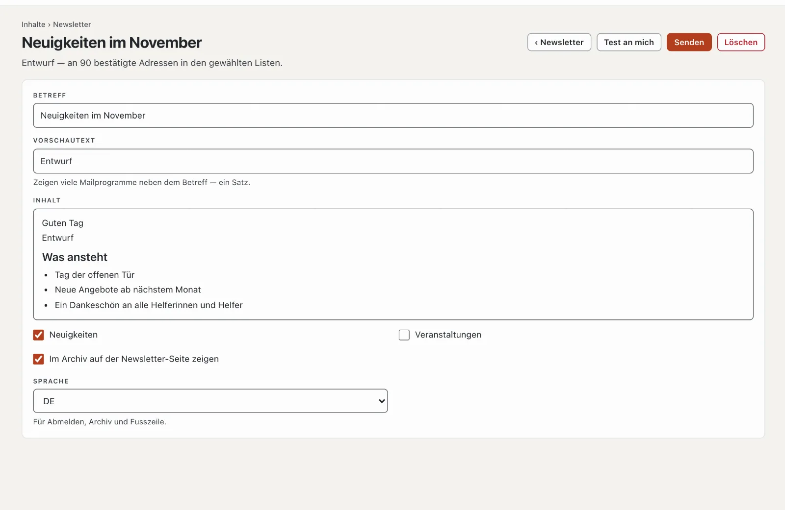

# Plugin «Newsletter»

Mit «Newsletter» schreiben Sie Ihren Abonnentinnen und Abonnenten regelmässig: Anmeldung mit Bestätigung per Mail
(Double-Opt-In), mehrere Listen zur Wahl, Abmelden mit einem Klick und ein Archiv der Ausgaben auf Ihrer Website.
Versendet wird über einen Versanddienst wie Brevo, Mailjet oder Infomaniak. Das Plugin kostet CHF 99 mit einem Jahr
Updates und kommt von Basalto.



## Installieren und einschalten

1. Auf basaltocms.com im Marktplatz kaufen ([Kaufen](installieren.md#kaufen)), dann im Backend unter
   **Verwaltung › Module › Marktplatz** bei «Newsletter» **«Installieren»**
   ([Plugin installieren](installieren.md#plugin-installieren)).
2. Unter **Verwaltung › Sites › Site bearbeiten › Reiter «Module»** für die Sites einschalten — ab Werk ist es aus.

Danach steht unter **Inhalte** der Reiter **«Newsletter»**.

## Einrichten

1. **Newsletter-Seite:** **Seiten › Neu**, Name zum Beispiel «Newsletter», Reiter **«Experten»** › **«Modul
   einhängen»** › **«Newsletter»**, veröffentlichen. Dort melden sich Besucher an, bestätigen, melden sich ab und lesen
   das Archiv.
2. **Listen:** unter **Inhalte › Newsletter › Listen und Versand** mindestens eine Liste, etwa «Neuigkeiten».
   **«Bei der Anmeldung zur Wahl»** macht sie öffentlich; interne Listen füllt nur das Team.
3. **Versanddienst:** gleiche Seite, unten. Einfaches Hosting erlaubt nur rund hundert Mails pro Stunde — Newsletter
   gehen deshalb über einen Dienst:

| Dienst | Was Sie eintragen |
| --- | --- |
| Brevo | SMTP-Benutzer und SMTP-Schlüssel aus dem Konto bei Brevo |
| Mailjet | API-Schlüssel als Benutzername, geheimen Schlüssel als Passwort |
| Infomaniak | Adresse und Passwort eines Postfachs bei Infomaniak |
| Eigener SMTP-Server | Server, Port (587 oder 465), Benutzername, Passwort |

Server und Port füllt Basalto bei Brevo, Mailjet und Infomaniak selbst aus. Die **Absender-Adresse** muss beim Dienst
bestätigt sein, und Ihre Domain braucht SPF und DKIM für den Dienst — sonst landen Newsletter im Spam. **Mails pro
Minute** richten Sie nach Ihrem Tarif. **«Verbindung prüfen»** meldet sich einmal beim Server an. Das Passwort bleibt
verschlüsselt auf dem Server; leer gelassen bleibt das gespeicherte.

## Anmelden und abmelden

- Die **Anmeldung** steht auf der Newsletter-Seite und als Lava-Teil **«Newsletter-Anmeldung»** auf jeder Seite, etwa
  in der Fusszeile:

```lava

```

  Mit `list: "Veranstaltungen"` meldet der Teil nur für diese Liste an; sonst wählen Besucher unter den öffentlichen.
- Nach dem Absenden erhält die Person eine Mail mit **«Anmeldung bestätigen»**. Erst dann ist sie angemeldet; der Link
  gilt sieben Tage. Basalto bewahrt den Nachweis auf: Zeitpunkt der Einwilligung, Seite der Anmeldung, Zeitpunkt der
  Bestätigung.
- **Abmelden** geht mit einem Klick: über den Link unten in jeder Ausgabe (mit einem Knopf auf der Newsletter-Seite) oder
  über den Abmelde-Knopf, den Mailprogramme wie Gmail neben dem Absender zeigen.

## Eine Ausgabe senden

1. **Inhalte › Newsletter** › **«Neue Ausgabe»** mit dem Betreff.
2. **Vorschautext** (ein Satz, den viele Mailprogramme neben dem Betreff zeigen), **Inhalt** im Editor, die **Listen**
   ankreuzen. Änderungen speichern sich selbst.
3. **«Test an mich»** schickt die Ausgabe an Ihre eigene Adresse.
4. **«Senden»** — die Abfrage nennt die Zahl der Empfänger. Danach geht der Versand im Tempo des Dienstes los; die
   Seite zeigt, wie viele versendet und wie viele fehlgeschlagen sind, mit Grund.

Mit **«Im Archiv auf der Newsletter-Seite zeigen»** erscheint die Ausgabe nach dem Versand im Archiv — und jede Mail hat
den Link **«Im Browser ansehen»**. **«Als neue Ausgabe kopieren»** nimmt eine versendete Ausgabe als Vorlage.

## Abonnenten

**Inhalte › Newsletter › Abonnenten** zeigt **Angemeldet**, **Wartet auf Bestätigung** und **Abgemeldet**, mit Suche,
Filter nach Liste, Sammelaktionen (abmelden, löschen) und **«Bestätigte als CSV»**. **«Adresse eintragen»** schickt die
Bitte um Bestätigung — oder trägt die Person gleich ein, wenn sie nachweislich schriftlich zugestimmt hat.

## Datenschutz

Unbestätigte Anmeldungen löscht der nächtliche Löschlauf nach sieben Tagen, Abgemeldete nach 30 Tagen. Die Adressen
einer Person gehören zur **Auskunft** und **Löschung** unter **Verwaltung › Benutzer**
([Benutzer](../verwaltung/benutzer.md)). Abonnenten gehen nicht mit dem Export einer Site mit — ihre Einwilligung gilt
für die bisherige Site.

## Wenn etwas nicht klappt

| Zeichen | Ursache | Lösung |
| --- | --- | --- |
| «Keine Verbindung zum Versanddienst» | Benutzername, Passwort oder Port falsch | Zugang beim Dienst prüfen, Port 587 oder 465 |
| Mails kommen im Spam an | Absender nicht bestätigt, SPF/DKIM fehlen | Domain beim Dienst bestätigen, DNS-Einträge setzen |
| der Versand bleibt stehen | der Zeitplan der Installation läuft nicht | Cron einrichten ([Betrieb](../verwaltung/betrieb.md)) |

## Weiter

- [Benutzer](../verwaltung/benutzer.md)
- [Für Installationen](installieren.md)
- [Marktplatz](README.md)
