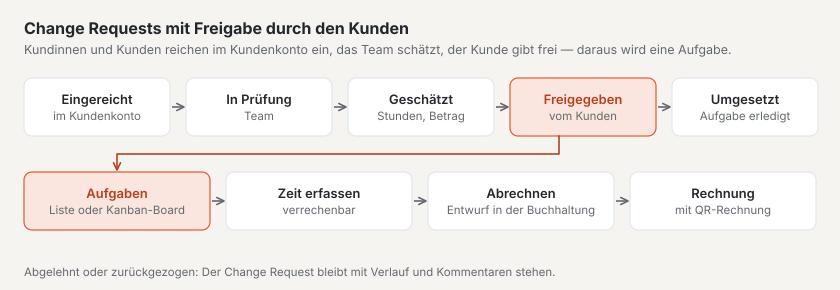

# Plugin «Projektmanagement»

Mit «Projektmanagement» führen Sie Projekte für Ihre Kundinnen und Kunden: Meilensteine, Aufgaben, erfasste Zeit und
Budget an einem Ort. Ihre Kunden reichen **Change Requests** (Änderungswünsche) im Kundenkonto ein, sehen Ihre
**Aufwandschätzung** und geben sie frei — daraus wird eine Aufgabe. Mit den Plugins «CRM», «Finanzbuchhaltung» und
«Kanban-Board» arbeitet es von selbst zusammen. Das Plugin ist kostenpflichtig — CHF 129 mit einem Jahr Updates — und
kommt von Basalto.

## Installieren und einschalten

1. Auf basaltocms.com kaufen — einmalig je Installation ([Kaufen](installieren.md#kaufen)).
2. Im Backend unter **Verwaltung › Module › Marktplatz** bei «Projektmanagement» **«Installieren»**
   ([Plugin installieren](installieren.md#plugin-installieren)).
3. Unter **Verwaltung › Sites › Site bearbeiten › Reiter «Module»** einschalten — ab Werk ist es aus.

Danach steht unter **Inhalte** der Menüpunkt **«Projekte»**. Die Zahl daran nennt die Change Requests, die neu
eingegangen sind und auf Ihr Team warten.

## Ein Projekt anlegen

1. Unter **Inhalte › Projekte** im Formular **«Neues Projekt»** den **Namen** eintragen.
2. Den **Kunden** wählen bzw. eintragen, auf Wunsch **Stundensatz** und **Budget (Stunden)**.
3. **«Anlegen»** — das Projekt bekommt die nächste Nummer der Site und öffnet sich.

Die Liste zeigt die laufenden Projekte (geplant, aktiv, pausiert); die Knöpfe darüber filtern nach **Abgeschlossen**,
**Archiv** und **Alle**, die Suche findet Name, Nummer und Kunde. Oben stehen die Kennzahlen: laufende Projekte, offene
Aufgaben, Change Requests beim Team und solche, die auf die Freigabe des Kunden warten.

## Angaben, Budget und Zugang im Kundenkonto

Auf der Seite eines Projekts speichern sich die **Angaben** selbst:

| Feld | |
| --- | --- |
| **Kunde** | mit dem Plugin «CRM» eine Auswahl aus Ihrer Kundenliste, sonst ein Name |
| **Stand** | Geplant, Aktiv, Pausiert, Abgeschlossen oder Abgebrochen |
| **Projektleitung**, **Beginn**, **Ende** | wer verantwortlich ist und wann das Projekt läuft |
| **Stundensatz**, **Währung** | gilt für neu erfasste Zeit und schlägt den Betrag einer Schätzung vor |
| **Budget (Stunden)**, **Budget (CHF)** | die Kennzahlen oben vergleichen die erfasste Zeit damit |
| **Im Kundenkonto zeigen** | Kunden mit Zugang sehen das Projekt und reichen Change Requests ein |
| **Zugang im Kundenkonto (E-Mail-Adressen)** | eine Adresse je Zeile — wer sich damit im Kundenkonto anmeldet, sieht das Projekt |

Die Kennzahlen **Stunden** und **Betrag** zeigen den Verbrauch neben dem Budget. Ab 80 % erscheinen sie gelb mit dem
Hinweis «Mehr als 80 % des Budgets sind verbraucht», über 100 % rot.

**Archivieren** nimmt ein Projekt aus den Listen und aus dem Kundenkonto; **Zurückholen** bringt es zurück.

## Meilensteine und Aufgaben

- **Meilensteine** legen Sie unter **«Neuer Meilenstein»** mit Termin an. **«Erreicht»** hält das Datum fest, ein
  verpasster Termin erscheint als **überfällig**.
- **Aufgaben** haben einen Stand — **Offen**, **In Arbeit**, **Prüfen**, **Fertig** —, eine verantwortliche Person,
  eine Fälligkeit, eine **Schätzung** (als 2:30 oder 2.5 Stunden) und auf Wunsch einen Meilenstein. Ein Klick öffnet
  die Aufgabe; sie speichert sich selbst.
- Markierte Aufgaben wechseln mit **«Stand: …»** in der Leiste unten gemeinsam den Stand oder werden gelöscht.

## Aufgaben als Kanban-Board

Ist das Plugin «Kanban-Board» installiert und eingeschaltet, steht oben auf der Projektseite **«Als Kanban-Board»**. Die
Aufgaben erscheinen dort als Karten in vier Spalten — eine je Stand —, mit Meilenstein, Schätzung, Fälligkeit und
verantwortlicher Person. Ziehen Sie eine Karte in eine andere Spalte, ändert sich der Stand der Aufgabe; die
Reihenfolge bleibt erhalten. WIP-Limits stellen Sie im Kanban-Board ein. Ohne das Plugin zeigt das Projekt die Aufgaben
als Liste.

## Zeit erfassen und abrechnen

1. Auf der Projektseite unter **«Zeit erfassen»** **Datum**, **Dauer** (1:30 oder 1.5), auf Wunsch eine **Aufgabe** und
   einen **Text** eintragen; **«Verrechenbar»** ist angekreuzt.
2. **«Erfassen»** — die Zeit erscheint in der Liste **«Erfasste Zeit»** und zählt fürs Budget. Der Stundensatz des Projekts
   wird mit der Zeit gespeichert; ändert er sich später, bleibt der alte für schon erfasste Zeit.

**Abrechnen mit dem Plugin «Finanzbuchhaltung»:** **«Zeit abrechnen»** übergibt alle verrechenbare, noch nicht
abgerechnete Zeit als **Rechnungsentwurf** — eine Position je Aufgabe mit den Stunden, dem Stundensatz und dem Zeitraum.
In der Finanzbuchhaltung prüfen und stellen Sie die Rechnung aus; MWST, Nummer und QR-Rechnung kommen dort dazu. Die
Zeit zeigt danach die Rechnung und lässt sich nicht mehr löschen. Wird der Entwurf gelöscht oder die Rechnung
storniert, ist die Zeit wieder offen.

**Ohne Finanzbuchhaltung** lädt **«Zeit als CSV»** die ganze Zeit des Projekts als Tabelle herunter (Semikolon, öffnet
sich in Excel richtig).

## Change Requests mit Kunden

Ein Change Request ist ein Änderungswunsch zu einem Projekt. Er durchläuft diese Stände:

| Stand | Wer ist am Zug | Was geschieht |
| --- | --- | --- |
| **Eingereicht** | Ihr Team | im Kundenkonto eingereicht oder vom Team erfasst |
| **In Prüfung** | Ihr Team | Sie klären den Wunsch |
| **Geschätzt — wartet auf Freigabe** | der Kunde | Ihre Aufwandschätzung (Stunden und Betrag) liegt beim Kunden |
| **Freigegeben** | Ihr Team | der Kunde hat die Schätzung freigegeben — eine Aufgabe mit der Schätzung ist angelegt |
| **Umgesetzt** | — | alle Aufgaben des Change Requests sind erledigt |
| **Abgelehnt** | — | von Ihnen abgelehnt oder die Schätzung vom Kunden abgelehnt |
| **Zurückgezogen** | — | der Kunde hat ihn vor der Freigabe zurückgezogen |

Jeder Change Request bekommt eine fortlaufende Nummer im Projekt und eine Priorität nach der MoSCoW-Methode: **Muss**,
**Soll**, **Kann** oder **Diesmal nicht**.

### Im Kundenkonto

Kunden mit Zugang sehen im Kundenkonto den Bereich **«Projekte»**: je Projekt die Change Requests mit Stand und Verlauf.

1. **«Change Request einreichen»** öffnen.
2. **Titel**, **«Was soll sich ändern?»**, auf Wunsch **«Warum?»**, **«Wie wichtig?»** und **«Gewünscht bis»** eintragen.
3. **«Absenden»** — Ihr Team bekommt eine Nachricht.

Liegt eine Schätzung vor, steht sie im Kundenkonto unter «Als Nächstes». Der Kunde wählt **«Schätzung freigeben»**
oder **«Ablehnen»**; solange nichts freigegeben ist, kann er den Change Request **zurückziehen**. Kommentare schreibt er
direkt beim Change Request. Bei jedem neuen Stand und bei Ihren Antworten bekommt die Person, die ihn eingereicht hat,
eine Mail.

**Zugang hat**, wer sich mit einer Adresse aus **«Zugang im Kundenkonto»** anmeldet — und mit dem Plugin «CRM» jede
Adresse des Kunden und seiner Kontaktpersonen.

### Im Backend

Unter **Inhalte › Projekte › Change Requests** stehen alle Change Requests, gefiltert danach, wer am Zug ist: **Beim
Team**, **Beim Kunden**, **Freigegeben**, **Abgeschlossen**. Ein Klick öffnet einen:

- **«In Prüfung nehmen»**, **«Ablehnen»** und — sobald freigegeben — **«Als umgesetzt markieren»**.
- **«Aufwand schätzen»**: Stunden, Betrag (leer: Stunden × Stundensatz) und eine **Bemerkung für den Kunden**.
  **«Schätzung senden»** setzt den Stand auf «Geschätzt» und benachrichtigt den Kunden. Eine neue Schätzung ersetzt die
  alte, solange nichts freigegeben ist.
- **«Kommentar»**: Mit **«Intern»** sieht ihn nur Ihr Team, sonst auch der Kunde.
- Der **Verlauf** zeigt jeden Wechsel des Stands und alle Kommentare.

Auch Ihr Team kann auf der Projektseite einen Change Request erfassen, etwa nach einem Telefonat.

## Mit anderen Plugins

| Plugin | Was es bringt |
| --- | --- |
| [CRM](plugin-crm.md) | Kunden aus Ihrer Kundenliste wählen; ändert sich ein Kunde im CRM, folgt das Projekt; Kontaktpersonen haben Zugang im Kundenkonto; beim Kunden im CRM stehen seine Projekte |
| [Finanzbuchhaltung](plugin-finanzbuchhaltung.md) | erfasste Zeit mit einem Klick als Rechnungsentwurf |
| [Kanban-Board](plugin-kanban.md) | die Aufgaben eines Projekts als Board; Karten lassen sich an Projekte hängen |

Unter **Verwaltung › Module** steht bei «Projektmanagement», mit welchen Plugins es zusammenarbeitet.

## Benachrichtigungen

Ihr Team bekommt **«Neuer Change Request»**, **«Change Request entschieden»** (freigegeben, abgelehnt, zurückgezogen)
und **«Kommentar zu einem Change Request»** — in der Glocke und, wenn eingestellt, per Mail. Wer sie bekommt, steuert
das Recht auf den Bereich «Projekte» ([Benachrichtigungen](../redaktion/index.md#benachrichtigungen)).

## Datenschutz

- **Auskunft und Löschung** je E-Mail-Adresse erledigt die Verwaltung unter «Verwaltung › Benutzer» (oder
  `php artisan basalto:privacy`): Die Auskunft nennt die Projekte mit Zugang, die eingereichten Change Requests und die
  Kommentare. Das Löschen entfernt die Adresse aus den Zugängen und ersetzt Name und Adresse an Change Requests und
  Kommentaren; die Change Requests selbst bleiben als Teil des Projekts.
- Der **Export einer Site** nimmt keine Projekte mit — sie bleiben bei der bisherigen Site.

## Wenn etwas nicht klappt

| Zeichen | Ursache | Lösung |
| --- | --- | --- |
| Der Kunde sieht das Projekt im Kundenkonto nicht | Adresse fehlt unter «Zugang im Kundenkonto», «Im Kundenkonto zeigen» ist aus oder das Projekt ist archiviert | Adresse eintragen, Häkchen setzen, Projekt zurückholen |
| «Zeit abrechnen» fehlt | das Plugin «Finanzbuchhaltung» ist nicht da oder für die Site aus — oder es gibt keine offene verrechenbare Zeit | Plugin einschalten bzw. «Zeit als CSV» nutzen |
| «Als Kanban-Board» fehlt | das Plugin «Kanban-Board» ist nicht da oder für die Site aus | im Marktplatz installieren und einschalten |
| «Geben Sie die Dauer als 1:30 oder 1.5 ein.» | Dauer in einer anderen Form | Stunden und Minuten mit Doppelpunkt oder Stunden mit Dezimalpunkt |
| «Abgerechnete Zeit lässt sich nicht löschen» | die Zeit gehört zu einer Rechnung | die Rechnung in der Finanzbuchhaltung stornieren — danach ist die Zeit wieder offen |
| «Das geht in diesem Stand nicht mehr.» | der Change Request ist schon entschieden | den Verlauf ansehen; einen neuen Change Request einreichen |

## Weiter

- [Plugin «CRM»](plugin-crm.md)
- [Plugin «Finanzbuchhaltung»](plugin-finanzbuchhaltung.md)
- [Plugin «Kanban-Board»](plugin-kanban.md)
- [Für Installationen](installieren.md)
