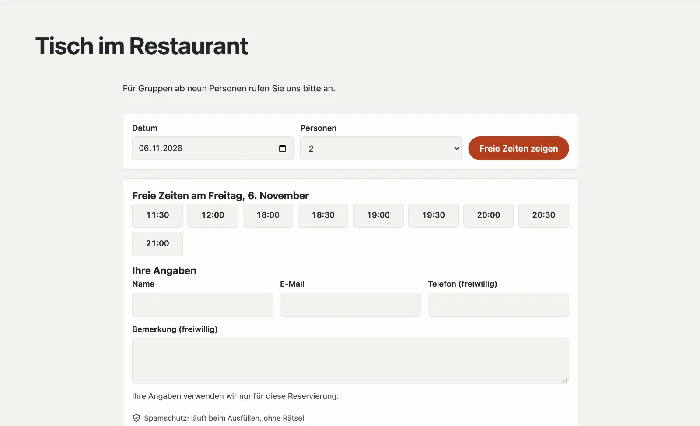

# Plugin «Reservierungen und Termine»

Mit «Reservierungen und Termine» reservieren Ihre Gäste online: einen Tisch im Restaurant, eine Beratung, einen Raum.
Sie legen fest, wann reserviert werden kann und wie viele Plätze es gibt; Gäste wählen Tag und Zeit, bekommen eine
Bestätigung mit Kalendereintrag und eine Erinnerung und stornieren selbst über ihren Link. Auf Wunsch zahlen sie eine
Anzahlung über Ihr Stripe-Konto. Das Plugin kostet CHF 149 mit einem Jahr Updates und kommt von Basalto.



## Installieren und einschalten

1. Auf basaltocms.com im Marktplatz kaufen ([Kaufen](installieren.md#kaufen)), dann im Backend unter
   **Verwaltung › Module › Marktplatz** bei «Reservierungen und Termine» **«Installieren»**
   ([Plugin installieren](installieren.md#plugin-installieren)).
2. Unter **Verwaltung › Sites › Site bearbeiten › Reiter «Module»** für die Sites einschalten — ab Werk ist es aus.

Danach steht unter **Inhalte** der Reiter **«Reservierungen»**.

## Festlegen, was sich reservieren lässt

Ein **Angebot** ist das, was Gäste reservieren — «Tisch im Restaurant», «Beratung im Laden», «Sitzungszimmer». Unter
**Inhalte › Reservierungen › Angebote und Zeiten** legen Sie eines mit einer Vorlage an und passen es danach an:

| Vorlage | gedacht für |
| --- | --- |
| Tische | Gruppen, mehrere gleichzeitig, sofort bestätigt |
| Termin für eine Person | eine Reservierung je Zeit, ohne Frage nach der Zahl der Personen |
| Raum | eine Reservierung je Zeit, auf Anfrage |

| Einstellung | |
| --- | --- |
| Zeiten je Wochentag | als «11:30-14:00, 18:00-22:00» — dazwischen ist Pause, leer heisst geschlossen |
| Dauer (Minuten) | so lange belegt eine Reservierung die Plätze |
| Beginn alle (Minuten) | z. B. 30: 18:00, 18:30, 19:00 … |
| Plätze gleichzeitig | bei Tischen die Zahl der Personen, bei Terminen meist 1 |
| Grösste Gruppe online | grössere Gruppen melden sich direkt; 1 = ohne Frage nach der Zahl der Personen |
| Vorlauf (Minuten) | so kurzfristig lässt sich frühestens reservieren |
| Im Voraus (Tage) | so weit in die Zukunft |
| Selbst stornieren bis (Stunden vorher) | danach nur noch direkt bei Ihnen |
| Bestätigung | **sofort** (die Reservierung gilt gleich) oder **auf Anfrage** (Sie sagen zu oder ab) |
| Anzahlung | fest oder je Person; 0 = keine |
| Online reservierbar | ohne Haken ist das Angebot pausiert |

**Geschlossen** (gleiche Seite): Ferien, Feiertage, geschlossene Gesellschaft — vom ersten bis zum letzten Tag, für ein
Angebot oder alle. Bestehende Reservierungen in dieser Zeit bleiben; der Hinweis nennt, wie viele es sind.

## Die Reservierungsseite anlegen

1. **Seiten › Neu** (oder Ihre bestehende Seite «Reservieren»).
2. Reiter **«Experten»** › **«Modul einhängen»** › **«Reservierungen»**, speichern und veröffentlichen.

Mit einem Angebot reservieren Gäste direkt auf dieser Seite, mit mehreren wählen sie zuerst das Angebot. Ein Tag ohne
freie Zeit nennt die nächsten freien Tage. Ausgebuchte Zeiten sind durchgestrichen.

Kurz reservieren von jeder Seite aus — etwa der Startseite — mit dem Lava-Teil **«Reservieren»** (Tag und Personen,
weiter auf der Reservierungsseite) oder im Theme:

```lava

```

## Was Gäste bekommen

| Wann | Mail |
| --- | --- |
| sofort bestätigt | Bestätigung mit Kalendereintrag (.ics) und Link zur eigenen Reservierung |
| auf Anfrage | Eingangsbestätigung; später Bestätigung oder Absage |
| vor dem Termin | Erinnerung (einstellbar: 2 Stunden, einen Tag oder zwei Tage vorher, oder keine) |
| storniert oder geändert | Mitteilung mit den neuen Angaben |

Unter dem Link zur eigenen Reservierung sehen Gäste den Stand, laden den Kalendereintrag und **stornieren** bis zur
Frist selbst. Ihr Team erhält zu neuen Reservierungen, Anfragen und Stornierungen eine Nachricht (Glocke und Mail,
einstellbar im Profil).

## Reservierungen verwalten

**Inhalte › Reservierungen** zeigt einen Tag (Blättern mit **«‹ Vortag»**, **«Heute»**, **«Folgetag ›»**) oder
**«Alle kommenden»**, **«Anfragen»** und **«Frühere»**, mit Suche nach Name, E-Mail oder Telefon. Die Zahl im Menü
nennt die offenen Anfragen.

- **Bestätigen**, **Ablehnen** und **Stornieren** einzeln oder gesammelt — die Gäste erhalten eine Mail.
- **Reservierung eintragen** für Anrufe und Gäste am Tresen: gleich bestätigt, Mail nur mit E-Mail-Adresse. Das Team darf
  ausserhalb der Zeiten und über die Plätze hinaus eintragen; ist eine Zeit dann überbucht, steht es im Hinweis.
- In einer Reservierung ändern Sie Angebot, Tag, Zeit und Personen; auf Wunsch erhält der Gast die neuen Angaben. Die
  **interne Notiz** sieht nur das Team.

## Mit Anzahlung

Eine Anzahlung geht über Ihr eigenes Stripe-Konto ([Zahlungen](../verwaltung/zahlungen.md)): Der Gast wird nach dem
Absenden zu Stripe geleitet, die Zeit ist so lange für ihn reserviert. Nach dem Bezahlen gilt die Reservierung (oder
wartet als Anfrage); bricht er ab oder zahlt nicht, wird der Platz nach Ablauf des Checkouts wieder frei. Eine
Rückerstattung bei einer Stornierung lösen Sie im Stripe-Dashboard aus. Ohne eingerichtete Zahlungen reservieren Gäste
ohne Anzahlung.

## Datenschutz

Gäste geben Name, E-Mail und auf Wunsch Telefon und Bemerkung an. Nach einer Frist (ab Werk 365 Tage nach dem Termin,
einstellbar) ersetzt der nächtliche Löschlauf diese Angaben; Tag, Zeit und Personen bleiben für Ihre Zahlen. Die
Reservierungen einer E-Mail-Adresse gehören zur **Auskunft** und **Löschung** unter **Verwaltung › Benutzer**
([Benutzer](../verwaltung/benutzer.md)). Reservierungen
gehen nicht mit dem Export einer Site mit, die Angebote schon.

## Wenn etwas nicht klappt

| Zeichen | Ursache | Lösung |
| --- | --- | --- |
| «An diesem Tag lässt sich nicht online reservieren» | Tag vor dem Vorlauf oder nach «Im Voraus» | Einstellung des Angebots prüfen |
| keine Zeiten an einem Wochentag | keine Zeiten eingetragen oder geschlossen | Zeiten und «Geschlossen» prüfen |
| keine Erinnerungen | der Zeitplan der Installation läuft nicht | Cron einrichten ([Betrieb](../verwaltung/betrieb.md)) |

## Weiter

- [Zahlungen](../verwaltung/zahlungen.md)
- [Für Installationen](installieren.md)
- [Marktplatz](README.md)
