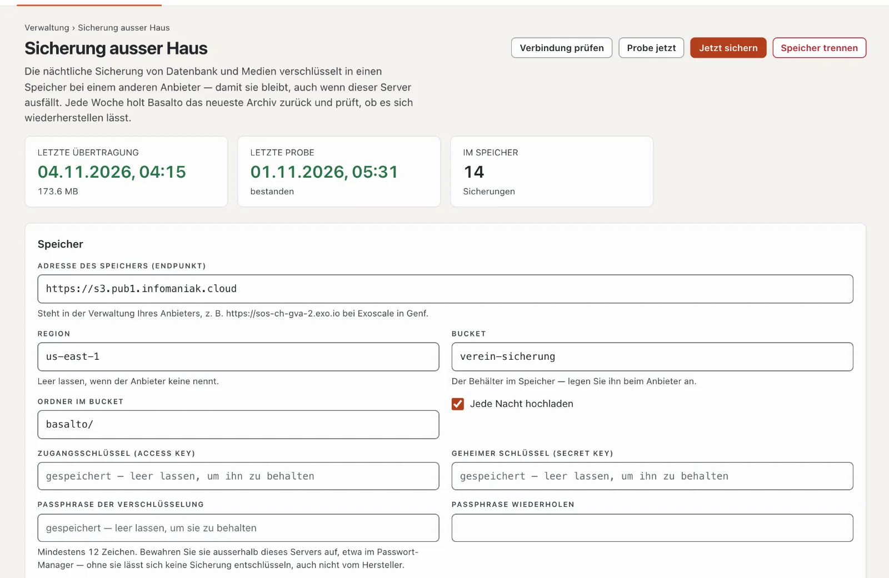

# Plugin «Sicherung ausser Haus»

Basalto sichert jede Nacht Datenbank und Medien auf dem eigenen Server. Fällt der Server aus, ist diese Sicherung mit
ihm weg. «Sicherung ausser Haus» lädt jede Sicherung verschlüsselt in einen Speicher bei einem anderen Anbieter, räumt
dort alte Sicherungen auf und prüft jede Woche, ob sich die neueste wiederherstellen lässt. Das Plugin kostet CHF 79
mit einem Jahr Updates und kommt von Basalto.



## Installieren

1. Auf basaltocms.com im Marktplatz kaufen ([Kaufen](installieren.md#kaufen)), dann im Backend unter
   **Verwaltung › Module › Marktplatz** bei «Sicherung ausser Haus» **«Installieren»**
   ([Plugin installieren](installieren.md#plugin-installieren)).
2. Das Plugin gilt für die ganze Installation — es gibt keinen Schalter je Site. Danach steht unter **Verwaltung** der
   Eintrag **«Sicherung ausser Haus»**. Ihn sehen alle, die auch **Verwaltung › Betrieb** sehen.

Das Plugin braucht die PHP-Erweiterung «sodium»; bei den meisten Hostern ist sie an. Fehlt sie, zeigt die Seite den
Hinweis **«Verschlüsselung nicht möglich»** — der Hoster schaltet sie in den PHP-Einstellungen ein.

## Den Speicher einrichten

Sie brauchen einen S3-kompatiblen Speicher bei einem anderen Anbieter als Ihrem Hoster, zum Beispiel Infomaniak Swiss
Backup oder Exoscale.

1. Beim Anbieter einen **Bucket** anlegen — den Behälter für die Sicherungen — und Zugangsdaten für S3 erzeugen
   (Zugangsschlüssel und geheimer Schlüssel), die im Bucket schreiben, lesen und löschen dürfen. Bei Infomaniak Swiss
   Backup und bei Exoscale stehen Endpunkt, Region und Zugangsdaten in der Verwaltung des Anbieters.
2. Unter **Verwaltung › Sicherung ausser Haus** im Abschnitt **«Speicher»** ausfüllen:

   | Feld | Was hinein gehört |
   | --- | --- |
   | **Adresse des Speichers (Endpunkt)** | die Adresse für S3, z. B. `https://sos-ch-gva-2.exo.io` bei Exoscale in Genf |
   | **Region** | z. B. `ch-gva-2` bei Exoscale; leer lassen, wenn der Anbieter keine nennt |
   | **Bucket** | der Name des Buckets |
   | **Ordner im Bucket** | ab Werk `basalto/` — mit eigenem Ordner passen mehrere Installationen in einen Bucket |
   | **Zugangsschlüssel (Access Key)**, **Geheimer Schlüssel (Secret Key)** | die Zugangsdaten aus Schritt 1 |
   | **Passphrase der Verschlüsselung**, **Passphrase wiederholen** | mindestens 12 Zeichen — lesen Sie den nächsten Abschnitt |
   | **Aufbewahren: mindestens so viele Sicherungen**, **… Tage** | ab Werk 14 Sicherungen und 30 Tage, siehe [Aufbewahrung](#aufbewahrung) |
   | **Jede Nacht hochladen** | ab Werk an |

3. **«Speichern und prüfen»**: Basalto schreibt eine kleine Datei in den Bucket, liest sie und löscht sie wieder. Erst
   wenn das klappt, wird gespeichert; sonst steht der Grund beim Endpunkt.

Gespeicherte Schlüssel und die Passphrase zeigt die Seite nie wieder an — leer lassen behält sie. **«Verbindung
prüfen»** wiederholt die Prüfung jederzeit. **«Speicher trennen»** entfernt die Verbindung; die Sicherungen im Speicher
bleiben.

## Die Passphrase gut aufbewahren

Basalto verschlüsselt jede Sicherung auf Ihrem Server, bevor sie ihn verlässt — der Anbieter des Speichers sieht nur
verschlüsselte Daten, auch keine Dateinamen. Der Schlüssel entsteht aus der Passphrase (Argon2id), verschlüsselt wird
mit XChaCha20-Poly1305 aus der Bibliothek libsodium.

- Bewahren Sie die Passphrase **ausserhalb dieses Servers** auf, etwa im Passwort-Manager. **Ohne sie lässt sich keine
  Sicherung entschlüsseln** — auch nicht von Basalto. Liegt sie nur auf dem Server, geht sie mit ihm verloren.
- Bewahren Sie daneben den `APP_KEY` der Installation auf: Ohne denselben Schlüssel lassen sich verschlüsselte Angaben in
  der zurückgespielten Datenbank nicht lesen ([Backup](../betrieb/backup.md)).
- Ändern Sie die Passphrase, brauchen die älteren Sicherungen im Speicher weiterhin die bisherige. Behalten Sie beide,
  bis die älteren aus der Aufbewahrung gefallen sind.

## Was jede Nacht geschieht

1. Um **03:15 UTC** sichert Basalto Datenbank und Medien auf dem Server ([Backup](../betrieb/backup.md)).
2. Um **04:15 UTC** verschlüsselt das Plugin die neueste Sicherung und lädt sie als
   `basalto-backup-JJJJMMTT-HHMMSS.zip.enc` in den Ordner im Bucket. Danach vergleicht es die Grösse im Speicher mit der
   hochgeladenen Datei. Eine Sicherung, die schon im Speicher liegt, lädt es nicht noch einmal hoch.
3. Zum Schluss wendet es die Aufbewahrung an.

Die verschlüsselte Kopie entsteht kurz im Ordner `storage/app` der Installation — dort braucht es so viel freien Platz,
wie die Sicherung gross ist. Das Plugin lädt die Sicherungen aus dem Standardordner `storage/app/backups` hoch, in den
die nächtliche Sicherung schreibt; Sicherungen, die Sie von Hand mit `--path` anderswo ablegen, nimmt es nicht mit.

**«Jetzt sichern»** legt sofort eine neue Sicherung an und lädt sie hoch — im Hintergrund. Das Ergebnis steht nach
einigen Minuten im **Verlauf**: Zeit, Art, Sicherung, Grösse, Stand und Meldung. Oben zeigt die Seite die
**Letzte Übertragung**, die **Letzte Probe** und wie viele Sicherungen **Im Speicher** liegen. Ist **Jede Nacht
hochladen** aus, steht die Seite auf **«Pausiert»**; «Jetzt sichern» und die Probe gehen weiter.

## Aufbewahrung

Gelöscht wird im Speicher nur, was über **beiden** Grenzen liegt: Die neuesten Sicherungen nach **Aufbewahren:
mindestens so viele Sicherungen** bleiben immer, ebenso alle aus den letzten Tagen nach **Aufbewahren: mindestens so
viele Tage**. Mit den Vorgaben 14 und 30 bleiben also mindestens die neuesten 14 Sicherungen und dazu alle der letzten
30 Tage. Andere Dateien im Ordner fasst das Plugin nicht an.

## Die Probe jede Woche

Jeden Sonntag um **05:30 UTC** holt das Plugin die neueste Sicherung aus dem Speicher, entschlüsselt sie beim
Herunterladen und prüft sie mit der Wiederherstellungsprüfung von Basalto: Manifest, Grösse und SHA-256 jeder Datei.

- **Mit SQLite** spielt die Probe die Datenbank in eine Wegwerf-Datenbank zurück und öffnet sie (Integritätsprüfung und
  Zählprobe).
- **Mit MariaDB, MySQL oder PostgreSQL** prüft die Probe nur, ob der Datenbankabzug vollständig ist — Kopf,
  Schlusszeile und Kerntabellen. Zurückgespielt wird dabei nicht; spielen Sie darum ab und zu eine Sicherung von Hand
  in eine leere Datenbank zurück ([Wiederherstellen](../betrieb/backup.md#wiederherstellen)).

**«Probe jetzt»** startet die Probe sofort. Im Verlauf steht sie als **Probe** mit **«in Ordnung»** oder
**«gescheitert»** und den Prüfschritten unter **Meldung**; den Stand der letzten Prüfung zeigt auch **Verwaltung ›
Betrieb**.

## Alarm

Scheitert eine Übertragung oder eine Probe, erhalten alle, die **Verwaltung › Betrieb** sehen, die Benachrichtigung
**«Sicherung ausser Haus gescheitert»** in der Glocke und per Mail — mit dem Grund. Die Mail ist ab Werk an; wer sie
nicht möchte, stellt sie im **Profil** im Reiter **«Benachrichtigungen»** ab. Den Grund zeigt auch die Seite selbst,
oben als **«Letzte Übertragung gescheitert»** bzw. **«Letzte Probe gescheitert»**.

## Eine Sicherung zurückholen

Zurückholen und entschlüsseln geht auf der Konsole des Servers:

```sh
php artisan basalto:ausser-haus-holen --liste                              # was im Speicher liegt
php artisan basalto:ausser-haus-holen                                      # die neueste
php artisan basalto:ausser-haus-holen basalto-backup-20261104-031500.zip   # eine bestimmte
php artisan basalto:ausser-haus-holen --ziel=/srv/zurueck                  # in einen anderen Ordner
```

Das entschlüsselte ZIP landet ab Werk in `storage/app/backups`; liegt dort schon eine Datei mit demselben Namen, bleibt
sie unangetastet. Danach geht es weiter wie unter [Wiederherstellen](../betrieb/backup.md#wiederherstellen): zuerst
`php artisan basalto:backup-verify <archiv>`, dann zurückspielen.

### Nach dem Verlust des Servers

1. Basalto neu installieren und das Plugin installieren.
2. Unter **Verwaltung › Sicherung ausser Haus** den Speicher und die Passphrase eintragen, dann
   `php artisan basalto:ausser-haus-holen`.
   Oder ohne Einrichten: die Datei in der Verwaltung des Anbieters herunterladen, auf den Server legen und
   `php artisan basalto:ausser-haus-holen --datei=/pfad/basalto-backup-20261104-031500.zip.enc --passphrase-fragen`
   — der Befehl fragt nach der Passphrase.
3. Weiter wie unter [Wiederherstellen](../betrieb/backup.md#wiederherstellen) — mit dem `APP_KEY` der alten
   Installation.

`--passphrase-fragen` hilft auch, wenn eine ältere Sicherung noch die bisherige Passphrase braucht.

## Wenn etwas nicht klappt

| Zeichen | Ursache | Lösung |
| --- | --- | --- |
| «Keine Verbindung zum Speicher: …» beim Speichern | Endpunkt, Region, Bucket oder Schlüssel stimmen nicht, oder die Schlüssel dürfen im Bucket nicht schreiben | Angaben mit der Verwaltung des Anbieters vergleichen; den Schlüsseln Rechte zum Schreiben, Lesen und Löschen im Bucket geben |
| «Verschlüsselung nicht möglich» | die PHP-Erweiterung «sodium» fehlt | beim Hoster in den PHP-Einstellungen einschalten |
| «Es gibt keine Sicherung auf dem Server …» | die nächtliche Sicherung läuft nicht | Cron-Eintrag des Schedulers prüfen ([Hosting](../betrieb/hosting.md)); den Stand zeigt **Verwaltung › Betrieb** |
| «Jetzt sichern» oder «Probe jetzt» bleibt ohne Ergebnis | die Warteschlange wird nicht abgearbeitet | Cron-Eintrag des Schedulers prüfen; fehlgeschlagene Jobs stehen unter **Verwaltung › Betrieb** |
| «Entschlüsseln gescheitert: falsche Passphrase oder veränderte Datei.» | die Sicherung ist mit einer anderen Passphrase verschlüsselt | mit `--passphrase-fragen` die frühere Passphrase eingeben |
| «Die verschlüsselte Sicherung ist unvollständig.» bei der Probe | die Datei im Speicher ist abgeschnitten | **«Jetzt sichern»**, danach **«Probe jetzt»**; hält der Fehler an, beim Anbieter nachfragen |
| Die Übertragung scheitert bei grossen Sicherungen | zu wenig freier Platz in `storage/app` für die verschlüsselte Kopie | Platz schaffen oder beim Hoster mehr Speicherplatz buchen |

## Weiter

- [Backup](../betrieb/backup.md)
- [Betrieb](../verwaltung/betrieb.md)
- [Für Installationen](installieren.md)
- [Marktplatz](README.md)
