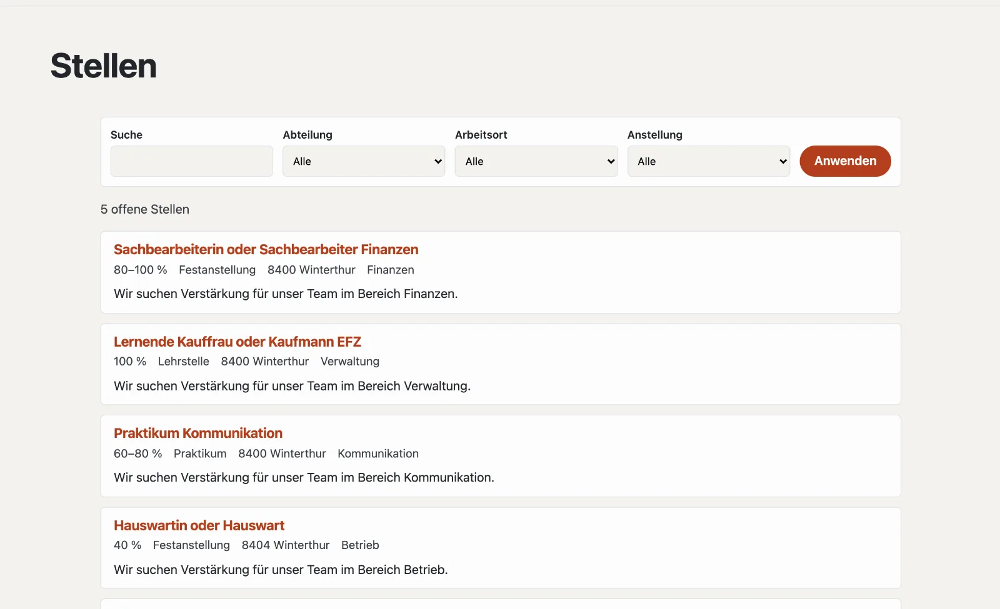

# Plugin «Stellenangebote»

Mit «Stellenangebote» schreiben Sie offene Stellen aus: mit Pensum, Anstellung, Arbeitsort und Eintritt, auf einer
eigenen Stellenseite mit Filter. Bewerbungen kommen über ein Formular der Site, auf Wunsch über einen eigenen Link.
Suchmaschinen bekommen zu jeder offenen Stelle strukturierte Daten. Das Plugin ist kostenlos und kommt von Basalto.



## Installieren und einschalten

1. Im Backend unter **Verwaltung › Module › Marktplatz** bei «Stellenangebote» **«Installieren»**
   ([Plugin installieren](installieren.md#plugin-installieren)).
2. Unter **Verwaltung › Sites › Site bearbeiten › Reiter «Module»** für die Sites einschalten, die es nutzen sollen —
   ab Werk ist es aus.

Danach steht unter **Inhalte** der Reiter **«Stellen»**.

## Die Stellenseite anlegen

1. **Seiten › Neu** (oder eine bestehende Seite), Name zum Beispiel «Offene Stellen».
2. Reiter **«Experten»** › **«Modul einhängen»** › **«Stellen»**, speichern.
3. Die Seite wie gewohnt veröffentlichen.

| Adresse unter der Seite | Was erscheint |
| --- | --- |
| (die Seite selbst) | offene Stellen, neueste zuerst; ab vier Stellen mit Suche und Filter nach Abteilung, Arbeitsort und Anstellung |
| `<adresse>` | eine Stelle mit allen Angaben und der Bewerbung |

Eine Stelle, die nicht mehr ausgeschrieben ist, bleibt unter ihrer Adresse erreichbar — mit dem Hinweis, dass sie nicht
mehr offen ist, und ohne Bewerbung.

## Eine Stelle ausschreiben

Unter **Inhalte › Stellen** legen Sie eine Stelle mit ihrem **Titel** an. Sie ist zuerst ein **Entwurf**; danach öffnet
sich das Formular mit allen Angaben. Änderungen speichern sich selbst.

| Feld | |
| --- | --- |
| Titel, Kurztext, Beschreibung | je Sprache der Site; der Kurztext steht in der Liste und bei Suchmaschinen |
| Pensum von, bis (%) | z. B. 80–100 % |
| Anstellung | Festanstellung, befristet, Lehrstelle, Praktikum, Auftrag oder freiwillig |
| Abteilung, Arbeitsort | für den Filter und die strukturierten Daten |
| Teilweise von zu Hause | erscheint bei den Eckdaten |
| Eintritt | leer heisst «nach Vereinbarung» |
| Ausgeschrieben bis | danach verschwindet die Stelle von selbst aus der Liste |
| Kontaktperson, E-Mail der Kontaktperson | erscheinen bei der Stelle |
| Link zur Bewerbung | nur, wenn Bewerbungen über ein Bewerbungsportal laufen |

| Knopf | Wirkung |
| --- | --- |
| **Veröffentlichen** | die Stelle erscheint auf der Stellenseite |
| **Als besetzt markieren** | sie verschwindet aus der Liste |
| **Wieder ausschreiben** | eine besetzte Stelle ist wieder offen |
| **Zurückziehen** | wieder ein Entwurf |
| **Duplizieren** | eine Kopie als Entwurf — praktisch für ähnliche Stellen |

## Bewerbungen

Ohne eigenen Link steht unter jeder offenen Stelle das Bewerbungsformular der Site:

1. Unter **Inhalte › Stellen** **«Bewerbungsformular anlegen»** — es enthält Name, E-Mail, Telefon, Nachricht, Lebenslauf
   (PDF) und weitere Unterlagen.
2. Anpassen lässt es sich unter **Inhalte › Formulare** («bewerbung»).
3. Ein anderes Formular wählen Sie unten auf **Inhalte › Stellen** unter **«Bewerbung»**.

Bewerbungen sind Eingänge des Formulars: Sie finden sie unter **Formulare › Eingänge**, mit der Seite der Stelle, von
der sie kamen. Die Spalte «Bewerbungen» in der Liste zählt sie je Stelle. Aufbewahrt und gelöscht werden sie wie alle
Eingänge ([Formulare](../redaktion/formulare.md)).

## Offene Stellen auf anderen Seiten

Die neuesten offenen Stellen — etwa auf der Startseite — zeigt der Lava-Teil **«Offene Stellen»**: unter
**Einrichtung › Layouts › Reiter «Teile»** **«+ Instanz»** (Anzahl, Überschrift), dann in eine Region setzen oder im
Editor einer Seite mit **«+ Lava-Teil»** einfügen. Im Theme geht es auch direkt:

```lava

```

## Suchmaschinen und Datenschutz

Jede offene Stelle trägt strukturierte Daten (schema.org `JobPosting`: Titel, Beschreibung, Anstellung, Arbeitsort,
Arbeitgeber, ausgeschrieben bis) und steht in der Sitemap. Das Plugin selbst speichert keine Bewerbungen — die liegen
bei den Eingängen der Formulare. Die Stellen gehen mit dem Export einer Site mit.

## In der Statistik

Unter [Statistik](../verwaltung/statistik.md) zeigt der Reiter **Stellen** offene Stellen, neu ausgeschriebene und die Bewerbungen über das Formular, mit dem Vergleich zum Zeitraum davor.

## Weiter

- [Formulare](../redaktion/formulare.md)
- [Für Installationen](installieren.md)
- [Marktplatz](README.md)
