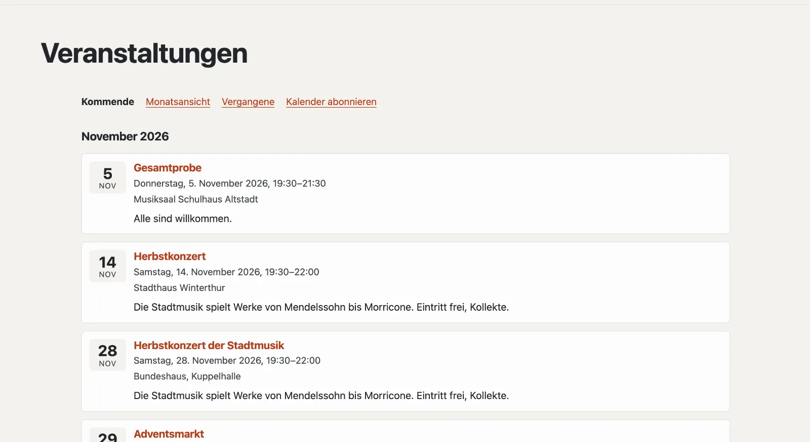

# Plugin «Veranstaltungen»

Mit «Veranstaltungen» kündigen Sie Termine an: Konzerte, Proben, Kurse, Märkte. Besucherinnen und Besucher sehen sie
als Liste und als Monatsansicht, tragen einzelne Termine in ihren Kalender ein oder abonnieren den ganzen Kalender der
Site. Suchmaschinen bekommen zu jeder Veranstaltung strukturierte Daten. Das Plugin ist kostenlos und kommt von
Basalto.



## Installieren und einschalten

1. Im Backend unter **Verwaltung › Module › Marktplatz** bei «Veranstaltungen» **«Installieren»**
   ([Plugin installieren](installieren.md#plugin-installieren)).
2. Unter **Verwaltung › Sites › Site bearbeiten › Reiter «Module»** für die Sites einschalten, die es nutzen sollen —
   ab Werk ist es aus.

Danach steht unter **Inhalte** der Reiter **«Veranstaltungen»**.

## Die Veranstaltungsseite anlegen

Damit Besucher die Termine sehen, braucht es eine Seite, in die das Plugin eingehängt ist:

1. **Seiten › Neu** (oder eine bestehende Seite), Name zum Beispiel «Veranstaltungen».
2. Reiter **«Experten»** › **«Modul einhängen»** › **«Veranstaltungen»**, speichern.
3. Die Seite wie gewohnt veröffentlichen.

Die Seite selbst und alle Adressen darunter beantwortet jetzt das Plugin — im Layout Ihres Themes, mit dem Titel der
Seite. Fehlt die Seite, weist die Liste in der Verwaltung darauf hin.

| Adresse unter der Seite | Was erscheint |
| --- | --- |
| (die Seite selbst) | kommende Veranstaltungen nach Monaten |
| `monat` | Monatsansicht mit Blättern; auf schmalen Bildschirmen als Liste der Tage |
| `archiv` | vergangene Veranstaltungen, neueste zuerst |
| `kalender.ics` | Kalender zum Abonnieren — kommende und die der letzten 90 Tage |
| `<adresse>` | eine Veranstaltung mit allen Angaben |
| `<adresse>.ics` | dieselbe zum Eintragen in den eigenen Kalender |

Ein Termin von heute bleibt den ganzen Tag unter «Kommende»; um Mitternacht (Zeitzone der Site) wandert er ins Archiv.

## Veranstaltungen erfassen

Unter **Inhalte › Veranstaltungen** legen Sie eine Veranstaltung mit **Titel** und **Beginn** an. Sie ist zuerst ein
**Entwurf**; danach öffnet sich das Formular mit allen Angaben. Änderungen speichern sich selbst.

| Feld | |
| --- | --- |
| Titel, Kurztext, Beschreibung | je Sprache der Site; fehlt eine Sprache, erscheint die Standardsprache. Der Kurztext steht in Listen und bei Suchmaschinen |
| Beginn, Ende | in der Zeitzone der Site; ohne Ende gilt der Termin bis Mitternacht |
| Ganztägig | nur das Datum zählt, die Uhrzeit erscheint nicht |
| Veranstaltungsort, Adresse | für die Seite, den Kalender, Suchmaschinen und «Route planen» |
| Link | Anmeldung oder weitere Informationen |
| Adresse unter der Veranstaltungsseite | aus dem Titel vorgeschlagen, z. B. `herbstkonzert` |

| Knopf | Wirkung |
| --- | --- |
| **Veröffentlichen** | Besucher sehen die Veranstaltung |
| **Absagen** | sie bleibt sichtbar, mit dem Vermerk «Abgesagt»; Kalender-Abos streichen sie beim nächsten Abgleich |
| **Zurückziehen** | wieder ein Entwurf |
| **Duplizieren** | eine Kopie als Entwurf — praktisch für wiederkehrende Termine |

Die Liste zeigt «Kommend», «Vergangen», «Entwürfe» und «Alle», mit Suche und Sammelaktionen (veröffentlichen,
zurückziehen, löschen).

## Nächste Veranstaltungen auf anderen Seiten

Die nächsten Termine — etwa auf der Startseite — zeigt der Lava-Teil **«Nächste Veranstaltungen»**: unter
**Einrichtung › Layouts › Reiter «Teile»** bei «Nächste Veranstaltungen» **«+ Instanz»** (Anzahl, Überschrift), dann in
eine Region setzen oder im Editor einer Seite mit **«+ Lava-Teil»** einfügen
([Aufbau: Layouts, Teile und Templates](../einrichtung/aufbau.md)). Im Theme geht es auch direkt:

```lava

```

## Mit der Karte

Ist auch das Plugin [Karte ohne Tracking](plugin-karte.md) installiert und eingeschaltet, zeigt die Seite einer
Veranstaltung mit Adresse die Karte dazu — erst nach einem Klick.

## Suchmaschinen und Datenschutz

Jede Veranstaltung trägt strukturierte Daten (schema.org `Event`: Name, Zeiten, Ort, Stand, Veranstalterin) und steht in
der Sitemap der Site. Das Plugin speichert keine Personendaten; die Veranstaltungen gehen mit dem Export einer Site mit.

## In der Statistik

Unter [Statistik](../verwaltung/statistik.md) zeigt der Reiter **Veranstaltungen** kommende Veranstaltungen, Termine im Zeitraum, neu erfasste und abgesagte, mit dem Vergleich zum Zeitraum davor.

## Weiter

- [Plugin «Karte ohne Tracking»](plugin-karte.md)
- [Für Installationen](installieren.md)
- [Marktplatz](README.md)
