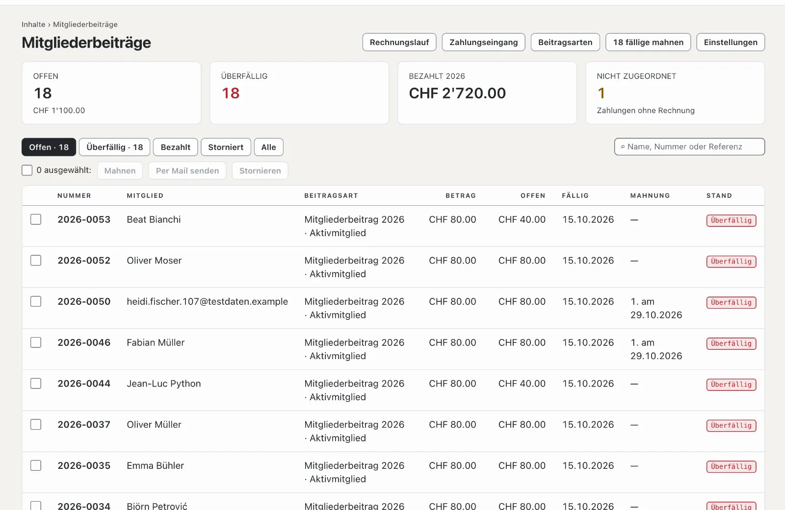

# Plugin «Vereinsbeiträge mit QR-Rechnung»

Mit «Vereinsbeiträge mit QR-Rechnung» stellen Sie den Mitgliedern Ihres Vereins die Beiträge in Rechnung: Jedes Mitglied
hat eine Beitragsart, ein Rechnungslauf erstellt die Rechnungen als PDF mit QR-Zahlteil und schickt sie per Mail — oder
legt sie als Sammel-PDF zum Drucken bereit. Dazu kommen Mahnungen in drei Stufen und der Zahlungseingang aus der
Bankdatei im Format camt.054 (ISO 20022). Das Plugin ist kostenpflichtig — CHF 129 mit einem Jahr Updates — und kommt
von Basalto.

## Installieren und einschalten

1. Auf basaltocms.com kaufen — einmalig je Installation ([Kaufen](installieren.md#kaufen)).
2. Im Backend unter **Verwaltung › Module › Marktplatz** bei «Vereinsbeiträge mit QR-Rechnung» **«Installieren»**
   ([Plugin installieren](installieren.md#plugin-installieren)).
3. Unter **Verwaltung › Sites › Site bearbeiten › Reiter «Module»** einschalten — zusammen mit dem Modul **«Mitglieder»**:
   Beiträge gehen an die aktiven Mitglieder der Site ([Mitglieder](../redaktion/mitglieder.md)). Ab Werk sind beide aus.

Danach steht unter **Inhalte** der Menüpunkt **«Mitgliederbeiträge»**. Die Zahl daran nennt die überfälligen
Rechnungen.

## Verein und Konto eintragen

Unter **Mitgliederbeiträge › Einstellungen** stehen die Angaben für jede Rechnung und den QR-Zahlteil. Sie speichern sich
selbst.

| Feld | |
| --- | --- |
| **Name des Vereins**, **Strasse**, **Hausnummer**, **PLZ**, **Ort**, **Land** | Absender der Rechnung und «Konto / Zahlbar an» im Zahlteil; Schweiz oder Liechtenstein |
| **IBAN oder QR-IBAN** | Konto des Vereins. Mit einer QR-IBAN trägt jede Rechnung eine **QR-Referenz**, mit einer gewöhnlichen IBAN eine **Creditor Reference (RF)** — beide ordnet der Zahlungseingang selbst zu |
| **BESR-ID** | nur, wenn Ihre Bank zur QR-IBAN eine vergeben hat — sonst leer lassen |
| Währung | CHF oder EUR |
| **Zahlungsfrist (Tage)** | schlägt im Rechnungslauf «Zahlbar bis» vor (ab Werk 30) |
| **Frist einer Mahnung (Tage)** | so lange nach einer Mahnung ist die nächste möglich; die Mahnung nennt diese Frist (ab Werk 14) |
| **Mails je Stunde höchstens** | ab Werk 80 — viele Hoster erlauben rund 100 Mails je Stunde |
| **Satz auf der Rechnung** | zum Beispiel ein Dank für die Treue zum Verein |

Fehlen Name, IBAN, PLZ oder Ort, meldet die Übersicht **«Kontoangaben fehlen»**, und ein Rechnungslauf ist nicht möglich.

## Beitragsarten anlegen und zuordnen

Unter **Mitgliederbeiträge › Beitragsarten** legen Sie mit **«Neue Beitragsart»** Name und Betrag an, zum Beispiel
«Aktivmitglied» mit CHF 80 oder «Passivmitglied» mit CHF 40. Ein Klick auf eine Beitragsart öffnet sie: Name, Betrag,
eine **Beschreibung** nur für Sie, **«In neuen Rechnungsläufen wählbar»** und die Reihenfolge.

Darunter stehen die aktiven Mitglieder mit Beitragsart und Versand. Filtern Sie nach Beitragsart, **«Ohne Beitragsart»**,
**«Befreit»** oder **«Per Post»**, markieren Sie Mitglieder und wählen Sie in der Leiste unten:

| Knopf | Wirkung |
| --- | --- |
| **Beitragsart: …** | das Mitglied zahlt diese Beitragsart |
| **Befreien** | keine Rechnung, etwa für Ehrenmitglieder |
| **Rechnung per Post** | die Rechnung kommt ins Sammel-PDF zum Drucken statt per Mail |
| **Rechnung per Mail** | wieder per Mail — so ist es ab Werk |

## Einen Rechnungslauf starten

Unter **Mitgliederbeiträge › Rechnungslauf** sehen Sie oben, wie viele Mitglieder aktiv sind, wie viele noch **ohne
Beitragsart** sind (sie bekommen keine Rechnung) und wie viele Mails warten.

1. Im Formular **«Neuer Rechnungslauf»** den **Titel** eintragen — er steht auf der Rechnung, etwa «Mitgliederbeitrag
   2027» — dazu **Jahr**, **Rechnungsdatum** und **«Zahlbar bis»**.
2. Die Beitragsarten ankreuzen, die in Rechnung gestellt werden.
3. **«Rechnungen gleich per Mail senden»** angekreuzt lassen oder später senden.
4. **«Rechnungen erstellen»**.

Jedes aktive Mitglied mit einer der gewählten Beitragsarten bekommt eine Rechnung mit der nächsten Nummer des Jahres
(«2027-0001») und seiner Zahlungsreferenz. Name und Adresse stammen aus dem Kundenkonto des Mitglieds, so wie sie beim
Rechnungslauf sind; die Rechnung erscheint in der Sprache des Kundenkontos. Wer befreit ist, auf Freigabe wartet oder
gesperrt ist, bekommt keine. Wer im selben Jahr schon eine Rechnung mit demselben Titel hat, wird übersprungen — so
können Sie denselben Lauf später für neue Mitglieder wiederholen.

## Per Mail oder per Post

- **Per Mail:** Die Mail nennt Betrag und Frist, das PDF mit dem QR-Zahlteil liegt bei. Die Mails gehen nach und nach
  hinaus, höchstens so viele je Stunde wie eingestellt; der Rest folgt in der nächsten Stunde. Unter **«Bisherige
  Läufe»** schickt **«Per Mail senden»** alle offenen Rechnungen eines Laufs, die noch nicht per Mail gingen.
- **Per Post:** In der Spalte **«Per Post»** öffnet **«Sammel-PDF»** alle Rechnungen des Laufs für Mitglieder mit
  «Rechnung per Post» — eine A4-Seite je Rechnung, der Zahlteil unten mit der Linie zum Abtrennen.
- **Eine einzelne Rechnung:** in der Liste öffnen, dann **«PDF»** oder **«Per Mail senden»**.

## Die Rechnungen im Blick

Die Übersicht **Mitgliederbeiträge** zeigt die Zahl und den Betrag der offenen Rechnungen, die überfälligen, den Betrag
der bezahlten Rechnungen des laufenden Jahres und die Zahlungen ohne Rechnung. Die Liste filtert nach **Offen**, **Überfällig**,
**Bezahlt**, **Storniert** und **Alle** und sucht nach Name, Nummer oder Referenz. Der Stand einer Rechnung ist
**Offen**, **Teilweise bezahlt**, **Überfällig**, **Bezahlt** oder **Storniert**. Für mehrere markierte Rechnungen
gibt es **«Mahnen»**, **«Per Mail senden»** und **«Stornieren»** — eine stornierte Rechnung bleibt mit Vermerk in der
Liste.

## Mahnen

Ist «Zahlbar bis» vorbei, lässt sich eine offene Rechnung mahnen:

- oben in der Übersicht **«… fällige mahnen»** für alle auf einmal,
- für markierte Rechnungen mit **«Mahnen»** in der Leiste,
- in einer Rechnung mit **«Mahnen»**.

Es gibt drei Stufen. Die nächste ist erst möglich, wenn die **Frist einer Mahnung** seit der letzten um ist. Die Mahnung
trägt den Titel «1. Mahnung» (bzw. 2. oder 3.), das Datum der Mahnung, eine neue Frist und den offenen Betrag nach
Teilzahlungen — auch im QR-Zahlteil. Mitglieder mit Mail bekommen sie per Mail; bei «Rechnung per Post» zeigt das PDF
der Rechnung jetzt die Mahnung zum Drucken.

## Zahlungseingang aus der Bankdatei

1. Im E-Banking die Gutschriftsanzeige im Format **camt.054 (ISO 20022)** als XML herunterladen — meist unter Dokumente
   oder Kontoauszüge.
2. Unter **Mitgliederbeiträge › Zahlungseingang** bei **«Bankdatei einlesen»** die Datei wählen und **«Einlesen»**.
3. Die Meldung nennt, wie viele Zahlungen zugeordnet wurden, wie viele nicht, wie viele Teilzahlungen waren und wie
   viele schon eingelesen waren.

Eine Gutschrift mit der Referenz einer offenen Rechnung verbucht sich selbst: Reicht der Betrag, ist die Rechnung
**Bezahlt** (mit dem Buchungstag); sonst bleibt sie offen, und der Rest ist der neue offene Betrag. Jede Buchung zählt
nur einmal, auch wenn Sie eine Datei zweimal hochladen. Belastungen und Stornobuchungen übergeht das Plugin.

Zahlungen ohne passende Referenz — oder für eine schon bezahlte bzw. stornierte Rechnung — stehen als **«nicht
zugeordnet»** in der Liste. Öffnen Sie eine, tragen Sie unter **«Rechnung zuordnen»** die **Rechnungsnummer** ein und
wählen Sie **«Zuordnen»**. Eine falsch eingelesene Zahlung lässt sich dort auch löschen.

## Zahlungen von Hand

Bar an der Versammlung bezahlt? In der Rechnung unter **«Zahlung erfassen»** den Betrag (vorgeschlagen ist der offene
Betrag), **«Eingang am»** und eine **Notiz** eintragen und **«Erfassen»**. Die Zahlungen einer Rechnung stehen unten in
ihrer Liste.

## Im Kundenkonto

Mitglieder sehen im Kundenkonto den Bereich **«Mitgliederbeiträge»** mit ihren Rechnungen, dem Stand und dem PDF —
solange eine Rechnung offen ist, mit dem QR-Zahlteil. Offene Rechnungen stehen dort auch unter «Als Nächstes».

## Datenschutz und Aufbewahrung

- **Auskunft und Löschung** je E-Mail-Adresse erledigt die Verwaltung unter «Verwaltung › Benutzer» (oder
  `php artisan basalto:privacy`): Die Auskunft nennt Beitragsart und Rechnungen. Das Löschen entfernt die Zuordnung;
  die Rechnungen bleiben als Buchungsbeleg mit Nummer, Betrag und Stand, aber ohne Name und Adresse.
- **Aufbewahrung:** Zehn Jahre nach Ende des Rechnungsjahres entfernt der nächtliche Löschlauf Rechnungen samt
  Zahlungen.
- Der **Export einer Site** nimmt nur die Beitragsarten mit; Rechnungen und Zahlungen bleiben bei der bisherigen Site.

## In der Statistik

Unter [Statistik](../verwaltung/statistik.md) zeigt der Reiter **Mitgliederbeiträge** Zahlungseingänge, offene Beträge, gestellte Rechnungen und Mahnungen, mit dem Vergleich zum Zeitraum davor.

## Wenn etwas nicht klappt

| Zeichen | Ursache | Lösung |
| --- | --- | --- |
| **«Kontoangaben fehlen»** | Name, IBAN, PLZ oder Ort des Vereins fehlen | unter **Einstellungen** ergänzen |
| «Das ist keine gültige IBAN aus der Schweiz oder Liechtenstein.» | Tippfehler oder Konto im Ausland | IBAN prüfen — die QR-Rechnung verlangt ein Konto in der Schweiz oder in Liechtenstein |
| Ein Mitglied bekommt keine Rechnung | nicht aktiv, befreit, ohne Beitragsart oder schon eine Rechnung mit demselben Titel im selben Jahr | Stand unter **Inhalte › Mitglieder** und Filter **«Ohne Beitragsart»** prüfen |
| Mails warten lange | das Kontingent der Stunde ist erreicht | warten — der Rest geht in der nächsten Stunde hinaus |
| «Das ist keine Bankdatei im Format camt.054 (ISO 20022).» | PDF, CSV oder ein anderes Format hochgeladen | im E-Banking die Gutschriftsanzeige als camt.054 (XML) herunterladen |
| Eine Zahlung ist «nicht zugeordnet» | ohne Referenz oder mit falscher Referenz überwiesen | unter **«Rechnung zuordnen»** die Rechnungsnummer eintragen |
| «Mahnen» fehlt | noch nicht fällig, die Frist seit der letzten Mahnung läuft noch oder schon die 3. Mahnung | später mahnen bzw. das Mitglied direkt ansprechen |

## Weiter

- [Mitglieder](../redaktion/mitglieder.md)
- [Für Installationen](installieren.md)
- [Marktplatz](README.md)
