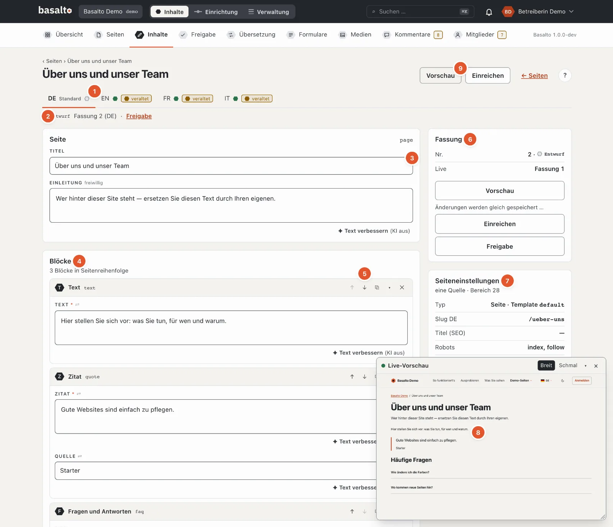
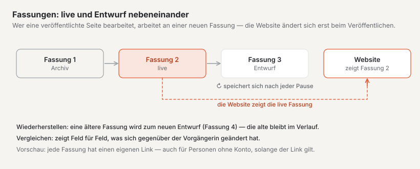
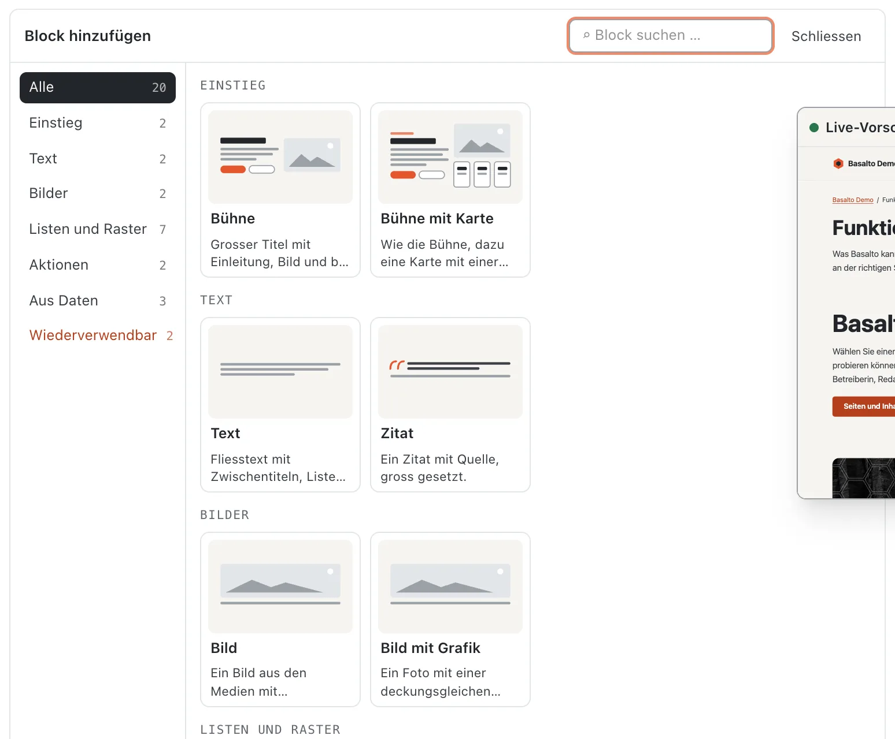
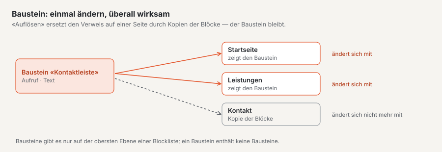
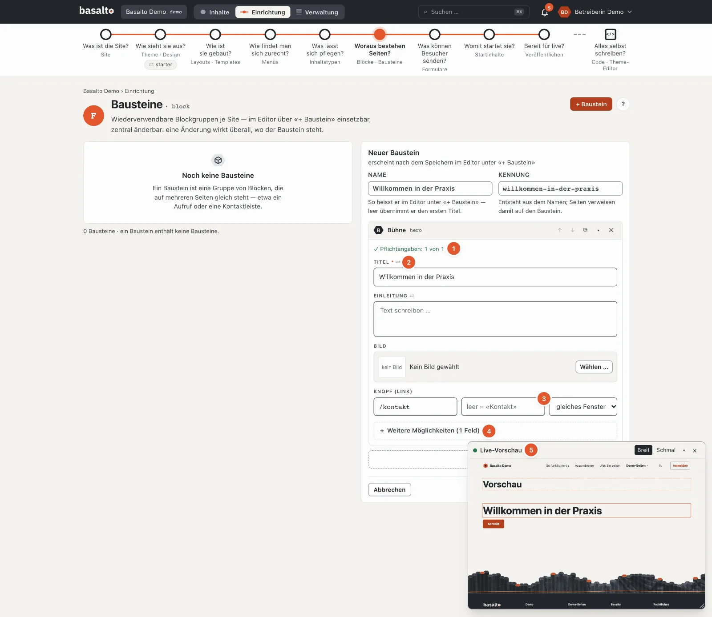
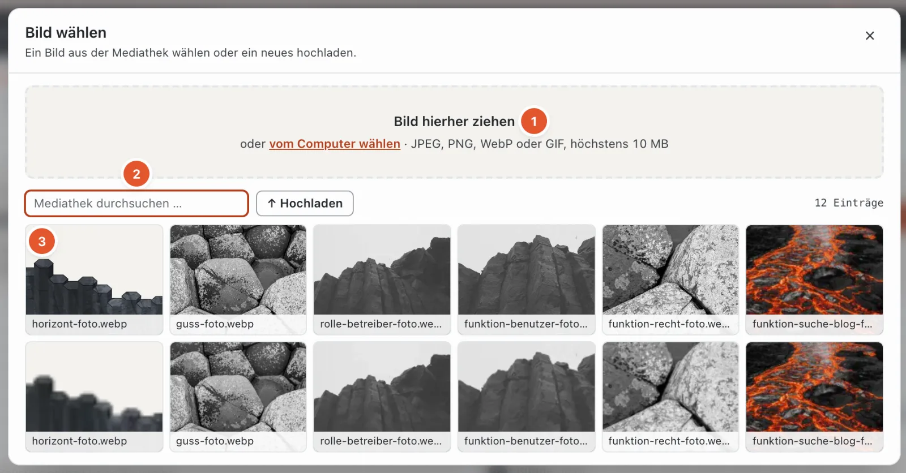
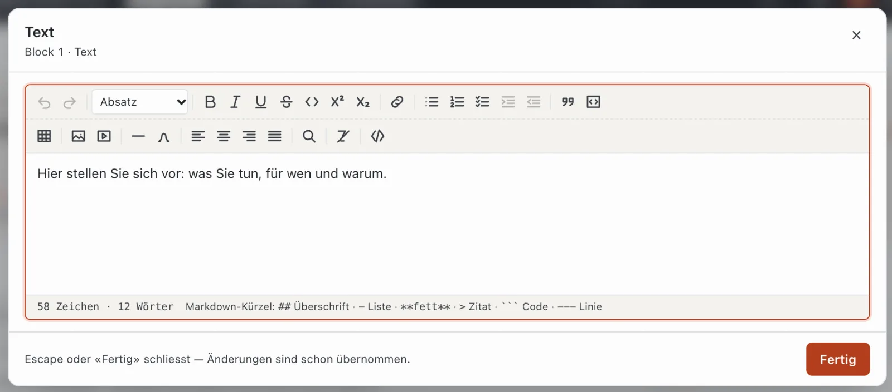
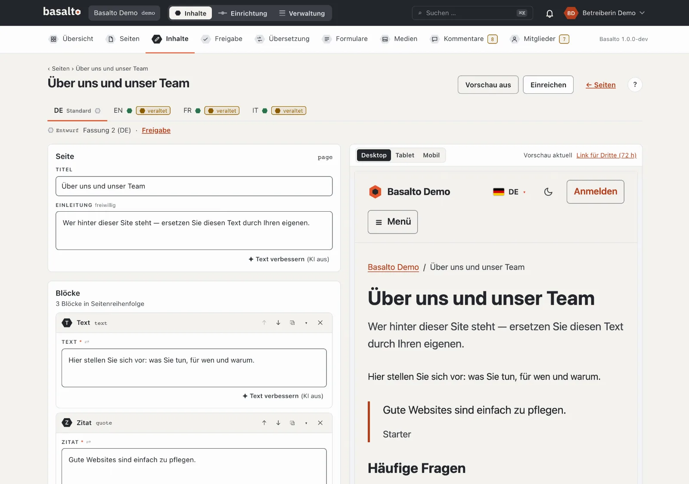
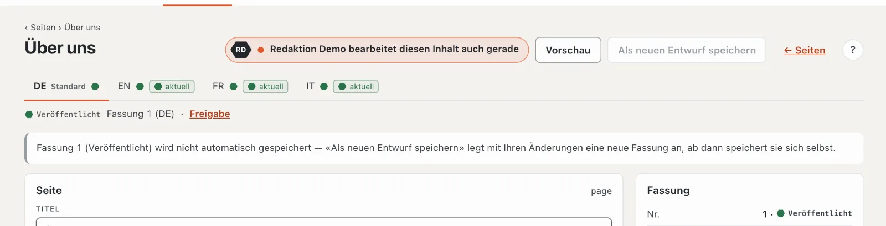

# Inhalte mit Blöcken bearbeiten

Der Inhalt einer Seite besteht aus **Blöcken**: Textabschnitte, Bilder, Bühnen, Formulare und was das Theme Ihrer Site sonst anbietet. Sie stellen die Blöcke im Editor zusammen, Basalto speichert jede Änderung selbst.

## Wo

- Für Seiten: Modus «Inhalte» › **Seiten**, in der Zeile der Seite der Knopf **«✎ Inhalt bearbeiten»**.
- Für andere Inhalte (zum Beispiel Blogbeiträge): Modus «Inhalte» › **Inhalte**, Typ wählen, beim Eintrag
  **«bearbeiten»**. Einen neuen Eintrag legen Sie dort mit **«Neuer Inhalt»** an.

### Die Liste «Inhalte»

Oben steht je **Inhaltstyp** des Themes ein Reiter mit der Zahl seiner Einträge. Ein Warnzeichen am Reiter heisst: Diesen
Typ gibt es im Theme nicht mehr — die Einträge bleiben gespeichert, lassen sich aber erst wieder bearbeiten, wenn das
Theme den Typ wieder kennt (Einrichtung › Inhaltstypen).

- **Filter:** Status und Sprache wirken sofort, die Suche (über die Titel aller Fassungen) mit Enter.
- **Spalten:** je Sprache ein Sechseck mit dem Status, dazu die Marke «veraltet», wenn die Übersetzung auf einer älteren
  Fassung beruht.
- **Reihenfolge und Seitengrösse** kommen aus Ihrem Profil (Einstellungen › «Sortierung der Listen», «Einträge pro
  Seite»); die Fussleiste nennt beides.
- **«Neuer Inhalt»** legt einen Eintrag als Entwurf in der Standardsprache an; gibt es nur einen Typ, ohne Rückfrage.
  Der Titel heisst zuerst «Neu: ‹Typ›».
- **Leer:** «Keine Inhaltstypen» heisst, das Theme definiert noch keine (siehe Einrichtung); «Noch kein Inhalt dieses
  Typs» und «Keine Inhalte mit diesem Filter» erklären sich selbst.

## Aufbau des Editors

1. **Sprachen** der Site als Reiter; «Standard» markiert die Standardsprache. Je Sprache ein Statuspunkt und, falls die
   Übersetzung hinter der Standardsprache herhinkt, die Marke «veraltet». Gibt es eine Sprache noch nicht, bietet der
   Reiter **«Übersetzung aus XX anlegen»** an: Die Struktur wird übernommen, die übersetzbaren Texte bleiben leer.
2. **Status und Fassung**, zum Beispiel «Entwurf · Fassung 2 (DE)», daneben der Link zur **Freigabe** dieser Fassung.
3. **Titel**, bei Inhalten ohne Seitenbaum der **Slug** (leer = aus dem Titel), die **Einleitung** und die **Felder**
   des Typs.
4. Die **Blöcke** in der Reihenfolge, in der sie auf der Seite stehen.
5. Die **Knöpfe eines Blocks** (siehe unten).
6. **Fassung:** Nummer, Status, welche Fassung live ist, und die Meldung des automatischen Speicherns.
7. **Seiteneinstellungen** (nur bei Seiten): Typ und Template, Slug, Titel für Suchmaschinen, Robots, Sichtbarkeit,
   Zeitfenster — und «Alle Einstellungen (12 Reiter)». Slug und Metadaten einer Seite stehen nicht im Editor, sondern
   dort (siehe [Seiten](seiten.md)).
8. **Fassungen** dieser Sprache mit «Vergleichen», «Vorschau» und «Wiederherstellen».
9. **Vorschau** und **Einreichen**.

Oben zählt der Editor «N Felder zu prüfen», wenn Angaben fehlen oder nicht stimmen; der betroffene Block bekommt einen
roten Rand und eine Zahl — Fehler in Unterblöcken zählen nach oben mit.

## Blöcke hinzufügen und ordnen

1. Klicken Sie unter den Blöcken auf **«+ Block einfügen»**. Ist die Liste noch leer, steht die Palette schon offen.
2. Wählen Sie in der **Palette** den gewünschten Block. Jede Karte zeigt ein **Schema** des Blocks — wo die Überschrift
   steht, ob es ein Bild, Knöpfe, Karten oder aufklappbare Fragen gibt — dazu den Namen und einen Satz, wofür er da ist.
   Links stehen die **Gruppen** (zum Beispiel «Einstieg», «Text», «Bilder», «Listen und Raster», «Aktionen», «Aus
   Daten») mit der Zahl ihrer Blöcke; ein Klick zeigt nur diese Gruppe. Das Feld **«Block suchen …»** filtert nach Name,
   Satz und Gruppe, **Enter** fügt den ersten Treffer ein. Blöcke, die an dieser Stelle nicht erlaubt sind, stehen
   gestrichelt und blass da — der Grund steht auf der Karte. Unter **«Wiederverwendbar»** fügen Sie einen Baustein oder
   einen Lava-Teil ein. **Esc** oder «Schliessen» klappt die Palette zu.
3. Füllen Sie die Felder des Blocks aus.

Neue Blöcke kommen ans Ende der Liste; mit ↑ ↓ bringen Sie sie an ihren Platz. Im Kopf jedes Blocks finden Sie:

| Knopf | Wirkung |
| --- | --- |
| ↑ / ↓ | eine Stelle nach oben oder unten (ganz oben bzw. unten gesperrt) |
| ⧉ | Block duplizieren — die Kopie steht direkt darunter |
| ▾ / ▸ | Block einklappen oder ausklappen |
| ✕ | Block löschen — mit Rückfrage «Block löschen?» |

Ziehen mit der Maus gibt es im Block-Editor nicht — ↑ ↓ sind dafür eindeutig und mit der Tastatur bedienbar.
Eingeklappte Blöcke zeigen eine kurze Zusammenfassung ihres Inhalts. Eine Zahl am Block meldet Felder, die noch nicht
stimmen.

### Bausteine und Lava-Teile

- Ein **Baustein** ist eine Gruppe von Blöcken, die auf mehreren Seiten gleich steht (zum Beispiel eine Kontaktleiste).
  Im Editor steht er als **Verweis**: Ändert jemand den Baustein unter Einrichtung › Bausteine («zentral bearbeiten»),
  ändert er sich auf allen Seiten. **«Auflösen»** ersetzt den Verweis auf dieser einen Seite durch Kopien der Blöcke —
  ab da sind sie hier frei änderbar, der Baustein bleibt für die übrigen Seiten. Bausteine gibt es nur auf der obersten
  Ebene einer Blockliste; ohne angelegte Bausteine meldet die Auswahl «Noch keine Bausteine».
- Ein **Lava-Teil** ist ein Stück des Themes mit Einstellungen, zum Beispiel eine Navigation oder ein Suchfeld. Seine
  Einstellungen stehen unter Einrichtung › Layout › Teile; im Editor wählen Sie nur, welcher Teil hier steht. Ein
  Lava-Teil lässt sich nicht auflösen.

### Gesperrte Blöcke

Welche Blöcke an einer Stelle erlaubt sind, legt das Theme je Inhaltstyp bzw. je Feld fest. Gesperrte Blöcke bleiben in
der Palette sichtbar; der Grund nennt den Geltungsbereich, zum Beispiel «‹Bühne› ist für den Typ Seite nicht erlaubt».
Ändern lässt sich das unter Einrichtung › Inhaltstypen.

### Verschachtelte Blöcke

Manche Blöcke enthalten selbst wieder Blöcke, zum Beispiel eine Spalte oder ein Register. Darin fügen Sie Blöcke genauso hinzu wie oben — beliebig tief. Welche Blöcke wo erlaubt sind, legt das Theme fest.

Erscheint «Unbekannter Block», gibt es diesen Block im Theme nicht (mehr). Der Inhalt bleibt gespeichert; wenden Sie sich an die Person, die das Theme betreut.

## Die Felder eines Blocks

Das Formular eines Blocks führt Sie:

1. **Pflichtangaben.** Über den Feldern zählt «Pflichtangaben: 1 von 2», bis alle da sind (dann mit ✓).
2. **Beschriftung und Hilfe.** Über jedem Feld steht seine Beschriftung mit `*` für Pflicht und ⇄, wenn es je Sprache
   übersetzt wird. Darunter erklärt ein Satz, wofür das Feld da ist, und im leeren Feld steht ein Beispiel — beides
   kommt aus dem Theme.
3. **Was automatisch kommt.** Ein leeres Feld, das einen Wert von anderswo übernimmt, zeigt ihn grau: «leer =
   «Kontakt»». Lassen Sie die Beschriftung eines Links leer, steht auf der Seite der Titel der Zielseite. Beim Feld
   «Adresse» schlägt der Editor die Seiten der Site vor — tippen Sie einen Teil des Titels oder der Adresse und wählen
   Sie.
4. **Das Wichtigste zuerst.** Oben stehen die Pflichtfelder, alles schon Ausgefüllte und die Hauptfelder des Blocks —
   bei einer Bühne zum Beispiel Titel, Einleitung, Bild und Knopf. Feineinstellungen wie Nachweise, kleine
   Bildfassungen oder eine abweichende Beschriftung stehen unter **«+ Weitere Möglichkeiten (N Felder)»**; ein Klick
   klappt sie auf, «− Weniger zeigen» wieder zu. Was ausgefüllt ist, bleibt immer sichtbar.
5. **Live-Vorschau** im kleinen Fenster — siehe [unten](#live-vorschau-im-fenster).

Pflichtfelder prüft Basalto erst beim **Einreichen** — das automatische Speichern nimmt auch Unvollständiges an, damit
nichts verloren geht.

| Feldtyp | Bedienung |
| --- | --- |
| Text, E-Mail, URL, Slug | eine Zeile; Slug nur a–z, 0–9 und «-» |
| Textbereich, Markdown, Code | mehrere Zeilen; Markdown und Code in Festbreitenschrift |
| Fliesstext (richtext) | formatierter Text — ein Klick öffnet das grosse Fenster (siehe unten) |
| Zahl | Ziffern, mit Minimum und Maximum aus dem Theme |
| Schalter | ein oder aus |
| Datum, Datum mit Zeit | Auswahl im Kalender |
| Auswahl | eine Option aus der Liste; «—» heisst keine (nur, wenn das Feld keine Pflicht ist) |
| Tags | Wort eingeben, mit Enter oder Komma übernehmen; doppelte werden ignoriert, ✕ entfernt eines |
| Bild | «Wählen …» (oder ein Klick auf das Vorschaubild) öffnet die Mediathek als Dialog — siehe unten; der Alt-Text ist aus dem Dateinamen vorbelegt — bitte prüfen |
| Bild (Adresse) | wie «Bild»: ein Bild aus der Mediathek wählen oder hochladen; ein Klick ins leere Feld öffnet den Dialog. Wer eine Datei des Themes kennt, tippt ihre Adresse ein (z. B. `landing/foto.webp`) |
| Galerie | «+ Bilder wählen …»: im Dialog wählt ein Klick ab oder an, «Fertig» schliesst; ↑ ↓ ordnen, Alt-Text je Bild |
| Datei | eine Datei aus der Mediathek, im selben Dialog |
| Link | Adresse (/kontakt, https://…, mailto:), Beschriftung und Ziel («gleiches Fenster» oder «neues Fenster»). Tippen Sie den Titel einer Seite («Kontakt»), wird daraus ihre Adresse («/kontakt»); ist es weder Adresse noch Seite, warnt das Feld |
| Relation | ein anderer Inhalt der Site (zum Beispiel eine Person), aus einer Liste gewählt |
| Wiederholung (repeater) | mehrere gleich gebaute Zeilen (zum Beispiel Karten): «+ Zeile», ↑ ↓ ordnen, «Entfernen» löscht die Zeile **ohne Rückfrage** |
| Blöcke | verschachtelte Blöcke (siehe unten) |
| Farbe | Farbwähler oder Hex-Wert (#rrggbb) |
| SEO | Titel und Beschreibung mit Zählern (empfohlen 60 bzw. 160, höchstens 120 bzw. 320 Zeichen) |
| JSON | strukturierte Daten; geprüft, wenn Sie das Feld verlassen |

### Bilder wählen und hochladen

Bei Bild-, Galerie- und Dateifeldern öffnet sich die Mediathek als Dialog über der Seite:

1. **Hineinziehen** — Bilder aus dem Finder oder Explorer auf die Fläche oben ziehen, oder **«vom Computer wählen»**.
   JPEG, PNG, WebP oder GIF bis 10 MB. Was hochgeladen ist, landet in der Mediathek und ist sofort gewählt.
2. **Suchen und Ordner** — nach Namen filtern und auf einen Ordner der Mediathek einschränken.
3. **Wählen** — ein Klick auf ein Bild übernimmt es und schliesst den Dialog. Bei einer Galerie wählt jeder Klick ab
   oder an; «Fertig» schliesst. Bilder ohne Alt-Text tragen die Marke «Alt-Text fehlt».

Felder mit einer Bildadresse (etwa das Bild einer Bühne) nehmen auch ein **Bild des Themes**: Der Dialog hat dann
den Reiter **«Bilder des Themes»** neben der Mediathek. Die Bilder sind nach Ordnern geordnet (Reiter mit Zahl);
zusammengehörige Dateien stehen als Motiv beisammen — etwa «buehne» mit Foto, Foto · 960 und Schema. **Fotos** und
**Grafiken** lassen sich getrennt zeigen, das gewählte Bild steht oben unter «Aktuell gewählt». Im Feld erscheint die
Miniatur; fehlt eine Datei, steht dort **«Datei fehlt»**.

Esc, × oder ein Klick neben den Dialog schliessen ohne Änderung.

Zeigt ein Feld «Unbekannter Feldtyp», kennt Basalto den Typ nicht (zum Beispiel aus einem abgeschalteten Modul); der
Inhalt bleibt gespeichert.

## Fliesstext bearbeiten

Fliesstext-Felder zeigen im Formular nur den formatierten Text. Ein Klick darauf (oder **«Bearbeiten ↗»**) öffnet den Text in einem grossen Fenster mit voller Werkzeugleiste. **«Fertig»** oder Esc schliesst es — Ihre Änderungen sind dann schon übernommen.

Die Werkzeugleiste hat zwei Reihen:

- **Rückgängig**, **Wiederholen** und das **Absatzformat** (Absatz, Überschrift 2, 3 oder 4),
- **Fett**, **Kursiv**, **Unterstrichen**, **Durchgestrichen**, **Code**, **Hochgestellt**, **Tiefgestellt**,
- **Link**, **Aufzählung**, **Nummerierung**, **Aufgabenliste**, Einzug rein und raus,
- **Zitat**, **Codeblock**, **Tabelle**, **Bild aus der Mediathek**, **Einbettung** (YouTube, Vimeo, Karte), **Trennlinie**, **Sonderzeichen**,
- Ausrichtung **linksbündig**, **zentriert**, **rechtsbündig**, **Blocksatz**,
- **Suchen und Ersetzen**, **Format entfernen** und **Quelltext** (nur zum Lesen).

Unten zählt der Editor Zeichen und Wörter. Wer lieber tippt, nutzt die Markdown-Kürzel: `##` für eine Überschrift, `-` für eine Liste, `**fett**`, `>` für ein Zitat, drei Backticks für Code und `---` für eine Linie.

**Tastenkürzel** (Mod = ⌘ auf dem Mac, Ctrl unter Windows; die Werkzeugleiste zeigt sie auch beim Überfahren):

| Kürzel | Wirkung | Kürzel | Wirkung |
| --- | --- | --- | --- |
| Mod+Z / ⇧+Mod+Z | rückgängig / wiederholen | Mod+K | Link |
| Mod+B / Mod+I / Mod+U | fett / kursiv / unterstrichen | ⇧+Mod+8 / 7 / 9 | Aufzählung / Nummerierung / Aufgabenliste |
| ⇧+Mod+S | durchgestrichen | Tab / ⇧+Tab | Listenpunkt ein- / ausrücken |
| Mod+E | Code im Text | ⇧+Mod+B | Zitat |
| Mod+. / Mod+, | hoch- / tiefgestellt | Alt+Mod+C | Codeblock |
| ⇧+Mod+L / E / R / J | links / zentriert / rechts / Blocksatz | | |

**Tabellen:** «Tabelle» fügt 3 × 3 Zellen mit Kopfzeile ein. Steht der Cursor in einer Tabelle, bietet ein Menü Zeilen
und Spalten einfügen oder löschen, Zellen verbinden oder teilen und die Tabelle löschen.

**Codeblock:** Die Sprache des Codes (für die Farben) wählen Sie im Block selbst.

**Suchen und Ersetzen** (Lupe): Gross- und Kleinschreibung zählen nicht; «Weiter», «Ersetzen» und «Alle ersetzen»,
ohne Treffer «kein Treffer».

**Links:** Markieren Sie den Text, klicken Sie auf «Link» und tragen Sie die Adresse ein (https://…, mailto:, ein Pfad wie /kontakt oder #). Wahlweise einen **Titel** (erscheint beim Überfahren). Wählen Sie, ob der Link im gleichen oder in einem neuen Fenster öffnet, und klicken Sie auf **«Anwenden»**. «Link entfernen» hebt ihn wieder auf.

**Bilder im Text:** «Bild aus der Mediathek» fügt ein Bild ein. Tragen Sie einen **Alt-Text** ein (er beschreibt das Bild für Menschen, die es nicht sehen), auf Wunsch eine Beschriftung, und wählen Sie die Ausrichtung.

**Einbettungen:** Fügen Sie die Adresse eines Videos von YouTube oder Vimeo oder einer Karte von Google Maps oder OpenStreetMap ein. Erkennt Basalto die Adresse, meldet das Fenster «… erkannt»; eine unbekannte Adresse lässt sich nicht einfügen. Die Einbettung lädt auf der Website erst, wenn die Besucherin zustimmt.

## Einfügen aus Word und anderen Programmen

Kopieren Sie Text aus Word, Google Docs oder einer Webseite und fügen Sie ihn mit ⌘V bzw. Ctrl+V in ein Fliesstext-Feld ein. Basalto übernimmt dabei:

- Überschriften, Absätze, Aufzählungen und nummerierte Listen (auch aus Word),
- Fett, Kursiv, Unterstrichen, Durchgestrichen, Hoch- und Tiefgestellt,
- Tabellen und Links,
- **Bilder**: Sie werden automatisch in die Mediathek hochgeladen und im Text verknüpft.

Schriftarten, Farben und Schriftgrössen fallen weg — das Aussehen bestimmt das Theme. Eine Überschrift der obersten Ebene aus Word wird zur «Überschrift 2», tiefere enden bei «Überschrift 4». Eingefügter **Markdown**-Text (aus einem Texteditor) wird ebenfalls umgewandelt.

Für eingefügte Bilder gilt: JPEG, PNG, WebP oder GIF, höchstens 10 MB je Bild. Klappt ein Bild nicht, meldet der Editor «Ein Bild konnte nicht hochgeladen werden.» Prüfen Sie nach dem Einfügen die **Alt-Texte** der Bilder in der [Mediathek](medien.md).

## Live-Vorschau im Fenster

Ein kleines Fenster **«Live-Vorschau»** unten rechts zeigt den Inhalt mit dem echten Theme, gut eine halbe Sekunde
nach jeder Eingabe neu — ohne zu speichern. Es folgt Ihnen:

- **Das Feld, in dem Sie schreiben, leuchtet** in der Vorschau mit einem Lava-Rahmen auf; die Vorschau rollt dorthin.
- **Ein Klick auf eine Stelle der Vorschau** springt zum passenden Feld im Formular.
- **Verschieben** am Kopf, **Grösse** an der Ecke unten rechts, **«Breit»** (Desktop) oder **«Schmal»** (Telefon),
  **▾** klappt es ein, **×** schliesst es. Lage und Grösse merkt sich der Browser; geschlossen öffnet es der Knopf
  **«Live-Vorschau»** im Seitenkopf wieder.

Das Fenster erscheint, solange die grosse Vorschau (Split-Screen) aus ist und der Bildschirm mindestens 768 px breit ist.

## Vorschau im Split-Screen

Der Knopf **«Vorschau»** teilt den Bildschirm: links der Editor, rechts die Seite, wie sie aussehen wird — mit Ihren Änderungen, auch wenn sie noch nicht gespeichert sind. Die Vorschau aktualisiert sich knapp eine Sekunde nach jeder Änderung («Vorschau wird aktualisiert …», dann «Vorschau aktuell»); schlägt sie fehl, steht dort der Grund.

Mit der **Gerätebreite** prüfen Sie die Darstellung auf «Desktop» (volle Breite), «Tablet» (768 px) und «Mobil» (375 px). Auf schmalen Bildschirmen wechseln Sie mit den Reitern «Editor» und «Vorschau». «Vorschau aus» schliesst die Vorschau wieder.

### Vorschau mit anderen teilen

**«Link für Dritte (72 h)»** erzeugt einen Link, mit dem auch Personen ohne Zugang zum Backend die Seite ansehen können — zum Beispiel für eine Rückmeldung von Kundinnen. Mit «Kopieren» kommt der Link in die Zwischenablage. Er zeigt die neueste gespeicherte Fassung dieser Sprache, ist 72 Stunden gültig («läuft ab …») und wird von Suchmaschinen nicht erfasst.

## Automatisches Speichern

Einen Speichern-Knopf gibt es im Editor nicht. Gut eine Sekunde nach Ihrer letzten Eingabe speichert Basalto selbst. Unten rechts erscheint kurz «… gespeichert» mit der Uhrzeit; eine Fehlermeldung bleibt dort stehen, bis sie erledigt ist. Rechts unter «Fassung» steht, was gerade geschieht:

| Meldung | Bedeutung |
| --- | --- |
| Speichert automatisch in Fassung … | alles gespeichert |
| Änderungen werden gleich gespeichert … | Sie tippen noch |
| Speichert … | wird gerade gespeichert |
| Ohne Titel wird nicht gespeichert. | tragen Sie zuerst einen Titel ein |
| Nicht gespeichert — bitte die markierten Felder prüfen. | ein Feld stimmt nicht; es ist markiert |

Gespeichert wird immer **in den Entwurf**. Die live Fassung auf der Website ändert sich dadurch nicht. Geänderte Blöcke zeigen kurz «✓ gespeichert».

Ist die neueste Fassung schon eingereicht, freigegeben oder veröffentlicht, speichert der Editor nicht selbst. Der Knopf **«Als neuen Entwurf speichern»** legt dann mit Ihren Änderungen eine neue Fassung an; ab da speichert sie sich wieder selbst.

### Wer gerade mitarbeitet

Hat jemand anderes denselben Inhalt offen, steht oben neben den Knöpfen **«Marco Bernasconi bearbeitet diesen Inhalt
auch gerade»** mit den Initialen im Sechseck. Sprechen Sie sich ab, bevor Sie beide ändern: Jedes Speichern legt eine
neue Fassung an, und unter «Fassung» bleiben alle erhalten. Die Anzeige verschwindet, sobald die andere Person den
Editor schliesst — spätestens nach einer Minute.

## Fassungen und Wiederherstellen

Die Liste **«Fassungen»** rechts zeigt alle Fassungen dieser Sprache mit Nummer, Status, Autorin oder Autor und Datum.

- **«Vergleichen»** klappt auf, was sich gegenüber der vorherigen Fassung geändert hat — Zeile für Zeile «Feld: ‹alt› → ‹neu›», oder «keine Änderungen gegenüber der Vorgängerin».
- **«Vorschau»** öffnet genau diese Fassung in einem neuen Tab.
- **«Wiederherstellen»** legt aus einer älteren Fassung sofort einen **neuen Entwurf** an («Fassung 2 wiederhergestellt als Fassung 5»). Nichts wird überschrieben; die live Fassung bleibt, bis die neue veröffentlicht ist.

Wie viele archivierte Fassungen erhalten bleiben, legt die Einstellung «Archivierte Fassungen behalten» fest (Standard: 50 je Inhalt und Sprache).

## Einreichen

Sind Sie fertig, klicken Sie auf **«Einreichen»**. Vorher speichert der Editor, was noch aussteht; dann geht die Fassung in die Freigabe. Gesperrt ist «Einreichen» mit Grund, solange der Titel fehlt («erst den Titel eintragen, dann einreichen») oder Pflichtfelder leer sind («Einreichen erst mit allen Pflichtfeldern — N fehlen»); der Editor markiert sie. Mehr dazu unter [Freigabe und Veröffentlichung](freigabe.md).

Wurde eine Fassung zurückgewiesen, steht oben «Zurückgewiesen» mit dem Kommentar der prüfenden Person.

## Auf dem Telefon

Unter 768 px Breite stehen die Blöcke als **Karten** mit Kurzinhalt untereinander. Ein Tippen öffnet einen Block als
Blatt über die ganze Fläche; «Fertig» schliesst es. Löschen geht in zwei Schritten («Entfernen», dann «Wirklich
entfernen»). «+ Block» öffnet die Palette von unten. Eine feste Leiste unten trägt Vorschau und Einreichen.

## Häufige Fragen

**Wo stelle ich Slug, Seitentitel oder Beschreibung einer Seite ein?**
In den Seiteneinstellungen — Link «Alle Einstellungen (12 Reiter)» rechts im Editor. Siehe [Seiten](seiten.md).

**Ich arbeite in einer anderen Sprache als der Standardsprache.**
Nutzen Sie «Übersetzen nebeneinander» — dort steht der Text der Standardsprache direkt über Ihrem. Siehe [Übersetzen](uebersetzen.md).

**Ich habe aus Versehen einen Block gelöscht.**
Öffnen Sie in der Liste «Fassungen» die vorherige Fassung mit «Wiederherstellen». Der gelöschte Block ist im neuen Entwurf wieder da; Änderungen seit dieser Fassung müssen Sie dann neu machen.

## Weiter

- [Medien](medien.md)
- [Freigabe und Veröffentlichung](freigabe.md)
- [Übersetzen](uebersetzen.md)
