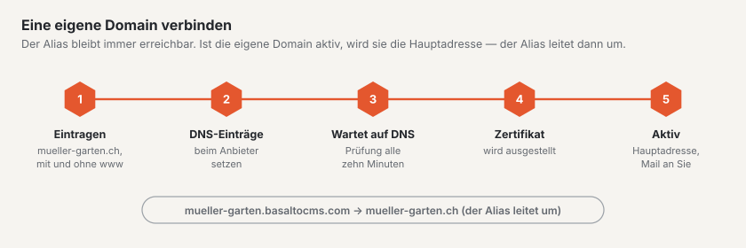

# Domains

Unter **Verwaltung › Konto › Domains** legen Sie fest, unter welchen Adressen Ihre Site erreichbar ist. Den Reiter sehen Besitzer, Verwaltung und Abrechnung des Kontos; ändern dürfen Besitzer und Verwaltung.

## Alias

Jede Site ist ab dem ersten Moment unter ihrem **Alias** erreichbar, zum Beispiel `mueller-garten.basaltocms.com` — in jedem Plan inklusive.

- **Alias ändern:** neuen Namen eintragen (3–40 Zeichen, Kleinbuchstaben, Ziffern und Bindestrich) und «Alias ändern» wählen. Der neue Alias gilt sofort. Der alte leitet noch **30 Tage** auf die Site um und ist danach frei.
- Ob ein Name frei ist, sehen Sie schon beim Tippen; ist er vergeben, steht ein Vorschlag daneben.
- Suchmaschinen nehmen den Alias nicht auf. Wer gefunden werden will, verbindet eine eigene Domain.

## Eigene Domain

Sie bringen Ihre Domain mit (registriert bei Ihrem Anbieter, zum Beispiel Infomaniak, Hostpoint, Cloudflare oder Swizzonic).

1. Unter «Weitere Domain» die Domain eintragen, zum Beispiel `mueller-garten.ch`, und «Domain hinzufügen» wählen. Die Adresse mit und ohne `www` legen wir beide an — sie zählen als **eine** Domain.
2. Die angezeigten **DNS-Einträge** bei Ihrem Anbieter genau so eintragen, wie sie dastehen (Typ, Name, Wert).
3. Warten: Wir prüfen alle zehn Minuten. Mit «Jetzt prüfen» geht es sofort (einmal je Minute). Der Stand wechselt von «wartet auf DNS» über «Zertifikat wird ausgestellt» zu «aktiv» — in der Regel in unter 15 Minuten, manchmal bis zu einigen Stunden.
4. Sobald die Domain aktiv ist, wird sie die **Hauptadresse** Ihrer Site, und Sie bekommen eine Mail. Der Alias leitet ab dann auf Ihre Domain um; Links mit dem Alias funktionieren weiter.

Steht «Fehler», nennt der Reiter die Meldung. Meist fehlt ein DNS-Eintrag oder ist vertippt — korrigieren Sie ihn und prüfen Sie erneut.

**Hauptadresse wechseln:** Mit «… zur Hauptadresse» wählen Sie, ob Ihre Site unter `www.mueller-garten.ch` oder `mueller-garten.ch` erscheint; die andere Adresse leitet um.

**Entfernen:** «Entfernen» löscht die Domain. War sie die Hauptadresse, ist es wieder der Alias.

## Wie viele Domains

| Plan | Eigene Domains |
| --- | --- |
| Start | keine |
| Standard | 1 |
| Pro | 5 |

Ist das Kontingent belegt, können Besitzer und Abrechnung beim Hinzufügen eine **Zusatzdomain für CHF 5 im Monat** bestellen — oder auf einen grösseren Plan wechseln. In der Testphase gibt es noch keine eigene Domain. Ihre Site bleibt in jedem Fall erreichbar.

## Weiter

- [Export und Kündigung](konto.md)
- [Live gehen](../einrichtung/live-gehen.md)
