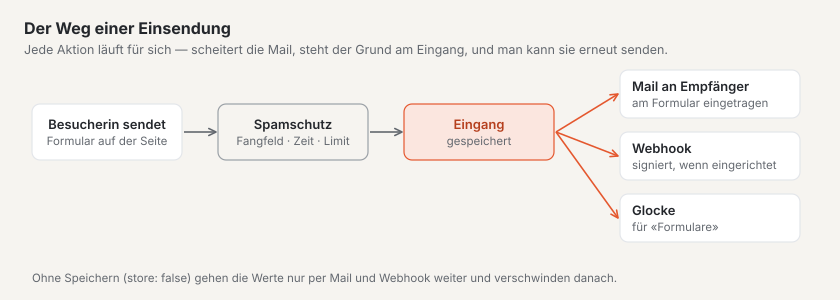
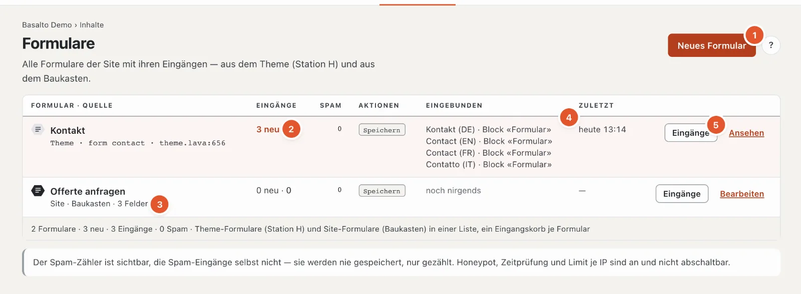
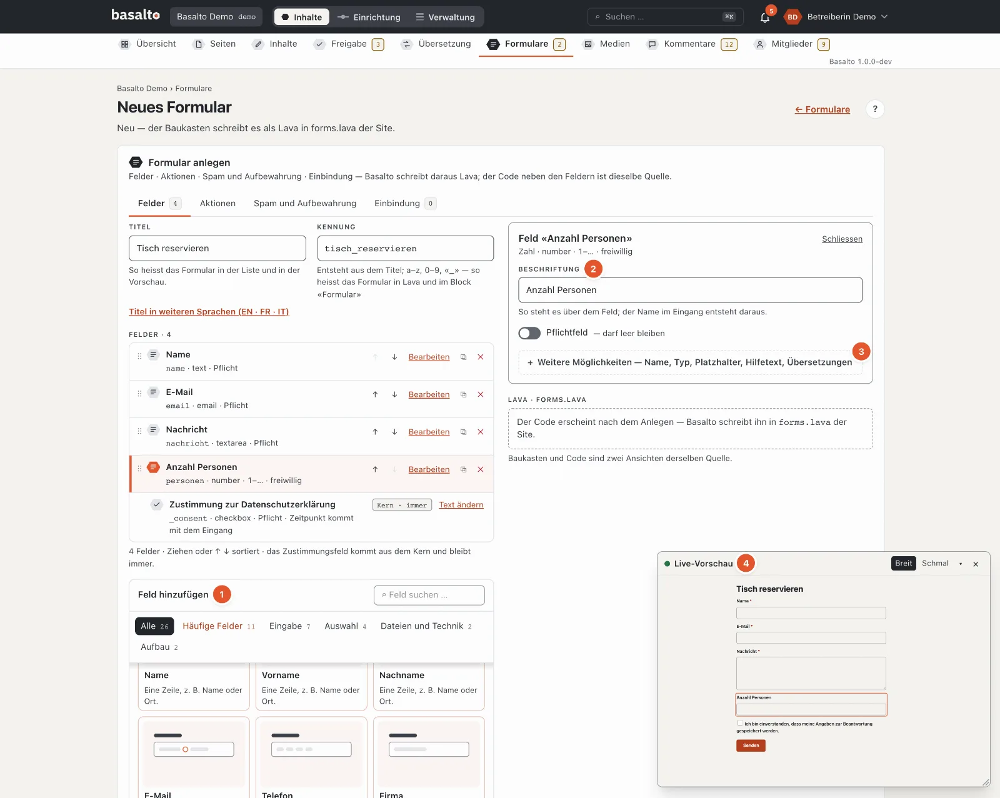
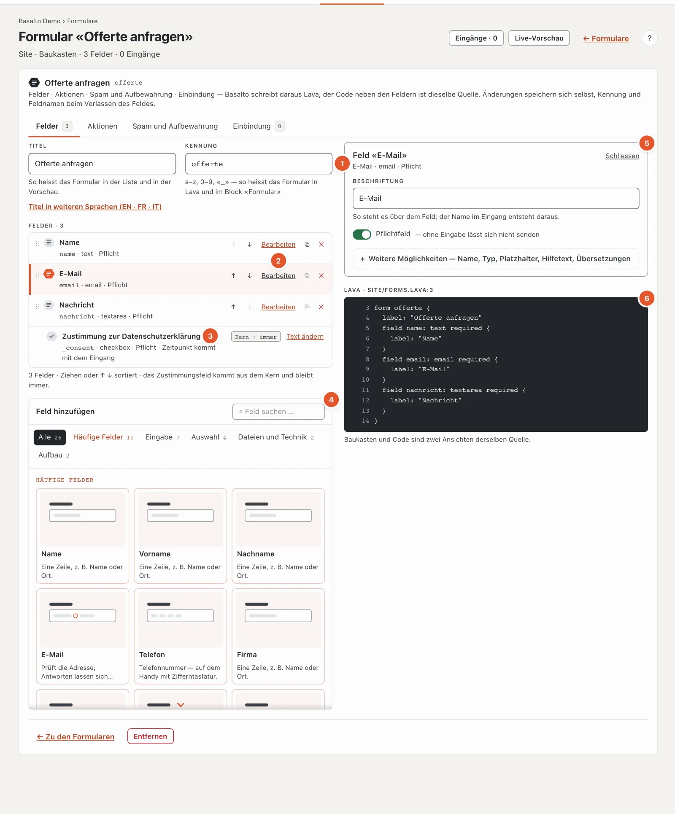
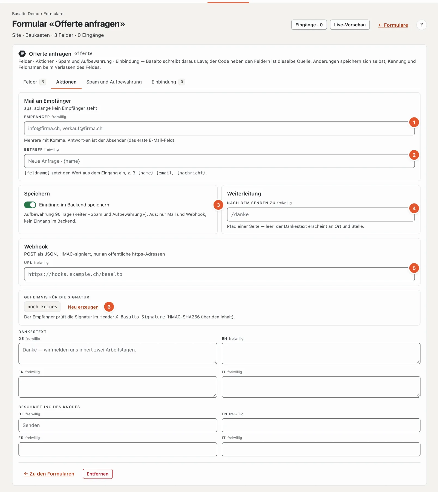
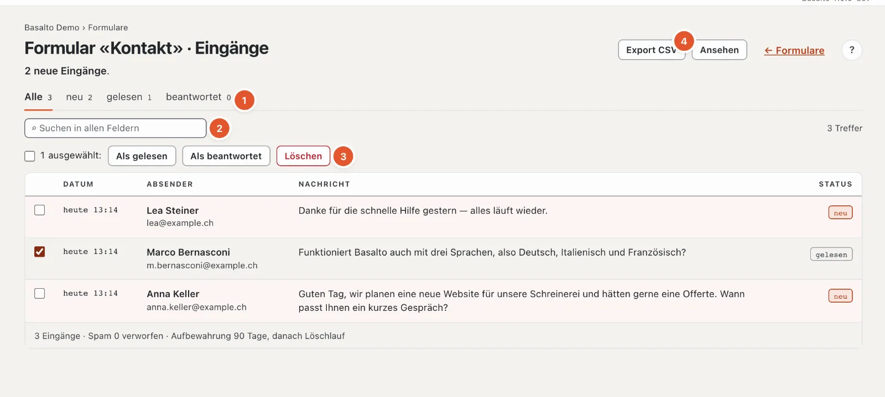
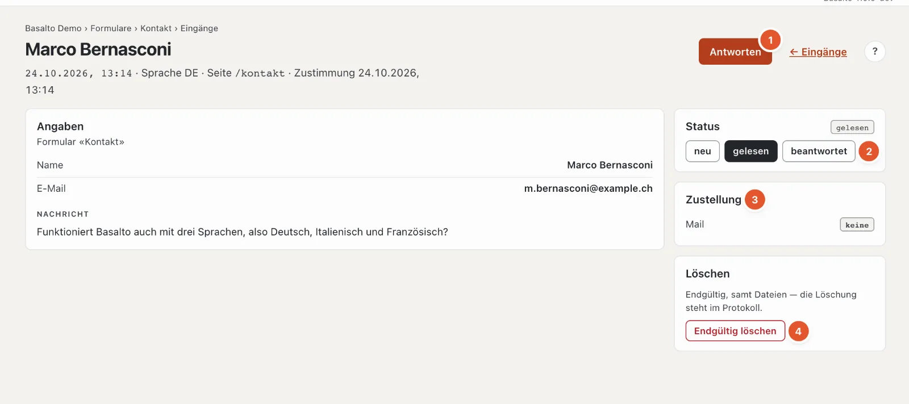

# Formulare

Mit Formularen nehmen Sie Anfragen, Anmeldungen oder Bestellungen über die Website entgegen. Jedes Formular hat einen eigenen **Eingangskorb** im Backend und kann jeden Eingang zusätzlich per Mail verschicken oder an ein anderes System weitergeben.

## Wo

Modus «Inhalte» › **Formulare**.

1. **«Neues Formular»** legt ein Formular mit dem Baukasten an.
2. **Eingänge**: «3 neu · 3» heisst drei neue von insgesamt drei. Formulare mit neuen Eingängen sind hell hinterlegt.
3. **Quelle**: «Site · Baukasten» oder «Theme · form contact · theme.lava:612» (die Stelle im Theme).
4. **Eingebunden**: auf welchen Seiten und in welcher Sprache das Formular im Block «Formular» steht — oder «noch nirgends».
5. **«Eingänge»** öffnet den Eingangskorb, «Bearbeiten» (bei Theme-Formularen «Ansehen») das Formular.

Ausserdem zeigt die Liste den **Spam-Zähler**, die eingestellten **Aktionen** (Mail, Speichern, Weiterleitung, Webhook) und unter «Zuletzt» den Zeitpunkt des letzten Eingangs. Konnte eine Mail nicht zugestellt werden, steht in Rot «1 Mail nicht zugestellt — im Eingang erneut senden».

Es gibt zwei Arten von Formularen:

- **Site-Formular** — im Backend mit dem Baukasten angelegt; Sie können es selbst ändern.
- **Theme-Formular** — kommt mit dem Theme. Sie können es ansehen und seine Eingänge bearbeiten, Felder und Texte aber nicht ändern. Das Starter-Theme bringt zum Beispiel das Formular «Kontakt» mit.

## Ein Formular anlegen

1. Klicken Sie auf **«Neues Formular»**.
2. Tragen Sie den **Titel** ein, zum Beispiel «Tisch reservieren». Die **Kennung** entsteht daraus («tisch_reservieren»); unter ihr wählen Sie das Formular später im Block «Formular» aus. Titel in weiteren Sprachen stehen hinter **«Titel in weiteren Sprachen»** — leer gilt der Titel der Standardsprache.
3. Klicken Sie auf **«Anlegen»**.

Ein neues Formular hat schon drei Pflichtfelder: **Name**, **E-Mail** und **Nachricht**. Passen Sie sie an oder fügen Sie weitere hinzu.

Danach speichern sich alle Änderungen selbst; Kennung und Feldnamen beim Verlassen des Feldes. Solange eine Angabe nicht stimmt, wird nichts gespeichert: Oben steht «N Angaben stimmen nicht», am Reiter die Zahl der Fehler und am Feld der Grund. Das Formular hat vier Reiter.

### Felder hinzufügen und einstellen

Der Baukasten führt Sie wie die Formulare der Blöcke:

1. **Feld hinzufügen** — eine Palette mit Zeichnung und einem Satz je Feld, nach Gruppen (Häufige Felder, Eingabe, Auswahl, Dateien und Technik, Aufbau) und mit Suche; Enter fügt den ersten Treffer ein. Die **häufigen Felder** bringen Beschriftung, Name und Pflicht gleich mit: Name, Vorname, Nachname, E-Mail, Telefon, Firma, Nachricht, Wunschtermin, Anzahl Personen, Anhang und «Bitte rufen Sie mich zurück» — die Beschriftung in jeder Sprache der Site.
2. **Das Wichtigste zuerst** — ein gewähltes Feld zeigt oben nur seine **Beschriftung**, **Pflichtfeld** und was der Typ unbedingt braucht (die **Optionen** einer Auswahl, die **Dateitypen** einer Datei, den **Wert** eines versteckten Feldes). Der **Name** im Eingang entsteht aus der Beschriftung, solange Sie ihn nicht selbst ändern.
3. **Weitere Möglichkeiten** — Name, Typ, Platzhalter, Hilfetext, Grenzen und die **Übersetzungen** je weiterer Sprache (leer gilt die Standardsprache). Steht dort ein Fehler, ist der Bereich schon offen.
4. **Live-Vorschau** — das Formular, wie Besucher es sehen, im kleinen Fenster unten rechts, bei jeder Änderung neu. Das gewählte Feld leuchtet auf; ein Klick auf ein Feld der Vorschau öffnet seine Einstellungen. Verschieben, Grösse und Schliessen wie bei den [Blöcken](bloecke.md#live-vorschau-im-fenster); geschlossen öffnet sie «Live-Vorschau» im Seitenkopf wieder.

### Reiter «Felder»

1. **Kennung** — Kleinbuchstaben, Ziffern und «_», vorne ein Buchstabe, 2 bis 60 Zeichen, eindeutig in der Site. Die Kennungen der Theme-Formulare sind vergeben.
2. **Die Felder** in ihrer Reihenfolge. Unter dem Titel steht eine Kurzzeile, zum Beispiel «email · email · Pflicht» (Name, Typ, Pflicht) oder «radio · 4 Optionen». «Bearbeiten» öffnet die Einstellungen, ↑ und ↓ verschieben das Feld (oder ziehen Sie es am Griff ⠿), ⧉ dupliziert es, ✕ entfernt es.
3. **Zustimmung zur Datenschutzerklärung** — steht in jedem Formular und lässt sich nicht entfernen («Kern · immer»). Der Zeitpunkt der Zustimmung wird mit dem Eingang gespeichert. Den Text ändern Sie mit «Text ändern».
4. **Feld hinzufügen** — die Palette (siehe oben) mit den häufigen Feldern und je Typ einer Karte: Text, E-Mail, Zahl, Telefon, URL, Datum, Mehrzeilig, Auswahl, Radio, Checkbox, Datei, Bereich, Verstecktes Feld, Erklärung und Gruppe.
5. **Die Einstellungen des gewählten Feldes** — «Schliessen» klappt sie zu.
6. **Der Code** — dasselbe Formular als Lava, nur zum Lesen und mit Zeilennummern; er erscheint nach dem Anlegen. Sie brauchen ihn nicht: Baukasten und Code sind zwei Ansichten derselben Quelle.

Die Einstellungen eines Feldes:

- **Beschriftung** und **Pflichtfeld** — oben.
- **Name** (unter «Weitere Möglichkeiten») — der Schlüssel des Feldes im Eingang und im CSV-Export, aus der Beschriftung abgeleitet. Er muss im ganzen Formular eindeutig sein, auch über Gruppen hinweg. Ändern Sie ihn bei einem Formular mit Eingängen nur mit Bedacht: Alte Eingänge behalten den alten Schlüssel.
- **Typ**, **Platzhalter** (steht grau im leeren Feld) und **Hilfetext** (steht unter dem Feld) — unter «Weitere Möglichkeiten», dort auch Beschriftung, Platzhalter, Hilfetext und Optionen je weiterer Sprache.
- Je nach Typ:
  - **Auswahl** und **Radio**: die **Optionen**, eine je Zeile und Sprache. Ohne Optionen lässt sich das Formular nicht speichern.
  - **Zahl** und **Bereich**: **Min**, **Max** und **Schritt**.
  - **Text** und **Mehrzeilig**: **Höchstens Zeichen** — ohne Angabe 500 bei Text, 5000 bei Mehrzeilig.
  - **Datei**: die erlaubten **Dateitypen** (zum Beispiel «pdf, docx») und die **Grösse in MB**. Ohne Angabe sind PDF und Bilder bis 10 MB erlaubt.
  - **Verstecktes Feld**: der **Wert**, der unsichtbar mitgeschickt wird — zum Beispiel, um zu erkennen, von welcher Aktion eine Anfrage kommt.
  - **Erklärung**: nur ein Text, ohne Eingabe.
  - **Gruppe**: fasst Felder unter einer Überschrift zusammen; ihre Unterfelder fügen Sie mit der Palette «Unterfeld hinzufügen» in den Einstellungen der Gruppe hinzu. Gruppen lassen sich nicht verschachteln; Ziehen sortiert innerhalb derselben Ebene.

Ein Formular braucht mindestens ein Eingabefeld.

### Reiter «Aktionen»

1. **Empfänger** — eine oder mehrere Adressen, mit Komma getrennt. Ohne Empfänger ist der Mailversand aus. Antworten auf diese Mail gehen an die Absenderin (das erste E-Mail-Feld des Formulars).
2. **Betreff** — mit {feldname} setzen Sie Werte aus dem Eingang ein, zum Beispiel «Neue Anfrage · {name}».
3. **Eingänge im Backend speichern** — ist der Schalter aus, gehen die Werte nur per Mail und Webhook weiter, und es bleibt nichts im Backend; auch angehängte Dateien nicht.
4. **Weiterleitung** — wohin Besucher nach dem Senden kommen: der Pfad einer Seite («/danke») oder eine vollständige https-Adresse. Leer erscheint der Dankestext an Ort und Stelle.
5. **Webhook** — leitet jeden Eingang als JSON an ein anderes System weiter, zum Beispiel an ein CRM. Erlaubt sind nur https-Adressen im öffentlichen Internet. Das richtet in der Regel die Technik ein.
6. **Geheimnis für die Signatur** — damit prüft das andere System, dass der Eingang wirklich von Ihrer Site kommt (Kopfzeile X-Basalto-Signature). «Neu erzeugen» macht ein neues Geheimnis; das alte gilt dann sofort nicht mehr, tragen Sie das neue beim Empfänger nach.

Darunter stehen **Dankestext** und **Beschriftung des Knopfs** je Sprache.

Webhook und Geheimnis sieht und ändert nur, wer bei Formularen alles darf (Recht «Formulare · alles»).

### Reiter «Spam und Aufbewahrung»

Der **Spam-Schutz** funktioniert ohne Rätsel für Besucher. Feld, Zeitprüfung und Limit sind immer an:

- ein für Menschen unsichtbares Feld, das nur Maschinen ausfüllen,
- eine Zeitprüfung: Wer schneller als 3 Sekunden nach dem Laden sendet, gilt als Maschine — ebenso, wer eine Seite sendet, die länger als 14 Tage offen war,
- ein Limit von 5 Eingängen je Minute und IP-Adresse.
- eine kleine **Rechenaufgabe für den Browser** (Proof of Work): Sie läuft beim Ausfüllen im Hintergrund, ohne Rätsel und ohne Daten an Dritte; unter dem Formular steht «Spamschutz: geprüft». Ohne Skript fragt das Formular eine einfache Rechnung («4 + 7 =»). Abschalten lässt sie sich unter Verwaltung › Einstellungen › Spamschutz.

Spam wird nie gespeichert, nur gezählt. Der Absender bekommt dieselbe Danke-Antwort wie alle anderen — so lernt eine Maschine nicht, woran sie gescheitert ist.

Unter **Aufbewahrung** legen Sie fest, nach wie vielen Tagen Eingänge gelöscht werden (1 bis 3650). Leer gilt die Einstellung der Site — ab Werk **90 Tage** («Verwaltung › Einstellungen», Gruppe «Aufbewahrung», «Formulareingänge aufbewahren»). Danach löscht ein nächtlicher Löschlauf die Eingänge samt Dateien endgültig.

### Reiter «Einbindung»

Hier sehen Sie, auf welchen Seiten das Formular steht, mit einem Link in den Editor. Auf eine Seite bringen Sie es mit dem **Block «Formular»** im Block-Editor (siehe [Inhalte mit Blöcken bearbeiten](bloecke.md)). Alternativ kann es in einem Layout fest eingebaut sein. Der Eingangskorb ist in beiden Fällen derselbe.

### Die Kennung ändern

Blöcke und Layouts finden das Formular über seine Kennung. Ist es eingebunden, bleibt die Kennung deshalb fest — Basalto meldet «Die Kennung bleibt, solange das Formular eingebunden ist» und nennt die Seiten. Wählen Sie dort zuerst ein anderes Formular, dann lässt sich die Kennung ändern. Eingänge und Spam-Zähler ziehen bei einer Änderung mit.

## Eingänge ansehen

Klicken Sie in der Liste beim Formular auf **«Eingänge»** (im Formular selbst steht derselbe Knopf oben).

1. **Status** — «Alle», «neu», «gelesen», «beantwortet», je mit der Zahl.
2. **Suche** in allen Feldern; sie startet von selbst, sobald Sie kurz aufhören zu tippen.
3. **Mehrere bearbeiten** — Häkchen vor den Eingängen setzen (das Häkchen oben wählt alle auf dieser Seite), dann **«Als gelesen»**, **«Als beantwortet»** oder **«Löschen»**.
4. **«Export CSV»** — die Eingänge als Tabelle, siehe unten.

Die Liste zeigt Datum, Absender, einen Auszug der Nachricht und den Status. Als Absender gilt das erste Textfeld und die E-Mail-Adresse, der Auszug kommt aus dem ersten mehrzeiligen Feld. Lange Listen blättern Sie unten.

Die drei Status:

- **neu** — noch nicht geöffnet,
- **gelesen** — geöffnet (das geschieht automatisch beim Öffnen),
- **beantwortet** — von Ihnen so markiert.

## Ein Eingang

Oben stehen Zeitpunkt, Sprache, die Seite, von der der Eingang kam, und der Zeitpunkt der Zustimmung. Darunter alle **Angaben**; angehängte Dateien laden Sie mit einem Klick herunter. Hat jemand ein Feld später aus dem Formular entfernt, steht sein Wert mit «(Feld entfernt)» trotzdem da.

1. **«Antworten»** öffnet Ihr Mailprogramm mit der Adresse der Absenderin. Der Knopf erscheint nur, wenn der Eingang eine gültige E-Mail-Adresse enthält. Danach markieren Sie den Eingang als «beantwortet».
2. **Status** — neu, gelesen oder beantwortet.
3. **Zustellung** — für Mail und Webhook je «zugestellt», «wartet auf den Versand», «nicht zugestellt» oder «keine» (das Formular verschickt keine Mail bzw. hat keinen Webhook).
4. **«Endgültig löschen»**, siehe unten.

### Mail nicht zugestellt

Konnte die Mail an die Empfänger nicht verschickt werden, steht in der Karte «Zustellung» «nicht zugestellt» und darunter der Grund (beim Webhook ebenso). Mit **«Mail erneut senden»** versuchen Sie es noch einmal. Auch die Liste der Formulare und die «Übersicht» weisen auf solche Eingänge hin.

## Benachrichtigung

Neue Eingänge meldet die Glocke oben rechts (mehrere Eingänge in einem Formular stehen in einer Zeile). Ob Sie dazu auch eine Mail wollen, stellen Sie im Profil unter «Benachrichtigungen» ein. Die Mail mit dem Inhalt des Eingangs geht dagegen an die Empfänger, die im Reiter «Aktionen» stehen.

## Exportieren

**«Export CSV»** lädt die Eingänge als Tabelle herunter, die sich in Excel oder Numbers direkt öffnen lässt (Semikolon als Trenner, Umlaute bleiben erhalten) — mit Datum, Sprache, Seite, Status, Zustimmung und allen Feldern. Bei Dateien steht nur der Dateiname. Ein gesetzter Filter (Status, Suche) gilt auch für den Export. Die Datei heisst zum Beispiel «eingaenge-contact-2026-10-21.csv». Jeder Export wird protokolliert.

## Löschen

Ein Eingang wird **endgültig** gelöscht, samt angehängten Dateien — es gibt keinen Papierkorb. Im Eingang: «Endgültig löschen», dann «Ja, löschen». Mehrere auf einmal: Häkchen setzen, «Löschen», dann «Ja, endgültig löschen». Die Löschung steht im Protokoll.

Ein ganzes Site-Formular entfernen Sie unten im Formular mit «Entfernen». Seine Eingänge bleiben bis zum nächsten Löschlauf erhalten.

## Häufige Fragen

**Warum sehe ich die Spam-Eingänge nicht?**
Spam wird nie gespeichert, nur gezählt. Die Zahl steht in der Liste der Formulare und unten im Eingangskorb.

**Ein Theme-Formular soll ein zusätzliches Feld bekommen.**
Theme-Formulare ändert die Person, die das Theme betreut. Alternativ legen Sie ein eigenes Site-Formular an und wählen es im Block «Formular».

**Ich kann die Kennung nicht ändern.**
Das Formular ist eingebunden. Wählen Sie auf den genannten Seiten im Block «Formular» zuerst ein anderes Formular.

**Die Eingänge eines Theme-Formulars sind verschwunden.**
Ist ein Formular nicht mehr im Theme, sind auch seine Eingänge nicht mehr erreichbar. Fragen Sie die Person, die das Theme betreut.

**Darf ich Eingänge länger aufbewahren?**
Bewahren Sie Personendaten nur so lange auf, wie Sie sie brauchen. Die Frist stellen Sie je Formular im Reiter «Spam und Aufbewahrung» ein.

## Weiter

- [Hilfe für die Redaktion](index.md)
- [Einstellungen](../verwaltung/einstellungen.md)
