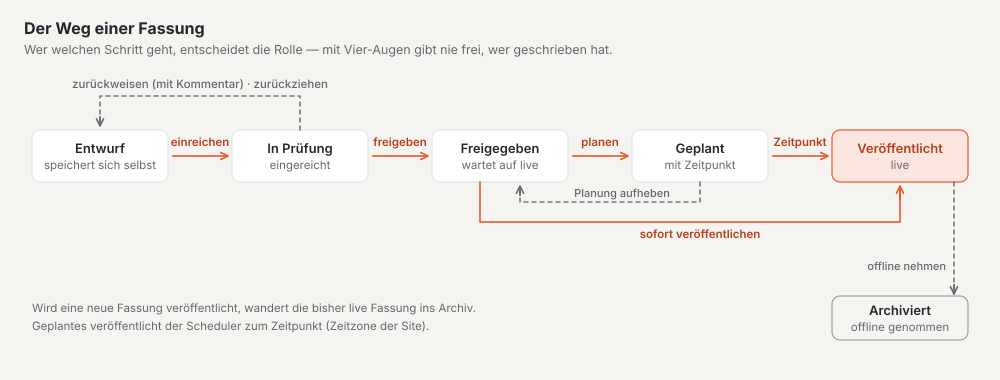
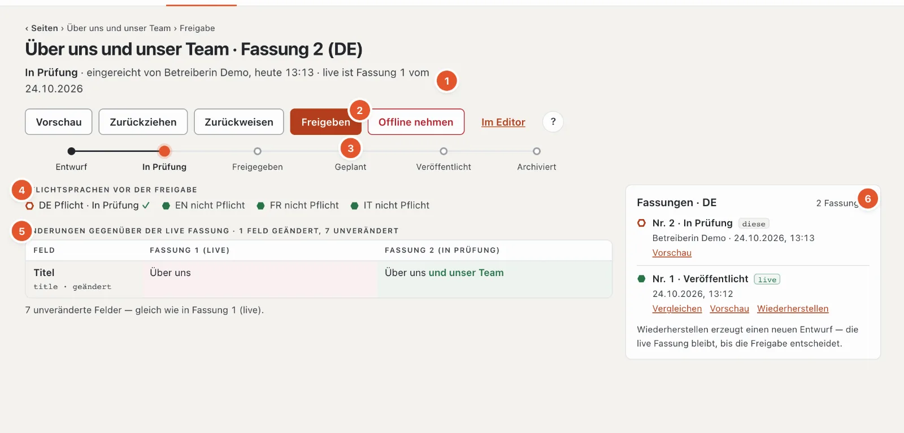
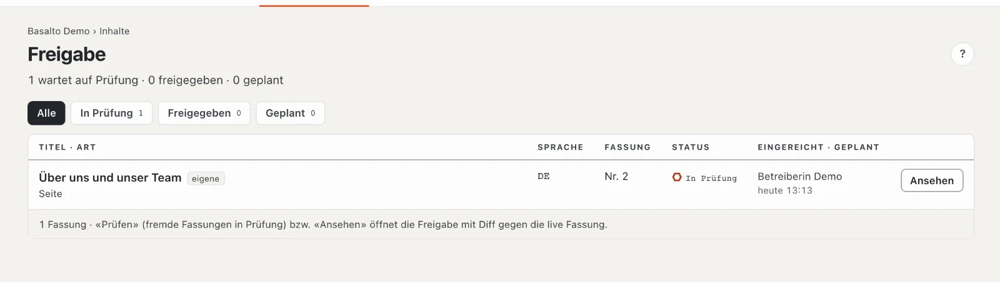

# Freigabe und Veröffentlichung

Nichts geht ungeprüft live. Jede Fassung durchläuft einen festen Ablauf: Die Redaktion reicht ein, die Freigabe prüft, gibt frei und veröffentlicht — sofort oder zu einem geplanten Zeitpunkt. Die live Fassung auf der Website bleibt dabei unverändert, bis eine neue veröffentlicht ist.

## Wo

- Modus «Inhalte» › **Freigabe** — alle Fassungen, die auf Prüfung oder Veröffentlichung warten.
- Die Freigabe einer einzelnen Seite öffnen Sie im Seitenbaum mit dem Knopf **«✓ Freigabe»** in der Zeile, im Editor
  über den Link «Freigabe» neben dem Status, aus der Liste mit **«Prüfen»** bzw. **«Ansehen»**.

Wer freigeben darf, erfährt von jeder eingereichten Fassung auch über die **Glocke** (und auf Wunsch per E-Mail); wer
eingereicht hat, erfährt, wenn die Fassung zurückgewiesen, freigegeben oder veröffentlicht ist — siehe
[Benachrichtigungen](index.md#benachrichtigungen).

> «Veröffentlichen» heisst hier: **eine Fassung** einer Seite live stellen. Das «Veröffentlichen» im Modus Einrichtung
> ist etwas anderes — dort wird die ganze **Site** zum ersten Mal live geschaltet.

## Der Ablauf einer Fassung

Oben auf der Freigabeseite zeigt eine Bahn, wo die Fassung steht:

**Entwurf → In Prüfung → Freigegeben → Geplant → Veröffentlicht → Archiviert**

| Status | Bedeutung |
| --- | --- |
| Entwurf | wird bearbeitet und speichert sich automatisch |
| In Prüfung | eingereicht, wartet auf die Freigabe |
| Freigegeben | geprüft, bereit zum Veröffentlichen |
| Geplant | wird zu einem festgelegten Zeitpunkt veröffentlicht |
| Veröffentlicht | ist live auf der Website |
| Archiviert | eine frühere live Fassung oder offline genommen |

Jede Sprache hat ihre eigenen Fassungen und durchläuft den Ablauf für sich.

## Wer darf was

| Schritt | Rollen |
| --- | --- |
| Einreichen, Zurückziehen | Redaktion, Übersetzung, Administrator, Betreiber |
| Freigeben, Zurückweisen | Freigabe, Administrator, Betreiber |
| Planen, Veröffentlichen, Offline nehmen | Freigabe, Administrator, Betreiber |

Knöpfe, die Ihre Rolle nicht hat, erscheinen gar nicht. **«Freigeben»** und **«Veröffentlichen»** dagegen stehen auch
gesperrt da, mit dem Grund darunter — und zwar immer **ein** Grund, in fester Reihenfolge (siehe die Schritte unten).
Gilt derselbe Grund für beide, heisst es «Freigeben und Veröffentlichen gesperrt: …».

## Die Freigabeseite

1. **Kopfzeile:** Status, wer ihn gesetzt hat und wann, und welche Fassung live ist («live ist Fassung 1 vom …» bzw.
   «noch keine Fassung live»).
2. **Die Schritte**, die gerade möglich sind (Vorschau, Zurückziehen, Zurückweisen, Freigeben, Planen, Veröffentlichen,
   Offline nehmen) und «Im Editor».
3. **Die Statusbahn.**
4. **Pflichtsprachen vor der Freigabe:** je Pflichtsprache ✓ oder ✗. ✓ heisst, die neueste Fassung dieser Sprache ist
   kein Entwurf mehr; Sprachen, die keine Pflicht sind, stehen zur Information daneben.
5. **Änderungen** gegenüber der live Fassung (sonst gegenüber der vorigen): je geändertem Feld eine Zeile mit «alt» und
   «neu», geänderte Wörter hervorgehoben, darunter «N unveränderte Felder». Bei der ersten Fassung steht «Erste Fassung
   — nichts zu vergleichen».
6. **Fassungen** dieser Sprache: «diese» markiert die angezeigte, «live» die veröffentlichte, ältere stehen unter
   «Archiv» — mit «Vergleichen», «Vorschau» und «Wiederherstellen».

Auf dem Telefon stehen die Schritte in einer festen Leiste unten.

## Die einzelnen Schritte

### Einreichen

Im Editor oder auf der Freigabeseite: **«Einreichen»**. Die Fassung wechselt auf «In Prüfung» und erscheint in der Liste «Freigabe». Fehlen Pflichtfelder, reicht Basalto nicht ein und markiert die Felder im Editor.

Mehrere Seiten auf einmal reichen Sie im Seitenbaum über die Sammelaktion ein (siehe [Seiten](seiten.md)).

### Zurückziehen

Haben Sie zu früh eingereicht, holt **«Zurückziehen»** die Fassung zurück in den Entwurf. Das geht, solange sie «In Prüfung» ist.

### Prüfen

Die Freigabeseite zeigt, **was sich geändert hat** — gegenüber der live Fassung oder, wenn noch keine live ist, gegenüber der vorigen Fassung. Mit «Vorschau» sehen Sie die Seite, wie sie aussehen wird; «Im Editor» führt zum Inhalt.

In der Liste der **Fassungen** vergleichen Sie mit «Vergleichen» eine ältere Fassung mit der aktuellen; «Vergleich schliessen» blendet den Vergleich wieder aus.

### Freigeben

**«Freigeben»** setzt die Fassung auf «Freigegeben». Gesperrt ist der Knopf — geprüft in dieser Reihenfolge —, wenn

1. das Vier-Augen-Prinzip gilt und Sie die Fassung selbst erstellt oder eingereicht haben,
2. eine Pflichtsprache noch fehlt («Freigabe erst mit allen Pflichtsprachen — es fehlen: …», siehe [Übersetzen](uebersetzen.md)),
3. Ihre Rolle nicht freigibt.

### Zurückweisen

**«Zurückweisen»** öffnet ein Feld **«Kommentar»** mit dem Hinweis, an wen die Fassung zurückgeht («zurück an ‹Name›»). Schreiben Sie, was sich ändern soll — der Kommentar ist Pflicht (höchstens 2000 Zeichen). Die Fassung geht als Entwurf zurück an die Autorin oder den Autor; der Kommentar steht danach oben im Editor unter «Zurückgewiesen», und die Person bekommt eine Benachrichtigung.

### Planen

Unter **«Planen»** wählen Sie **Datum** und **Zeit** (vorbelegt: morgen 08:00) und klicken auf **«Veröffentlichung planen»**. Die Zeit gilt in der Zeitzone der Site; arbeiten Sie in einer anderen Zeitzone, weist die Seite darauf hin. Ein Zeitpunkt in der Vergangenheit wird abgewiesen — für sofort nehmen Sie «Veröffentlichen». Bis zum geplanten Zeitpunkt bleibt die bisherige live Fassung online.

- **«Neu planen»** ändert den Zeitpunkt.
- **«Planung aufheben»** setzt die Fassung zurück auf «Freigegeben».

Die Veröffentlichung übernimmt ein Dienst im Hintergrund (der Scheduler) auf die Minute genau. Sein «Herzschlag» steht neben dem Planungsfeld: Hat er sich in den letzten fünf Minuten gemeldet, ist alles gut; sonst steht rot «geplante Veröffentlichungen laufen nicht» — informieren Sie dann die Administration, denn ohne ihn bleibt Geplantes liegen.

### Veröffentlichen

**«Veröffentlichen»** stellt eine freigegebene oder geplante Fassung **sofort** live. Die bisherige live Fassung wird archiviert. Gesperrt ist der Knopf — geprüft in dieser Reihenfolge —, wenn

1. der Slug in dieser Sprache schon von einer anderen veröffentlichten Seite belegt ist,
2. die Alt-Text-Pflicht gilt und ein Bild keinen Alt-Text hat (siehe [Medien](medien.md)),
3. Ihre Rolle nicht veröffentlicht.

### Offline nehmen

**«Offline nehmen»** nimmt die live Fassung vom Netz — möglich, sobald es eine live Fassung gibt, egal in welchem Status die neueste Fassung gerade ist. Nach der Rückfrage «Ja, offline nehmen» ist die Seite in dieser Sprache nicht mehr erreichbar; die Fassung wird archiviert. Der Inhalt selbst bleibt erhalten: Mit «Wiederherstellen» in der Liste der Fassungen wird daraus wieder ein Entwurf, der erneut den Ablauf durchläuft.

## Vier-Augen-Prinzip

Ist das Vier-Augen-Prinzip eingeschaltet, darf niemand die eigene Arbeit freigeben: Wer eine Fassung erstellt oder eingereicht hat, kann sie nicht selbst freigeben. Auf der Freigabeseite steht dann «Vier-Augen-Prinzip: Wer einreicht, gibt nicht selbst frei.», in der Liste sind eigene Fassungen mit «eigene» markiert.

Eingeschaltet wird es von einer Administratorin oder einem Administrator unter «Verwaltung › Einstellungen», Gruppe «Freigabe». Ab Werk ist es aus.

## Die Liste «Freigabe»

Die Kopfzeile zählt «N warten auf Prüfung · N freigegeben · N geplant». Oben filtern Sie nach **«In Prüfung»**, **«Freigegeben»** und **«Geplant»** — jeweils mit der Zahl der Fassungen — oder zeigen «Alle». Jede Zeile nennt Titel, Art, Sprache, Fassungsnummer, Status und wer wann eingereicht hat bzw. wann veröffentlicht wird; geplante stehen zuerst, nach ihrem Zeitpunkt. «eigene» markiert Fassungen, die Sie eingereicht haben (ohne Einreichende: die Sie verfasst haben).

**«Prüfen»** steht bei eingereichten Fassungen anderer Personen; bei allen übrigen heisst der Knopf «Ansehen». Wartet nichts, steht dort «Nichts wartet auf Freigabe», bei einem Filter ohne Treffer «Nichts in diesem Filter». Die Zahl am Menüpunkt «Freigabe» zählt, was auf Prüfung wartet.

## Ältere Fassung zurückholen

In der Liste der Fassungen auf der Freigabeseite legt **«Wiederherstellen»** aus einer älteren Fassung einen neuen Entwurf an. Die live Fassung bleibt, bis dieser Entwurf den Ablauf durchlaufen hat.

## Häufige Fragen

**Ich habe eingereicht — und jetzt?**
Die Fassung wartet in «Freigabe». Wer freigeben darf, sieht sie dort und als Aufgabe auf der «Übersicht». Wird sie zurückgewiesen, steht der Kommentar in Ihrem Editor.

**Die Seite ist veröffentlicht, aber ich will etwas korrigieren.**
Bearbeiten Sie sie einfach im Editor. Es entsteht ein neuer Entwurf, die live Fassung bleibt online, bis die Korrektur freigegeben und veröffentlicht ist.

**Kann ich freigeben und veröffentlichen in einem Schritt?**
Nein, das sind zwei Schritte: erst «Freigeben», dann «Veröffentlichen» oder «Veröffentlichung planen».

## Weiter

- [Übersetzen](uebersetzen.md)
- [Seiten und Seitenbaum](seiten.md)
- [Rollen](../verwaltung/rollen.md)
