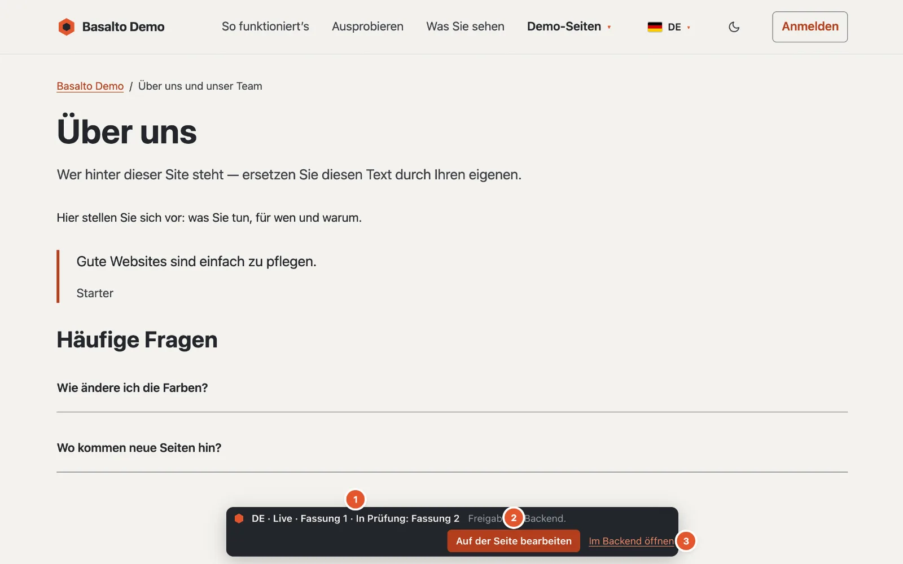
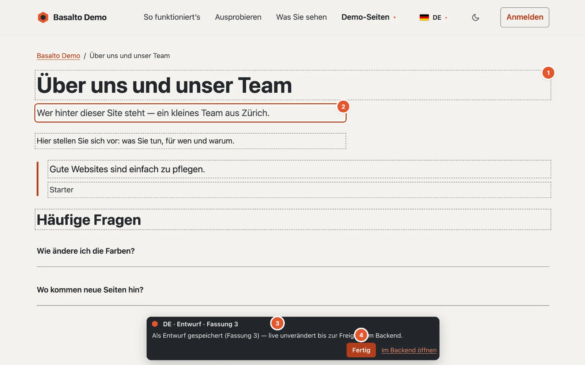

# Auf der Seite bearbeiten

Kleine Textkorrekturen erledigen Sie direkt auf der Website: Tippfehler beheben, einen Satz umstellen, einen Titel kürzen. Ihre Änderung wird als **Entwurf** gespeichert — auf der Website ändert sich für Besucher nichts, bis die Fassung im Backend freigegeben und veröffentlicht ist.

## Wo

Auf der Website selbst. Sind Sie im selben Browser im Backend angemeldet und dürfen Sie die Seite bearbeiten, erscheint unten auf jeder veröffentlichten Seite eine kleine **Leiste von Basalto**.

1. **Sprache und Stand** — zum Beispiel «DE · Live · Fassung 4». Wartet schon eine neuere Fassung, steht sie dabei: «Live · Fassung 4 · In Prüfung: Fassung 5». Daneben ein Hinweis bzw. die letzte Meldung.
2. **«Auf der Seite bearbeiten»** schaltet den Bearbeitungsmodus ein; darin heisst der Knopf **«Fertig»**.
3. **«Im Backend öffnen»** führt direkt in den Editor dieser Seite und Sprache.

Besucherinnen und Besucher sehen diese Leiste nie.

## Wer darf

Alle, die Inhalte bearbeiten dürfen: Redaktion, Administrator und Betreiber. Die Rollen «Übersetzung» und «Freigabe» allein genügen nicht — Übersetzungen entstehen Feld für Feld in der Übersetzungsansicht (siehe [Übersetzen](uebersetzen.md)).

## So gehen Sie vor

1. Öffnen Sie die Seite auf der Website und klicken Sie in der Leiste auf **«Auf der Seite bearbeiten»**. Die Seite lädt neu und zeigt nun den neuesten Stand — auch einen noch nicht veröffentlichten Entwurf. Die Leiste nennt, wie viele Felder bearbeitbar sind («3 Felder bearbeitbar — Änderungen speichern sich als Entwurf.»).
2. Die bearbeitbaren Texte sind **gestrichelt umrandet** (1 im Bild). Klicken Sie hinein und ändern Sie den Text; das Feld in Arbeit hat einen **Rahmen** (2).
3. Knapp eine Sekunde nach Ihrer letzten Eingabe speichert Basalto selbst. Die Leiste meldet «Speichert …» und dann zum Beispiel «Als Entwurf gespeichert (Fassung 5) — live unverändert bis zur Freigabe im Backend.» (3)
4. Klicken Sie auf **«Fertig»** (4), um den Bearbeitungsmodus zu verlassen. Er bleibt sonst für Ihre Sitzung eingeschaltet, auch auf anderen Seiten. Ist noch nicht alles gespeichert, fragt Basalto «Nicht alle Änderungen sind gespeichert. Trotzdem beenden?».
5. Reichen Sie die Fassung im Backend ein — über «Im Backend öffnen» und dort «Einreichen» (siehe [Freigabe und Veröffentlichung](freigabe.md)).

Ist die neueste Fassung bereits eingereicht, freigegeben oder veröffentlicht, beginnt Ihre erste Änderung einen **neuen Entwurf**; die Leiste weist darauf hin.

## Was sich hier bearbeiten lässt

- der **Titel** und die **Einleitung**,
- die Textfelder des Inhaltstyps,
- Text, Textfeld und Fliesstext in **Blöcken**, auch in verschachtelten.

Im Fliesstext kennt der Frontend-Editor **Fett** (⌘B bzw. Ctrl+B), **Kursiv** (⌘I bzw. Ctrl+I) und **Link** (⌘K bzw. Ctrl+K) — ohne Werkzeugleiste. Bei ⌘K fragt ein kleines Fenster nach der Adresse; leer entfernt es den Link. Eingefügter Text kommt immer als reiner Text an, ohne fremde Formatierung.

In einzeiligen Feldern beendet **Enter** die Eingabe; in mehrzeiligen Textfeldern macht Enter eine neue Zeile. **Esc** verlässt jedes Feld.

## Was im Backend bleibt

- Bilder, Tabellen und Einbettungen,
- Fliesstext mit mehr als einfacher Formatierung — dann ist das Feld auf der Seite nicht bearbeitbar. Einfach heisst: Absätze, Zwischentitel, Listen, Zitate, Trennlinien und Zeilenumbrüche, dazu fett, kursiv, unterstrichen, durchgestrichen, Code, hoch- und tiefgestellt und Links. Bilder, Tabellen, Aufgabenlisten oder Einbettungen im Fliesstext machen das Feld zum Fall fürs Backend,
- Blöcke hinzufügen, verschieben oder löschen,
- Slug, Metadaten und alle übrigen Einstellungen,
- Einreichen, Freigeben und Veröffentlichen.

Gibt es auf einer Seite nichts, was sich hier bearbeiten lässt, meldet die Leiste «Auf dieser Seite lässt sich hier kein Text bearbeiten — bitte im Backend.»

## Wenn etwas nicht klappt

Konnte ein Feld nicht gespeichert werden, hat es einen **roten Rahmen**, und die Leiste nennt den Grund.

**«Diese Seite wurde inzwischen anderswo geändert — bitte neu laden, damit nichts überschrieben wird.»**
Jemand hat dieselbe Fassung gleichzeitig im Backend oder auf der Seite geändert. Basalto speichert dann nicht, um nichts zu überschreiben — und nimmt auf dieser Seite nichts mehr an, bis sie neu geladen ist. Laden Sie die Seite neu und machen Sie Ihre Änderung noch einmal.

**«Keine Verbindung — die Änderung ist noch nicht gespeichert.»**
Das Netz war weg. Prüfen Sie die Verbindung; die nächste Eingabe versucht es wieder.

**«Keine Berechtigung, diese Seite zu bearbeiten.»**
Ihre Rolle erlaubt diese Seite oder Sprache nicht (mehr) — fragen Sie die Administration.

**«Die Sitzung ist abgelaufen — bitte neu laden und anmelden.»**
Melden Sie sich im Backend wieder an und laden Sie die Seite neu.

**Der Text ist zu lang.**
Einzeilige Texte haben höchstens 300 Zeichen, Textfelder 5000, Fliesstext 20'000. Längere Texte bearbeiten Sie im Backend.

**Ich verlasse die Seite, bevor gespeichert ist.**
Der Browser fragt nach, wenn noch Änderungen ungespeichert sind.

## Weiter

- [Inhalte mit Blöcken bearbeiten](bloecke.md)
- [Freigabe und Veröffentlichung](freigabe.md)
