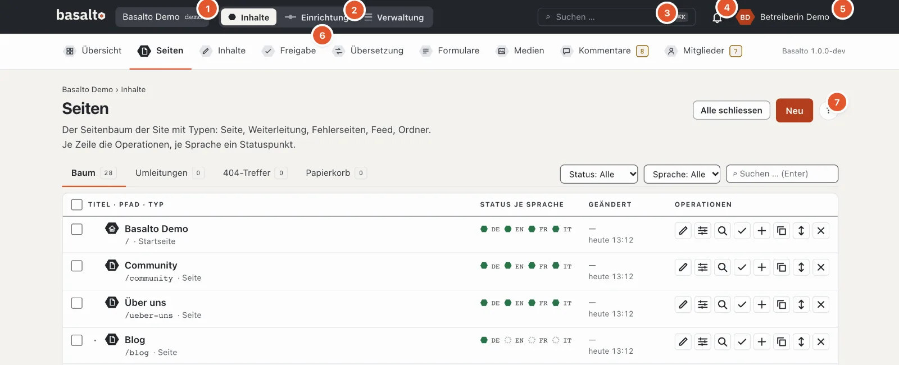
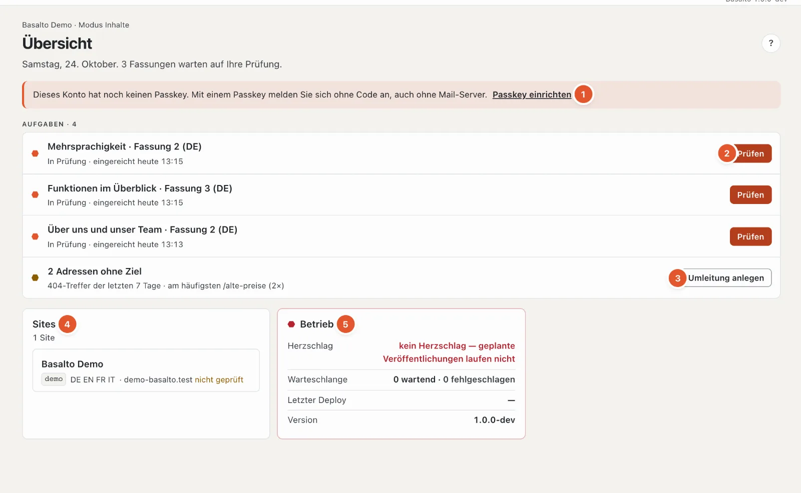
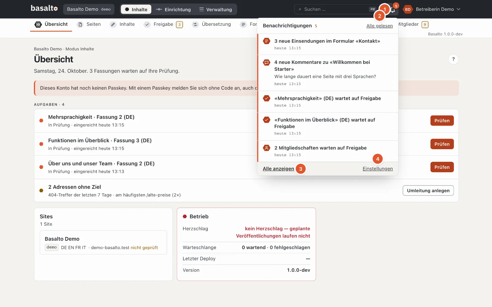
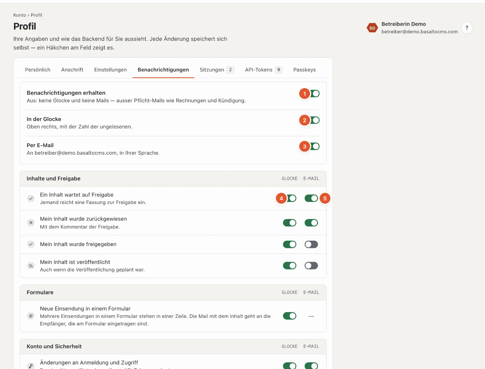
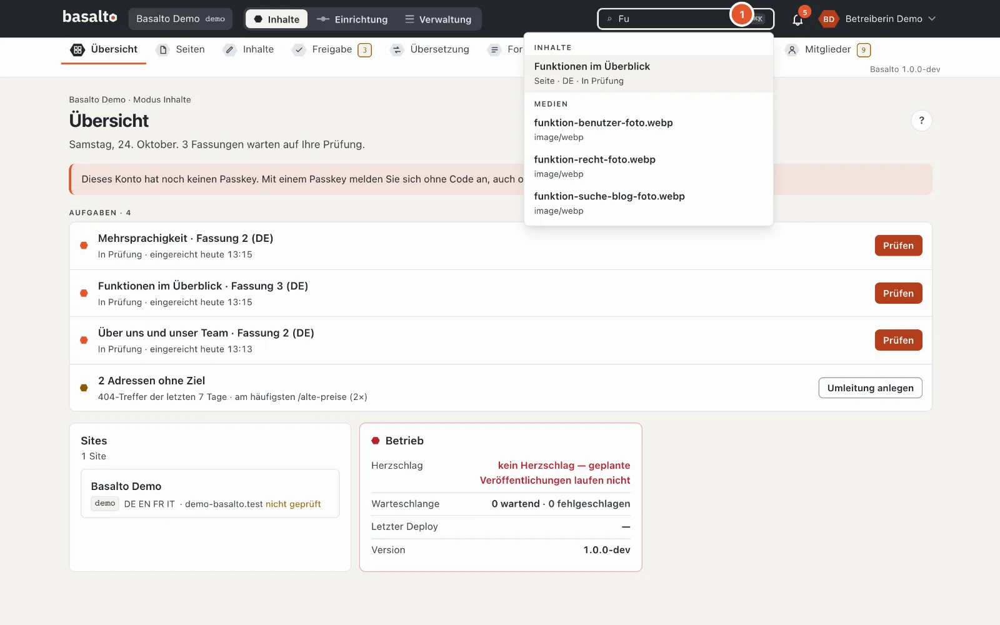

# Hilfe für die Redaktion

Diese Hilfe erklärt die tägliche Arbeit im Backend von Basalto: Seiten anlegen, Texte und Bilder pflegen, übersetzen, freigeben und veröffentlichen. Sie brauchen dafür kein Technikwissen.

Auf fast jeder Seite im Backend steht oben rechts ein rundes **«?»**. Es öffnet die Hilfe, die zu dieser Seite passt — als Leiste am rechten Rand, die Seite dahinter bleibt bedienbar. Schneller geht es mit der Taste **?** oder **F1**; mehr dazu unter [Hilfe und Tastenkürzel](#hilfe-und-tastenkürzel).

## Was die Hilfe enthält

| Seite | Worum es geht |
| --- | --- |
| [Seiten und Seitenbaum](seiten.md) | Seiten anlegen, verschieben, kopieren, löschen; Papierkorb, Umleitungen und 404-Treffer |
| [Inhalte mit Blöcken bearbeiten](bloecke.md) | Block-Editor, Fliesstext, Einfügen aus Word, Vorschau, automatisches Speichern, Fassungen |
| [Medien](medien.md) | Mediathek, Hochladen, Ordner, Alt-Texte, Bildvarianten, Ersetzen, Papierkorb |
| [Übersetzen](uebersetzen.md) | Übersetzung aus der Standardsprache, Pflichtsprachen, Fallback, Übersicht «Übersetzung» |
| [Freigabe und Veröffentlichung](freigabe.md) | Einreichen, freigeben, zurückweisen, planen, veröffentlichen, offline nehmen; Vier-Augen-Prinzip |
| [Formulare](formulare.md) | Formulare anlegen, Eingänge ansehen, exportieren und löschen, Mail an Empfänger |
| [Kommentare](kommentare.md) | Kommentare moderieren, beantworten, als Spam markieren, löschen |
| [Mitglieder](mitglieder.md) | Seiten nur für Mitglieder, Anmeldung ohne Passwort, Freigabe, Sperre, Einladung |
| [Auf der Seite bearbeiten](frontend-editor.md) | Texte direkt auf der Website ändern — als Entwurf |
| [KI-Vorschläge](ki.md) | Text verbessern, übersetzen, SEO-Angaben und Alt-Texte vorschlagen lassen — nur auf Klick, als Entwurf |

## Rollen

Was Sie im Backend tun dürfen, hängt von Ihrer Rolle in der Site ab. Die Rolle vergibt eine Administratorin oder ein Administrator unter «Verwaltung › Benutzer». So sind die Vorlagen eingestellt — Ihre Installation kann sie angepasst oder eigene Rollen angelegt haben:

| Rolle | Darf |
| --- | --- |
| **Redaktion** | Seiten und Inhalte anlegen, bearbeiten und löschen, Medien verwalten, Formulare und Eingänge pflegen, Kommentare moderieren, Fassungen einreichen. Freigeben, Veröffentlichen, Einrichtung und Verwaltung gehören nicht dazu. |
| **Freigabe** | Eingereichte Fassungen prüfen, freigeben oder zurückweisen, Veröffentlichungen planen, veröffentlichen und offline nehmen. |
| **Übersetzung** | Inhalte in die weiteren Sprachen der Site übersetzen — die Quellsprache bleibt gesperrt. |
| **Administrator** | Alles in der Site, auch Einrichtung, Benutzer, Rollen und Einstellungen. |
| **Betreiber** | Alles; die Rolle ist unveränderlich, jede Site hat mindestens einen Betreiber. |

Was Ihre Rolle nicht darf, erscheint nicht im Menü. Fehlt Ihnen ein Recht innerhalb einer Seite, zeigt das Backend den Grund direkt am gesperrten Knopf — zum Beispiel «Ihre Rolle gibt nicht frei». Wie Rollen eingestellt werden, steht im Betriebshandbuch unter «Rollen und Rechte».

## Aufbau des Backends

### Die Kopfzeile

1. **Site** — arbeiten Sie in mehreren Sites, wählen Sie hier die Site aus.
2. **Inhalte · Einrichtung · Verwaltung** — der Schalter zwischen den Modi; Sie sehen nur die, die Ihre Rolle braucht.
3. **Suchen …** — die Suche (siehe [Suche](#suche)).
4. Die **Glocke** — Ihre Benachrichtigungen (siehe [Benachrichtigungen](#benachrichtigungen)).
5. Ihr **Profilbild** und Name — das Menü mit Profil, Einstellungen, Hilfe und «Abmelden».
6. Die **Stationen** des Modus, hier mit Zahl (siehe unten).
7. Das runde **«?»** — die Hilfe zu dieser Seite.

### Modus «Inhalte»

Hier findet die Redaktionsarbeit statt. Unter der Kopfzeile stehen die Stationen:

- **Übersicht** — Ihre Aufgaben: Fassungen zum Prüfen, Zurückgewiesenes, fehlende Übersetzungen in Pflichtsprachen, Adressen ohne Ziel und Hinweise wie fehlende Alt-Texte. Steht nichts an, heisst es «Nichts wartet auf Sie».
- **Seiten** — der Seitenbaum der Website.
- **Inhalte** — Einträge ohne festen Platz im Seitenbaum, zum Beispiel Blogbeiträge oder Personen.
- **Freigabe** — alles, was auf Prüfung oder Veröffentlichung wartet.
- **Übersetzung** — was in anderen Sprachen fehlt oder veraltet ist.
- **Formulare** — Formulare und ihre Eingänge.
- **Medien** — die Mediathek.
- **Kommentare** und **Mitglieder** — erscheinen nur, wenn das jeweilige Modul für die Site eingeschaltet ist.

Eine Zahl in **Bernstein** neben einer Station bedeutet: Dort wartet etwas auf Sie — bei «Freigabe» Fassungen zum Prüfen, bei «Übersetzung» Lücken, bei «Formulare» neue Eingänge, bei «Kommentare» und «Mitglieder» Wartendes. Eine **graue** Zahl ist nur zur Information. Die Zahlen werden alle 30 Sekunden neu gezählt.

### Die Übersicht

Oben steht das Datum und in einem Satz, was ansteht.

1. **Hinweise** — zum Beispiel, dass Ihr Konto noch keinen Passkey hat, dass Bilder ohne Alt-Text eingebunden sind, dass die Mail eines Formulareingangs nicht zugestellt wurde, dass ein Hintergrund-Job gescheitert ist (mit «Noch einmal versuchen» und «Verwerfen», wenn Sie den Betrieb verwalten) oder dass die Installation noch keine Lizenz hat.
2. **Aufgaben** mit dem passenden Knopf:
   - **In Prüfung** — Fassungen anderer, die Sie freigeben dürfen: «Prüfen».
   - **Freigegeben** — wartet aufs Veröffentlichen; **Geplant** — geht zur gesetzten Zeit live.
   - **Zurückgewiesen** — nur Ihre eigenen Fassungen, mit «Überarbeiten».
   - **Übersetzung** — fehlende oder veraltete Übersetzungen in Pflichtsprachen (aus den 100 zuletzt geänderten Inhalten, höchstens 30 Aufgaben).
3. **Adressen ohne Ziel** — 404-Treffer der letzten 7 Tage mit der häufigsten Adresse und «Umleitung anlegen»; nur, wenn Sie veröffentlichen dürfen.
4. **Sites** — die Sites, in denen Sie arbeiten, mit Sprachen und Domain.
5. **Betrieb** — Herzschlag (läuft der Zeitplan?), Warteschlange, letzter Deploy und Version. Rot heisst: Hier stimmt etwas nicht — zum Beispiel laufen ohne Herzschlag geplante Veröffentlichungen nicht.

Steht nichts an, heisst es «Nichts wartet auf Sie».

### Modus «Einrichtung»

Hier wird die Site gestaltet und aufgebaut. Unter der Kopfzeile steht der **Fahrplan**: neun Stationen in der
Reihenfolge, in der eine Site entsteht — jede mit der Frage, die sie beantwortet, und dem Fachbegriff darunter:

| Station | Fachbegriff |
| --- | --- |
| Was ist die Site? | Site |
| Wie sieht sie aus? | Theme · Design — darunter der Umsteigepunkt zu den **Themes** |
| Wie ist sie gebaut? | Layouts · Templates |
| Wie findet man sich zurecht? | Menüs |
| Was lässt sich pflegen? | Inhaltstypen |
| Woraus bestehen Seiten? | Blöcke · Bausteine |
| Was können Besucher senden? | Formulare |
| Womit startet sie? | Startinhalte |
| Bereit für live? | Veröffentlichen |

Ein Klick auf eine Station öffnet eine Karte: was die Station bedeutet, ihr Stand (dieselbe Prüfung wie
`basalto:check`) und die Seiten dazu. Ein rotes ✗ oder ein gelbes ! an einer Station zeigt, wo etwas fehlt; ein
gestrichelter grauer Ring heisst, die Station wartet noch. **Esc** schliesst die Karte. Am Ende zweigt **«Code»** ab — der
Theme-Editor für alle, die das Theme selbst schreiben. Auf dem Telefon klappt der Fahrplan als Liste auf. Alles dazu steht in
der eigenen Hilfe zur Einrichtung: [Einrichtung](../einrichtung/README.md).

### Modus «Verwaltung»

«Sites», «Module», «Benutzer», «Rollen», «Einstellungen», «Lizenz», «Betrieb», «Protokoll», «Passkeys» und was Module
dazu beitragen. Diese Bereiche sind meist Sache von Administratorinnen und Administratoren; sie haben eine eigene Hilfe:
[Verwaltung](../verwaltung/README.md).

## Ihr Konto: Profil und Einstellungen

Oben rechts steht Ihr **Profilbild** (oder Ihre Initialen). Ein Klick öffnet das Menü mit **«Profil»**, **«Einstellungen»**, **«Hilfe und Tastenkürzel»** und **«Abmelden»**; mit der Tastatur wählen Sie mit **↑ ↓** (Pos1 und Ende springen zum ersten und letzten Eintrag), **Esc** schliesst.

Das Profil hat diese Reiter:

- **Persönlich:** Vor- und Nachname, Telefon (die Vorwahl wählen Sie über die Flagge) und ein **Profilbild** (JPEG, PNG oder WebP bis 5 MB, wird quadratisch zugeschnitten). Ohne Bild erscheinen Ihre Initialen. Die **E-Mail-Adresse** ändert die Verwaltung.
- **Anschrift:** Strasse, Postleitzahl, Ort und Land.
- **Einstellungen:** Sprache der Oberfläche, Zeitzone, Datums- und Zeitformat, **Startseite nach der Anmeldung** (Übersicht, Seiten, Freigabe, Übersetzung oder Medien), **Erscheinungsbild** (hell, dunkel oder wie im Betriebssystem), **Einträge pro Seite** (25, 50 oder 100 — für Inhalte, Medien, Formular-Eingänge und Protokoll), **Sortierung der Listen** (neueste oder älteste zuerst, nach Titel) und die **Tastenkürzel der Hilfe** (ein- oder ausschalten).
- **Benachrichtigungen:** siehe [Benachrichtigungen](#benachrichtigungen).
- **Sitzungen:** wo Sie angemeldet sind — Browser, IP-Adresse und «zuletzt aktiv»; «diese Sitzung» ist die, in der Sie gerade arbeiten. «Abmelden» beendet eine Sitzung, **«Alle anderen beenden»** alle ausser dieser. Praktisch, wenn Sie sich an einem fremden Gerät nicht abgemeldet haben.
- **API-Tokens:** für Programme, die über die Schnittstelle mit Basalto arbeiten (zum Beispiel ein Import). **«Neues Token»**: Name, Site, **Fähigkeiten** (lesen, schreiben — nie mehr, als Ihre Rolle darf) und auf Wunsch ein Ablaufdatum, dann «Token anlegen». Das Token erscheint **nur ein einziges Mal** — kopieren Sie es sofort. Die Liste zeigt, wann ein Token angelegt und zuletzt benutzt wurde; «Widerrufen» sperrt es nach einer Rückfrage sofort.
- **Passkeys:** führt zur Verwaltung Ihrer Passkeys (Anmeldung ohne Code, mit Fingerabdruck, Gesicht oder Gerätesperre). Dort steht auch **«Meine Daten herunterladen (JSON)»** — alles, was Basalto über Ihr Konto speichert.

Jede Änderung speichert sich selbst und gilt nur für Sie.

## Benachrichtigungen

Die **Glocke** (1) oben rechts zeigt in Lava, wie viele Benachrichtigungen ungelesen sind (ab 100 «99+»). Ein Klick öffnet die neusten acht; ungelesene tragen links die rote Linie. Ein Klick auf eine Benachrichtigung öffnet, worum es geht — stammt sie aus einer anderen Site, wechselt das Backend dorthin. Mit dem Häkchen am Rand markieren Sie eine als gelesen (ein zweiter Klick macht sie wieder ungelesen), **«Alle gelesen»** (2) erledigt alle auf einmal, **Esc** schliesst. Die Glocke fragt jede Minute nach, ob etwas dazugekommen ist — nur, solange das Fenster sichtbar ist —, und schlägt dann kurz aus. Haben Sie die Benachrichtigungen ganz ausgeschaltet, steht in der Glocke **«Einschalten»**.

**«Alle anzeigen»** (3) öffnet das **Center**: alle Benachrichtigungen nach Tagen, mit den Filtern «Ungelesen» und nach Gruppe, je Zeile «Als gelesen» oder «Als ungelesen» und «Entfernen», oben «Alle als gelesen» und «Gelesene entfernen».

Was Sie bekommen, hängt von Ihrer Rolle ab — zum Beispiel:

| Benachrichtigung | Wer sie bekommt |
| --- | --- |
| Ein Inhalt wartet auf Freigabe | Wer freigeben darf |
| Mein Inhalt wurde zurückgewiesen, freigegeben, veröffentlicht | Wer die Fassung eingereicht hat |
| Neue Einsendung in einem Formular | Wer Formulare und Eingänge sieht — mehrere Einsendungen eines Formulars stehen in einer Zeile |
| Neuer Kommentar | Wer Kommentare moderiert — je Inhalt gebündelt |
| Neue Mitgliedschaft wartet auf Freigabe | Wer Mitglieder verwaltet |
| Der Support des Herstellers greift zu | Wer die Site verwaltet |
| Änderungen an Anmeldung und Zugriff | Sie selbst (neuer Passkey, neues API-Token) |
| Abo, Rechnungen, Testphase, Domain, Export | Besitz und Abrechnung des Kontos (nur im Abo) |

Was in der Glocke und was per E-Mail kommt, stellen Sie im Profil unter **«Benachrichtigungen»** ein (auch über «Einstellungen» (4) unten in der Glocke): ein **Hauptschalter** (1), je ein Schalter für **Glocke** (2) und **E-Mail** (3) und darunter jede Benachrichtigung einzeln, nach Gruppen, mit den Spalten **Glocke** (4) und **E-Mail** (5). Arbeiten Sie auch im Extranet des Herstellers, kommt eine Spalte **«Extranet»** dazu. **Pflicht-Mails** wie Rechnungen und Kündigung kommen immer — dort lässt sich nur die Glocke abschalten. Wo statt eines Schalters ein Strich steht, stellt man die Mail anderswo ein: bei Formularen am Formular (Empfänger), bei Kommentaren am Kommentar-Block. «Vorgaben wiederherstellen» unten setzt alle einzelnen Benachrichtigungen auf ihre Vorgabe zurück; die drei Hauptschalter bleiben, wie sie sind.

## Suche

Das Feld **«Suchen …»** in der Kopfzeile öffnen Sie auch mit der Tastenkombination **⌘K** (Mac) oder **Ctrl+K** (Windows). Geben Sie mindestens zwei Zeichen ein. Die Suche findet, je Gruppe höchstens sechs Treffer:

- **Inhalte** und Seiten nach ihrem Titel — auch Entwürfe, mit Typ, Sprache und Status,
- **Medien** nach Dateiname oder Titel — ein Treffer öffnet die Mediathek mit diesem Suchwort,
- **Benutzer** nach Name oder E-Mail-Adresse, sofern Sie Benutzer verwalten dürfen.

Mit den Pfeiltasten wählen Sie einen Treffer, **Enter** öffnet ihn, **Esc** schliesst die Suche. Auf dem Telefon ist die Suche ausgeblendet.

## Hilfe und Tastenkürzel

Die Hilfe-Leiste zeigt die Seite, die zu Ihrer Arbeit passt, und durchsucht die ganze Dokumentation: diese Redaktions-Hilfe, den Betrieb, die Entwickler-Doku und den Marktplatz. Tippen Sie oben in der Leiste ein Stichwort; ein Treffer führt direkt zum passenden Abschnitt. Links im Text öffnen die nächste Hilfeseite in der Leiste selbst. **«Als Seite öffnen»** zeigt die Seite in voller Breite, mit allen Hilfeseiten links.

**Breite der Leiste:** Ziehen Sie den linken Rand der Leiste mit der Maus nach links oder rechts. Mit der Tastatur geht es am Griff mit **← →** (mit Umschalttaste in grösseren Schritten), **Pos1** und **Ende** springen zur grössten und kleinsten Breite. Basalto merkt sich die Breite in Ihrem Profil — beim nächsten Öffnen, auch auf einem anderen Gerät, ist sie wieder so. Auf schmalen Bildschirmen füllt die Leiste die ganze Breite.

**Bilder:** Ein Klick auf ein Bild der Hilfe zeigt es gross, der Hintergrund wird unscharf. **Esc**, ein Klick daneben oder **×** schliessen es.

| Taste | Wirkung |
|---|---|
| **?** oder **F1** | Hilfe öffnen oder schliessen |
| **/** | in der offenen Hilfe suchen |
| **Esc** | Hilfe schliessen |
| **⌘K** oder **Ctrl+K** | im Backend suchen |
| **↑ ↓** und **Enter** | Treffer wählen und öffnen |

In Eingabefeldern und Editoren — auch im Code-Editor — sind **?** und **/** normale Zeichen; dort öffnet nur **F1** die Hilfe. Die Übersicht der Tasten steht auch in der Leiste unter **«Tastenkürzel»**.

## Wichtige Begriffe

- **Fassung** — jede Sprache eines Inhalts hat nummerierte Fassungen. Was live auf der Website steht, ist immer eine bestimmte Fassung. Änderungen landen in einem Entwurf, die live Fassung bleibt unberührt, bis eine neue veröffentlicht wird.
- **Status einer Fassung** — «Entwurf», «In Prüfung», «Freigegeben», «Geplant», «Veröffentlicht», «Archiviert». Mehr dazu unter [Freigabe und Veröffentlichung](freigabe.md).
- **Standardsprache** — die Hauptsprache der Site. Übersetzungen entstehen aus ihr.
- **Pflichtsprache** — eine Sprache, ohne deren Fassung nicht freigegeben wird.
- **Automatisches Speichern** — im Editor gibt es keinen Speichern-Knopf; Änderungen speichern sich nach einer kurzen Pause selbst.

## Häufige Fragen

**Ich habe etwas geändert, aber auf der Website sehe ich es nicht.**
Änderungen werden als Entwurf gespeichert. Sichtbar werden sie erst, wenn die Fassung eingereicht, freigegeben und veröffentlicht ist. Siehe [Freigabe und Veröffentlichung](freigabe.md).

**Ich sehe den Knopf «Veröffentlichen» nicht oder er ist gesperrt.**
Veröffentlichen dürfen die Rollen «Freigabe», «Administrator» und «Betreiber». Als Redaktion reichen Sie die Fassung ein.

**Wo finde ich gelöschte Seiten oder Bilder?**
Im Reiter «Papierkorb» unter «Seiten» bzw. im «Papierkorb» der Mediathek. Siehe [Seiten](seiten.md) und [Medien](medien.md).

## Weiter

- [Seiten und Seitenbaum](seiten.md)
- [Inhalte mit Blöcken bearbeiten](bloecke.md)
- [Medien](medien.md)
