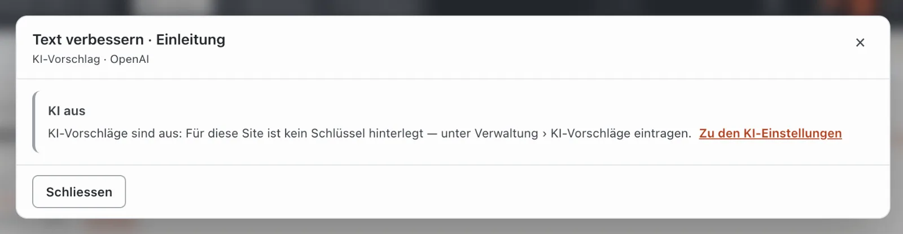
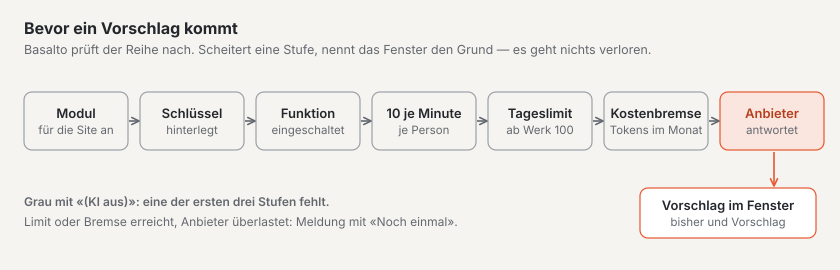
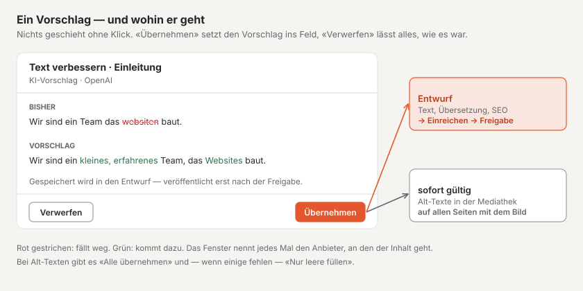

# KI-Vorschläge

Mit dem Modul «KI-Vorschläge» schlägt eine künstliche Intelligenz Ihnen vor, wie ein Text besser klingt, was ein Bild als Alt-Text braucht, wie ein Feld übersetzt heissen könnte oder welcher Seitentitel und welche Beschreibung in die Suchergebnisse passen. Drei Regeln gelten immer:

- **Nichts geschieht ohne Klick.** Die KI arbeitet nur, wenn Sie auf **«✦ Vorschlag»** klicken — nie im Hintergrund, nie beim Öffnen einer Seite.
- **Es ist immer ein Vorschlag.** Sie sehen ihn neben dem bisherigen Text und entscheiden: **«Übernehmen»** oder **«Verwerfen»**.
- **Übernommen wird in den Entwurf.** Veröffentlicht wird ein Vorschlag nie automatisch — er geht denselben Weg wie jede Änderung: Entwurf, Einreichen, Freigabe. Einzige Ausnahme sind Alt-Texte in der Mediathek (siehe unten).

## Wo die Knöpfe stehen

| Funktion | Wo | Wer darf |
| --- | --- | --- |
| **Text verbessern** | Im Block-Editor unter jedem Text-, Textbereich- und Fliesstextfeld, auch unter der Einleitung | Redaktion, Administrator, Betreiber |
| **Übersetzung** | Beim Übersetzen nebeneinander unter jedem übersetzbaren Feld — der vierte Knopf neben «→ übernehmen» | alle, die übersetzen dürfen |
| **SEO-Vorschlag** | In den Seiteneinstellungen, Reiter «Metadaten», je Sprache | Redaktion, Administrator, Betreiber |
| **Alt-Texte vorschlagen** | In der Mediathek im Detail eines Bilds, unter den Alt-Texten | alle, die Medien bearbeiten dürfen |

Die Knöpfe erscheinen nur, wenn das Modul für die Site eingeschaltet ist. Leere Felder haben keinen Knopf — ohne Text gibt es nichts zu verbessern.

Beim **Alt-Text** gibt es den Knopf nur für Rasterbilder (JPG, PNG, WebP, GIF) — nicht für SVG und PDF — und nur, wenn der gewählte Anbieter Bilder lesen kann (DeepSeek und Groq können es nicht).

**Grau mit «(KI aus)»** heisst: Für die Site ist kein Schlüssel hinterlegt oder die Funktion ist ausgeschaltet. Ein Klick nennt den Grund — das Fenster hat dann nur «Schliessen» und den Link **«Zu den KI-Einstellungen»**.

## So geht es

1. Klicken Sie unter dem Feld auf **«✦ Text verbessern»** (bzw. «Vorschlag», «SEO-Vorschlag», «Alt-Texte vorschlagen»).
2. Ein Fenster öffnet sich: «Vorschlag kommt …». Nach wenigen Sekunden stehen **bisher** und **Vorschlag** nebeneinander; gestrichene Wörter rot, neue grün.
3. **«Übernehmen»** setzt den Vorschlag ins Feld. Danach können Sie ihn wie jeden Text weiter ändern.
4. **«Verwerfen»** schliesst das Fenster — es ändert sich nichts.

Im offenen Entwurf speichert das automatische Speichern den übernommenen Text wie getippt. Steht im Editor eine veröffentlichte Fassung, entsteht der Entwurf erst mit **«Als neuen Entwurf speichern»**; die veröffentlichte Fassung bleibt, wie sie ist.

### Text verbessern

Die KI korrigiert Rechtschreibung, Grammatik und Zeichensetzung und macht den Text klarer — in derselben Sprache, mit derselben Aussage und etwa gleich lang. Im Fliesstext bleiben Überschriften, Listen, Links und Hervorhebungen erhalten. Enthält ein Fliesstext **Bilder, Tabellen, Aufgabenlisten oder Einbettungen**, macht die KI keinen Vorschlag — diese Teile gingen auf dem Weg verloren.

### Übersetzung

Beim Übersetzen nebeneinander nimmt die KI immer den Text der **Quellfassung** in der Standardsprache — nicht das, was im Zielfeld steht. «Ins Zielfeld übernehmen» setzt die Übersetzung ins Feld der Zielsprache; gespeichert wird in den Entwurf dieser Sprache. Prüfen Sie Fachbegriffe und Namen.

### SEO-Vorschlag

Aus dem Inhalt der neuesten Fassung schlägt die KI einen **Seitentitel** (höchstens 60 bis 70 Zeichen) und eine **Beschreibung** (höchstens 160 Zeichen) vor. «Übernehmen» setzt beide Felder; die Suchergebnis-Vorschau darunter zeigt sofort, wie es aussieht.

Gibt es in der Sprache noch keine Fassung, heisst es «erst Inhalt, dann Metadaten»; hat die Seite noch keinen Text, gibt es keinen Vorschlag.

### Alt-Texte

Die KI sieht das Bild an und schlägt für **jede Sprache der Site** einen Alt-Text vor. **«Alle übernehmen»** setzt alle Sprachen. Fehlen nur einige Alt-Texte, gibt es zusätzlich **«Nur leere füllen»** — dann bleiben die vorhandenen, wie sie sind.

**Achtung:** Medien haben keine Fassungen. Übernommene Alt-Texte speichern sich sofort und gelten gleich auf allen Seiten, die das Bild zeigen. Die Übernahme steht im Protokoll. Prüfen Sie den Vorschlag deshalb genau — die KI kennt weder die Namen der Personen noch den Zusammenhang.

## Datenschutz

Jeder Vorschlag schickt den betroffenen Inhalt an den Anbieter, den Ihre Site gewählt hat (etwa OpenAI, Anthropic oder Mistral): den Text des Felds, den Quelltext einer Übersetzung, den Inhalt einer Seite für den SEO-Vorschlag oder das Bild. Das Fenster nennt den Anbieter jedes Mal. Schicken Sie nichts, was das Haus nicht verlassen darf.

Basalto selbst speichert dabei **keine Inhalte**: Im Protokoll steht nur, wer wann welche Funktion an welchem Inhalt genutzt hat und ob der Vorschlag übernommen wurde.

## Einschalten und Grenzen

Eine Administratorin oder ein Administrator richtet die KI unter **Verwaltung › KI-Vorschläge** ein. Oben steht, wie viele Vorschläge heute schon gemacht wurden und wie viele Tokens diesen Monat verbraucht sind.

1. **Anbieter** — OpenAI, Anthropic (Claude), Google Gemini, Mistral AI, xAI (Grok), DeepSeek, Groq oder OpenRouter. Das **Modell** ist freiwillig; leer gilt die Vorgabe für den Anbieter.
2. **Schlüssel (API-Key)** — vom Anbieter. Er wird verschlüsselt gespeichert und verlässt den Server nur in der Anfrage an den Anbieter; danach steht hier nur noch «gesetzt ✓» mit den letzten Zeichen. «Schlüssel entfernen» schaltet alle KI-Knöpfe der Site aus.
3. **Tageslimit** — Vorschläge je Tag für die ganze Site, ab Werk 100 (1 bis 10'000). Ist es erreicht, sagt es das Fenster; am nächsten Tag geht es weiter.
4. **Kostenbremse** — Tokens je Monat (ab 1000), leer heisst ohne Bremse. Ist sie erreicht, gibt es bis Monatsende keine Vorschläge mehr.
5. **Funktionen** — je ein Schalter für Text verbessern, Alt-Texte, Übersetzung und SEO-Vorschläge.
6. **Nutzung** — je Monat die Zahl der Vorschläge, wie viele übernommen wurden und wie viele gescheitert sind, die Tokens und die Aufteilung je Funktion. Inhalte stehen dort keine.

Dazu gilt immer:

- **Je Person höchstens zehn Vorschläge in der Minute.**
- **Höchstens 12'000 Zeichen** gehen an den Anbieter; ein längerer Text bekommt keinen Vorschlag.
- **Fehler des Anbieters** (überlastet, Guthaben aufgebraucht, Schlüssel abgelehnt) erscheinen als verständliche Meldung mit **«Noch einmal»**. Es geht dabei nichts verloren.

## Häufige Fragen

**Ich sehe keinen Knopf «Vorschlag».**
Das Modul ist für die Site nicht eingeschaltet, oder das Feld ist leer. Übersetzende sehen «Text verbessern» und «SEO-Vorschlag» nicht.

**Der Knopf ist grau und heisst «(KI aus)».**
Es fehlt der Schlüssel, oder die Funktion ist ausgeschaltet. Fragen Sie die Administration der Site.

**Ist der Vorschlag schon auf der Website?**
Nein. Ausser bei Alt-Texten landet er im Entwurf und braucht wie jede Änderung Einreichen, Freigabe und Veröffentlichung.

## Weiter

- [Inhalte mit Blöcken bearbeiten](bloecke.md)
- [KI-Vorschläge einrichten](../betrieb/ki.md)
