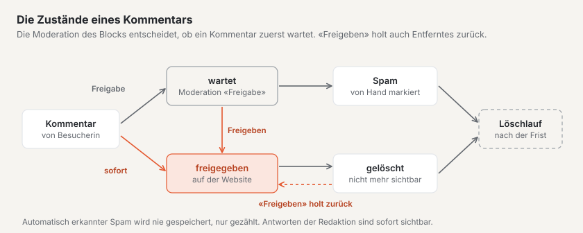
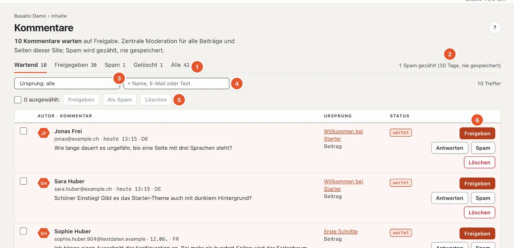
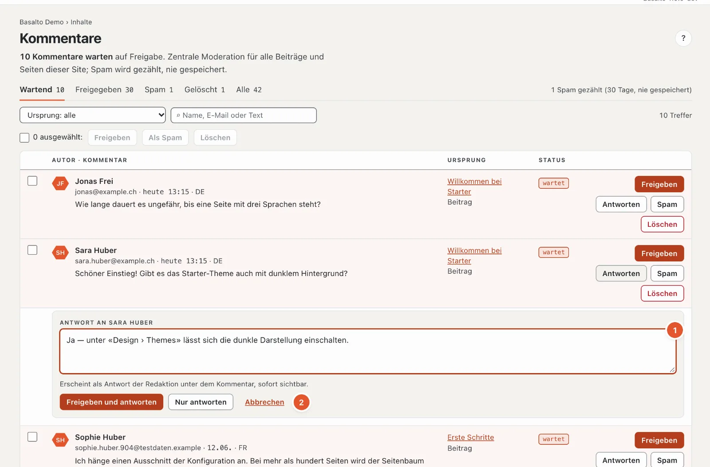

# Kommentare

Mit dem Modul «Kommentare» können Besucherinnen und Besucher Beiträge und Seiten kommentieren — ohne Konto. Im Backend moderieren Sie alle Kommentare der Site an einem Ort.

## Wo

Modus «Inhalte» › **Kommentare**. Der Menüpunkt erscheint nur, wenn das Modul für die Site eingeschaltet ist (das erledigt eine Administratorin oder ein Administrator unter «Verwaltung › Sites», Reiter «Module»). Die Zahl am Menüpunkt zeigt, wie viele Kommentare auf Freigabe warten.

Moderieren dürfen alle, die Inhalte bearbeiten dürfen: Redaktion, Administrator und Betreiber.

## Wie Kommentare auf eine Seite kommen

Kommentare erscheinen dort, wo der **Block «Kommentare»** auf einer Seite steht. Im Starter-Theme hat der Block diese Einstellungen:

| Einstellung | Wirkung |
| --- | --- |
| Moderation | «Freigabe»: jeder Kommentar wartet in der Moderation · «sofort»: sichtbar, bis jemand ihn entfernt |
| Sortierung | älteste oder neueste zuerst |
| Anzahl je Seite | wie viele Kommentare auf einmal erscheinen (1 bis 100, ab Werk 20) |
| Antworten | Besucher dürfen auf einer Ebene antworten, oder gar nicht |
| Benachrichtigung | Mail bei neuem Kommentar an die Redaktion, an die Autorin oder den Autor des Beitrags, oder aus |
| Kommentare schliessen | keine neuen Kommentare mehr; bestehende bleiben sichtbar |

Die Einstellungen ändern Sie wie jeden anderen Block im Editor der Seite; die Änderung wird wie jede andere erst mit der Veröffentlichung wirksam.

Steht die Moderation auf «Freigabe», warten auch Antworten von Besuchern auf Freigabe. Wer kommentiert, sieht nach dem Senden «Ihr Kommentar wartet auf Freigabe.». Name, E-Mail und Kommentar sind Pflicht, eine eigene Website freiwillig; die E-Mail-Adresse wird nie veröffentlicht.

## Die Moderation

1. **Status** — «Wartend», «Freigegeben», «Spam», «Gelöscht» oder «Alle», je mit der Zahl. Warten Kommentare, öffnet die Seite direkt mit «Wartend».
2. **Spam-Zähler** — wie viel Spam in den letzten 30 Tagen abgewiesen wurde. Die Summe seit Beginn steht unten in der Fussleiste.
3. **Ursprung** — nur die Kommentare einer Seite oder eines Beitrags.
4. **Suche** nach Name, E-Mail oder Text.
5. **Mehrere auf einmal** — siehe unten.
6. **Die Aktionen** je Kommentar.

Kommentarformulare nutzen denselben Spam-Schutz wie [Formulare](formulare.md), mit der Rechenaufgabe für den Browser. Ist unter Verwaltung › Einstellungen › Spamschutz **«Stop Forum Spam abfragen»** an, landen Kommentare bekannter Spam-Absender direkt unter «Spam» — ein Irrtum lässt sich dort freigeben.

Jede Zeile zeigt Autorin oder Autor mit E-Mail (und Website, falls angegeben), Datum und Sprache, den Text, bei Antworten «↳ Antwort auf …», den Ursprung mit Link und den Status. Antworten der Redaktion tragen das Kennzeichen «Redaktion». Je 50 Kommentare stehen auf einer Seite; weitere blättern Sie unten.

Die Aktionen — es erscheinen nur die, die zum Status passen:

- **«Freigeben»** — der Kommentar erscheint auf der Website. Bei allen, die nicht schon freigegeben sind.
- **«Antworten»** — öffnet ein Antwortfeld (siehe unten). Bei wartenden und freigegebenen Kommentaren.
- **«Spam»** — markiert den Kommentar als Spam; er verschwindet sofort von der Website. Antworten der Redaktion lassen sich nicht als Spam markieren, nur löschen.
- **«Löschen»** — entfernt den Kommentar sofort von der Website.

Gelöschte und als Spam markierte Kommentare bleiben noch eine Weile in der Moderation (Filter «Gelöscht» bzw. «Spam»). Mit «Freigeben» holen Sie einen versehentlich entfernten Kommentar zurück.

## Antworten

1. Klicken Sie beim Kommentar auf **«Antworten»** und schreiben Sie Ihre Antwort in das Feld **«Antwort an …»** (2 bis 5000 Zeichen).
2. Wartet der Kommentar noch, wählen Sie **«Freigeben und antworten»** (beides in einem Schritt) oder **«Nur antworten»** — dann bleibt der Kommentar wartend. Bei freigegebenen Kommentaren heisst der Knopf einfach «Antworten». «Abbrechen» schliesst das Feld.

Auf dem Telefon gibt es nur «Freigeben und antworten» bzw. «Antworten».

Ihre Antwort erscheint **sofort** unter dem Kommentar, gekennzeichnet als Antwort der Redaktion, mit Ihrem Namen. Antworten gibt es auf einer Ebene: Antworten Sie auf eine Antwort, steht Ihre unter demselben ursprünglichen Kommentar.

## Mehrere Kommentare auf einmal

Setzen Sie die Häkchen vor den Kommentaren (oder oben «Alle auf dieser Seite wählen») und wählen Sie **«Freigeben»**, **«Als Spam»** oder **«Löschen»**.

## Spam

Automatisch erkannter Spam — etwa von Programmen, die Formulare massenhaft ausfüllen — wird **nie gespeichert**, nur gezählt. Der Schutz ist derselbe wie bei Formularen: ein unsichtbares Feld, eine Zeitprüfung und ein Limit je IP-Adresse. Die Zahl steht oben in der Moderation. Was trotzdem durchkommt, markieren Sie von Hand mit «Spam»; das zählt ebenfalls mit.

## Benachrichtigung

Neue Kommentare meldet die Glocke oben rechts (mehrere zu einem Inhalt stehen in einer Zeile). Die Mail dazu stellen Sie nicht im Profil ein, sondern am Block «Kommentare» (Einstellung «Benachrichtigung»).

## Datenschutz

Unten auf der Seite fasst der Kasten «Datenschutz» zusammen, was gespeichert wird:

- **IP-Adresse** — nur als Prüfsumme, für das Limit je IP; die Adresse selbst wird nicht gespeichert.
- **E-Mail-Adresse** — gespeichert, aber nie veröffentlicht.
- **Löschung** — gelöschte Kommentare und Spam löscht ein nächtlicher Löschlauf nach der eingestellten Frist endgültig, ab Werk **365 Tage**. Die Frist ändert eine Administratorin oder ein Administrator unter «Verwaltung › Einstellungen», Gruppe «Aufbewahrung», «Gelöschte Kommentare und Spam aufbewahren». Freigegebene und wartende Kommentare bleiben.
- **Auf Anfrage** — Auskunft und Löschung je E-Mail-Adresse erledigt die Verwaltung unter «Verwaltung › Benutzer».

Wer kommentiert, stimmt der Veröffentlichung von Name und Kommentar ausdrücklich zu.

## Häufige Fragen

**Ein Kommentar ist auf der Website nicht zu sehen.**
Prüfen Sie den Status in der Moderation. «wartet» heisst: Er muss noch freigegeben werden. Ist die Einbindung auf «sofort» gestellt, erscheint er ohne Freigabe.

**Ich möchte keine neuen Kommentare mehr zu einem Beitrag.**
Setzen Sie im Block «Kommentare» dieses Beitrags den Haken «Kommentare schliessen». Bestehende Kommentare bleiben sichtbar.

**Ich habe einen Kommentar versehentlich gelöscht.**
Filtern Sie nach «Gelöscht» und klicken Sie beim Kommentar auf «Freigeben».

## Weiter

- [Mitglieder](mitglieder.md)
- [Hilfe für die Redaktion](index.md)
