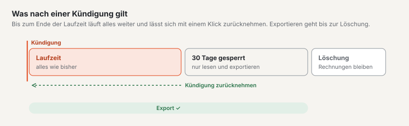

# Export und Kündigung

Unter **Verwaltung › Konto › Export und Kündigung** holen Sie Ihre Daten ab und kündigen Ihr Abo. Den Reiter sehen
Besitzer, Verwaltung und Abrechnung des Kontos; kündigen kann nur der **Besitzer**.

## Export

«Ihre Daten bleiben Ihre»: Den Vollexport können Sie **jederzeit** erstellen — nicht erst, wenn Sie gehen.

1. Unter «Umfang» wählen Sie **Ganzes Konto** (nur Besitzer) oder **eine Site**.
2. «Neuen Export erstellen» wählen. Der Export entsteht im Hintergrund; der Balken zeigt, wie weit er ist. Sie können
   die Seite verlassen.
3. Ist er fertig, bekommen Sie eine **Mail mit Link**. Der Link gilt **7 Tage**; zum Herunterladen melden Sie sich an.
   Danach löschen wir die Datei — erstellen Sie bei Bedarf einfach einen neuen.

Was drin ist: Inhalte als JSON mit allen Fassungen und Sprachen, Medien mit ihren Bildvarianten, Theme, Navigation,
Formulare, Einstellungen und Benutzer mit ihren Rollen. Formulareingänge (Personendaten) gehen nicht mit. Der Export hat
dasselbe Format wie der Import: **Export → leere Installation → Import** ergibt dieselbe Site, auch auf Ihrem eigenen
Server.

Es läuft immer nur ein Export gleichzeitig. Exportieren dürfen der Besitzer (Site oder ganzes Konto) sowie Verwaltung
des Kontos und Betreiber einer Site (nur die Site).

## Kündigen

1. Im Kasten «Abo kündigen» stehen Ihre Daten: **Laufzeit bis**, was **danach** gilt und der Tag der **Löschung**.
2. Den **Namen des Kontos** genau so eingeben, wie er dasteht, und den Haken «Ich habe den Export erstellt oder brauche
   ihn nicht» setzen.
3. «Kündigung bestätigen» wählen. Sie bekommen eine Mail mit allen Daten.

Was dann gilt:

| Zeitraum | Was gilt |
| --- | --- |
| Bis zum Ende der Laufzeit | Alles wie bisher. Die Laufzeit endet mit der bezahlten Periode; in der **Testphase sofort**. Es kommt keine weitere Rechnung. |
| 30 Tage danach | **Gesperrt:** Ihre Website zeigt nur noch «Diese Site ist nicht mehr verfügbar.» Sie selbst können im Backend alles lesen und exportieren, aber nichts mehr ändern. Andere Benutzer kommen nicht mehr hinein. |
| Am Tag der Löschung | Wir löschen Sites, Medien und Benutzer endgültig. Ihr Konto und Ihre **Rechnungen bleiben**, weil das Gesetz es verlangt. Ihr Alias ist danach wieder frei. |

Wir erinnern Sie **sieben Tage** und **einen Tag** vor der Löschung per Mail.

Oben im Backend steht während der Laufzeit ein Band: «Gekündigt · Laufzeit bis … · danach 30 Tage gesperrt · Löschung
am …».

## Kündigung zurücknehmen

Bis zum Ende der Laufzeit genügt ein Klick: **«Kündigung zurücknehmen»** im Band oben oder im Kasten «Was jetzt gilt».
Ihr Abo läuft dann einfach weiter, als wäre nichts gewesen. Nach dem Ende der Laufzeit geht das nicht mehr — die Site
ist gesperrt und wird gelöscht.

## Umzug bei einem Planwechsel

Wechseln Sie zwischen **Start** und **Standard** oder **Pro**, ziehen Ihre Sites auf eine andere Plattform um. Das
geschieht von selbst:

- Während des Umzugs (meist wenige Minuten) können Sie im Backend lesen, aber nichts speichern. Ein Band zeigt es an.
- Ihre Website bleibt die ganze Zeit erreichbar, und ihre **Adressen bleiben gleich** — Alias und eigene Domains.
- Danach bekommen Sie eine Mail. Melden Sie sich mit dem Code per Mail an; **Passkeys** und **Zwei-Faktor-Anmeldung**
  richten Sie neu ein.
- Prüfen Sie Ihre Sites und wählen Sie unter «Export und Kündigung» **«Umzug abschliessen»**. Erst dann löschen wir die
  alte Kopie.

## Häufige Fragen

**Kann ich meine Site später auf einem eigenen Server weiterführen?**
Ja. Erstellen Sie einen Export der Site und importieren Sie ihn in eine Basalto-Installation (`basalto:import`).

**Ich finde den Link aus der Mail nicht mehr.**
Unter «Export und Kündigung» steht der Export mit «Herunterladen», solange er verfügbar ist.

**Ich habe gekündigt — kann ich trotzdem noch exportieren?**
Ja, bis zur Löschung: während der Laufzeit und während der 30 Tage Sperre.

**Warum ist der Knopf «Abo kündigen» nicht da?**
Kündigen kann nur der Besitzer des Kontos. Die Rolle sehen Sie oben im Konto («Besitzer», «Verwaltung», «Abrechnung»).

## Weiter

- [Domains](domains.md)
- [Sites](../verwaltung/sites.md)
