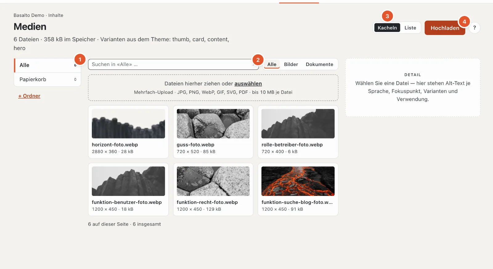
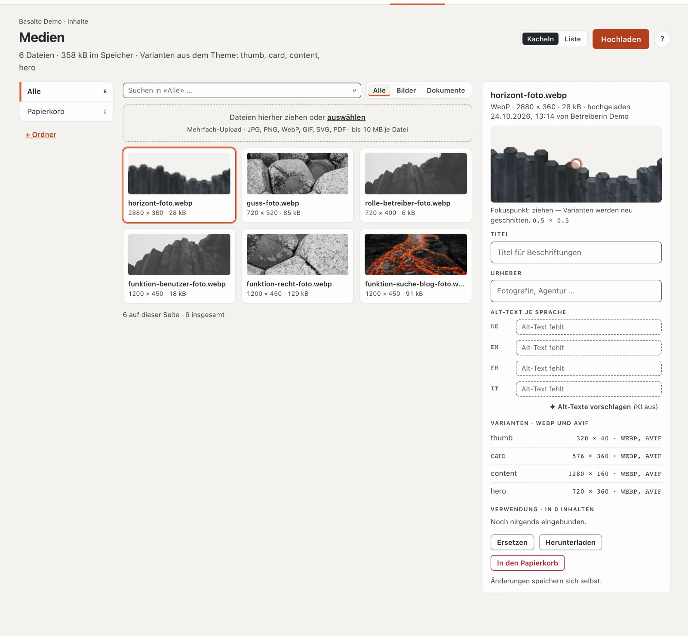
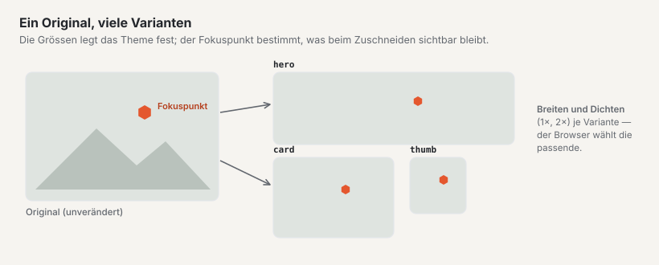
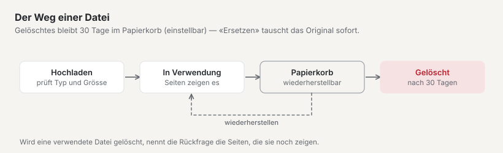

# Medien

In der Mediathek liegen alle Bilder und Dokumente der Site. Von hier aus binden Sie sie in Seiten und Inhalte ein. Ein Bild laden Sie einmal hoch — Basalto erzeugt daraus selbst die passenden Grössen für jedes Gerät.

## Wo

Modus «Inhalte» › **Medien**.

Die Kopfzeile nennt die Zahl der Dateien, den belegten Speicher und die **Varianten aus dem Theme** (die Grössen, die Basalto aus jedem Bild schneidet). Links stehen die Ordner (1), in der Mitte die Dateien, rechts das **Detail** der gewählten Datei. Oben suchen Sie und filtern nach Typ (2: «Alle», «Bilder», «Dokumente») und schalten die Darstellung zwischen «Kacheln» und «Liste» um (3).

- **Suche:** über Dateiname, Titel und Urheber — nur im geöffneten Ordner («Suchen in ‹Alle›» durchsucht alles); Enter startet sie.
- **Liste:** Spalten Masse (bei SVG «Vektor»), Grösse, Zustand (zum Beispiel «Alt-Text fehlt») und hochgeladen. Reihenfolge und Zahl je Seite kommen aus Ihrem Profil.
- **Leer:** «Noch keine Dateien» (dann ist die ganze Fläche Ablagefläche), «Dieser Ordner ist leer», «Keine Treffer» oder «Der Papierkorb ist leer».

## Dateien hochladen

1. Öffnen Sie links den Ordner, in den die Dateien gehören (oder «Alle»).
2. Ziehen Sie die Dateien in die Fläche **«Dateien hierher ziehen oder auswählen»** — oder klicken Sie auf **«Hochladen»** (4).
3. Basalto zeigt je Datei den Stand — wartet, lädt, fertig oder abgewiesen — und oben zum Beispiel «2 von 3 fertig · 1 abgewiesen». Bei Bildern erscheint danach kurz «Varianten werden erzeugt …». Solange ein Upload läuft, ist ein zweiter gesperrt.

Erlaubt sind **JPG, PNG, WebP, GIF, SVG und PDF bis 10 MB je Datei**; mehrere Dateien auf einmal sind möglich. Abgewiesen wird eine Datei mit Grund: falscher Typ, zu gross oder ein SVG mit Skript (aus Sicherheitsgründen). Hat Ihre Site ein **Speicher-Kontingent**, warnt die Mediathek ab 90 % und meldet bei vollem Speicher «Speicher voll — Upload gesperrt.» Beim Ersetzen zählt die alte Datei nicht mit.

Hochladen und Angaben pflegen dürfen Rollen mit «Medien · bearbeiten»; Ordner, Ersetzen und Papierkorb verlangen «Medien · löschen».

Bilder, die Sie im Editor aus Word oder einer Webseite einfügen, landen ebenfalls hier (siehe [Inhalte mit Blöcken bearbeiten](bloecke.md)).

## Ordner

- **«+ Ordner»** legt einen neuen Ordner an — innerhalb des gerade geöffneten Ordners (höchstens 6 Ebenen, Namen bis 120 Zeichen). Namen eintragen, «Anlegen».
- **✎** benennt einen Ordner um, **✕** löscht ihn — beide erscheinen, wenn Sie den Ordner mit der Maus überfahren. Die Dateien darin (auch aus Unterordnern) gehen nicht verloren, sie wandern nach «Alle».
- Eine Datei verschieben Sie im Detail mit dem Feld **«Ordner»**.

## Das Detail einer Datei

Klicken Sie auf eine Datei. Rechts sehen Sie Typ, Masse, Grösse, wann und von wem sie hochgeladen wurde, und:

- **Vorschau mit Fokuspunkt** — ziehen Sie den Punkt auf das Wichtigste im Bild (zum Beispiel ein Gesicht). Zugeschnittene Varianten werden dann so geschnitten, dass dieser Bereich sichtbar bleibt. Gespeichert wird beim Loslassen; die Zahlen darunter (0 bis 1 je Achse, 0.5 × 0.5 ist die Mitte) zeigen die Lage. Neu geschnitten werden nur Rasterbilder.
- **Titel** und **Urheber** (zum Beispiel Fotografin oder Agentur).
- **Alt-Text je Sprache** (siehe unten).
- **Ordner**.
- **Varianten** — die Grössen, die Basalto für das Theme erzeugt hat, je mit Breite × Höhe und Formaten (zum Beispiel «576 × 360 · WEBP, AVIF»); «ausstehend», solange sie noch entstehen.
- **Verwendung** — in welchen Inhalten die Datei eingebunden ist.

Alle Angaben **speichern sich selbst**; ein «✓ gespeichert» bestätigt es. «Herunterladen» lädt das Original herunter.

## Alt-Text

Der Alt-Text beschreibt ein Bild für Menschen, die es nicht sehen können, und für Suchmaschinen. Schreiben Sie kurz, was auf dem Bild zu sehen ist und wozu es dient — je Sprache der Site ein eigener Text.

**«Alt-Texte vorschlagen»** lässt die KI je Sprache einen Alt-Text schreiben, wenn das Modul «KI-Vorschläge» eingerichtet ist — die Vorschläge stehen sofort im Feld; prüfen Sie sie (siehe [KI-Vorschläge](ki.md)). Sonst steht dort «(KI aus)».

Ist in Ihrer Site die **Alt-Text-Pflicht** eingeschaltet, gilt:

- Im Detail steht neben «Alt-Text je Sprache» die Marke «Pflicht».
- Bilder ohne Alt-Text tragen in der Übersicht den Hinweis «Alt-Text fehlt» mit den betroffenen Sprachen.
- Ein Inhalt, der ein Bild ohne Alt-Text in seiner Sprache enthält, lässt sich **nicht veröffentlichen**. Die Freigabe nennt die betroffenen Bilder.
- Auf der «Übersicht» erscheint ein Hinweis mit der Zahl der eingebundenen Bilder ohne Alt-Text.

Die Pflicht schaltet eine Administratorin oder ein Administrator unter «Verwaltung › Sites», Site öffnen, Reiter «Allgemein», **«Alt-Text Pflicht»** ein (siehe [Die Site](../einrichtung/site.md)). Manche Themes verlangen Alt-Texte von sich aus — das Starter-Theme tut es.

## Bildvarianten

Beim Hochladen erzeugt Basalto aus jedem Bild die Grössen, die das Theme vorsieht — zum Beispiel ein kleines Vorschaubild, ein Kartenbild und ein grosses Bühnenbild — im modernen Format WebP, je nach Theme zusätzlich AVIF und in doppelter Auflösung für hochauflösende Bildschirme. Die Website liefert jedem Gerät die passende Grösse aus. Sie müssen dafür nichts tun; Bilder vorher zu verkleinern ist nicht nötig.

Für SVG-Grafiken und PDF-Dokumente gibt es keine Varianten.

## Datei ersetzen

Mit **«Ersetzen»** im Detail laden Sie eine neue Datei an die Stelle der alten — etwa ein aktualisiertes Foto oder eine neue Preisliste. Alle Seiten, die die Datei verwenden, zeigen danach die neue; Sie müssen nichts neu einbinden. Die Varianten werden neu erzeugt, und der Dateiname wechselt auf den der neuen Datei.

**Achtung:** Das alte Original und seine Varianten werden dabei **sofort gelöscht** — ohne Papierkorb. Brauchen Sie die alte Datei noch, laden Sie sie vorher herunter.

## Papierkorb

**«In den Papierkorb»** im Detail legt eine Datei in den Papierkorb. Ist sie noch eingebunden, nennt die Rückfrage die Inhalte; mit «Trotzdem in den Papierkorb» bestätigen Sie. Ist sie nirgends eingebunden, genügt eine kurze Rückfrage. Im Detail einer gelöschten Datei steht «Im Papierkorb seit …».

- Der Ordner **«Papierkorb»** links zeigt alle gelöschten Dateien.
- **«Wiederherstellen»** im Detail holt eine Datei zurück.
- Nach **30 Tagen** im Papierkorb löscht ein nächtlicher Löschlauf die Datei endgültig — Original und Varianten. Die Frist lässt sich unter «Verwaltung › Einstellungen» (Gruppe «Medien», «Papierkorb der Mediathek») ändern.

Bis zur endgültigen Löschung zeigen Seiten, die das Bild noch verwenden, eine bereits erzeugte Variante; danach bleibt die Stelle leer. Prüfen Sie deshalb vor dem Löschen die «Verwendung».

## Bilder im Editor wählen

Ein Bildfeld im Editor öffnet mit **«Wählen»** die Mediathek als Fenster: Suche nach Name oder Nummer (#12), Ordner, **«Hochladen»** direkt hier (nur Rasterbilder, in «Alle»), die Marke «Alt-Text fehlt» an Bildern ohne Alt-Text (sie sperrt später das Veröffentlichen, wenn die Pflicht gilt). Bei Galerien wählen Sie mehrere Bilder; die Reihenfolge ordnen Sie danach im Feld.

## Auf dem Telefon

Die Ordner stehen als Auswahlfeld oben, das Detail öffnet sich als Blatt über die ganze Fläche, und eine feste Leiste unten trägt «Hochladen».

## Häufige Fragen

**Ich finde ein Bild nicht mehr.**
Suchen Sie oben in der Mediathek oder in der Suche der Kopfzeile nach dem Dateinamen. Wählen Sie dabei links «Alle», damit alle Ordner durchsucht werden. Sehen Sie auch im «Papierkorb» nach.

**Warum kann ich meine Seite nicht veröffentlichen?**
Steht bei der Freigabe «Alt-Text fehlt», ergänzen Sie den Alt-Text der genannten Bilder hier in der Mediathek — in der Sprache der Seite.

**Muss ich Bilder vor dem Hochladen verkleinern?**
Nein. Laden Sie das Bild in guter Qualität hoch (bis 10 MB); Basalto erzeugt die Grössen selbst.

## Weiter

- [Inhalte mit Blöcken bearbeiten](bloecke.md)
- [Aussehen: Themes, Design und Bildvarianten](../einrichtung/aussehen.md)
