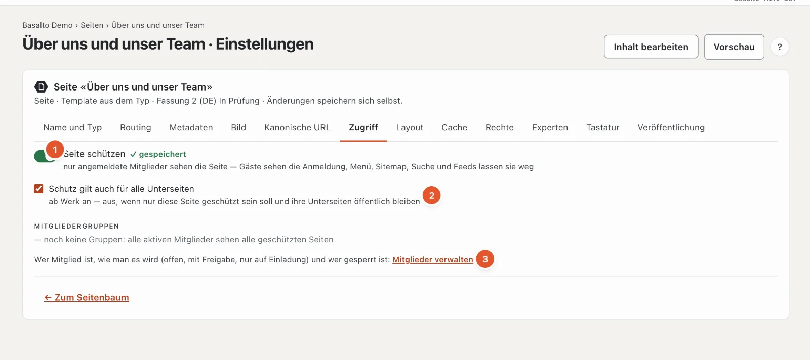
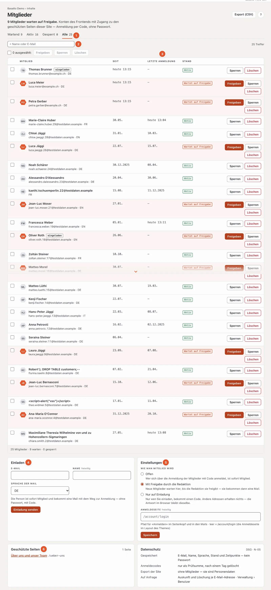

# Mitglieder

Mit dem Modul «Mitglieder» machen Sie Seiten nur für angemeldete Mitglieder sichtbar — einen Vereinsbereich, Unterlagen für Partner, Protokolle. Mitglieder melden sich **ohne Passwort** an: Sie geben ihre E-Mail-Adresse ein und bekommen einen Code per Mail. Im Backend sehen Sie alle Mitglieder der Site, geben neue frei, sperren und laden ein.

## Wo

- Modus «Inhalte» › **Mitglieder** — die Liste, Einladungen, die Einstellungen und die geschützten Seiten auf einen Blick. Die Zahl am Menüpunkt zeigt, wie viele Mitglieder auf Freigabe warten.
- In den Einstellungen jeder Seite, Reiter **«Zugriff»** — dort schützen Sie eine Seite.

Der Menüpunkt erscheint nur, wenn das Modul für die Site eingeschaltet ist (Modus «Verwaltung» › «Sites», Site öffnen, Reiter **«Module»**; ab Werk aus — siehe [Die Site](../einrichtung/site.md#reiter-module)).

| Rolle | Darf |
| --- | --- |
| Redaktion | Mitglieder ansehen, freigeben, sperren, einladen; Seiten schützen |
| Administrator, Betreiber | zusätzlich Mitgliedschaften löschen, die Liste exportieren (CSV) und die Einstellungen ändern |

## Eine Seite schützen

Öffnen Sie die Einstellungen der Seite (im Seitenbaum «Einstellungen»), Reiter **«Zugriff»**.

1. Schalten Sie **«Seite schützen»** ein. Die Änderung speichert sich selbst und gilt sofort — auch für die schon veröffentlichte Fassung.
2. **«Schutz gilt auch für alle Unterseiten»** ist ab Werk an: Alles unter dieser Seite ist dann ebenfalls nur für Mitglieder. Schalten Sie es aus, wenn nur diese eine Seite geschützt sein soll.

Gruppen von Mitgliedern gibt es nicht: Alle aktiven Mitglieder sehen alle geschützten Seiten der Site (darum steht unter «Mitgliedergruppen» «noch keine Gruppen»). Der Link **«Mitglieder verwalten»** (3) führt zur Liste.

Auch ein **Ordner** lässt sich schützen — praktisch für einen ganzen Mitgliederbereich: Alle Seiten im Ordner sind geschützt.

Steht eine Seite unter einer geschützten Seite, zeigt der Reiter «Zugriff» oben «Geschützt durch «…»». Dann ist die Seite geschützt, was auch immer Sie bei ihr selbst einstellen — öffnen lässt sie sich nur beim Vorfahren.

### Was Gäste sehen

- Statt des Inhalts eine Seite **«Anmeldung erforderlich»** mit dem Anmeldeformular — weder Titel noch Text der geschützten Seite. Hat die Site eine Fehlerseite «401», erscheint deren Text darüber.
- Im **Menü** fehlen geschützte Seiten, ebenso in der **Sitemap**, in der **Suche**, in **Listen** und in **Feeds**. Mitglieder sehen sie im Menü, sobald sie angemeldet sind.
- Suchmaschinen bekommen den Status «401» und «noindex»; nichts davon landet im Index.

Geschützte Seiten kommen nie aus dem Seiten-Cache. Angemeldete Mitglieder sehen immer die frische Seite, nur für sich.

### Ist das Modul aus

Geschützte Seiten bleiben geschützt — es kann sich aber niemand anmelden. Gäste sehen nur «Diese Seite ist nur für Mitglieder». Die Redaktion der Site sieht geschützte Seiten immer, wenn sie im Backend angemeldet ist (Vorschau, Bearbeiten auf der Seite).

## Wie man Mitglied wird

Unter «Mitglieder» › **Einstellungen** wählt eine Administratorin oder ein Administrator die Regel für die Site:

| Regel | Was passiert |
| --- | --- |
| **Offen** | Wer sich über die Anmeldung der Mitglieder mit Code anmeldet, ist sofort Mitglied. |
| **Mit Freigabe durch die Redaktion** (Vorgabe) | Die Mitgliedschaft entsteht beim ersten Anmelden, wartet aber, bis die Redaktion sie freigibt. Das Mitglied bekommt dann eine Mail. |
| **Nur auf Einladung** | Nur eingeladene Adressen bekommen einen Code. Für andere Adressen geht nichts hinaus — die Antwort im Browser bleibt dieselbe, damit niemand ausprobieren kann, wer Mitglied ist. |

Bei «Mit Freigabe» meldet die Glocke oben rechts neue Anträge («… möchte Mitglied werden»; mehrere stehen in einer Zeile).

Die Anmeldung steht auf jeder geschützten Seite und auf der Anmeldeseite der Site (`/account/login`). Im Starter-Theme führt **«Anmelden»** oben rechts dorthin. Unter **«Anmeldeseite»** können Sie stattdessen eine eigene Seite angeben, auf der Ihr Theme die Anmeldung zeigt — ein Pfad, der mit «/» beginnt, höchstens 200 Zeichen. Er gilt auch für die Links in den Mails. «Speichern» übernimmt Regel und Anmeldeseite.

### Einladen

Unter «Mitglieder» › **Einladen**: E-Mail-Adresse, auf Wunsch Name, Sprache der Mail — **«Einladung senden»**. Die Person ist sofort Mitglied und bekommt eine Mail mit dem Weg zur Anmeldung; in der Liste trägt sie das Kennzeichen «eingeladen».

- Wartet die Adresse schon auf Freigabe, wird sie mit der Einladung sofort aktiv.
- Ist sie schon aktiv, bekommt sie nur die Mail noch einmal.
- Eine gesperrte Adresse bekommt keine Einladung; geben Sie sie zuerst wieder frei.

## Die Liste

1. **Stand** — «Wartend», «Aktiv», «Gesperrt», «Alle», je mit der Zahl. Warten Mitglieder, öffnet die Seite direkt mit «Wartend».
2. **Suche** nach Name oder E-Mail.
3. **Seit** — wann die Mitgliedschaft entstand; **Letzte Anmeldung** — «—» heisst: noch nie angemeldet.
4. **Einladen** und 5. **Einstellungen** (Regel und Anmeldeseite), siehe oben.
6. **Geschützte Seiten** — alle geschützten Seiten der Site mit Link, und der Kasten **Datenschutz**.

Je 50 Mitglieder stehen auf einer Seite; auf dem Telefon als Karten untereinander.

Die Aktionen je Mitglied:

- **«Freigeben»** — die Mitgliedschaft wird aktiv; wer gewartet hat, bekommt eine Mail. Gesperrte geben Sie so auch wieder frei.
- **«Sperren»** — die Person sieht keine geschützte Seite mehr, auch wenn sie sich neu anmeldet.
- **«Löschen»** (Administrator, Betreiber) — die Mitgliedschaft verschwindet. Das Konto dahinter bleibt, weil es etwa Lizenzen oder Einträge im Marktplatz tragen kann; ganz gelöscht wird eine Person über den Datenschutz (siehe unten).

Mit den Häkchen wählen Sie mehrere Mitglieder auf einmal. **«Export (CSV)»** oben rechts lädt die gefilterte Liste herunter (E-Mail, Name, Sprache, Stand, Zeitpunkte) — mit Semikolon als Trenner, sodass Excel sie direkt öffnet. Jeder Export steht im Protokoll.

## Datenschutz

- Gespeichert werden E-Mail, Name, Sprache, Stand und Zeitpunkte — **kein Passwort**. Anmeldecodes nur als Prüfsumme; der nächtliche Löschlauf entfernt sie nach einem Tag.
- **Auskunft und Löschung** je E-Mail-Adresse erledigt die Verwaltung unter «Verwaltung › Benutzer» (oder `php artisan basalto:privacy`): Die Auskunft nennt Konto und Mitgliedschaften; das Löschen entfernt die Mitgliedschaften und anonymisiert das Konto.
- Der **Export einer Site** (Umzug, Vorlage) nimmt die Mitglieder nicht mit — sie sind Personendaten. Die geschützten Seiten gehen mit.

## Für Theme-Autoren

Die Tags ``, `` und `` beschreibt [Lava — die Theme-Sprache](../entwickler/lava.md#tags-der-mitglieder).

## Häufige Fragen

**Ein Mitglied sieht die Seite nicht.**
Prüfen Sie in der Liste den Stand: «Wartet auf Freigabe» oder «Gesperrt» öffnen keine geschützte Seite. Und: Ist die Person in derselben Site angemeldet? Konten gelten je Site.

**Ich sehe die geschützte Seite, obwohl ich nicht Mitglied bin.**
Sie sind im Backend angemeldet — die Redaktion der Site sieht geschützte Seiten immer. Melden Sie sich ab oder öffnen Sie ein privates Fenster, um die Seite wie ein Gast zu sehen.

**Es kommt kein Code an.**
Prüfen Sie den Spam-Ordner. Steht die Site auf «Nur auf Einladung», bekommen nur eingeladene Adressen einen Code.

## Weiter

- [Kommentare](kommentare.md)
- [Community](../community/README.md)
